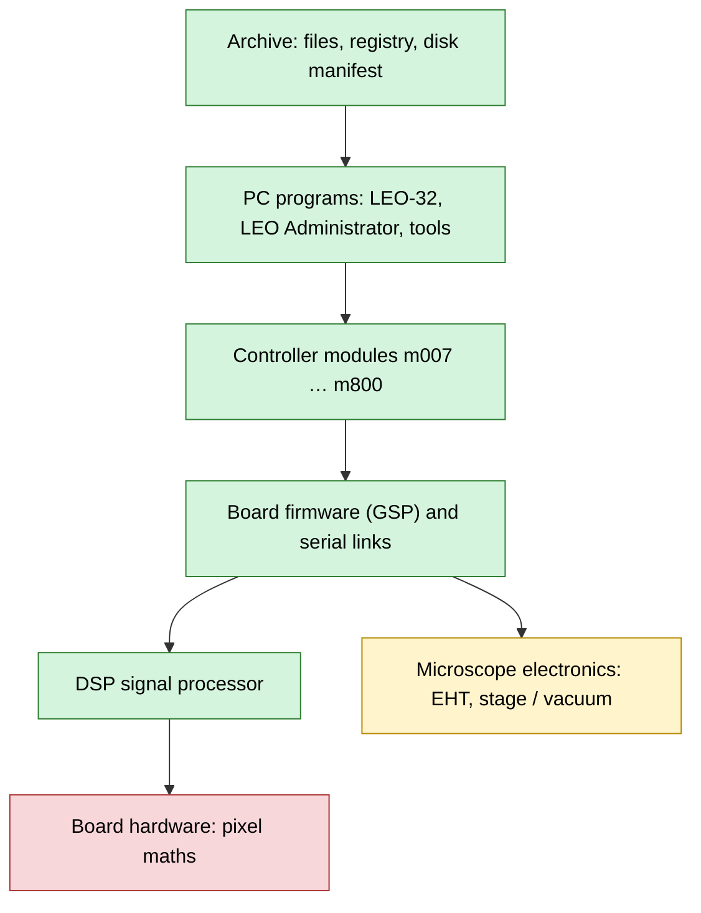

[Home](README.md) › Status

# Status: what's done and what's still open

> **In short:** all the software on the original control PC is archived and reverse engineered, from the user
> interface down to the commands sent over the serial links to the microscope electronics. What's still open needs
> either a **working microscope** (units, the meaning of a few codes, untested repair procedures) or the **board
> schematics**; a few things are out of scope on purpose. Points still to be confirmed are marked **\*?\*** in the pages.

Green: done. Yellow: formats done, units and meanings to confirm on a working machine. Red: needs board schematics or
measurements.

## Done

**Archive**
- Every SEM file, untouched, at its `C:\` path, kept in a private archive (not distributed with this public copy; see [Need files to recover a machine?](README.md#need-files-to-recover-a-machine)).
- Every file on the disk image with size, date, hash and version: [`manifest/files.csv`](manifest/files.csv).
- Full registry exports of the original PC: [`registry/`](registry).
- LEO's own help files and manuals as text: [docs/help/](docs/help).

**PC programs**
- All 81 SEM binaries decompiled, with the functions Ghidra missed recovered: [docs/decompiled/](docs/decompiled),
  per-function digests in [docs/programs-digest/](docs/programs-digest).
- Pages for every program: [programs index](docs/components/README.md). In depth: the user interface
  ([sem.exe](docs/components/sem.md)), the [LEO server](docs/components/leoserv.md) (start-up, 217-message API, timers,
  admin functions 10–17), [leopm](docs/components/leopm.md), [macros](docs/components/macros.md),
  [imgmgr](docs/components/imgmgr.md), the [ActiveX controls](docs/components/controls.md) and
  [what is on each panel](docs/components/panels.md).
- [LEO Administrator](docs/components/admin32.md): every menu, form and button, including the licence screens and how
  a licence change reaches the running server.
- [Calibration tools](docs/components/calibration.md), [utilities and Parachute backup](docs/components/utilities.md),
  [DOS board tools](docs/components/board-tools.md), [RemCon32](docs/components/remcon32.md) (98 remote commands).
- The three Visual Basic 3 tools (hrru, speed, leosync), decompiled with the archive's own p-code reader:
  [docs/vb3/](docs/vb3/README.md).

**Licences, dongle and service access**
- The start-up licence check, the dongle driver interface, the Key Code formula, Rescue Serial Number, licence files
  and the licence tables: [DESkey](docs/components/deskey.md).
- Service, Factory and Development accounts and the factory codes: [Service accounts](docs/components/service-accounts.md).

**Controller modules and mechanisms**
- Every exported function of m007 … m800 with its firmware call: [docs/modules-api/](docs/modules-api).
- One chapter per mechanism (vacuum, EHT and gun, stage, scanning, detectors, display and export, rules and licences):
  [subsystems](docs/subsystems/README.md), including about 300 rules for why a button is grey.

**Board, firmware and links**
- All GSP firmware modules disassembled with their symbols: [GSP firmware](docs/firmware/README.md).
- Both serial links (9600 8N1): every command, and the argument format of each stage / vacuum command:
  [Serial protocols](docs/firmware/serial-protocols.md). EHT: kV and photomultiplier scaling read from the code.
- The DSP: processor identified, program disassembled, all 48 commands described, PC ⇄ DSP registers mapped:
  [DSP](docs/dsp/README.md). How the PC drives the board: [Hardware interface](docs/hardware-interface.md).

**Files, settings and messages**
- DATA.VAC: 205 fields, checksum, safety copies: [File formats](docs/file-formats.md); also config.LEO, access.leo,
  LUTs and the LEO TIFF tag.
- Registry values and who reads them: [Registry](docs/registry-config.md). Messages 400–999:
  [Error codes](docs/error-codes.md). 1013 parameters: [parameters.csv](docs/parameters.csv).

**Repair help**
- [Troubleshooting](docs/troubleshooting.md) by symptom, and step-by-step [fix guides](docs/fixes/README.md) for
  licence, dongle, serial-number, database and configuration problems.

## Open

**Needs a working microscope** (everything here is read from the code; only the result on the machine is missing)
- Moving this disk image to another LEO 430 (Rescue Serial Number or Factory → Serial Number): decoded, never tried on
  a real machine. Also confirm the dongle text and that no licence message appears at start-up.
- EHT link: the units and scaling of each command (kV and photomultiplier scaling are read from the code).
- Stage / vacuum link: what some letters stand for (`.VL A`, `.CE M`, `.CA O`, `.SE`, `.SZ`), the units of the stage
  numbers (motor steps assumed) and the threshold formula.
- RemCon32: how replies and errors are framed, and the input line ending.
- Detectors and beam: how Brightness maps to the photomultiplier and Contrast to the offset on SE detectors, the details
  of Standby / Beam Off, the vacuum gauge unit factor, `Filament0` in `L500.ini`.

**Needs board schematics or measurements**
- The per-pixel image maths (mixing, averaging) is done by the video board hardware; the DSP only loads coefficients.
- The meaning of the board's hardware registers is inferred from how the code uses them.

**Not on the disk**
- DSP overlay code that commands 0x01 / 0x27 load later (not in `DPRAM.IMG`).
- `HCSTG.VBX` (hot / cold stage option, not fitted) and `7CMDIALOG.VBX` are referenced but missing.

**Covered at reference level only** (listed and searchable, not each written up in prose)
- Internal helper functions of the programs and controller modules: see the digests.
- GSP firmware: described at the level of the mechanism chapters, not routine by routine.
- In the VB3 tools, a few runtime functions and variables were named by hand from context
  ([names](docs/vb3/README.md)).
- Dialog table: the user-level mask is listed raw; the meaning of its bits is not confirmed.
- Registry `EO`, `Support Level`, `Series Default`, `Install Default`: nothing on the disk reads them.

**Out of scope**
- The bit-level protocol inside the dongle driver `DK2WN95.386`: the work stops at its port and function layer.

## How it was made
From a disk image of the original PC, only ever read; dynamic work (LEO's own viewer, registry exports) ran in
throw-away virtual machines booted from copies of it. Tools: Ghidra, QEMU / 86Box, MAME unidasm, helpdeco and the
archive's own scripts ([list](docs/tools.md)). The git history keeps the dated log of the work.

---
[Home](README.md)
