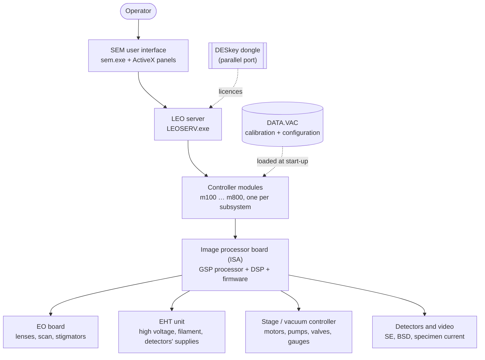

# LEO 430 SEM: control software, reverse engineered

> ## [Troubleshooting guide](docs/troubleshooting.md)
> Look up your symptom (start-up errors, greyed-out functions, licence messages, vacuum, high voltage, stage, imaging)
> to find the likely cause, what to check, and a step-by-step fix where there is one.
>
> **Need files to recover a machine?** [Open an issue](https://github.com/ELPoupa/leo430-sem-archive/issues/new/choose) ([details](#need-files-to-recover-a-machine)).

This repository documents **how the LEO 430 scanning electron microscope (SEM) is controlled by its PC**: every program,
driver, configuration file, board firmware module and serial link, from the operator interface down to the pumps,
lenses and high-voltage supply.

It's based on a complete image of an original LEO 430 control PC (Windows 98 SE, **LEO-32 V02.04**, 2001). The
original files are kept unmodified in a private archive and aren't included in this public copy (see [Need files to recover a machine?](#need-files-to-recover-a-machine)); everything here was worked out from them.

**Who is it for?** Anyone who owns or looks after a LEO 400-series SEM and wants to keep it running, repair or replace
its PC, or recover lost configuration or licences, and anyone curious about how a late-1990s SEM works.

---

## How the system fits together

The PC never talks to the microscope electronics directly: **everything goes through a single ISA board** running
LEO firmware. Details: [Architecture](docs/architecture.md) · [Hardware interface](docs/hardware-interface.md).

---

## Contents

### Operating principles (one page per mechanism)
| Mechanism | Contents |
|---|---|
| [Start-up (power-on to user interface)](docs/boot-chain.md) | every step from BIOS to the SEM window, and what fails without the board |
| [Vacuum](docs/subsystems/vacuum.md) | pump and vent sequences, vent refusal conditions, gauges, interlocks |
| [High voltage and gun (EHT)](docs/subsystems/eht-gun.md) | beam on and run-up, filament ramps, automatic trip recovery |
| [Stage](docs/subsystems/stage.md) | stage types and axes, initialisation, safe moves, venting position |
| [Scanning and electron optics](docs/subsystems/scanning-eo.md) | magnification, focus, lenses, stigmators, autofocus |
| [Detectors and image signal](docs/subsystems/detectors-acquire.md) | brightness and contrast, automatic brightness, signal mixing, noise reduction |
| [Display, scan modes and image export](docs/subsystems/display-modes-export.md) | split, quad and spot modes, image filters, image storage, photographic unit |
| [Rules, licences and access levels](docs/subsystems/core-rules-accessories.md) | why a function is greyed out, and which licence enables what |
| [All mechanisms on one map](docs/subsystems/README.md) | dependencies between subsystems |

### Programs on the PC
| Topic | Page |
|---|---|
| Index of programs and their roles | [Programs index](docs/components/README.md) |
| The SEM user interface | [sem.exe](docs/components/sem.md) |
| The LEO server: start-up, messages, shutdown | [LEO server](docs/components/leoserv.md) |
| The parameter model | [Server and parameters](docs/components/server-and-parameters.md) · [Controller modules](docs/components/modules/README.md) |
| LEO Administrator (users, licences, serial number) | [admin32](docs/components/admin32.md) |
| Calibration tools | [Calibration](docs/components/calibration.md) |
| Macros | [Macros](docs/components/macros.md) |
| Remote control over RS-232 | [RemCon32](docs/components/remcon32.md) |
| Panel and dialog reference | [Panels](docs/components/panels.md) |
| Utilities and backup (Parachute) | [Utilities](docs/components/utilities.md) |
| Board set-up tools (DOS) | [Board tools](docs/components/board-tools.md) |

### Licences, dongle and service access
| Topic | Page |
|---|---|
| The DESkey dongle and the licence check | [DESkey](docs/components/deskey.md) |
| Transferring a disk image to another LEO 430 (serial and licence correction) | [DESkey → Moving a disk image](docs/components/deskey.md#moving-a-disk-image-to-another-leo-430-rescue-serial-number) |
| Service, Factory and Development accounts | [Service accounts](docs/components/service-accounts.md) |

### Board, firmware and links
| Topic | Page |
|---|---|
| PC–board interface | [Hardware interface](docs/hardware-interface.md) |
| Board firmware | [GSP firmware](docs/firmware/README.md) |
| Serial command sets of the EHT unit and the stage / vacuum controller | [Serial protocols](docs/firmware/serial-protocols.md) |
| The DSP signal processor | [DSP](docs/dsp/README.md) |

### Files, settings and messages
| Topic | Page |
|---|---|
| What's installed on the PC | [Inventory](docs/inventory.md) |
| File formats (DATA.VAC, config.LEO, LUTs, TIFF tags …) | [File formats](docs/file-formats.md) |
| Registry settings | [Registry](docs/registry-config.md) |
| Error and status messages (400–999) | [Error codes](docs/error-codes.md) |
| Parameter dictionary (magnification, kV, …) | [parameters.csv](docs/parameters.csv) · [usage by module](docs/parameter-usage.csv) |
| LEO manuals and online help, converted to text | [docs/help/](docs/help) |

---

## Glossary

| Term | Meaning | More |
|---|---|---|
| **SEM** | Scanning electron microscope | |
| **LEO-32** | LEO's Windows control software (this archive: V02.04) | [Architecture](docs/architecture.md) |
| **LEOSERV** | The LEO server: owns all parameters, loads the controller modules, checks the licences | [LEO server](docs/components/leoserv.md) |
| **Controller module** | 16-bit DLL handling one subsystem: m100 EHT, m200 optics, m300 display, m400 modes, m500 stage, m600 vacuum, m700 detectors, m800 export, m007 core | [Modules](docs/components/modules/README.md) |
| **Parameter** | A named value the server knows: analogue `AP_…` (e.g. magnification), state `DP_…` (e.g. vacuum status), command `CMD_…` (e.g. Pump) | [parameters.csv](docs/parameters.csv) |
| **Image processor board** | The ISA card through which the PC drives the whole microscope | [Hardware interface](docs/hardware-interface.md) |
| **GSP** | TMS34020 graphics processor on that board; runs LEO's firmware modules | [Firmware](docs/firmware/README.md) |
| **TIGA / TIGASEM** | TI's interface for the GSP, and LEO's DLL built on it (the PC ⇄ board API) | [Hardware interface](docs/hardware-interface.md#tigasem-api-the-pc--board-protocol) |
| **Firmware module (.RLM, .440)** | Code loaded into the GSP per subsystem, e.g. G600.440 vacuum | [Firmware](docs/firmware/README.md) |
| **DSP** | ADSP-21xx signal processor on the board: scan generator and video pipeline control | [DSP](docs/dsp/README.md) |
| **EO board** | Electron-optics electronics: lens currents, scan coils, stigmators, blanking | [Scanning](docs/subsystems/scanning-eo.md) |
| **EHT** | Extra-high tension: the accelerating voltage (kV) and gun supplies | [EHT and gun](docs/subsystems/eht-gun.md) |
| **Filament / run-up** | Tungsten (or LaB6) electron source, heated in controlled ramps | [EHT and gun](docs/subsystems/eht-gun.md) |
| **StgVac** | The combined stage and vacuum controller, on a serial link from the board | [Serial protocols](docs/firmware/serial-protocols.md) |
| **C1, C2, C3** | Condenser lenses (C1, C2) and objective lens (C3) | [Scanning](docs/subsystems/scanning-eo.md) |
| **WD** | Working distance (lens to specimen) | [Scanning](docs/subsystems/scanning-eo.md) |
| **Stigmator** | Coils that correct astigmatism | [Scanning](docs/subsystems/scanning-eo.md) |
| **SE / InLens / SE2** | Secondary-electron detectors | [Detectors](docs/subsystems/detectors-acquire.md) |
| **BSD / QBSD** | Backscattered-electron detector (4-quadrant) | [Detectors](docs/subsystems/detectors-acquire.md) |
| **SCM** | Specimen current monitor | [Detectors](docs/subsystems/detectors-acquire.md) |
| **PM** | Photomultiplier (inside the SE detector) | [Detectors](docs/subsystems/detectors-acquire.md) |
| **Zone** | One part of the screen with its own detector and settings (split / quad screen) | [Detectors](docs/subsystems/detectors-acquire.md) |
| **LUT** | Look-up table: maps signal levels to grey levels | [Display](docs/subsystems/display-modes-export.md) |
| **ABC / Auto BC** | Automatic brightness and contrast | [Detectors](docs/subsystems/detectors-acquire.md) |
| **HRRU** | High Resolution Recording Unit: photo CRT and camera | [Display and export](docs/subsystems/display-modes-export.md) |
| **DATA.VAC** | The machine's configuration and calibration file (`C:\LEO\data.vac`), "NVRAM" | [File formats](docs/file-formats.md) |
| **DESkey (DK2)** | Parallel-port dongle; its content must match the machine serial to enable the licences | [DESkey](docs/components/deskey.md) |
| **Licence** | Optional feature (split screen, image maths, …) enabled by the serial / dongle check | [Rules and licences](docs/subsystems/core-rules-accessories.md) |
| **sem_init** | Start-up program that loads the DSP program and board parameters | [sem_init](docs/components/sem_init.md) |
| **VP** | Variable pressure (not on the LEO 430) | [Vacuum](docs/subsystems/vacuum.md) |

---

## What is in this repository

| Folder | Contents | Kind |
|---|---|---|
| [`docs/`](docs) | all documentation listed above | **start here** |
| [`registry/`](registry) | registry exports of the original PC | archive |
| [`manifest/`](manifest) | `files.csv`: every file on the disk image with size, date, hash and version | archive |
| `original/` | not included in this public copy: LEO's program files are kept in a private archive ([need files to recover a machine?](#need-files-to-recover-a-machine)) | archive |
| raw analysis data | disassembly, decompiled code, string tables and CSV tables underlying the pages above | [raw data index](docs/raw-data.md) |

## Need files to recover a machine?
LEO's program files aren't included in this public repository. If you own or maintain a LEO 400-series SEM and need
files to get its control PC running again, [open an issue](https://github.com/ELPoupa/leo430-sem-archive/issues/new/choose) with the "Files to recover a machine"
template, saying which machine it is and what's missing. Please don't post personal details there; we can continue
privately.

## Status
The software is reverse engineered end to end; the bit-level dongle protocol is out of scope. Points that can only be
confirmed on a working microscope are marked **\*?\*** in the pages. What's done and what's still open:
**[Status](PROGRESS.md)**.

## Legal
An independent, non-commercial preservation and repair project, not affiliated with LEO or ZEISS. LEO's software,
manuals and trademarks belong to their owners, and anything a rights holder objects to will be taken down. No
warranty: use at your own risk. Details in the [legal notice](LEGAL.md); this project's own work is under CC BY 4.0
(docs) and MIT (code), see [LICENSE.md](LICENSE.md).

## Provenance
Source: a disk image of the original control PC, restored to a virtual disk and read with 7-Zip. Dynamic data
(configuration listings, registry exports) were produced in throw-away virtual machines booted from copies of that
image, never from the original.
