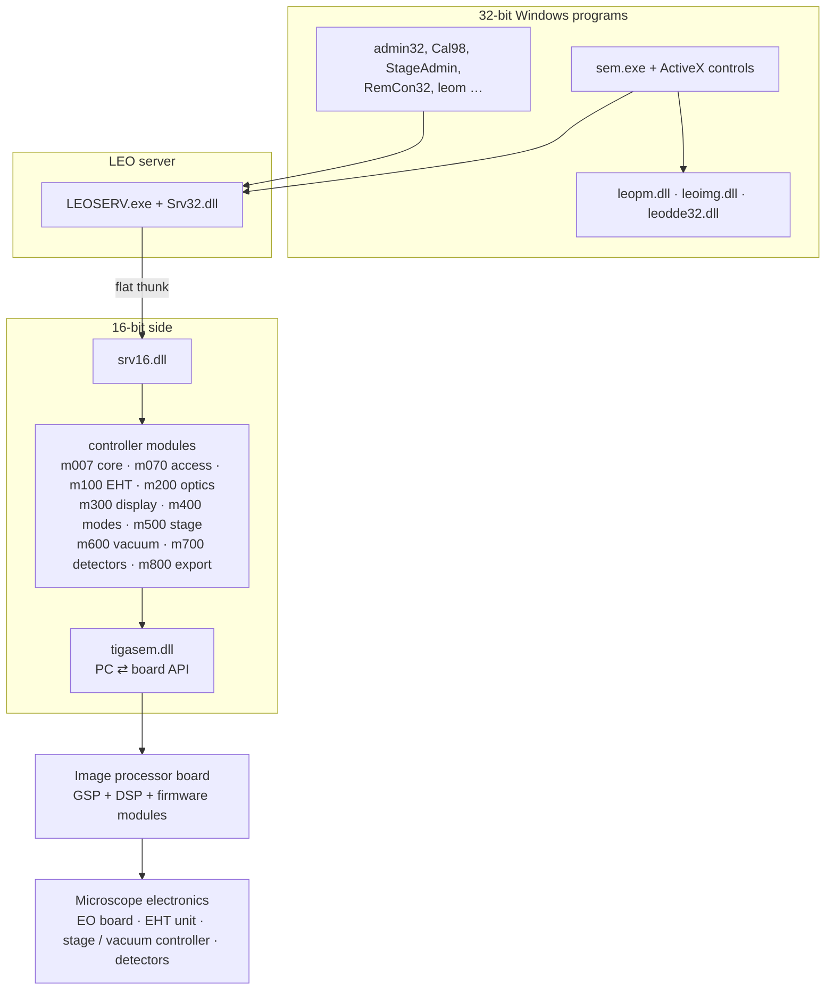

[Home](../README.md) › Architecture

# Software architecture

> **In short:** LEO-32 is layered. The operator programs (32-bit Windows) talk to one **server**. The server crosses
> into the 16-bit world, where one **controller module per subsystem** handles the hardware through `tigasem.dll`,
> which drives the **image processor board**. The board runs LEO firmware that finally talks to the microscope's
> electronics.



Every controller module has the same set of functions (initialise, restore configuration, timer tick, and one
function per parameter), which matches the server's parameter model: **values**, **states** and **commands**.
More: [Server and parameters](components/server-and-parameters.md) · [Controller modules](components/modules/README.md)
· [Hardware interface](hardware-interface.md).

---

## Technical reference

*Full detail for maintenance and further reverse engineering: function names, addresses, parameters, sources. Inferred points are marked \*?\*.*

Derived from the binaries' export/import tables ([`exports.csv`](exports.csv), [`imports.csv`](imports.csv)),
the registry ([`registry-config.md`](registry-config.md)) and the boot chain ([`boot-chain.md`](boot-chain.md)).

### Layers
```
 sem.exe  (SEM User Interface, Win32 MFC)        remcon32.exe (serial remote control)   admin32 / Cal98 / l500cal / StageAdmin ...
    │  LEO ActiveX controls: ParamMgr, TabMgr, NavMgr, StgMgr/StgNav, LUTMgr, ImgMgr, DialgMgr, LEOBtn/Combo/Stat/Analg/IG/Tkb, leoapi
    │  leopm.dll (parameter manager API: PMGetValue/PMUpdateValue/...)   leoimg.dll (TIFF/print/HRRU)   leodde32.dll (DDE)
    ▼
 LEOSERV.exe  ("LEO SRV-32", Leo-32 Server V03.00 Jan 2000, Win32 MFC)
    │  Srv32.dll  — 32-bit server API (SRV_Get_Value, SRV_Execute_Command, SRV_Get_Machine_Type, SRV_Get_Stage_Position, ...)
    │      ⇅ flat thunk (SRV_THUNKDATA16)
    │  srv16.dll  — 16-bit side (SRV_LOAD_DLL, SRV_SET_VALUE, SRV_TIMER_TICK, SRV_LOAD_VIS_TABLE, ...)
    ▼
 Controller modules (Win16 DLLs, loaded by srv16 per registry M100…M800 / Gsp / EO)
    m007 core/UIF · m070 LEOACC · m100 EHT · m200 EO · m300 DISP · m400 MODE · m500 STAGE · m600 VAC · m700 ACQUIRE · m800 IMEX
    ▼
 tigasem.dll (Win16 TIGA host API: INITIALISETIGA, HOSTTOGSP, GSPTOHOST, POKEBREG, PEEKBREG, SETINTERRUPT, ...)
    ▼  TIGA comms driver (TIGACD, INT 0x7F) set up by LEOEXEC.BAT
 TMS34020 image processor board ("Stereoscan Image Processor") + DSP (parameters from sem_init.dat / dpram.img)
    ▼
 Microscope electronics (scan, EO, EHT, vacuum, stage)
```

### Controller module interface
Every `mNNN.dll` exports the same skeleton (prefix = subsystem):
`INITIALISE_<X>_CONTROLLER_DATA`, `INITIALISE_<X>_CONTROLLER`, `<X>_CONTROLLER_SHUTDOWN`, `<X>_REPORTID`,
`<X>_TIMER_TICK`, `RESTORE_<X>_CONFIG` / `GET_<X>_CONFIG`, plus parameter setters/switches/commands:
`SET<param>` (analogue values), `SWITCH<param>` (states), `DOCOMMAND<cmd>` (actions).
This matches the parameter model used everywhere else: **values** (analogue, with low/high limits),
**states** (digital/enumerated) and **commands**, addressed by mnemonic (see leopm's `PMGetMnemonic`).

| Module | Subsystem | Exports | Examples |
|---|---|---|---|
| m007 | Core / UIF parameter server (S300 heritage) | 116 | UIF_INITIATE, SETVALUE, GETSTATE, EXECUTECOMMAND, S300_TICK |
| m070 | LEOACC accessory controller, control-panel visibility tables | 44 | INITIALISE_LEOACC_CONTROLLER, LOADVISTABLES, REGISTERLEOPANEL |
| m100 | EHT / gun | 74 | SETTARGETKV, SETMANUALCURRENT, SWITCHFILAMENT_TYPE, DOCOMMANDBEAM_ON, DOCOMMANDRUNUP |
| m200 | Electron optics | 301 | SETMAG, SETWD, SETSCANROTATION, SETC1/C2/C3, SETSTIGX…, wobble |
| m300 | Display / overlay manager | 101 | SWITCHPROFILE, SWITCHIMAGE_STORE, OM_CREATE_OVERLAY_OBJ |
| m400 | Scan mode | 47 | DOCOMMANDMODE_NORMAL/SPLIT/QUAD/REDUCED/EMISSION, SWITCHSPOT, SWITCHLINE_SCAN |
| m500 | Stage | 168 | DOCOMMANDSTAGE_INIT, SETXYSTAGE_GOTO, SETSTAGE_GOTO_Z, SWITCHSTAGE_TYPE |
| m600 | Vacuum | 69 | DOCOMMANDPUMP, DOCOMMANDVENT, SWITCHAIRLOCK, SWITCHGATE_VALVE |
| m700 | Acquisition / detectors | 133 | SWITCH4QBSD_*, DOCOMMANDFRAME_AVERAGE, DOCOMMANDLUT_GAMMA |
| m800 | Image export / HRRU photo | 115 | SAVEGREY, LOADIMAGE, GETTIFFHEADER, DOCOMMANDTAKE_PHOTO |

A typical LEO 430 installation enables `Gsp=1`, `EO=1`, `M200=1`, `M600=6` (others 0); see
[`registry-config.md`](registry-config.md). How the other modules are selected is still to confirm in `srv16.dll`.

### Other components
- **leopm.dll** (73 exports): parameter manager used by the UI — PMGetValue, PMUpdateValue, PMGetLimits, PMGetMnemonic, licences, user prefs.
- **leoimg.dll** (13): IMGSaveTiff, IMGLoadTiff, IMGGetTiffHeader, IMGPrintImage, IMGHrruPhoto.
- **leodde32.dll** (67): DDE server (analogue/digital advise, histogram/profile data, ExecuteCommand).
- **tigasem.dll** (439): TIGA host interface + LEO graphics primitives on the TMS34020.
- **IMPROC\Improc.ocx** on **Matrox MIL 4.0** (`mil*.dll`): image processing.

---
[Home](../README.md)
