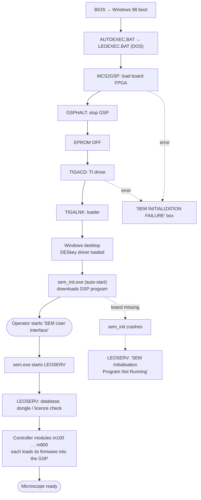

[Home](../README.md) › Start-up

# Start-up: from power-on to the SEM user interface

> **In short:** the image processor board is prepared **in DOS, before Windows starts** (FPGA load, processor halt,
> TI driver). Windows then starts `sem_init`, which downloads the DSP program. Only then can the operator start the
> SEM user interface, which starts the LEO server, which loads the controller modules and their firmware. If any step
> fails, the later ones fail too.


What each step does in detail: [Board tools](components/board-tools.md) · [sem_init](components/sem_init.md) ·
[DESkey check](components/deskey.md) · [Hardware interface](hardware-interface.md).

---

## Technical reference

*Full detail for maintenance and further reverse engineering: function names, addresses, parameters, sources. Inferred points are marked \*?\*.*

Reconstructed from `AUTOEXEC.BAT`, `LEOEXEC.BAT`, `SYSTEM.INI`, the registry (`registry/REGFULL.REG`),
the original `BOOTLOG.TXT` and live observation in the 86Box/QEMU test VMs.

```
BIOS (Intel 430TX board)
 └─ IO.SYS / MSDOS.SYS (Win98 SE, BootGUI=1, BootMulti=1, logo.sys = LEO splash)
     ├─ CONFIG.SYS (empty) → HIMEM.SYS, DBLBUFF.SYS (DoubleBuffer=1), IFSHLP.SYS
     └─ AUTOEXEC.BAT
         └─ CALL LEOEXEC.BAT C:            ── real-mode image processor bring-up
             ├─ SET TIGA=-mC:\TIGA -lC:\TIGA ; PATH += C:\GSPUTILS;C:\TIGA
             ├─ MCS2GSP C:\GSPUTILS\MMLCA.MCS   load memory-module LCA (FPGA) bitstream
             ├─ GSPHALT                          halt the TMS34020 GSP
             ├─ EPROM OFF                        disable board EPROM (base 0xEFF00000)
             ├─ TIGACD                           TI TIGA comms driver 2.20 → INT 0x7F
             └─ TIGALNK -lx                      TIGA linking loader 3.3
                 (any error → "SEM INITIALIZATION FAILURE" box + PAUSE)
 └─ WIN.COM → VMM32.VXD
     ├─ static VxDs from registry (Services\VxD): ... DK2WN95.386 (DES key driver, LPTPort=0x378),
     │  LMOUSE.VXD (Logitech), SYMEVNT.386 (Symantec)
     ├─ SYSTEM.INI [boot]: display.drv=pnpdrvr.drv (S3 Trio64V+ "s3mm.drv"), mouse.drv=lmouse.drv
     └─ Explorer shell
         ├─ HKLM\...\Run "SEM init" = C:\WINDOWS\sem_init.exe      (Win16)
         │     window "Initialise TIGA..." — downloads DSP/board parameters from
         │     C:\WINDOWS\sem_init.dat and dpram.img via SYSTEM\tigasem.dll + TIGAWIN.RLM.
         │     Stays resident; the LEO server refuses to start without it
         │     ("SEM Initialisation Program Not Running").
         ├─ other Run entries: Logitech em_exec, Symantec vptray, Ghost tray, Windows tray/scanreg
         └─ user starts "SEM User Interface" (desktop/Start menu) → sem.exe
               └─ starts/attaches LEOSERV.exe ("LEO SRV-32", Leo-32 Server V03.00 Jan 2000)
                     ├─ Srv32.dll ⇄ srv16.dll (thunk to the Win16 side)
                     ├─ hardware modules m100…m800.dll (Win16), enabled per registry
                     │  HKLM\Software\LEO Electron Microscopy Ltd\LEO-32: Gsp, EO, M100…M800, Machine
                     ├─ image processing: IMPROC\Improc.ocx on Matrox MIL 4.0
                     └─ machine data: C:\LEO (config.LEO, data.vac, calibration tables)
```

Observed in the VMs (no SEM hardware present):
1. `LEOEXEC.BAT`: GSPHALT times out, TIGACD reports "TIGA Comm Driver not installed" → failure box.
2. `sem_init.exe` crashes ("illegal operation") — it cannot reach the board.
3. `LEOSERV` then shows "LEO Server : Fatal Error — SEM Initialisation Program Not Running".

### Startup-relevant settings
| Where | Setting | Value |
|---|---|---|
| `MSDOS.SYS` | BootGUI / BootMulti / DoubleBuffer / AutoScan | 1 / 1 / 1 / 1 |
| `SYSTEM.INI` | display / mouse | S3 Trio64V+ (pnpdrvr.drv) / Logitech (lmouse.drv) |
| `WINDOWS\DOSSTART.BAT` | MS-DOS mode | `c:\mouse\mouse.exe` |
| Registry `Run` | `SEM init` | `C:\WINDOWS\sem_init.exe` |
| Registry `App Paths` | sem.exe, LEOserv.exe, admin32.exe | LEO-32 folder |

---
[Home](../README.md)
