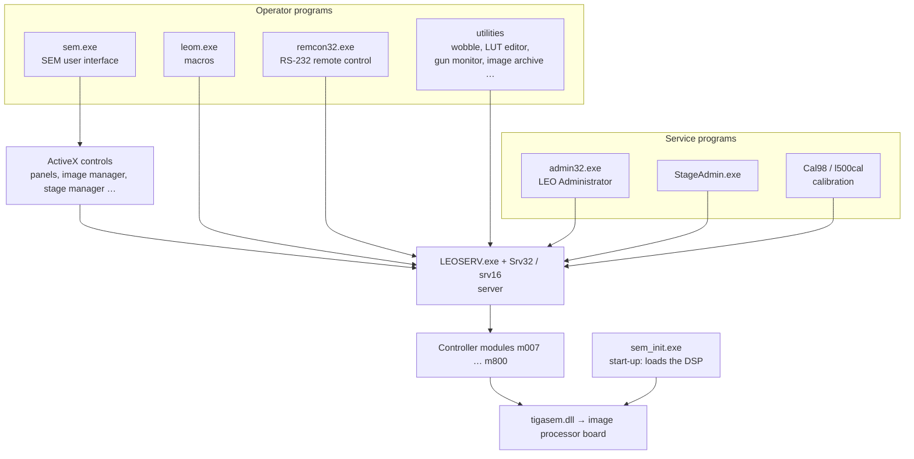

[Home](../../README.md) › Programs

# Programs on the control PC

The LEO-32 suite is a set of programs around one **server** (LEOSERV). The operator and service programs never touch
the hardware: they ask the server, which passes the request to a controller module and then to the image processor
board.

## Pages
| Page | What it covers |
|---|---|
| [SEM user interface (sem.exe)](sem.md) | the main operator program: structure, menus, how it talks to the server |
| [LEO server (LEOSERV)](leoserv.md) | start-up step by step, the ~200 messages it answers, timers, closing down, admin functions |
| [Parameter manager (leopm)](leopm.md) | how every program reads and changes parameters, parameter IDs, notifications |
| [Image manager (imgmgr)](imgmgr.md) | the image window: annotation, measuring, saving / exporting / printing / photo |
| [Server and parameters](server-and-parameters.md) | LEOSERV, Srv32 / srv16, the parameter model (values, states, commands) |
| [Controller modules](modules/README.md) | one 16-bit module per subsystem (m007 … m800) |
| [sem_init](sem_init.md) | start-up program, `SEM_INIT.DAT` register script, `DPRAM.IMG` DSP program |
| [DESkey dongle and licences](deskey.md) | how the licence check works, moving a disk image to another machine |
| [Service accounts](service-accounts.md) | Service, Factory and Development logins and what each unlocks |
| [LEO Administrator (admin32)](admin32.md) | users, licences, serial number, machine configuration |
| [Calibration](calibration.md) | Cal98 (lens calibration) and l500cal (scan / magnification wizard) |
| [Macros](macros.md) | macro editor and the macro file format |
| [RemCon32](remcon32.md) | RS-232 remote control and its 98 commands |
| [ActiveX controls](controls.md) | the LEO controls the user interface is built from |
| [What is on each panel](panels.md) | every tab and dialog with the parameters it shows and drives, and the licence it needs |
| [Utilities](utilities.md) | gun tools, HRRU photo tools, display helpers, converters, image archive, backup |
| [Board tools](board-tools.md) | DOS tools that bring the board up before Windows starts |

---

## Technical reference

*Every binary and its role. Decompiled C for each one is in [`../decompiled/`](../decompiled) (`<name>.c`); LEO's own
documentation (decompiled help files) is in [`../help/`](../help) (`<NAME>/<NAME>.txt`).*

### Operator programs
| Binary | Role | Help |
|---|---|---|
| `sem.exe` | SEM User Interface (main operator program): parameter tabs, toolbars, data zone, image gallery, annotation, macros | `sem`, `OPERATION`, `GETSTART`, `HOW_TO` |
| `leom.exe` | macro editor / runner (`.MLL` library, `.MLC` collections, `.MLF` files) | `LEOM` |
| `remcon32.exe` | RS232 remote control | `REMCON32` |
| `ImgArc.exe` | FTP remote image archiving (Mabry FTP32/GetHst32 OCX) | `IMGARC` |
| `Parachute\Parachute.exe` | archive/restore of user settings and data (Pchute20.dll, Pchute2x.ocx, ControlResizer.ocx) | `PARACHUTE` |
| `leolut.exe` | look-up table tool (`SEMLUT` file type) | `LUTMGR` |
| `Gun Monitor.exe`, `gunserv.exe` | electron gun / filament monitoring | `LEOSERV` |
| `wobble.exe` | focus wobbler | — |
| `leomouse.exe` | mouse-adjust handling (`LEO_MOUSE_REGISTER`) | — |
| `LeoPath.exe` | path helper | — |

### Service and setup programs (Start menu "LEO-32 Service")
| Binary | Role | Help |
|---|---|---|
| `admin32.exe` | LEO Administrator: machine configuration, users, licences, edits DATA.VAC through the server | `ADMIN32` |
| `StageAdmin.exe` | stage administrator (service only) | `STAGEADMIN`, `STAGE` |
| `Cal98.exe` | calibration ("Cal 98") | — |
| `l500cal.exe` | LEO 1500 calibration wizard | — |
| `checkdb.exe` | upgrade user database (`leo_user.mdb`) | — |
| `convert.exe`, `view.exe` | convert / view `DATA.VAC` (view.exe = "LEO Configuration File Viewer V22.00") | — |
| `hrru.exe`, `speed.exe` | editors for the HRRU register file `hrru.cnf` / film-speed table `hrru.spd` (VB3) | [code](../vb3/README.md) |
| `leosync.exe` | PC / TIGA picture alignment (H / V sync offsets, VB3) | [code](../vb3/leosync.txt) |

### Server, modules, libraries
| Binary | Role |
|---|---|
| `leoserv.exe` | LEO SRV-32 server |
| `Srv32.dll` / `srv16.dll` | 32/16-bit server halves (thunk) |
| `m007 … m800.dll` | controller modules: core, LEOACC, EHT, EO, display, mode, stage, vacuum, acquire, image export (see [../architecture.md](../architecture.md)) |
| `leopm.dll` | parameter manager API + mnemonic table |
| `leoimg.dll` | TIFF load/save, print, HRRU photo |
| `leodde32.dll` | DDE server |
| `s400eng/fre/ger.dll` | string tables |
| `IMPROC\Improc.ocx` + `mil*.dll` | image processing on Matrox MIL 4.0 |
| `cmdialog.vbx`, `SPIN.VBX`, `THREED.VBX` | VB3 controls |

### LEO ActiveX controls (`LEO-32\SYSTEM\*.ocx`)
| Control | Role | Help |
|---|---|---|
| ParamMgr | parameter display/edit | `TABMGR`, `DLGMGR` |
| TabMgr | parameter tab dialogs | `TABMGR` |
| DialgMgr | dialogs | `DLGMGR` |
| NavMgr, StgMgr, StgNav, LEONavgt | stage navigation / stage manager | `STGMGR`, `STAGE` |
| LUTMgr | LUT editor | `LUTMGR` |
| ImgMgr | image manager (display, annotation, measurement) | `IMGMGR` |
| LEOIG | image gallery | `GALLERY` |
| LEOTkb | trackerball / knob panel | `LEOTKB`, `JOYSTICK` |
| LEOBtn, LEOCombo, LEOStat, LEOAnalg | UI widgets bound to parameters | — |
| leoapi | automation API object (used by third-party software, e.g. SIS) | — |

### Windows-level components
| File | Role |
|---|---|
| `WINDOWS\sem_init.exe` | board/DSP bring-up (see [sem_init.md](sem_init.md)) |
| `WINDOWS\SYSTEM\tigasem.dll` | TIGA/hardware API (439 functions, see [../tigasem-api.csv](../tigasem-api.csv)) |
| `WINDOWS\SYSTEM\TIGAWIN.RLM` | LEO graphics engine for the GSP |
| `WINDOWS\SYSTEM\DK2WIN32.DLL`, `DK2WN95.386` | DES parallel-port key API + VxD; checked by LEOSERV to enable licences, see [deskey.md](deskey.md) |
| `C:\GSPUTILS\*`, `C:\TIGA\*` | DOS bring-up tools and GSP firmware (see [../boot-chain.md](../boot-chain.md), [../hardware-interface.md](../hardware-interface.md)) |

### LEO documentation recovered (decompiled help)
`OPERATION` operation manual · `MAINT` user maintenance (gun firing unit, anode, apertures, desiccant, rotary pump oil, vacuum leaks,
six-monthly maintenance) · `ERRORS` error messages with code tables (incl. DSP command numbers) · `RELEASE` release notes ·
`sem` UI reference · `GETSTART`, `HOW_TO` · `ADMIN32`, `STAGEADMIN`, `STAGE`, `STGMGR`, `JOYSTICK` · `IMGMGR`, `IMPROC`, `LUTMGR`,
`GALLERY`, `IMGARC` · `LEOM`, `TOOLEDIT`, `TABMGR`, `DLGMGR`, `LEOTKB` · `LEOSERV` · `PARACHUTE` · `REMCON32`.

---
[Home](../../README.md)
