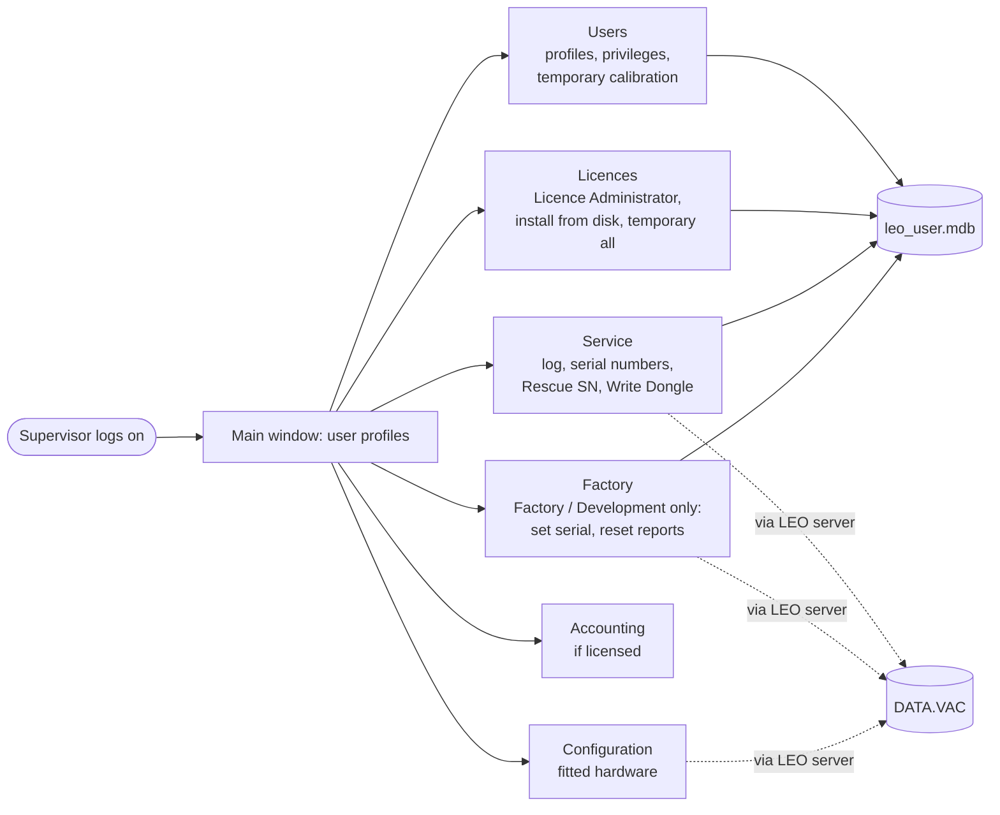

[Home](../../README.md) › [Programs](README.md) › LEO Administrator

# LEO Administrator (admin32.exe)

> **In short:** the service program for **users, licences, serial number, service log and hardware configuration**.
> It never talks to the hardware: it edits the user database (`leo_user.mdb`) directly and asks the running LEO server
> to change DATA.VAC. Only users with the Supervisor privilege can log on; some menus depend on the account
> ([Service accounts](service-accounts.md)).

Serial-number and licence procedures step by step: [DESkey and licences](deskey.md).

---

## Technical reference

*Full detail for maintenance and further reverse engineering: function names, addresses, parameters, sources. Inferred points are marked \*?\*.*

`LEO-32\admin32.exe` V08.03 (14-Mar-00), Visual Basic 6, compiled to native code (project `C:\ADMIN\ADMIN32\admin.vbp`).
It manages users, user accounting, licences, the service log, the machine serial number and the hardware
configuration. It talks to the LEO server through the ParamMgr control (`ParamMgr1`) and opens `leo_user.mdb`
through DAO with the workgroup file `LEO-32\SYSTEM\system.mda`.

Every form, control and event handler with its code address: [`../vb6/admin32-objects.csv`](../vb6/admin32-objects.csv)
(made with `tools/vb6-objects.ps1`). Readable disassembly of any handler:
`tools/vb-annotate.ps1`. LEO's own help: [`../help/ADMIN32/ADMIN32.txt`](../help/ADMIN32/ADMIN32.txt).
Account rights: [service-accounts.md](service-accounts.md). Key codes, serial and licences: [deskey.md](deskey.md).

### Log-on
Form `logon` ("Admin Log on"). User names and passwords come from the `Users` table (upper-cased, password trimmed;
"Invalid Username" / "Invalid password"). Only users with `Supervisor` = True may use the Administrator
("This User does not have Supervisor Priviledge"). If the table is empty, four built-in accounts are used instead
(see service-accounts.md). After log-on, `Main.Form_Load` (`0x00450CA0`) hides the Factory menu unless the user is
FACTORY or DEVELOPMENT and sets the "LEO account" flag (`0x0049B066`) for SERVICE, FACTORY and DEVELOPMENT.

### Connection to the server
LEO Administrator reaches the LEO server through the ParamMgr control. The first time it needs the server (for
example to send an admin function), `FUN_00455060` creates the control and initialises it under the client name
"Admin Configuration". ParamMgr's `Initialise` / `InitialiseWithUsername` (`parammgr.ocx` `FUN_10008017`) looks for
the server window ("LEO SRV-32" and its variants); if none answers, `FUN_10008310` starts `LEOSERV.EXE` from the
LEO-32 folder (registry `App Paths`, default `C:\PROGRAM FILES\LEO\LEO32`) and waits up to 2 minutes for it.
So **LEO-32 does not have to be running** for serial or licence changes; the first one just takes longer while the
server starts.

### Menus of the main window (`Main`, "Leo-32 Administrator")
The window lists the user profiles (`List1`: name, user directory, image directory, user level).

| Menu item (control) | Click handler | Opens / does |
|---|---|---|
| Users → New .. (`doNewUser`) | `0x0044FFE0` | `user` "User Profile", empty |
| Users → Edit .. (`doEditUser`) | `0x0044FAC0` | `user` for the selected profile (also on double-click, `List1` event 1) |
| Users → Delete (`doDelete`) | `0x0044F180` | deletes the selected profile (warns if it has accounting records) |
| Accounting (`acnt`, shown only when accounting is licensed) | `0x0044E300` | menu |
| Accounting → Create Database (`doCreateDB`) | `0x0044F110` | creates `account.mdb` ("Database Account.mdb exists - no action taken") |
| Accounting → Active (`doActive`) | `0x0044E7B0` | switches session accounting on/off (asks before deactivating) |
| Accounting → Owners (`doOwners`) | `0x004500D0` | `owners` "Account Owners", `EdOwner` / `addOwner` |
| Accounting → Delete Up To.. (`doDeleteSession`) | `0x0044F9D0` | `delSess` "Delete session records" |
| Accounting → Compact / Repair Database | `0x0044EA60` / `0x004501C0` | compacts or repairs `account.mdb` |
| Accounting → Review... (`doAccountReview`) | `0x0044E530` | `DBReview`: sessions and totals per user/owner, print, copy to clipboard |
| Licences .. (`doLicences`) | `0x0044FE40` | `licence` "Licence Administration" |
| Configuration .. (`doConfig`) | `0x0044EEC0` | `config` / `config5` "System Configuration" (chosen by machine type) |
| Service → Log... (`doService`) | `0x00450810` | `srv_main` "Service Log" |
| Service → Serial Numbers ... (`doServiceSN`) | `0x00450900` | `SNForm`: serial from the key, the database and Data.Vac side by side |
| Service → Rescue SN ... (`doRescueSN`) | `0x004505F0` | `RescueSN` (Key Code) |
| Service → Write Dongle .. (`DoWriteDongle`) | `0x004509F0` | `wrtDongle` (Key Code) |
| Factory → Serial Number ... (`doFactorySerial`) | `0x0044FBF0` | `factory` "Factory Settings" (FACTORY / DEVELOPMENT only) |
| Factory → Reset Reports (`doResetReports`) | `0x004506E0` | deletes all service reports and resets the report number |
| Database → Compact / Repair (`doCompactUserDB` / `doRepairUserDB`) | `0x0044ECA0` / `0x004503E0` | `leo_user.mdb` (keeps a `.BAK`) |
| Help → Help Contents / About.. | `0x0044FCE0` / `0x0044E440` | `help\english\admin32.hlp`, `about` |

### Forms
| Form | Caption | What it does |
|---|---|---|
| `logon` | Admin Log on | see above |
| `newpass` | Change password | 3–20 characters, typed twice |
| `user` | User Profile | name, password, user/image directories, user level, privileges (calibration, supervisor, buttons, gun off, gun align, stage initialise, common toolbar); frame "Temporary Calibration Privilege" → `TempCal` |
| `chooseDir` | Select Directory | directory picker, can create a directory |
| `licence` | Licence Administration | list of licences (by description / part number / sales code), enable/disable one, **Set All** / **Clear All** (FACTORY, DEVELOPMENT), **Restore Licences**, **All Licences (Temporary)** → `TempLic`, **Install from disk ..** (`.LIC`) |
| `TempLic` | Grant All Licences | days + Key Code (mode 3) → `keys."Licences Expire"` |
| `TempCal` | Grant Temporary Calibration Privilege | days + Key Code (mode 1) → calibration privilege of the edited user until that date |
| `config`, `config5` | System Configuration | the machine's fitted hardware, written as server parameters: stage type and motors, axes X/Y/Z/T/R/M, joystick, trackball, hard panel, airlock (+ control), viewing window, column pumping, EDX, WDX + gate valve motor, IXI backplate, rotate limit, SE supplies, monitor, HRRU, EBBU, adjustable anode, mixer, PM2/PM3, frame grabber / TV mode (CCD, PAL, NTSC), detectors and the inputs they are wired to (InLens, SE1, MPSE, VPSE, SE2, QBSD, RBSD, SCM, Cathodo, Trans, AUX) with checks such as "Detector requires Photo Multiplier", VP limit, DDE access. `config5` is the variant for other machine types ("Unknown machine type-config5") |
| `srv_main` | Service Log | service incident reports (number, date, engineer, symptoms, solution, key words, attachments, references); sort, filter, new/edit, export, delete. Create/edit only for the LEO accounts; read-only for others |
| `addSRV` | New/Edit Incident | one report ("Engineer's name MUST be entered", "Symptoms MUST be entered", major key word) |
| `keysel` | Keyword selection | key-word picker |
| `attach` / `RefForm` | Attachments / References | files (`.bmp`, `.tif`, `.txt`) copied under `Service Reports\`, links to other reports |
| `export` | Export Service Incidents | writes `.SRV` text files (see below) for a range or for all not yet exported |
| `delrep` | Delete Service Incidents | delete a range (only if exported) or all exported |
| `SNForm` | Serial Numbers | read-only: key text, `keys.SerialNumber`, Data.Vac serial |
| `RescueSN` | Rescue Serial Number | Key Code (mode 2) → serial from the key into the database and Data.Vac |
| `wrtDongle` | Write Dongle | Key Code (mode 4) → writes `LEO <series>-xx-yy` into the key |
| `factory` | Factory Settings | serial by hand (two 2-digit boxes), Omit Dongle Check |
| `owners`, `EdOwner`, `addOwner` | Account Owners, owner data | accounting owners (name, company, address) and which user names they own |
| `delSess` | Delete session records | deletes accounting sessions up to a date |
| `DBReview` | (account review) | see menu |
| `about` | About Leo Adminstrator | version |
| `GetKey` | Please Enter Keycode | leftover: stores the typed number in `0x0049B0AC`, which nothing reads |

The forms marked "Key Code" require the daily code; the [Key Recovery Helper](https://elpoupa.github.io/leo430-sem-archive/) generates it and gives the procedure for each form.

Modules and classes without a window: `Module1`, `detData` (detector table), `LeoHelper`, `DK2DEMO1` and `Dongle`
(the DK2WIN32 `Declare` statements and wrappers, from DES's demo code), `Hash`, `Machines` (machine type → series name,
"MachineAsSeries Unknown machine").

### Files and data it uses
- `leo_user.mdb` tables: `Users`, `keys`, `licences`, `serverLicences`, `masterLicences`, `copyLicences`, `validLicences`,
  `ServiceReport`, `Symptom`, `Solution`, `KeyWords`, `Attachments`, `Reference`.
- `account.mdb` (user accounting: `session`, `owner`, `ownerRelation`; status 0 normal end, 1 abnormal end,
  2 accounting on, 3 accounting off).
- `admin32.ini` (next to the program), registry `HKCU\Software\VB and VBA Program Settings\Leo Admin\Service`
  (`Sort Code`, `Filter Key`, `Filter Index`), `Windows\oeminfo.ini` (manufacturer `LEO Electron Microscopy Ltd.`,
  model, serial: shown in Windows System Properties).
- `C:\Program Files\Leo\Leo32\Service Reports\` (attachments and exports).

#### `.SRV` export format
Plain text, one block per report:
`REPORT <number>` … `SYMPTOMS` … `SOLUTION` … `ATTACHMENTS` … `REFERENCES` … `ENDREPORT`, and `END` at the end of
the file. "Save this directory to removable media then delete the contents of this directory."

---
[← Programs](README.md) · [Home](../../README.md)
