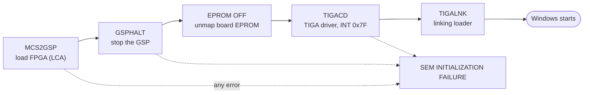

[Home](../../README.md) › [Programs](README.md) › Board tools

# Board bring-up tools (DOS)

> **In short:** five DOS programs run from `AUTOEXEC.BAT` before Windows starts. They load the board's FPGA, stop the
> GSP processor, switch off its EPROM and install TI's driver and loader so Windows programs can use the board.

---

## Technical reference

*Full detail for maintenance and further reverse engineering: function names, addresses, parameters, sources. Inferred points are marked \*?\*.*

Run from `AUTOEXEC.BAT` → `LEOEXEC.BAT` before Windows starts (see [../boot-chain.md](../boot-chain.md)), in this order:
`MCS2GSP C:\GSPUTILS\MMLCA.MCS`, `GSPHALT`, `EPROM OFF`, `TIGACD`, `TIGALNK -lx`. All are 16-bit DOS programs. The
host-interface protocol they share (GSP address to ports `0xA301`/`0xA300`, data through the memory window at
`D000`) is in [../hardware-interface.md](../hardware-interface.md). Decompiled code: [`../decompiled/`](../decompiled).

GSP addresses below are TMS34020 bit addresses as the tools pass them (high word, low word).

### `MCS2GSP.EXE` V2.00 (14-Nov-96): load the memory-module LCA
Configures the Xilinx LCA (FPGA) on the board's memory module from `MMLCA.MCS` (Intel-hex, 349 lines, starts with an
extended segment record `:020000020000FC`).
1. Reads and converts the hex file to bytes ("Non-hex character encountered" on a bad file).
2. **Reset:** reads the control register at GSP `0x6040:0040`, sets bit 3 (PROGRAM), writes it, clears bit 3 and writes
   it again; then reads the status register at `0x6030:0080` and waits (up to ~50 000 polls) for the LCA to enter the
   programming state ("DoneA not in programming state after LCA reset, aborting...").
3. **Download:** for every byte, LSB first, sets or clears **bit 2** (data) of the `0x6040:0040` register and writes it
   (each write clocks one bit), then checks the DONE status.
4. DONE must come exactly after **44 400 (0xAD70) clocks**: earlier → "LCA configured prematurely after %u clocks",
   exactly → "LCA configured correctly", never → "LCA failed to configure".

### `GSPHALT.EXE` V1.00 (16-July-93): stop the GSP
Writes **`0xC300`** to the GSP register at `0x0100:C000` (bit address `0xC0000100` region, the host control register),
then reads it back up to 1000 times until bit 4 (`0x10`) is set: "TMS34020 halted", else "Timeout Error, unable to halt
TMS34020, aborting...". Also checks its own code checksum (0x0D37) at start.

### `EPROM.EXE` V1.00 (16-July-93): `EPROM ON` / `EPROM OFF`
Moves the board's boot EPROM: **OFF** → "EPROM Disabled, base address 0xEFF00000", **ON** → "EPROM Enabled, base address
0xFFF00000" (presumably: the GSP reset vectors are at the top of its address space, so ON lets the GSP boot from the EPROM and
OFF moves it out of the way for the downloaded firmware *?*). Same host-interface routines as GSPHALT.

### `TIGACD.EXE`: TIGA communication driver ("Stereoscan Image Processor")
Texas Instruments TIGA 2.20 communication driver, LEO build. Memory-resident; installs on **INT 0x7F**. Reads
`TIGA.CFG` (board resources: I/O 0xA300, IRQ 9, windows D000/D800), loads the TIGA graphics manager `TIGAGM.OUT`
and the extended primitives `extprims.rlm` into the GSP (COFF loader built in: sections, relocation, `.cinit`
auto-initialisation, `.tigaext` extension functions, `.tigaisr` interrupt handlers). Command errors: "timeout waiting
for a free command buffer", "timeout waiting for current TIGA command", "not enough memory to store parameters".

### `TIGALNK.EXE`: TIGA linking loader
"TIGA Linking Loader" (Texas Instruments 1988–1990). Loads COFF modules into the GSP through TIGACD and links them
against the graphics manager's symbols. Options: `-lr` load RLM (relocatable module), `-lx` load and execute, `-la`
load ALM (absolute module), `-ca` create ALM, `-fs` flush symbols, `-cs` create symbol table, `-v` verbose, `-q` quiet.
`LEOEXEC.BAT` uses `-lx` for the LEO GSP firmware. Errors: "TIGA Comm Driver not installed", "Unresolved symbol
reference", "Invalid ALM load address".

### `TIGACFG.EXE`: TIGA setup
TI's menu program that writes `TIGA.CFG` from the board/monitor catalogue `TIGA.CL`: display board, monitor type and
configuration, bus width (8/16-bit transfers), host interrupt, memory configuration (I/O and memory-mapped windows),
primary or secondary display, TMS34010 or TMS34020 entries. Only needed when the board, monitor or PC resources
change.

### Windows side
- `WINDOWS\sem_init.exe` (run by LEO-32): downloads the DSP program and register script; see [sem_init.md](sem_init.md).
- `WINDOWS\SYSTEM\tigasem.dll` (16-bit): the TIGA/hardware API used by the controller modules; 439 exports in
  [../tigasem-api.csv](../tigasem-api.csv).
- `WINDOWS\SYSTEM\TIGAWIN.RLM`: LEO's GSP graphics engine for Windows.

---
[← Programs](README.md) · [Home](../../README.md)
