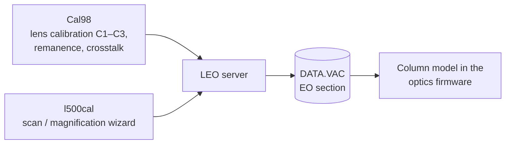

[Home](../../README.md) › [Programs](README.md) › Calibration

# Calibration programs (Cal98, l500cal)

> **In short:** two service tools that work out the column's calibration constants. They need the **Calibration
> privilege**. They do not touch hardware: they set parameters and run commands through the server, and the server
> stores the results in **DATA.VAC**.

---

## Technical reference

*Full detail for maintenance and further reverse engineering: function names, addresses, parameters, sources. Inferred points are marked \*?\*.*

Both are service tools. They only run their procedures when the logged-on user has the **Calibration** privilege
(server state `DP_CALIBRATION`; "Calibration not enabled!"). They do not touch hardware themselves: they read and set
server parameters (`AP_*` values, `DP_*` states) and run server commands (`CMD_*`) through the ParamMgr control, and the
server stores the results in `DATA.VAC` (the EO section: C1–C3 cal/remanence, crosstalk, mag cal, scan transforms…;
see [../file-formats.md](../file-formats.md)).

### `Cal98.exe`: column (condenser lens) calibration
"LEO 420/430 Series - Column Calibration V10.00 April 98", Visual Basic 6 (project `G:\WINDEV\S4XX\cal98\Cal98.vbp`),
uses `PARAMMGR.OCX`. Forms and handler addresses: [`../vb6/Cal98-objects.csv`](../vb6/Cal98-objects.csv).

**Purpose:** works out the calibration constants of the three condenser/objective lenses: **C1 cal / C1 rem, C2 cal /
C2 rem, C3 cal / C3 rem** (gain and remanence of each lens) and the lens **crosstalk** terms **XTLK12 / XTLK21**, from
lens currents measured at known conditions. It solves a small linear system ("Singular matrix." if the readings are
degenerate).

**Columns it accepts:** reads `DP_COLUMN_TYPE`. 420/430/460 columns ("420 Series"), or 435/438 VP (HPSEM) columns with a
separate procedure ("435VP Series - Column Calibration Calculator V08.02"; asks to remove the fixed aperture and use the
variable aperture). It refuses a LEO 440 ("This machine is a 440, or LEO is not running") and names 1400 / 1400VP as
unknown.

**Forms:** `Welcome` (OK / Quit / Help), `frmInfo` (engineer, customer, serial number, machine type for the log),
`Calibrate` (the procedure: buttons **C3 CAL**, **C1 CAL**, **C2 CAL/XTLK**, **DEFAULT CALIBRATION**, Continue, View Results;
fields for kV, WD, lens currents and excitations, cal/rem/crosstalk values; grey = default, red = calculated,
black = transferred to LEO).

**Procedure (from its prompts):**
1. Use a **15 mm WD test stub** (WD can be changed, 0–50 mm). Select and centre a **20 µm or 30 µm** aperture
   ("too large" / "too small" otherwise). Pick a specimen area of fairly uniform brightness.
2. Hysteresis removal first (`CMD_C1C2_HYSTERESIS`, `CMD_C3_HYSTERESIS`).
3. **C3 CAL:** centre the aperture, focus manually with C3; the program reads C3 current (`AP_C3`) and kV (`AP_ACTUALKV`),
   repeats at other kV values (`AP_MANUALKV`, "Please wait while new kV value is set…") and calculates C3 cal and rem
   (`CMD_CAL_C3`, `CMD_C3CAL`, `CMD_C3REM`).
4. **C1 CAL:** normalise C1 (`CMD_C1_NORMAL`), adjust C1 until inner and outer brightness match / for the brightest probe,
   reverse C1 (`CMD_C1_REVERSE`, `DP_C1REVERSAL`); calculates C1 cal and rem (`CMD_C1CAL`, `CMD_C1REM`).
5. **C2 CAL/XTLK:** adjust C2 for the brightest probe; calculates C2 cal and rem and Xtalk21, and sets Xtalk12 = Xtalk21
   (`CMD_CAL_C1C2`, `CMD_C2CAL`, `CMD_C2REM`, `AP_XTALK12`, `AP_XTALK21`).
6. "Do you want to transfer these to LEO?" → the values are written as `AP_C1CAL`, `AP_C1REM`, `AP_C2CAL`, `AP_C2REM`,
   `AP_C3CAL`, `AP_C3REM`, `AP_XTALK12`, `AP_XTALK21`.
7. A log is written (`420cal*.clb` or `435vpcal*.clb`, "420 Series - Column Calibration results" with machine type,
   serial, customer, engineer) and can be opened in Notepad.

Other parameters it uses while working: `AP_BRIGHTNESS`, `AP_CONTRAST`, `AP_APERTURESIZE`, `AP_MAG`, `AP_WD`, `AP_IPROBE`,
`AP_SCM`, `AP_BEAMSHIFT_X/Y`, `AP_GUNSHIFT_X`, `AP_GUNTILT_X`, `AP_TARGETKV`, `AP_SPOT_POSN_X/Y`, `DP_OPERATING_MODE`,
`DP_OPTIMODE`, `DP_MAGTRACK`, `DP_OPTIBEAM`, `DP_RUNUPSTATE`, `DP_SPOT`, freeze states, scan-mode commands.
Errors from the server are shown as "Invalid identifier", "Cannot set state in this context", "Incorrect state value",
"Parameter disabled", "LEO Inactive".

### `l500cal.exe`: scan and magnification calibration wizard ("LEO Calibration")
MFC program (114 688 bytes, 2000-09-04). Name from the LEO 1500 series, but it has no machine-type check in its strings.
Menus/dialogs: [`../ui/l500cal-resources.txt`](../ui/l500cal-resources.txt); handlers: [`../ui/l500cal-msgmaps.csv`](../ui/l500cal-msgmaps.csv).
Its pages host the LEO parameter controls (analogue `{F8BEBA63-…}`, static read-out `{A53617E4-…}`, button `{EF2ED2A4-…}`, combo `{E6D6CD83-…}`,
navigation `{CAD10405-…}`; see controls.md); clicking a mouse symbol assigns that parameter to the mouse.

"Select calibration procedures" lists the procedures; each page has **Undo**; the end page offers **Repeat Procedure**
and **Save to NVRAM** ("save the calibration to NVRAM and then repeat the entire procedure until there are no further
changes"). Procedures (dialog titles):

| Procedure | What is adjusted (parameters) |
|---|---|
| Stage Angle Calibration | `AP_STAGEANGLE` |
| Scanning Calibration (line/frame amplitude, Auto Scan Rotate) | `AP_LINE_AMPL`, `AP_FRAME_AMPL`, `AP_SCANROTATION`; "Remove cable A22 (Frame scan out) from the EO Board. Adjust Line Ampl cal so that the scan is horizontal" |
| Calibrate Quadrizität (Line/Frame ratio) | `AP_LINE_FRAME_RATIO` so X and Y are equal |
| Scan Orthogonality Calibration | `AP_SCANORTHOG` so X and Y are perpendicular |
| Magnification Calibration (200×, 2000×, 20K×), Mag Range Offset, Mag Range Shift, Scan Rate Magnification | `AP_MAGCALX/Y`, `AP_MAGCALWIDTH/HEIGHT`, `AP_MAG_GAIN_X/Y`, `AP_MAG_SHIFT_X/Y`, `AP_MAG_COMP_AMPL/OFFSET`; calibration grid at 10 kV / 5 mm or 25 kV / 100 pA / 15 mm WD |
| Scan Centre Calibration | `AP_SCAN_OFFSET_X/Y`: a feature visible at the top and bottom of mag range 1 |
| Beamshift Calibration | `CMD_CAL_BEAM_SHIFT`, `AP_BEAMSHIFT_X/Y` |
| Dual Mag Calibration (two pages) | `CMD_CAL_DUALMAG`, `CMD_CAL_DUAL_MAG_SLOPE`, `AP_DUAL_MAG_OFFSET_X`, `AP_DUAL_MAG_SLOPE`, `AP_DUAL_MAG_Y_SLOPE` |
| ABCC Calibration | auto brightness/contrast: video mean and peak, B and C cal per detector (`AP_AUTO_BRIGHT`, `AP_AUTO_CONTRAST`) |
| Scan Amplifier Calibration | `CMD_CAL_LINEAMPL`, `CMD_CAL_FRAMEAMPL`, `CMD_CAL_LINETOFRAME` |
| Stigmator Balance (with Focus Wobble) | `AP_STIGBALAMP`, `AP_STIGBALPERIOD`, `AP_STIGX/YUPPER/LOWER`, `AP_STIG_X/Y` |
| Stereo Calibration | stereo tilt parameters |
| Output Device Calibration | `AP_OUTPUT_DEV_CAL` (printer / photo) |
| Image to Overlay Calibration | scan cal X/Y so the image lines up with the reduced raster (overrides `SetDisplayPos` in `l500.ini`) |
| Mix Delay Calibration, Auto Gun/Aperture align Calibration | detector mixing delay; automatic gun and aperture alignment |

Other parameters: `AP_SPOT`, `AP_SPOT_X_CAL`, `AP_ZOOMPOS_X`, `AP_ZOOM_FACTOR`, `AP_CURSOR_WIDTH`, `AP_IPROBE`, `AP_MANUALKV`,
`AP_MAG`, `CMD_CAL_MAGCAL`, `CMD_C1C2_HYSTERESIS`.

`C:\LEO\L500.ini` is the server's small settings file (`[User] UserMaxEht, Filament0`, `[Stage] Protected Z`,
`[VP] VP target, VP Limit`, `[EBBU] In Use`); the calibration wizard reads its optional `SetDisplayPos` entry.

---
[← Programs](README.md) · [Home](../../README.md)
