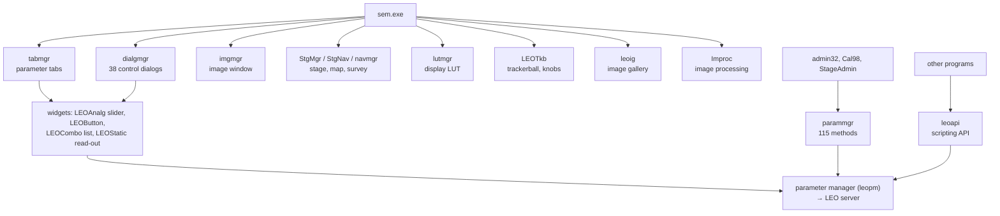

[Home](../../README.md) › [Programs](README.md) › ActiveX controls

# LEO ActiveX controls

> **In short:** most of the user interface is made of LEO's ActiveX controls: parameter tabs, dialogs, the image
> manager, stage manager, LUT manager, knob panel, and small buttons and sliders tied to one parameter. They talk to the
> server with registered window messages. Each control's programming interface (methods, properties, events) is in
> [`../typelibs/`](../typelibs/README.md).

**What is on each tab and dialog, parameter by parameter: [What is on each panel](panels.md).**

| Control | What it does | Methods → code | Panels |
|---|---|---|---|
| **parammgr** | the API the Visual Basic service programs use: values, states, commands, limits, licences, serial number, admin functions, macros, stage points list, histograms, user areas | [115 methods](../ui/parammgr-dispatch.csv) | — |
| **leoapi** | small scripting API for other programs: `Get`, `Set`, `Execute`, `Grab` (save image), stage position / move | [16](../ui/leoapi-dispatch.csv) | — |
| **tabmgr** | the parameter tabs (Detectors, Scanning, Vacuum, Gun, Apertures, Signal, Stage, X-ray) | [9](../ui/tabmgr-dispatch.csv) | [tabs](panels.md#parameter-tabs-tabmgrocx) |
| **dialgmgr** | the "SEM control dialogs": aperture, stigmation and C1/C2 / C3 calibration, beam shift, stage control and limits, specimen change, airlock, water flow, stage scan / registration / compucentric, stereo, gun alignment, noise reduction … | [14](../ui/dialgmgr-dispatch.csv) | [dialogs](panels.md#sem-control-dialogs-dialgmgrocx) |
| **imgmgr** | the image window | [73](../ui/imgmgr-dispatch.csv) | [page](imgmgr.md) |
| **StgMgr** | stage manager: points lists, stage scan wizard, survey settings | [13](../ui/StgMgr-dispatch.csv) | [dialogs](panels.md#stage-manager-stgmgrocx) |
| **StgNav** | stage map / navigation drawing: stage outline, carousel type, fields, object groups, metafile backdrop | [27](../ui/StgNav-dispatch.csv) | — |
| **navmgr** | navigation on the image: select point / area / line, centre point / feature, stage map, dynamic stig, survey and resolution modes | [19](../ui/navmgr-dispatch.csv) | — |
| **lutmgr** | display look-up table editor: invert, steps, brightness/contrast, gamma, red / green / blue / grey, grey wedge, load / save | [29](../ui/lutmgr-dispatch.csv) | — |
| **LEOTkb** | trackerball and knob panel: button assignment, auto XY, inverted axes | [17](../ui/LEOTkb-dispatch.csv) | — |
| **leoig** | image gallery (thumbnails, filter, print, delete) | [11](../ui/leoig-dispatch.csv) | — |
| **Improc** | image-processing tabs (Matrox MIL) | [8](../ui/Improc-dispatch.csv) | [tabs](panels.md#image-processing-imprococx) |
| **LEOAnalg, LEOButton, LEOCombo, LEOStatic, LEONavgt** | the widgets on the panels, each bound to one parameter | [3–7 each](../ui) | — |

---

## Technical reference

*Full detail for maintenance and further reverse engineering: function names, addresses, parameters, sources. Inferred points are marked \*?\*.*

The SEM UI is mostly built from these MFC ActiveX controls; sem.exe, the calibration tools and third-party programs
host them. Each control's COM interface (methods, properties, events) is in [`../typelibs/`](../typelibs); its dialogs
and menus in [`../ui/<name>-resources.txt`](../ui); its message handlers in [`../ui/<name>-msgmaps.csv`](../ui).
They talk to the server with the registered `PM_*` messages ([`../data/pm-messages.txt`](../data/pm-messages.txt)).

| Control | Role | Screens it provides (dialog titles) |
|---|---|---|
| `parammgr.ocx` (ParamMgr) | access to every server parameter by numeric ID or mnemonic: get/set values and states, limits, steps, XY values, licences, machine type, serial number, `ExecuteCommand`, `AdminFunction` | none (invisible) |
| `leoapi.ocx` (API.ApiCtrl.1) | scripting API for other programs: `Initialise`, `Get`/`Set` by mnemonic, `Execute`, `Grab` (save image), stage position / move, notifications | none |
| `tabmgr.ocx` | the tabbed parameter panels | Detectors, Scanning, Vacuum, Gun, Apertures, Stage, Signal, X-Ray (two layouts), Request Label, Save Points List |
| `dialgmgr.ocx` | the "SEM Control Dialogs" (single-parameter panels, focus/stigmation, calibration panels such as Output Device calibration) | 44 dialog templates whose titles come from its string table |
| `imgmgr.ocx` | image display, annotation and measurement, TIFF save/load with LEO's tags, print, photo, copy/paste | Save, Load, Data (standard / user), Photo, Annotation caption / line / brush / SEM parameter / micron measurement / TIFF parameter, Grid, Colour, Font, Measurement results panel, Image Gallery, Update Frequency, X-Ray amplitude scale |
| `leoig.ocx` | image gallery (thumbnails of `.TIF` files) | gallery properties, name filter, gallery file |
| `lutmgr.ocx` | input/display LUT manager | LUT step settings, Adjust LUT, Colour |
| `navmgr.ocx` | navigation / survey mode | Survey Mode Settings |
| `StgMgr.ocx` | stage manager: points lists, stage scan, stage map, sample holders | Define Scan Fields Wizard (4 steps), Stage Side View, Magnification adjustment, Points List Label, Point Data, Save Points, Survey Mode Settings, Sample Holder Settings |
| `StgNav.ocx`, `leonavgt.ocx` | stage navigation widgets (joystick-style moves on the image) | — |
| `LEOTkb.ocx` | trackerball and knob panel: which parameter each axis/knob/button drives | four panel layouts (LTB1–LTB4) |
| `leobtn.ocx`, `leocombo.ocx`, `leostat.ocx`, `leoanalg.ocx` | buttons, combo boxes, read-outs and sliders bound to one parameter (used on the panels and in l500cal) | — |
| `Improc.ocx` + `mil*.dll` | image processing on Matrox MIL 4.0 (licensed option, `IMPROC_PRESENT`) | 2D Filters, User Defined Filter, Image Maths, Threshold, Histogram Equalisation |
| `Pchute2x.ocx`, `ControlResizer.ocx` | Parachute backup engine; form resizing helper | — |
| `FTP32.OCX`, `GetHst32.OCX` | third-party (Mabry) FTP and host lookup, used by ImgArc | — |
| `IMGADMIN.OCX`, `IMGEDIT.OCX` | Windows Imaging (Wang/Kodak) controls shipped with Windows 98 | — |

CLSIDs seen inside LEO dialogs (hosted controls), from the registry export:

| CLSID | Name | File |
|---|---|---|
| `{A53617E4-86FC-11CF-A9A8-00608C5D307B}` | LEO SEM Static Control (`LEOSTAT.LEOStaticCtrl.1`) | `leostat.ocx` |
| `{F8BEBA63-8E0A-11CF-BBF2-0020AF71E433}` | LEO SEM Analogue Control (`LEOANALG.LEOAnalgCtrl.1`) | `leoanalg.ocx` |
| `{EF2ED2A4-893C-11CF-A9A8-00608C5D307B}` | LEO SEM Button OLE Control (`LEOBUTTON.LEOButtonCtrl.1`) | `leobtn.ocx` |
| `{E6D6CD83-775B-11CF-A9A8-00608C5D307B}` | LEO SEM Combo Control (`LEOCOMBO.LEOComboCtrl.1`) | `leocombo.ocx` |
| `{CAD10405-87C0-11CF-BBF2-0020AF71E433}` | LEO SEM Navigation Control (`LEONAVGT.LEONavgtCtrl.1`) | `leonavgt.ocx` |

---
[← Programs](README.md) · [Home](../../README.md)
