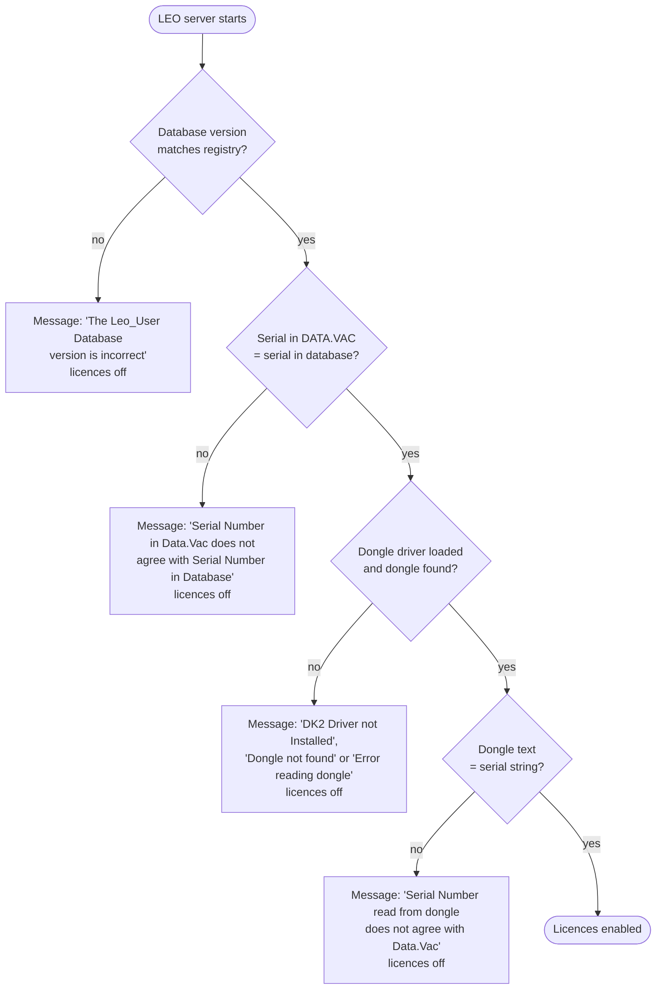
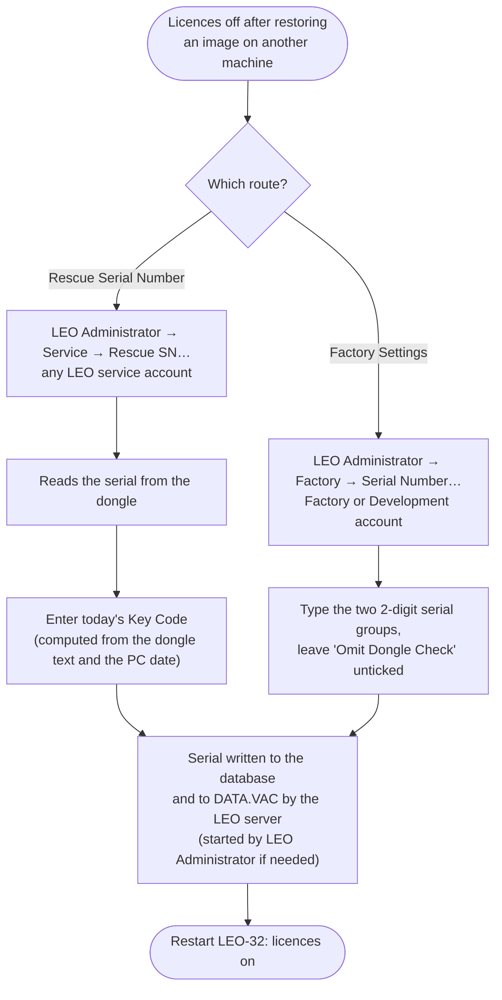

[Home](../../README.md) › [Programs](README.md) › DESkey dongle and licences

# DESkey dongle and licences

> **In short:** a small **DESkey DK2 dongle** on the parallel port holds the microscope's serial string (for example
> `LEO 430-12-34`). At start-up the LEO server reads it and compares it with the serial stored in `DATA.VAC` and in
> the user database. **If everything matches, the licensed options are switched on; if not, the microscope still
> works but every option stays off** (grey buttons) and a message says which check failed.

## The start-up check


The microscope always starts; only the options are affected. (An office "LEO-32 PC" install without microscope
hardware is the exception: there the dongle is mandatory.)

## Restoring a disk image on another LEO 430
The image carries the **source** machine's serial, but the target has its **own** dongle, so the last check fails.
Two LEO tools put the dongle's serial into the database and DATA.VAC:


Only the serial changes: the calibration in DATA.VAC is still the source machine's. Step-by-step details, the
accounts and the Key Code formula: [Moving a disk image to another LEO 430](#moving-a-disk-image-to-another-leo-430-rescue-serial-number).

## Good to know for repair
- A replacement PC needs a **real parallel port** at `0x378`; USB-to-parallel adapters do not work with this driver.
- Without a dongle the microscope runs with all options off; nothing else is blocked.
- Which options a licence enables: [Rules and licences](../subsystems/core-rules-accessories.md).

---

## Technical reference

*Full detail for maintenance and further reverse engineering: function names, addresses, parameters, sources. Inferred points are marked \*?\*.*

The original system has a **DK2 DESkey** from Data Encryption Systems Ltd on the parallel port (LPT1, `0x378`).
This note follows the check from the LEO server down to the port I/O.

Sources: `LEOSERV.exe` (function `0x00417C50` and the routines it calls), `DK2WIN32.DLL`, `DK2WN95.386`
(disassembled after flattening with `tools/le-flatten.ps1`), `srv16.dll`, `m007.dll`,
the `leo_user.mdb` licence tables ([`data/leo_user-licences.txt`](../data/leo_user-licences.txt)), the registry
(`registry/REGFULL.REG`), and LEOSERV's own message table (read with
`tools/res-strings.ps1`).

### In short
- **Only `LEOSERV.exe` checks the key**, once at start-up, before the controller modules are initialised.
  `admin32.exe` and `StageAdmin.exe` only read the same data back and display it.
- **On a microscope PC (the normal case), the key unlocks the optional licences.** It does not gate start-up.
  - LEOSERV reads 16 bytes from the key's memory at address `0x17` and compares them with the machine's serial-number
    string, built from `DATA.VAC`: **`LEO 430-12-34`**.
  - If they match, the machine's licences are enabled (table `serverLicences`).
  - If there is no driver, no key, a read error or a mismatch, the server shows a message and starts with **no licences**.
- **On an office "LEO-32 PC" install** (no image processor, no scan generator), the key is mandatory.
  It must hold `LEO-32-PC`, otherwise the server aborts.
- Chain: LEOSERV → `DK2WIN32.DLL` → `DeviceIoControl` on `\\.\DK2WN95` → `DK2WN95.386` VxD → raw port I/O on the LPT
  data, status and control registers → key.

```
LEOSERV.exe  (FUN_00417C50, at server start-up)
  │  reads: registry LEO-32 key ("DB Version", "Dongle"), leo_user.mdb table keys ("Version", "OmitDongleCheck",
  │         "TipData", "Serial_Number"), SRV_Get_State(DP_SCANGEN / DP_GSP / DP_COLUMN_TYPE), SRV_Get_Serial_Number
  │  calls:  DK2DriverInstalled → FindDK2(code1, code2) → DK2ReadMemory(port, code1, 0x17, 0x10, buf, 0x1E) → DK2Success
  ▼
DK2WIN32.DLL  (32-bit API, "DK2 DESkey" v11 API DLL 2.0, Data Encryption Systems 1997)
  │  Win9x: CreateFile("\\.\DK2WN95") + DeviceIoControl(code 1…0x16, 0x30-byte request block), one call per operation
  │  (NT: "\\.\DK2DRIVER"; Win32s: thunk to DK2WIN16.DLL; neither is used here)
  ▼
DK2WN95.386  (static VxD "DESkey DK2 Win95 VxD", device ID 0x362E, registry ...\Services\VxD\DK2 Windows95 Driver)
  │  W32_DEVICEIOCONTROL dispatch → key protocol routines → two port primitives: OUT base+n / IN base+n
  ▼
LPT port (data 0x378, status 0x379, control 0x37A) → DK2 DESkey
```

### When the check runs
In LEOSERV's start-up (around `0x0049EA87`), after the DDE server is set up, `FUN_00417C50` is called. Then the server
closes the database and calls `SRV_Initialise_Controller`. Its return value:

| Return | Effect |
|---|---|
| `0` | No message. Licences set. |
| `-1` | Fatal: `WM_CLOSE` is posted to the server, so LEO-32 does not start ("LEO Server : Fatal Error" box first). Only the "LEO-32 PC" key failures return this. |
| message ID | The message is added to the server's message list with a warning beep. Start-up continues. |

### Inputs
| Input | Where it comes from | Example value |
|---|---|---|
| `DB Version` | registry `HKLM\Software\LEO Electron Microscopy Ltd\LEO-32` (default `X`) | `09.02` |
| `Version` | `leo_user.mdb`, table `keys` | `09.02` |
| `OmitDongleCheck` | `keys` (default empty) | *not present* |
| `TipData` | `keys` (default `No`) | *not present* |
| `Serial_Number` | `keys` | `1234` |
| `Dongle` | registry LEO-32 key (default empty) | *not present* |
| `DP_SCANGEN` (DP 272) | `SRV_Get_State(0x110)`; set from registry `ScanGen` at start-up (hardware mode 2, m007 `UIF_INITIATE`) | `0` |
| `DP_GSP` (DP 131) | `SRV_Get_State(0x83)`; set from registry `Gsp` (hardware mode 1) = image processor fitted | `1` |
| `DP_COLUMN_TYPE` (DP 140) | `SRV_Get_State(0x8C)` | (only used for the FE gun flag, see below) |
| serial string | `SRV_Get_Serial_Number`: srv16 formats `"%s%2.2u-%2.2u"` with the machine-type prefix (`LEO 430-`), `DATA.VAC` serial / 100 and serial % 100. The string is returned as a global atom. | `LEO 430-12-34` |
| machine type | `SRV_Get_Machine_Type` (registry `Machine`) | `2` = LEO 430 |

The same string is stored in `keys.SerialNumber` (`LEO 430-12-34`), but the check does not read that row.

### Decision flow (`FUN_00417C50`)
1. **Database version.** If `DB Version` ≠ `keys.Version`, the routine returns `0xEFAD` ("The Leo_User Database version
   is incorrect…") straight away, and no licences are set.
2. **FE gun flag** (not part of the key check): a global flag at `0x0058A9D8` is cleared only if `TipData` ≠ `YES`,
   column type is 6 or 8, and GSP or ScanGen is set. Later, that flag disables the gun with message `0xEFBA` ("…a new
   Filament has been indicated and Gun Data has not been entered").
3. **"LEO-32 PC" key, only when `DP_SCANGEN` = 0 and `DP_GSP` = 0** (PC with no microscope hardware):
   - If the registry value `Dongle` equals the factory override code **`~#414166`** (stored at `.data 0x005811C4`),
     this step is skipped.
   - Otherwise: `DK2DriverInstalled`, then `FindDK2`, then up to 10 tries of `DK2ReadMemory(…, 0x17, 0x10, …)` until
     `DK2Success` is true. The text is upper-cased, right-trimmed and must equal `LEO-32-PC`.
   - Each failure returns `-1`, which is fatal: `0xEF9A` driver not loaded, `0xEF98` key not present,
     `0xEF99` read error, `0xEF9B` code error.
4. **Serial cross-check.** From the serial string, characters `len-5..len-4` and `len-2..len-1` are joined
   (`LEO 430-12-34` gives `1234`) and compared with `keys.Serial_Number`. If they differ, the routine returns `0xEF87`
   ("Serial Number in Data.Vac does not agree with Serial Number in Database. Licences will not be enabled") and enables
   no licences.
5. **Licences**, by `OmitDongleCheck` and hardware:

   | `OmitDongleCheck` | `DP_GSP` = 1 or `DP_SCANGEN` = 1 | Action |
   |---|---|---|
   | ≠ `Yes` | yes (**microscope PC**) | Read the key (step 6). On a match, load licences with `FUN_00419DF0`. Otherwise no licences and a message. |
   | ≠ `Yes` | no | `FUN_00418710`: every class 0/1 row of `validLicences` for the machine type. No key needed. |
   | `Yes` | yes | `FUN_00419DF0` without reading the key. Returns `0xEF7D` ("The Dongle check has been omitted. This should only occur during Factory Testing."). |
   | `Yes` | no | `FUN_00419DF0`, no message. |

6. **Machine key read** (the microscope PC path):
   - `DK2DriverInstalled` = 0 → `0xEF83` "DK2 Driver not Installed. Licences will not be enabled."
   - `FindDK2` = 0 → `0xEF84` "Dongle not found. …"
   - 10 failed reads → `0xEF85` "Error reading dongle. …"
   - Mismatch → `0xEF86` "Serial Number read from dongle does not agree with Data.Vac. Licences will not be enabled."

   The comparison is between the 16 bytes at key address `0x17` (upper-cased, right-trimmed) and the serial string as
   returned by the server.
7. **LEO 1430 special case:** if the serial string starts with `LEO 1430` and its two-digit groups are `50` (first) or
   `51` (second), licence 23 is forced on. This doesn't apply here.
8. `SRV_Set_Licenses(array)`: the licence array holds 64 dwords indexed by licence number (1–63) and is zeroed
   first, so after a failed check it is all zeros. srv16's `SRV_SET_LICENSES` passes it to `m007`
   `UIF_WRITE_LICENCES` (64 entries), which keeps a 64-byte table. Modules read it back with `UIF_READ_LICENCES`
   (magic `0x6614`).

#### Where the licence set comes from (`FUN_00419DF0`)
- `keys."Licences Expire"` empty (normal case): table **`serverLicences`** → `licence → code`.
- `Licences Expire` holds a date in the future: a temporary "All Licences" evaluation. The server logs
  "** User has Temporary 'All Licences' Enabled: Expires …" and uses `validLicences` for the machine type.
- If that date has passed: "*** Temporary 'All Licences' has expired". The server clears the key and falls back to
  `serverLicences`.

`validLicences` is filtered with `Machine = <machine type>`. Rows with class 0 or 1 are enabled; class 2 rows are
LEO-internal and never enabled.

#### Example licence set: a typical LEO 430 (`serverLicences`, the same as `MasterLicences` and `copyLicences`)
These 18 options need the key. Without it, they are off:

| # | Code | Option | # | Code | Option |
|---|---|---|---|---|---|
| 1 | STAGECO | Stage co-ordinate store/recall | 15 | CLIP | Cut & paste |
| 2 | STAGESCAN | Stage scan | 17 | REDUCED | Adjustable reduced raster |
| 3 | SCANEXP | Scan rate expansion | 23 | CENTRE | Centre feature / stage map |
| 4 | SCANROT | Scan rotation | 24 | GRAT | Graticule |
| 5 | SPLIT | Split screen | 25 | DOTMAP | Simple X-ray dot map / linescan |
| 7 | TILTCOMP | Tilt compensation | 27 | SPOT | Spot mode |
| 9 | DYNFOCUS | Dynamic focus | 30 | PORTEXP | Extra inputs |
| 11 | GAMMA | Input gamma | 31 | SIGMIX | Signal mixing |
| 12 | INVERT | Input signal invert | 32 | RS232 | RS232 remote control (RemCon32) |

The full lists (all 47 licences, valid licences per model) are in [`data/leo_user-licences.txt`](../data/leo_user-licences.txt).

### Messages (LEOSERV string table, English / French / German present)
| ID | English text |
|---|---|
| `0xEF1B` | LEO Server : Fatal Error *(box title)* |
| `0xEF98` / `0xEF99` / `0xEF9A` / `0xEF9B` | PC Dongle not present / read error / driver not loaded / code error. Server Aborting. |
| `0xEF83` / `0xEF84` / `0xEF85` | DK2 Driver not Installed / Dongle not found / Error reading dongle. Licences will not be enabled. |
| `0xEF86` | Serial Number read from dongle does not agree with Data.Vac. Licences will not be enabled. |
| `0xEF87` | Serial Number in Data.Vac does not agree with Serial Number in Database. Licences will not be enabled. |
| `0xEF7D` | The Dongle check has been omitted. This should only occur during Factory Testing. |
| `0xEFAD` | The Leo_User Database version is incorrect. Upgrade it using the Upgrade Database Utility. |

### Licence data: `leo_user.mdb`
- The path comes from the registry value `DB Path` (`…\LEO-32\SYSTEM\`). The file is an Access/Jet database
  protected by **user-level security** with the workgroup file `LEO-32\SYSTEM\system.mda`.
- LEOSERV opens it through a DAO workspace with a fixed account (needed to read the file with
  `tools/read-mdb.ps1` or Access 2.0 / 97 with `system.mda` as workgroup file):

  | Field | Value | LEOSERV `.data` |
  |---|---|---|
  | Workspace name | `LeoSpace` | `0x00581140` |
  | User name | `Phil Williams` | `0x0058114C` |
  | Password | `shepreth` | `0x0058115C` |
- Tables used here: `keys` (`KEY`, `stringVal`), `licences` (number, part number, sales code, description),
  `serverLicences` (`licence`, `code`), `validLicences` (`licence`, `machine`, `class`, `SalesCode`, `PartNumber`).
  `MasterLicences` and `copyLicences` hold the same set as `serverLicences`.

### `DK2WIN32.DLL` (32-bit API)
Selects a back end at load time with `GetVersionEx`: NT → `\\.\DK2DRIVER`, Win9x → `\\.\DK2WN95` (used here),
Win32s → universal thunk to `DK2WIN16.DLL` (not on the disk). Calls are serialised with the named semaphore
`DK2DriverAccessSemaphore`. On Win9x, each call opens the VxD, sends one `DeviceIoControl` with a 0x30-byte request
block, closes it, and loops while the status word is `-1` or `-2` (port busy). On `-1` it shows a modeless
"Waiting for Printer to Finish" box with a Cancel button.

| Export | Win9x IOCTL | Used by |
|---|---|---|
| `FindDK2(code1, code2)` → port ID (0 = not found) | 1 | LEOSERV, StageAdmin |
| `DK2FindLPTPort` | 2 | |
| `DK2GetDelayTime` / `DK2SetDelayTime` | 3 / 4 | |
| `DK2ReadRandomNumbers` | 5 | |
| `DK2ThroughEncryption` | 6 | |
| `DK2ReadMemory(port, code, addr, len, buf, bufsize)` | 7 | LEOSERV, admin32, StageAdmin |
| `DK2WriteMemory` | 8 | admin32 Write Dongle (`0x00499596`: key address 0x17, 16 bytes) |
| `DK2ReadDownCounter` / `DK2DecrementDownCounter` / `DK2RestartDownCounter` | 9 / 0xA / 0xB | |
| `DK2ReadDUSN` | 0xC | |
| `DK2SendAlgorithmString` / `DK2SendAlgorithmBuffer` | 0xE / 0x16 | |
| `DK2Success` → non-zero if the last operation worked | 0x10 | LEOSERV, admin32 |
| `DK2DetectSpeed` / `DK2Sub_DetectSpeed` / `DK2GetFlags` / `DK2SetFlags` | 0x11 / 0x12 / 0x13 / 0x14 | |
| `DK2DriverInstalled` (= the VxD can be opened) | — | LEOSERV, StageAdmin |

Request block (DK2ReadMemory): `+0x00` pointer to access code 1, `+0x04` pointer to access code 2 (FindDK2),
`+0x0C` key address, `+0x0E` length, `+0x10` port ID in / status out (`0` OK, `0xFFFF`/`0xFFFE` busy),
`+0x12` buffer size, `+0x14` buffer pointer. The success flag comes back at `+0x24`.

LEOSERV passes two short **access codes** to the key:

| Code | Bytes | As text | LEOSERV `.data` |
|---|---|---|---|
| 2-byte code | `66 67` | `fg` | `0x00581228` |
| 4-byte code | `E6 74 78 67` | `ætxg` (Windows-1252) | `0x00581220` |

The 2-byte code `fg` is the code passed to `DK2ReadMemory(port, code, 0x17, 0x10, …)` (`FUN` around
`leoserv.exe.c` line 32710). Where the 4-byte code goes (the second `FindDK2` code) is not clear from the
decompiled code, because the stack variables are reused *?*.

### `DK2WN95.386` (VxD)
- LE format, 3 objects. DDB `DK2WN95 ` at object 1 + `0x318C`: SDK 4.0, device ID **`0x362E`**, version 1.0,
  init order "undefined", control procedure `+0x3A10`, one V86/PM API entry `+0x3A40`.
  (Offsets are object-relative; in the flattened image add `0x1000`.)
- Loaded as a static VxD from `HKLM\System\CurrentControlSet\Services\VxD\DK2 Windows95 Driver`:

  | Value | Example setting |
  |---|---|
  | `StaticVxD` | `C:\WINDOWS\SYSTEM\DK2WN95.386` |
  | `LPTPort` | `0x378` |
  | `MainDelay` | `0x167` (timing loop count) |
  | `LastDK2Version` | `14` (key model seen last time) |

  The VxD also references the DESkey control-panel key `SOFTWARE\Data Encryption Systems Limited\DESkey Control
  Panel\Pages\GDICPLP` (the control panel is not installed).
- Control messages handled: `Device_Init` (sets a ready flag), `System_Exit` (frees the port list),
  `W32_DEVICEIOCONTROL` (0x23). The IOCTL dispatcher accepts code 0 (open), −1 (close) and 1–0x16 through a 22-entry
  table; any other code returns error `0x32` (not supported).
- The V86/PM API (function in client AX, 0–0x14) maps the client's ES:DI request block to flat memory and runs the
  same routines for DOS and Win16 callers.
- **FindDK2:** tries the port that worked last time first, then each parallel port in the VxD's port list. It probes
  with the access codes, records the key model byte, and returns the ID of the port where the key answered.
- **Hardware access:** all key traffic goes through two small routines, `OUT (port base + n), AL` and
  `IN AL, (port base + n)`, with n = 0 (data), 1 (status) or 2 (control). The key protocol is bit-banged on the data
  lines, and replies are read on the status lines, with software delays set by `MainDelay`.
- **Busy rule:** a port is reported busy (status `0xFFFF`/`0xFFFE`) when it is flagged in the VxD's port list and
  bit 3 of its control register (SELECT IN) is clear. That presumably means a print job is using it *?*.

### Other programs that read the key
- `admin32.exe` (LEO Administrator) calls `DK2ReadMemory(…, 0x17, 0x10, 32-char buffer)` + `DK2Success`, and shows the
  upper-cased text in a field, or "Dongle Read Failure".
- `StageAdmin.exe` calls `DK2DriverInstalled` (message box if missing), `FindDK2`, then `DK2ReadMemory(…, 0x17, 0x10, …)`
  and shows the text the same way.

### Practical notes for repair
- If the key or its port fails, the microscope still runs, but the 18 options above stay disabled. The server
  message tells which step failed (`0xEF83`–`0xEF87`).
- The key must hold the machine's serial string (`LEO 430-12-34`) at address `0x17`. `DATA.VAC` (serial `1234`,
  machine type LEO 430) and `leo_user.mdb` (`Serial_Number` = `1234`) must agree with it. A copy of the
  database taken right after installing the PC has `Serial_Number` = `0000`; restoring it would fail step 4.
- The VxD does raw port I/O, so a replacement PC needs a real parallel port at a legacy address (`LPTPort` = `0x378`).
  USB-to-parallel adapters do not provide those I/O ports.

### Moving a disk image to another LEO 430: "Rescue Serial Number"
Guided procedure for this case, including the Key Code: [Key Recovery Helper](https://elpoupa.github.io/leo430-sem-archive/).

A disk image restored on another LEO 430 (with that machine's own key) fails at step 6 (`0xEF86`): the key
holds the target machine's serial string, but `DATA.VAC` and `leo_user.mdb` still hold the source machine's serial
(for example `1234`). LEO's own tool for this case is in
**LEO Administrator** (`admin32.exe`, VB6, native code). Its "Rescue Serial Number" form says: *"It reads the Serial
Number from the Dongle and installs it into the Database and the Data.Vac file."*

- **Where:** LEO Administrator → **Service → Rescue SN…** (menu item `doRescueSN`). The Service menu is not
  name-checked; the daily Key Code is the real lock. Any of the LEO accounts below works (comparison of the accounts:
  [service-accounts.md](service-accounts.md)). The accounts are rows of the `Users` table of `leo_user.mdb`
  (passwords are case-insensitive):

  | User name | Password |
  |---|---|
  | `Factory` | `keele` |
  | `Service` | `petrol` |
  | `Development` | `stansted` |
- **Form load** (`FUN_00497A90`): `DK2ReadMemory(…, 0x17, 0x10, …)` into a 32-character space-filled buffer, upper-cased,
  shown in "Dongle Serial Number" and kept as the form's serial string. "Dongle Read Failure" if the read fails.
- **Key Code:** a number typed into the form. `FUN_00497D40` compares it with `FUN_004981C0(serial string, Now,
  0, 2)`, a checksum of the trimmed key text plus the day, month and year of the PC clock (so the code changes every
  day and depends on the PC's date, not the real date). A mismatch gives "Key Code not Valid or Incorrect Serial
  Number read from Dongle". See "Key Code formula" below.
- **On success:** the four-digit serial is taken from the key text (for example `LEO 430-56-78` → `5678`), then:
  - `leo_user.mdb` table `keys`: `Serial_Number` and `SerialNumber` are rewritten (`FUN_0047B760`).
  - `ParamMgr.AdminFunction(…, 12, serial)` → LEOSERV admin function 12 (`FUN_00415CA0`): `SRV_Get_Admin_Config`,
    serial replaced, `SRV_Set_Admin_Config` → the server writes it into `DATA.VAC`. LEO-32 does **not** have to be
    started first: LEO Administrator starts the server itself if none is running (see
    [LEO Administrator → Connection to the server](admin32.md#connection-to-the-server)).
  - `oeminfo.ini` (Windows System Properties OEM text) is updated (`FUN_00473F90`).
  - Message "Serial Numbers rescued". The licences are loaded at the next server start-up.
- Only the serial changes. The rest of `DATA.VAC` (calibration, beam time, filament data, column number) stays as it
  was on the source machine, and `serverLicences` stays the source machine's licence set.

#### Simpler route: Factory → Serial Number… (no Key Code)
The Factory Settings form (`factory`, menu `doFactorySerial`, shown only to FACTORY and DEVELOPMENT) sets the serial
by hand.
- **Form load** (`0x00473990`): machine type from the server (`GetMachineType`) into `LabelMachine`; `keys.serial_number`
  split into two 2-digit boxes, `batch` = serial ÷ 100 and `item` = serial mod 100 (for example `12` and `34`);
  the `Omit Dongle Check` box is ticked if `keys.OmitDongleCheck` = `Yes`.
- **OK** (`btnOK`, `0x004732A0`): serial = `batch` × 100 + `item`, formatted `0000`, then:
  - `keys.Serial_Number` = that number, `keys.SerialNumber` = `LEO <machine>-<batch>-<item>` (`FUN_0047B760`),
  - `AdminFunction(12, serial)` → LEOSERV → `DATA.VAC` (LEO Administrator starts the server if needed), as in Rescue,
  - `keys.OmitDongleCheck` = `Yes` or `No` from the box,
  - `oeminfo.ini` updated. "Invalid Serial Number" if the boxes don't parse.

To give the installation another machine's serial (for example `LEO 430-56-78`): log on as Factory or Development,
Factory → Serial Number…, set the boxes to `56` and `78`,
leave Omit Dongle Check unticked, OK, then restart LEO-32.

#### Key Code formula (`FUN_004981C0`)
Codes for all five dialogs below can be generated with the [Key Recovery Helper](https://elpoupa.github.io/leo430-sem-archive/) (English and French).

Arguments: text `T` (the key text, or the serial string being written), date `D` (`Now` on the PC), number `n`
(a value from the form, e.g. a duration in days), mode `m`. Integer arithmetic, overflow-checked.

```
T   = UCase(Trim(T))
sum = Σ (i = 1 … Len(T))  Asc(T[i]) × (m + 1) × i
code = sum + m × (13 × Day(D) + 8 × Month(D) + 42 × Year(D))
if m is 1, 3 or 5:
    k = 5 if n ≤ 3, 4 if n ≤ 5, else 8
    code = code + (Day(D) + Month(D) + Year(D)) × n × k
```

| Form (click handler) | Mode `m` | `n` | Text `T` |
|---|---|---|---|
| Rescue SN (`RescueSN.Command1`, `0x00497D40`) | 2 | 0 | key text read at form load |
| Temporary calibration (`TempCal.btnAction`, `0x00498490`) | 1 | duration (days) | `keys.SerialNumber` from the database |
| Grant All Licences (`TempLic.Command1`, `0x00498B50`) | 3 | duration (days) | `keys.SerialNumber` from the database |
| Write Dongle (`wrtDongle.Command1`, `0x00499080`) | 4 | 0 | `LEO <model>-xx-yy` built from the two 2-digit fields |
| Stage Administrator: Edit → Enter KeyCode (`StageAdmin` `GetKeycode.btnOK`, `0x00450960`; same routine copied at `0x00449C70`) | 5 | duration (days) | key text |

Grant All Licences writes `keys."Licences Expire"` = now + duration ("General Date"), which LEOSERV reads at start-up
(see "Where the licence set comes from" above). Temporary calibration grants the Calibration privilege until
now + duration.

#### The other key-code screens
admin32 declares 18 DK2WIN32 functions (VB `Declare` stubs at `0x00416A88`–`0x00416F7C`); it calls `FindDK2`,
`DK2DriverInstalled`, `DK2ReadMemory`, `DK2WriteMemory` and `DK2Success`.
- **Write Dongle** (Service → Write Dongle…, form `wrtDongle`): the machine series comes from the server
  (`GetMachineType` → e.g. `LEO 430`), the serial is typed into two 2-digit boxes ("Serial number fields must both be
  2 digits"). `T` = `LEO <series>-xx-yy`, mode 4. If the code matches: `FindDK2`, then `DK2WriteMemory(port, code,
  0x17, 0x10, T)`, `DK2Success` → "Dongle Written" or "Dongle Write Failure". This is how LEO put the serial string
  into a new key.
- **Grant All Licences** (Licence Administrator → button "All Licences (Temporary)", form `TempLic`): duration in days
  + Key Code (mode 3, `T` = `keys.SerialNumber`). Sets `keys."Licences Expire"` = now + days; at the next server
  start every class 0/1 licence of the machine type is on until that date.
- **Temporary calibration** (user profile editor, frame "Temporary Calibration Privilege" → "Action", form `TempCal` "Grant Temporary Calibration Privilege"): duration +
  Key Code (mode 1, `T` = `keys.SerialNumber`). Gives the edited user the Calibration privilege until now + days
  (`TempCalEnable`, `CalEnableExpires` in `Users`).

Worked example, Rescue with a key holding `LEO 430-56-78` (`m` = 2):
`sum` = 3 × 4741 = 14223, so **code = 14223 + 26 × day + 16 × month + 84 × year** of the PC clock.
3 Nov 2026 → 184661.

#### Licence Administration: where a change goes
The form's private procedures (names from the program, in the order of its method table at `0x40A6B4`):
`clearAllLicences` `0x47BA90`, `OptInstal` `0x47BB40` (the `.LIC` reader below), `displayLicenceArray` `0x47C440`,
`readLicenceInfo` `0x47CA10`, `readDBLicences(table)` `0x47D5C0` (method slot `0x708`), `readSEMLicences` `0x47D9F0`,
`setAllLicences` `0x47DAF0`, `writeDBlicences(table)` `0x47DBE0` (slot `0x714`), `writeSemLicences` `0x47DFD0`
(slot `0x718`).

`writeSemLicences` writes the current list to **`serverLicences`** (the table LEOSERV loads at start-up) and then calls
`ParamMgr.AdminFunction(…, 13, 0)` (wrapper `0x474FB0`): LEOSERV admin function 13 reloads the licences from
`serverLicences` at once, so **every change below is live immediately** in a running LEO-32 (and stays for the next
start).

| Action (handler) | Tables written | Then |
|---|---|---|
| tick / untick one licence (`btnEdit`, `0x47E5C0`) | `copyLicences` | `writeSemLicences` |
| **Restore Licences** (`btnRestore`, `0x47EAC0`) | reads `masterLicences`, writes it to `copyLicences` | `writeSemLicences` |
| **Set All** (`btnSetAll`, `0x47EC30`; Factory, Development) | `copyLicences` | `writeSemLicences` |
| **Clear All** (`btnClearAll`, `0x47E430`; Factory, Development) | `copyLicences` **and `masterLicences`** | `writeSemLicences` |
| **Install from disk ..** (`btnInstall` → `OptInstal`, `0x47C2D9`–`0x47C356`) | `masterLicences` and `copyLicences` | `writeSemLicences` |

So `masterLicences` is the stored reference set: Restore Licences brings it back after single changes or Set All,
but **Clear All overwrites it too**, after which only a backup of `leo_user.mdb` (or a licence file) restores the
licences.

#### Licence files (`.LIC`, Licence Administrator → "Install from disk ..")
LEO shipped extra licences on a floppy (`a:*.lic`). Reader: admin32 `0x0047BB40` (called from `licence.btnInstall`).
- **Size:** 1719 little-endian 16-bit words (3438 bytes), read with `Get`.
- **Data:** only every 27th word carries data, stored inverted: `v[k] = NOT W[27 × k]`, k = 0 … 62. The other
  words are filler.
- **Check word:** `W[1718]` (the last word, not inverted) must equal `(Σ v[0..62] AND NOT 0x1000) mod 4097`, else
  "Invalid Licence File Sumcheck!" plus "Please Phone LEO Customer Care Dept. … Quoting Order Number marked on
  licence disk".

| `v[k]` | Meaning |
|---|---|
| 0, 1 | first serial pair, as two character codes (`5`, `2`) |
| 2, 3 | second serial pair (`0`, `1`) |
| 4 … 10 | order number, 7 character codes (shown in the error messages) |
| 11 … 14 | not used by the reader |
| 15 | machine type (`2` = LEO 430), turned into `LEO <series>` by `0x00499B00` |
| 16 … | licence numbers to enable, one per entry; entries ≤ 0 are skipped |

- **Serial check:** `LEO <series>-<v0 v1>-<v2 v3>` must equal the server's serial string (`LEO 430-12-34`), else
  "Invalid Serial Number!". So a licence file only installs on the machine it was made for.
- **Install:** the listed licence numbers are added to the current set and written to both `masterLicences` and
  `copyLicences` (form methods at slots `0x708` / `0x714`). LEOSERV loads `serverLicences` at start-up; "Restore
  Licences" copies the master set there.
- No `.lic` file is in the archived installation.

#### Not a route: the m600 "dongle" messages
`m600.dll` contains "LEO Serial Number and Licence Dongle", "Re-read Serial Number and Licences from Dongle" and
"Re-write Licences to Dongle". They are Retry/Cancel boxes (`FUN_1000_2CC2`, `FUN_1000_2D60`) for an NVRAM storage
mode 4 that would keep the configuration on the key. In this build its read/write routines (`FUN_1000_409A`,
`FUN_1000_4118`) are stubs that return 0, so that mode is unused. Mode 5 dumps part of the record to `C:\LEO\data.dgl`.

---
[← Programs](README.md) · [Home](../../README.md)
