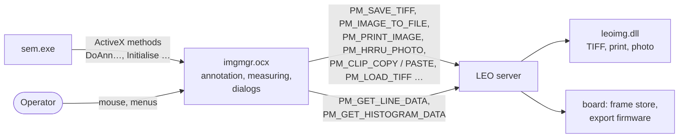

[Home](../../README.md) › [Programs](README.md) › [ActiveX controls](controls.md) › Image manager (imgmgr.ocx)

# Image manager (imgmgr.ocx)

> **In short:** the image window inside the SEM user interface. It draws the **annotation** layer (text, lines,
> markers, measurement objects, data zone, scale bars, cross-hairs, graticule), runs the **measurement tools**
> (line and vector profiles, histograms, magnification and scan calibration lines), and offers the **Send to** menu:
> TIFF, BMP, JPEG, clipboard, printer, HRRU photo, video printer, second image window. It never touches the image
> data itself: every save, load, print or photo request is sent to the LEO server, which does the work with the board
> and `leoimg.dll`.

## What it offers
| Area | Functions (ActiveX method → screen) |
|---|---|
| **Saving and exporting** | `DoAnnTIFFExport` → "Save" (whole image, centre or an area; with annotation / overlay / colour merge; user text; file list), `DoAnnBMPExport`, `DoAnnJPEGExport`, `DoAnnClipboard` → "Copy" / "Paste", `DoAnnPrintSetup` → "Print Setup", `DoAnnPhoto` → "Photo" (HRRU), Send to → Video Printer / 2nd Image Window |
| **Loading** | `DoAnnTIFFImport` → "Load" ("Standard Data" / "User Data" pages read back from the TIFF), `DoAnnLoadFilename`, image gallery (`DoAnnShowImageGallery`) |
| **Annotation** | `DoAnnSelect`, `DoAnnLoad` / `DoAnnSave`, text (`DoAnnCreateText`), lines, points, point-to-point, areas, aspect areas, caption / line / brush / font / colour settings, SEM parameter and "micron measurement" labels, data zone (`DoAnnLoadDataZone`) |
| **Measuring** | line profile, vector profile, live profile, stored and live histogram, "Measurement Object Results Panel", grid |
| **Calibration aids** | `DoAnnMagCal`, `DoAnnScanCal`, `DoAnnCalibrationLines`; Utilities → "User Calibration Enable" |
| **Scan-mode shortcuts** | Utilities → Commands: Normal / Reduced / Split / Quad (`DoAnnSplitScreen`, `DoAnnQuadMode`, `DoAnnDefineRaster`), `DoAnnSpot`, `DoAnnLineScan`, `DoAnnCrossHairs`, `DoAnnGraticule` |
| **Window** | `Initialise`, `ShowToolBar` / `HideToolBar`, `HidePanel`, `ShowDialogs` / `HideDialogs`, `SetBackdropBitmap`, `SetUserInteraction`, `InhibitSpot`, Utilities → "Reset Display LUT" |

## Good to know
- The TIFF files carry LEO's own tags with the microscope settings at the moment of saving; their layout is in
  [File formats](../file-formats.md#sem-tiff-images).
- The server keeps running counters for file names (`File Number`, `Print Number`, `HRRU Number`), and every
  saved, printed or photographed image is reported to user accounting (see [Display and export](../subsystems/display-modes-export.md)).

---

## Technical reference

*Generated data: every ActiveX method / property with the code that implements it
[`../ui/imgmgr-dispatch.csv`](../ui/imgmgr-dispatch.csv) (73 entries); classes and their method tables
[`../ui/imgmgr-classes.csv`](../ui/imgmgr-classes.csv) (49 classes); menu and message handlers
[`../ui/imgmgr-msgmaps.csv`](../ui/imgmgr-msgmaps.csv), [`../ui/imgmgr-handlers.csv`](../ui/imgmgr-handlers.csv);
dialogs [`../ui/imgmgr-resources.txt`](../ui/imgmgr-resources.txt); per-function digest
[`../programs-digest/imgmgr.ocx.md`](../programs-digest/imgmgr.ocx.md); programming interface
[`../typelibs/imgmgr.ocx.md`](../typelibs/imgmgr.ocx.md).*

- MFC ActiveX control, MFC linked statically (≈44 700 functions, most of them library code). Main class
  `CImgMgrCtrl` (134 virtual methods), property page `CImgMgrPropPage`, server link `CServerComms`.
- Dialog classes: TIFF export (`CTIFFExportSave`, `CTIFFExportSettings`, `CTIFFExportData`), TIFF import
  (`CTIFFImportLoad`, `CTIFFImportStandardData`, `CTIFFImportUserData`), photo (`CPhotoStart`, `CPhotoSelection`,
  `CPhotoSettings`), clipboard (`CClipboardCopy`, `CClipboardPaste`), options (`COptionsGeneral`, `COptionsUser`,
  `COptionsDefault`), each shown in a modeless sheet / frame (`CModeless…Sheet`, `CModeless…Frame`).
- Hosted parameter widgets inside its dialogs: `CLEOAnalg`, `CLEOButton`, `CLEOCombo`, `CLEOStatic`, `CLEOIG`.
- Own registered messages: `IMGMGR_CONTEXT_HELP`, `IMGMGR_FROZEN_UPDATE`, `IMGMGR_IMEX_REBUILD`,
  `IMGMGR_REFRESH_FILE_LIST`, `IM_OBJECT_NEEDS_REFRESH`, `IM_EXPOBJ_UPDATED`, `IM_IMPOBJ_UPDATED`, `IM_PTIFFEXP_SAVE`,
  `IM_PTIFFIMP_LOAD`, `IM_BACKDROP_IMAGE`, `GALDLGFRM_TIF_LOAD`; server messages it sends include `PM_SAVE_TIFF`,
  `PM_IMAGE_TO_FILE`, `PM_RAW_IMAGE_TO_FILE`, `PM_LOAD_TIFF`, `PM_GET_TIFF_HEADER`, `PM_TIFF_TO_BMP`,
  `PM_PRINT_IMAGE`, `PM_HRRU_PHOTO`, `PM_CLIP_COPY` / `PASTE` / `INFO`, `PM_GET_LINE_DATA`, `PM_GET_HISTOGRAM_DATA`,
  `PM_GET_IMAGE_PIXEL`, `PM_IMG_CREATE_TEXT` / `DELETE_TEXT`, `PM_CREATE` / `READ` / `DELETE_USER_AREA`,
  `PM_STAGE_LABEL`, `PM_STAGE_POINT_GOTO` (one helper function per message in `CServerComms`).
- Export settings are kept under the profile section `TIFFEXPORT` (`WHOLE`, `PARTIAL LEFT` / `TOP` / `RIGHT` /
  `BOTTOM` …).

---
[← ActiveX controls](controls.md) · [Home](../../README.md)
