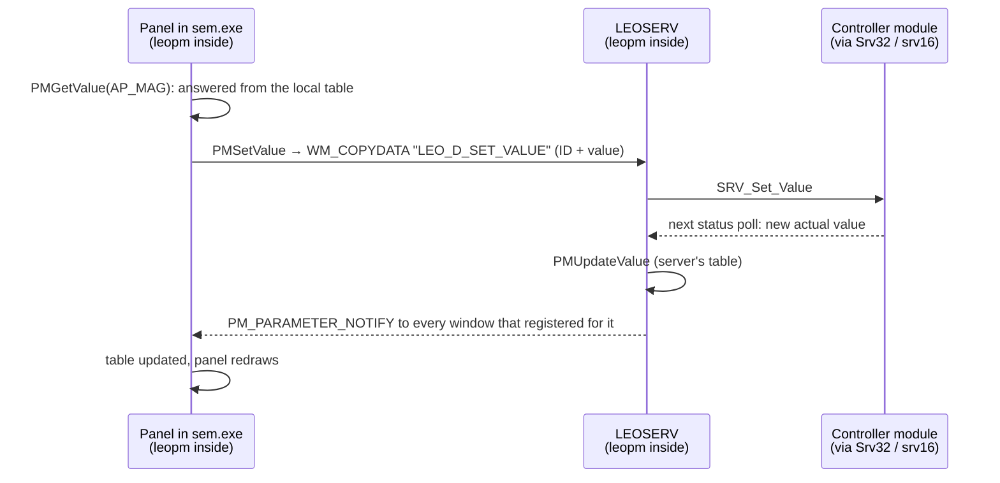

[Home](../../README.md) › [Programs](README.md) › Parameter manager (leopm.dll)

# Parameter manager (leopm.dll)

> **In short:** leopm is the library every LEO program (and the server itself) uses to read and change microscope
> parameters. Each program keeps **its own copy of the parameter table** inside leopm: names, units, limits,
> enabled/visible flags and the last known values. Reading a value is answered from that copy. Changing a value or
> running a command is sent to the server as a small data packet. When the server reports a new value, leopm updates
> the copy and tells every window that asked to be informed about that parameter.

## How a value moves

## Parameter IDs
A parameter is a 32-bit number: **type in the high 16 bits, index in the low 16 bits**. The index is the one in
[`../parameters.csv`](../parameters.csv) (e.g. `AP_MAG` = index 0).

| Type (high word) | Kind |
|---|---|
| 100, 101 | commands (`CMD_…`) — no value |
| 200, 201 | states (`DP_…`) |
| 300, 301, 302 | analogue values (`AP_…`) |
| 400 | strings (`SV_…`) |

Each kind has a main bank (100 / 200 / 300) and one or two extra banks (101, 201, 301, 302) held in separate
tables; the extra banks are most likely the user-interface-only parameters kept by leopm itself (units, presets,
measuring settings) *?*. An unknown type returns −2, an unknown index −3, a command asked for a value −4.

## What it provides
- **Values and states:** `PMGetValue`, `PMSetValue`, `PMGetValueAsString` (formatted with units and the right number of
  decimals: `= %#2.2f mm`, `nm` …), `PMGetStates` (names of the choices), `PMGetLimits`, `PMGetXyValues` /
  `PMSetXyValues`, `PMStepValue`, `PMGetDescaledValue`, `PMSetStringValue` / `PMGetStringValue`.
- **Names and help:** `PMGetName`, `PMGetMnemonic`, `PMTranslateMnemonic` (name ↔ ID), `PMGetUnitsString`,
  `PMGetParamGroup`, `PMGetCommandGroup`, `PMGetParamCount`, `PMHelpMode`.
- **Flags:** `PMIsEnabled`, `PMIsVisible`, `PMIsReadOnly`, `PMIsEntryOnly`, `PMIsReadWrite`, `PMIsVector`,
  `PMIsYofXY` (these come from the rules and access levels, see
  [Rules and licences](../subsystems/core-rules-accessories.md)).
- **Commands:** `PMExecuteCommand`.
- **Notifications:** `PMSetNotify` (register a window for a parameter), `PMGeneralNotifyMessage`, progress and image
  events (`PMNotifyProgressState`, `PMNotifyImexDone`, `PMNotifyTIFFParameter` …).
- **Server side** (called by LEOSERV when values change): `PMUpdateValue`, `PMUpdateState`, `PMUpdateXy`,
  `PMUpdateLowLimit` / `HighLimit`, `PMUpdateStateEnabled` / `ParameterEnabled` / `CommandEnabled`, `PMUpdateLicences`,
  `PMUpdateZone`, `PMUpdateOpMode`.
- **User settings:** `PMUpdateUserPrefs`, `PMUpdatePressureUnits` (Torr / mbar / Pa), `PMUpdateVPPressureUnits`,
  `PMUpdateMeasureUnits`, `PMSetLanguage`, `PMSetSensitivity`, presets (`PMGetPresetCount` …).
- **Mouse adjust and clicks on parameters:** `PMLeftMouseAdjSetup`, `PMMiddleMouseAdjSetup`, `PMParameterClick`,
  `PMParameterDblClick`, `PMParameterRightClick`.
- Its own small dialogs: "Enter XY Values", "Please Enter String", "Enter Named Value", "Select", "About Parameter
  Manager".

---

## Technical reference

*Generated data: [`../programs-digest/leopm.dll.md`](../programs-digest/leopm.dll.md) (every function with its
texts and calls), decompiled code [`../decompiled/leopm.dll.c`](../decompiled/leopm.dll.c).*

- 73 exports (listed in [`../exports.csv`](../exports.csv)); each is a thin MFC wrapper that calls the parameter
  object at `0x100D9560` (e.g. `PMGetValue` → `FUN_10078dd7`, `PMSetValue` → `FUN_100790dc`,
  `PMUserInitialise` → `FUN_10078bb3`, `PMUpdateValue` → `FUN_1007855c`).
- **Lookup** `FUN_100621e1` / **set** `FUN_10063473`: switch on the ID's high word (100, 101, 200, 201, 300, 301,
  302, 400) to the matching table (object offsets 0x08 / 0x28 / 0x48 / 0x68 / 0x88 / 0xA8 / 0xC8 / 0xE8).
- **Set path:** analogue set `FUN_10008425` packs `{index, double value}` (12 bytes) and `FUN_10082ec3` sends
  `WM_COPYDATA` (0x4A) to the server window with `dwData` = the registered message `LEO_D_SET_VALUE`; states, strings,
  XY values, steps, commands and mouse adjust use `LEO_D_SET_STATE`, `LEO_D_SET_STRING`, `LEO_D_SET_XY`,
  `LEO_D_STEP`, `LEO_D_EXECUTE`, `LEO_D_MOUSE_ADJUST_*` the same way. The server answers through its `LEO_D_*`
  handlers (see [LEO server](leoserv.md#message-api)).
- **Larger blocks** (`FUN_1002fe81` and a copy): a temporary named file mapping `MMF_LEO_PM_<tick>_<…>_<rand>`
  carries the data, `WM_COPYDATA` carries the mapping's name; the reply is copied back from the mapping.
- **Notification** `FUN_100783d6` → `FUN_1006311f`: each parameter object keeps the windows registered for it and
  posts the registered message `PM_PARAMETER_NOTIFY` to each (`FUN_100391ea`).
- Registers 246 window messages (`PM_*`, `LEO_*`); the list is in [`../data/pm-messages.txt`](../data/pm-messages.txt).

---
[← Programs](README.md) · [Home](../../README.md)
