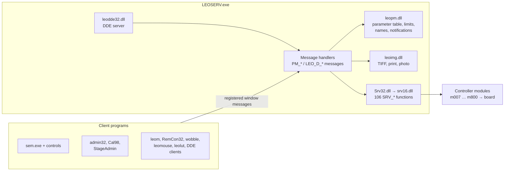
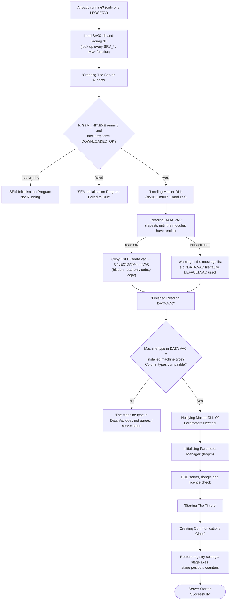

[Home](../../README.md) › [Programs](README.md) › LEO server (LEOSERV)

# LEO server (LEOSERV.exe)

> **In short:** LEOSERV is the one program every other LEO program talks to. It starts the hardware side (the 16-bit
> controller modules through `Srv32.dll`), loads the machine configuration, checks the dongle and licences, then
> answers about **200 named window messages** from its clients ("get this value", "run this command", "save this
> image", "log this user on"). Twice a second it runs the modules' status poll. When it closes it saves the
> configuration and the stage position.

## Where it sits

## Start-up, step by step
These are the texts shown in the "LEO-32 Server Startup Progress" window, in order, and what can stop it.

The dongle / licence step is described in [DESkey and licences](deskey.md).

## While running
| Timer | Every | Does |
|---|---|---|
| 15 | 0.5 s | **status poll**: `SRV_Timer_Tick` runs every module's timer tick (vacuum, EHT, stage, optics, detectors, export) and pushes the changed values to the clients |
| 20 | 60 s | writes the accounting "LogOff" time stamp (so an abnormal end still records the session) and logs vacuum, run-up state and filament current (and extractor values on field-emission machines), serial number and free disk space |
| 25, 35, 40, 45 | 0.05–1 s | short-lived timers started by individual features (mouse adjust, stage, auto functions) *?* |

## Closing down
When LEO-32 closes (or Windows shuts down), the server:
1. saves the **stage position and axis settings** to the registry (`HKLM\…\LEO-32\Stage`) — at the next start a
   stage that was not re-initialised gets its position back from there ("Stage initialised with position restored
   from registry");
2. saves the EHT shut-down state (`HKLM\…\LEO-32\EHT`);
3. saves the configuration (`SRV_Save_Configuration` → DATA.VAC);
4. shuts the controller modules down (`SRV_Kill_Controller`) and closes the parameter manager.

## Good to know for repair
- **`C:\LEO\DATA<n>.VAC` is the last configuration that loaded cleanly**: after each successful start the server
  copies `data.vac` there (hidden and read-only; `<n>` is the registry value `VacCount`). Every start where
  `data.vac` fails to load adds 1 to `VacCount`, so the next good start writes a new file and the earlier good copy
  is never overwritten by a bad one. If `data.vac` is damaged, the `DATA<n>.VAC` with the highest `<n>` is the
  newest good copy (several may exist, e.g. `DATA1.VAC`, `DATA2.VAC`).
- The **stage position survives a restart** through the registry, but only if LEO-32 was closed normally.
- If the server says "SEM Initialisation Program Not Running", the problem is before LEOSERV: see
  [sem_init](sem_init.md) and [Start-up](../boot-chain.md).

---

## Technical reference

*Generated data: every function with what triggers it, the server calls it makes and the texts it uses:
[`../programs-digest/leoserv.exe.md`](../programs-digest/leoserv.exe.md). Every message handler:
[`../ui/leoserv-handlers.csv`](../ui/leoserv-handlers.csv). Read any function with the run-time names filled in:
`tools/c-annotate-dyn.ps1 -Name leoserv.exe -Function FUN_xxxxxxxx`.*

### Identity
"LEO SRV-32", Leo-32 Server V03.00 Jan 2000, MFC 4.2 document/view application (`CLeoServDoc`, `CMainFrame`,
`CLeoServView`), also an OLE server (`CInPlaceFrame`). Imports `LEOPM.DLL`, `LEODDE32.DLL`, `DK2WIN32.DLL`; loads
`SRV32.DLL` and `LEOIMG.DLL` at run time.

### Start-up routine (`FUN_0049dc10`, InitInstance)
| Step | Code | Notes |
|---|---|---|
| single instance | `FUN_004a0770("LEOSERV.EXE")` | |
| helper programs list | leom.exe, wobble.exe, leomouse.exe, leolut.exe | closed with the server |
| `LoadLibrary("SRV32")` + `FUN_0049ccb0` | 93 `GetProcAddress` lookups | full list below |
| `LoadLibrary("LEOIMG")` + `FUN_0049d5b0` | 13 `IMG*` functions | |
| registry `Main Directory` | default `C:\PROGRAM FILES\LEO\LEO32` | |
| document template, `ProcessShellCommand` | 0xEF4B "Creating The Server Window" | |
| sem_init check | `SEM_INIT.EXE` running; DDE `SEM_INIT_SERVER` / `SEM_INIT_STATUS` / `STATUS` = `DOWNLOADED_OK`, `DOWNLOAD_FAILED` | 0xEF89 / 0xEF8A / 0xEF8B; "SEM Init - DSP Code Downloaded Okay" logged |
| 0xEF4C "Loading Master DLL" | `FUN_0046b000`, `FUN_0046b220` (`SRV_Initiate`, asks "Is The GSP/ScanGen Present?" / "Extended Tracing?" when the `QUERY` option is set), `FUN_0046bee0`, `FUN_0046b3d0` | |
| user level | `SRV_Set_User_Level` | |
| 0xEF4D "Reading DATA.VAC" | loop `SRV_Get_Configuration` + 250 ms + `SRV_Timer_Tick` while it returns 0x199 (still reading) | |
| result 0 | `CopyFile("C:\leo\data.vac", Format("C:\LEO\DATA%d.VAC", VacCount))`, attributes 0x23 | |
| result ≠ 0 | registry `VacCount` = `VacCount` + 1 (code at 0x0049E470: read with default 0, `inc eax`, write back) before the warning / stop below | |
| result 0x19A / 0x19C / 0x19D / 0x19E | warning added to the message list (410 / 412 / 413 / 414 range) and start continues | other results stop the start |
| 0xEF4E, compatibility | 0xEF82 machine type, 0xEF24 machine/column, 0xEF25 column/EO column | |
| 0xEF4F, 0xEF51 | modules told which parameters are needed; parameter manager started (`PMUserInitialise`); failure 0xEF28 / 0xEF52, "Reason For Failure" box | |
| DDE | `LEODDE32` initialised ("DDE Module failed to initialise"); `DDE Access` registry → `SRV_Set_State` | |
| dongle / licences | `FUN_00417c50` (see deskey.md), then `FUN_00418e20`, `SRV_Initialise_Controller` | |
| controller modules | `FUN_0046b3d0`: `SRV_Initialise_Controller(n, registry Mnnn)` for n = 300, 600, 200, 400, 500, 700, 800, 100, progress texts 0xEF58 … 0xEF5F; m007 `INITIALISE_CONTROLLER` passes the value on only to m600 (vacuum mode, [registry](../registry-config.md)) | |
| registry → server | `FUN_0046aef0` reads `Machine` (default 8) and `M100`…`M800`; `FUN_0046b220` turns `Ask` / `Gsp` / `ScanGen` / `Trace` into `SRV_Initiate(…, trace, hardware mode 0 / 1 GSP / 2 ScanGen)`; `FUN_0046bee0` sets `DP_SCANGEN_TYPE` and `DP_FRAME_GRABBER` from `ScanGenType` / `Frame Grabber` | |
| 0xEF54 timers, 0xEF55 comms | `FUN_004a0b80`, `FUN_00442c40` | |
| registry restore | `SE Supplies`; `Configuration`: `File Number`, `Print Number`, `HRRU Number` → `SRV_Set_Value`; `Stage`: `X…M Enabled`, `Motors`, positions → `SRV_Set_Stage_Position` (0xEFA7 / 0xEFA8 / 0xEFA9); `Shutdown` | |
| 0xEF56 / 0xEF57 | "Server Started Successfully", "Finished Setting Up The Server"; `Release`, `Patch` registry values logged | |

### Message API
The server's main window handles 217 registered messages (message map at `0x562C10`). Clients find the server window
with `PM_QUERY_SERVER` / `LEO_GET_SEM_HWND` and register with `PM_REGISTER`; most handlers first check that the
sender is registered (`FUN_004c3960` returns 5), else answer 6.

| Group | Messages | Done by |
|---|---|---|
| Parameters | `PM_GET_VALUE`, `PM_SET_VALUE`, `PM_GET_STATES`, `PM_GET_STRING`, `PM_IS_ENABLED`, `PM_IS_VISIBLE`, `PM_GET_LOW_LIMIT`, `PM_GET_MNEMONIC`, `PM_GET_NAME`, `PM_SET_NOTIFY`, `PM_EXECUTE_COMMAND` … | **leopm.dll** in the server process (`PMGetValue`, `PMSetValue`, `PMExecuteCommand` …) |
| Direct (older) API | `LEO_D_GET_VALUE`, `LEO_D_SET_VALUE`, `LEO_D_GET_XY`, `LEO_D_SET_STATE`, `LEO_D_EXECUTE`, `LEO_D_STEP` … | straight to `SRV_Get_Value`, `SRV_Set_Value`, `SRV_Execute_Command`, `SRV_Nudge_Value` … |
| Users | `PM_LOG_ON`, `PM_LOG_OFF`, `PM_REGISTER_USERNAME`, `PM_REVOKE_REGISTRATION`, `PM_GET/SET_USER_PREFERENCES`, `PM_GET_DIRECTORIES`, `PM_CHANGE_USER/IMAGE_DIRECTORY`, `PM_BUTTON_PRIVILEDGE` | log on/off unloads and reloads the modules with the user's language (`SRV_Unload_DLL`, `SRV_Load_DLL`, `SRV_Set_Language_Handle`) |
| Administration | `PM_ADMIN_FUNCTION`, `PM_D_GET/SET_ADMIN_CONFIG`, `PM_GET/D_GET/D_SET_LICENCES`, `PM_GET_SERIAL_NUMBER`, `PM_GET_MACHINE_TYPE` | see "Admin functions" |
| Images | `PM_IMAGE_TO_FILE`, `PM_IMAGE_FROM_FILE`, `PM_RAW_IMAGE_TO_FILE`, `PM_SAVE_TIFF`, `PM_LOAD_TIFF`, `PM_GET_TIFF_HEADER`, `PM_TIFF_TO_BMP`, `PM_PRINT_IMAGE`, `PM_HRRU_PHOTO`, `PM_CLIP_COPY/PASTE/INFO`, `PM_2ND_IMAGE_*` | leoimg.dll (`IMGSaveTiff`, `IMGPrintImageCheckMag` …) + `SRV_Import_Export` |
| LUTs | `PM_LUT_*`, `PM_SET_LUT_*`, `PM_READ_COLOR(_LUT)`, `PM_RGB_READ`, `PM_LOAD_LUT_FILE`, `PM_LUT_EDITOR` | `SRV_Lut_*`, `SRV_Set_Lut_*` |
| Stage | `PM_STAGE_GOTO`, `PM_GET_STAGE_POSITION`, `PM_STAGE_POINT_*`, `PM_STAGE_LABEL`, `PM_DELTA_SAMPLE_GOTO`, `PM_STAGE_SET_MAP_MODE` | `SRV_Stage_Goto`, `SRV_Get_Stage_Position`, points list file "Leo Points List" |
| Macros | `PM_EXECUTE_LIBRARY_MACRO`, `PM_EXECUTE_FILE_MACRO`, `PM_STEP/PAUSE/CONTINUE/HALT_MACRO`, `PM_AVAILABLE_MACROS`, `PM_MACRO_EDITOR`, `LEO_MACRO_MANAGER_REGISTER` | forwarded to leom.exe |
| Mouse / trackerball / knobs | `PM_MOUSE_ADJUST_START`, `LEO_MOUSE_REGISTER`, `PM_*_MOUSE_ADJUST_SETUP`, `PM_TRACKERBALL_*`, `PM_GET/SET_KNOB_ASSIGNMENT` | leomouse.exe; `SRV_SetKnob` |
| Data | `PM_GET_HISTOGRAM_DATA`, `PM_GET_LINE_DATA`, `PM_GET_APERTURE_TABLE`, `PM_SET_APERTURE_TABLE`, `PM_GET_CAL_COL_DATA`, `PM_DRAW_GREY_WEDGE`, `PM_POINT_AS_ZONE`, `PM_DO/STOP_FEATURESCAN` | `SRV_Get_Histo`, `SRV_GetLineData`, `SRV_*_Aperture_Table`, `SRV_get_column_cal_data` … |
| Messages | `PM_SERVER_MESSAGE`, `PM_GET_ERROR`, `PM_SERVER_HELP`, `PM_GET_HELP_PATH` | message list and `LOGFILE` (`FUN_00497500`) |

All 486 entries with handler address and what each reaches: [`../ui/leoserv-handlers.csv`](../ui/leoserv-handlers.csv).

### Admin functions (`PM_ADMIN_FUNCTION`, `FUN_00415ca0`)
The message parameter carries the function number in its high 16 bits and a value in its low 16 bits.

| No. | Does |
|---|---|
| 10 | sets every licence flag for the running session (`SRV_Set_Licenses` with all 63 entries on) |
| 11 | sets DDE access (`SRV_Set_State`) and stores `DDE Access` in the registry |
| 12 | writes the serial number (low 16 bits) into the configuration (`SRV_Get_Admin_Config` → `SRV_Set_Admin_Config` → DATA.VAC); used by LEO Administrator's serial screens |
| 13 | reloads the licences from the database table `ServerLicences`; sent by LEO Administrator's Licence Administration after every change (`writeSemLicences`, [deskey.md](deskey.md#licence-administration-where-a-change-goes)) |
| 14 | switches usage accounting on or off (flag `0x0058A9BC`, also set at start-up by `FUN_00418e20` when the "Accounting" setting is `YES`; the 60 s timer and `FUN_00419a30` log usage only while it is set) |
| 15 | defines the custom stage from the database ("Custom Stage Defined") unless the stage type is 7 |
| 16 | deletes the custom stage ("Custom Stage Deleted") |
| 17 | sets the field-emission gun-data flag `0x0058A9D8` = 1 ("gun data entered"). While it is 0 on column types 6 / 8, `FUN_004c0010` refuses gun states 2 / 3 with message 0xEFBA ([deskey.md](deskey.md)) |
| other | "Admin Function %d, data %d" message box |

### General functions (`PM_GENERAL_FUNCTION`, `FUN_004c8c90`)
Reached from the Parameter Manager control's `GeneralFunction(Password, fn, iData, fData1, fData2)` method
(parammgr.ocx `FUN_1000c1f5` → `WM_COPYDATA` with the registered message `PM_GENERAL_FUNCTION`). Functions
numbered 1000 and up only run when **Password = `0x48EBD196` (1223414166)**; otherwise the call returns 0. No program
on this disk calls them with it (probably a factory or service tool that is not installed here *?*).

| fn | Password needed | Does |
|---|---|---|
| 1 | no | `leopm` `PMGetSensitivity` (ordinal 72) |
| 1000 | yes | `leopm` `PMSetSensitivity` (ordinal 70) |
| 1002 | yes | `leopm` `PMSetMagCompensation` (ordinal 71) |
| 1003 | yes | opens the server's "Water Flow/Temperature" window (dialog 263, `FUN_004c4b30`) |
| other | | returns 0 |

### Closing (`FUN_004bc340`, WM_CLOSE / WM_QUERYENDSESSION)
`SRV_Get_Stage_Position` → registry `Stage` (+ "Failed to write Stage Data to HKEY_LOCAL_MACHINE"), EHT `Shutdown`
(+ "Failed to write EHT Data to HKEY_LOCAL_MACHINE"), window position, `SRV_Save_Configuration`,
`SRV_hpsem_function` (VP machines), `SRV_Kill_Controller`, `PMClose`.

### Run-time loaded functions
From `Srv32.dll` (`FUN_0049ccb0`): `SRV_Initiate`, `SRV_Initialise_Controller`, `SRV_Kill_Controller`,
`SRV_Load_DLL`, `SRV_Unload_DLL`, `SRV_Timer_Tick`, `SRV_Get/Set_Value`, `SRV_Get_Value_Extra`, `SRV_Get/Set_State`,
`SRV_Get_State_String`, `SRV_Get/Set_XY`, `SRV_Get_Command`, `SRV_Execute_Command`, `SRV_Set_String`,
`SRV_Nudge_Value`, `SRV_Get/Save_Configuration`, `SRV_Get/Set_Admin_Config`, `SRV_Get/Set_Licenses`,
`SRV_Get_Serial_Number`, `SRV_Get_Machine_Type`, `SRV_EO_Column_Type`, `SRV_Set_User_Level`,
`SRV_Set_Language_Handle`, `SRV_Load_String`, `SRV_GetStateValueResourceID`, `SRV_Load/Save_Vis_Table`,
`SRV_Get_Stage_Position`, `SRV_Set_Stage_Position`, `SRV_Stage_Goto`, `SRV_custom_stage_name`,
`SRV_define_custom_stage`, `SRV_Get_Histo`, `SRV_GetLineData`, `SRV_Get_Covariance`, `SRV_Get_Colour_Pixel`,
`SRV_Import_Export`, `SRV_Lut_*`, `SRV_Set_Lut_*`, `SRV_Read_Color(_Lut)`, `SRV_RGB_Read`, `SRV_Draw_Grey_Wedge`,
`SRV_Point_As_Zone`, `SRV_SetKnob`, `SRV_Get/Set_Aperture_Table`, `SRV_Set_Beamshift_Distance`,
`SRV_Set_Format_Modifier`, `SRV_Set_Def_Printing_Factor`, `SRV_do/stop_featurescan`, `SRV_get_column_cal_data`,
`SRV_hpsem_function`, `SRV_update_hpsem_panel`, `SRV_Misc_function`, `SRV_Notify`, `SRV_Handle`.
From `leoimg.dll` (`FUN_0049d5b0`): `IMGSaveTiff`, `IMGLoadTiffToBMP`, `IMGGetTiffHeader`, `IMGPrintImageCheckMag`,
`IMGPhotoCommand`, `IMGPhotoCommandCheckMag`, `IMGClipPaste`, `IMGGetClipInfo`, `IMGInfo` and others (13).

---
[← Programs](README.md) · [Home](../../README.md)
