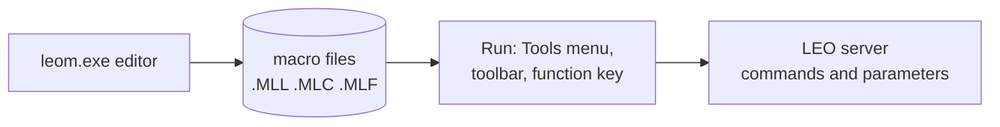
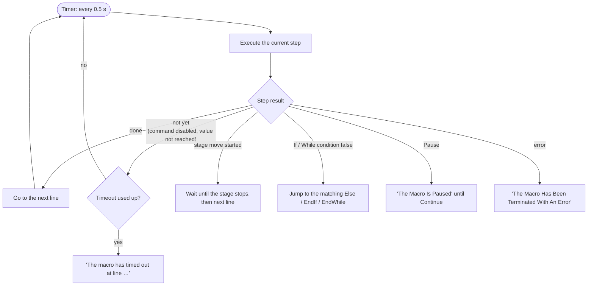

[Home](../../README.md) › [Programs](README.md) › Macros

# Macros (leom.exe)

> **In short:** a macro is a recorded list of server commands, parameter settings, messages and pauses. `leom.exe`
> edits and runs them; the SEM interface starts them from menus, toolbar buttons and function keys. Macros are stored
> in libraries (`.MLL`), collections (`.MLC`) or single files (`.MLF`); the format is decoded below.

## How a macro runs
leom runs **one step every half second**. Each step asks the server for what it needs and answers "done", "not yet"
or "error"; a step that is "not yet" is tried again at the next tick until its **timeout** (setting
`[Settings] Timeout`, default **10 s**).

| Step | What it does when run |
|---|---|
| Command | asks whether the command is enabled (`PM_IS_ENABLED`); if yes posts `PM_EXECUTE_COMMAND`, else retries until the timeout |
| Digital / Analogue value | sets the value (`PM_SET_VALUE`); retried until accepted; a stage target (`AP_STAGE_GOTO_*`, `AP_STAGE_DELTA_*`) then waits for the move |
| XY value | sets both values of an X/Y pair (`PM_SET_XY_VALUES`), e.g. beam shift or a stage X/Y target |
| If … Else … EndIf, While … EndWhile | reads a parameter (`PM_GET_VALUE`) and compares it with the stored value, "equal" or "not equal" |
| Wait for | waits until a parameter has the given value; at the timeout either continues or stops the macro, depending on the step's option |
| Delay | waits the given number of seconds |
| Confirm | reads the current value as text and asks the operator to confirm it |
| Message | shows a message box; the answer is stored in a flag parameter (`DP_FLAG0` …) that later If steps can test |
| Call | runs another macro and continues when it ends |
| Execute program | starts a Windows program (`CreateProcess`) |
| Mouse, Knob, Trackerball | assigns parameters to mouse adjustment, hard-panel knobs, trackerball buttons |
| Panel, Special | opens a control panel or runs a special user-interface function |
| LUT, Stage | sets up a look-up table / works with the stage points list and map mode |
| Pause, Halt | pauses until Continue / stops the macro |

---

## Technical reference

*Full detail for maintenance and further reverse engineering: function names, addresses, parameters, sources. Inferred points are marked \*?\*.*

`LEO-32\leom.exe` (MFC) is the macro editor and runner ("LEOM"). The SEM UI runs macros from the Tools menu, from
toolbar buttons and function keys (`PM_EXECUTE_LIBRARY_MACRO`, `PM_EXECUTE_FILE_MACRO`, `PM_MACRO_STATUS`…).
Menus/dialogs: [`../ui/leom-resources.txt`](../ui/leom-resources.txt); handlers: [`../ui/leom-msgmaps.csv`](../ui/leom-msgmaps.csv);
LEO's help: `docs/help/LEOM`.

### Editor
- **File:** New / Edit / Delete Macro, Clear Editor, Save (As) Macro To Library, Load Macro File, Save (As) Macro To File,
  Save As Macro to Common File, Macro Locations, Rename, Print.
- **Insert:** Command, Call Macro, Display Message, Special UIF Function, Mouse, Knob, End A Macro, Pause, Delay,
  Comment, Execute Program, and four "conditions" snapshots: Configuration, Gun, Setup, Application Conditions
  (they insert the current values of a group of parameters).
- **Library:** Load User Library, Merge Libraries, Load / Merge Standard Library, Save Library As.
- **Debug:** Run (F5), Step (F10), Continue (F7), Stop (Esc), Stop All Macros. **Generator:** Save System Conditions.

### Files
| Extension | Content | Example on a LEO 430 install |
|---|---|---|
| `.MLL` | macro library (many macros) | `DISTRIB\default.MLL` (25 macros); each user's `current.mll` |
| `.MLC` | macro "collection": usually one long conditions macro | `DISTRIB\Standard.MLC` ("Leo 420/430 standard macro"); each user's `RESTORE0.MLC` (state saved for File → Restore) |
| `.MLF` | single macro file | `DISTRIB\mouse stigmation.MLF` |

**Format** (all three; MFC `CArchive`): CString `"FORMAT"`, UInt32 format version (1), UInt32 number of strings that
follow minus one, then CStrings (one length byte, `0xFF` + UInt16 for longer ones, ANSI text). A macro starts with
`MACRONAME<name>` and `Version n`; each step is a keyword string followed by its argument string, except `CMMEndIf`,
`CMMElse`, `CMMEndWhile`, `CMMHalt`, `CMMPause`, which take none. Arguments use `%` between fields.

| Keyword | Argument | Meaning |
|---|---|---|
| `CMMComment` | text | comment |
| `CMMCommand` | `CMD_…` | run a server command |
| `CMMDigital` | `DP_…%value` | set a digital parameter (state); value can be a name, e.g. `DP_DETECTOR_CHANNEL%SE1` |
| `CMMAnalogue` | `AP_…%value` | set an analogue parameter, e.g. `AP_GAIN%1.000000e+002` |
| `CMMCXY` | `…%x%y` | set an X/Y parameter pair (`PM_SET_XY_VALUES`) |
| `CMMConfirm` | `DP_…%value` | show the current value as text and ask the operator to confirm |
| `CMMIfThen` … `CMMElse` … `CMMEndIf` | `DP_…%value%flag` | conditional block; flag 1 = "not equal", otherwise "equal" |
| `CMMWhile` … `CMMEndWhile` | `parameter%value%flag` | loop while the parameter equals (or, flag 1, differs from) the value |
| `CMMMessage` | `%#DP_FLAGn<text>` | show a message; the answer goes into a flag parameter (`DP_FLAG0`…) |
| `CMMMouse` | `AP_… AP_…` | assign parameters to mouse adjustment |
| `CMMKnob`, `CMMTracker` | parameters | assign knobs / trackerball axes |
| `CMMPanel` | panel | open a control panel |
| `CMMSpecial` | function | special UIF function |
| `CMMLut` | … | LUT set-up (`PM_LUT_QLIN`, `CMD_LUT_TRANSPARENT`, `DP_LUT_MODE`) (not used in LEO's shipped macros) |
| `CMMStage` | … | stage points list / map mode (`PM_STAGE_POINT_GET_MODE`, `PM_STAGE_SET_MAP_MODE`, `PM_STAGE_LABEL`) (not used in LEO's shipped macros) |
| `CMMCall` | macro name | call another macro |
| `CMMDelay` | seconds | wait |
| `CMMWaitForTimeout` | `parameter%value%…` | wait until the parameter has the value, or the timeout |
| `CMMPause` | — | pause until Continue |
| `CMMExec` | program | start a program (`CreateProcess`) |
| `CMMHalt`, `CMMHaltNew` | — | stop |

### Runner (code)
- Each step type is a class (`CMMCommand`, `CMMIfThen` …, all derived from `CMacroItem`, 48 virtual methods);
  class list with method addresses: [`../ui/leom-classes.csv`](../ui/leom-classes.csv). Slots: 35 save to file,
  36 load from file, 37 reset the timeout counter (`Timeout × 2` ticks), **38 execute**, 39–40 listing text,
  41 edit dialog, 42 block matching (only If / Else / EndIf / While / EndWhile override it).
- Timer 10 every 500 ms (`FUN_0043dd80`); the tick routine `FUN_0041f283` interprets each step's result.
- Step results and the status line they produce (texts from leom's string table):

| Result | Status text |
|---|---|
| 1 / 0x20 | "No Error Reported" / "Step Completed Without Error" |
| 0 | retry at the next tick |
| 0x14 | "The macro has timed out at line" |
| 0x15 | "Waiting for state change or timeout" |
| 0x16 / 0x17 / 0x18 | "Finding The End / Start Of The While Statement", "Finding The Next Else Or Endif Statement" |
| 0x19, 0x1A | "Macro Stopped By User" |
| 0x1B | "Performing Call/s To Additional Macros" |
| 0x1C, 0x1D | "Macro Finished Executing" |
| 0x1E | "The Macro Has Been Terminated With An Error" |
| 0x1F | "The Macro Is Paused" |
| 0x21 | wait for the stage move to finish |
| 0x22 | command / value not accepted before the timeout |

- Server calls go through a comms object (`DAT_0052C70C`) whose helpers each send one registered message, e.g.
  `FUN_004adfac` `PM_IS_ENABLED`, `FUN_004ae384` `PM_EXECUTE_COMMAND`, `FUN_004adbd8` `PM_SET_VALUE`,
  `FUN_004ace4d` `PM_GET_VALUE`, `FUN_004ada63` `PM_SET_XY_VALUES` (WM_COPYDATA). Annotated code:
  `tools/c-annotate-dyn.ps1 -Name leom.exe -Function FUN_xxxxxxxx`.

Readable listings of the factory macros (made with `tools/read-macros.ps1`):
[`../data/macros/`](../data/macros) (`default.MLL`, `Standard.MLC`, `mouse stigmation.MLF`, and the default user's
`current.mll` / `RESTORE0.MLC`). The library holds: Ext off / Ext On (external scan control), Freeze At End / Now,
Photo, F7, Change detector, Frame Avg / Frame Int / Line Integrate toggles, Scan Faster / Slower, Split toggle,
CP750 Print, Annotate and Measure, Save Image to File, Sample Change Toggle, KV / I Probe, Filament Adjust, VP Control,
Mag/Focus, Reduced toggle, Live, Pump, VENT.

---
[← Programs](README.md) · [Home](../../README.md)
