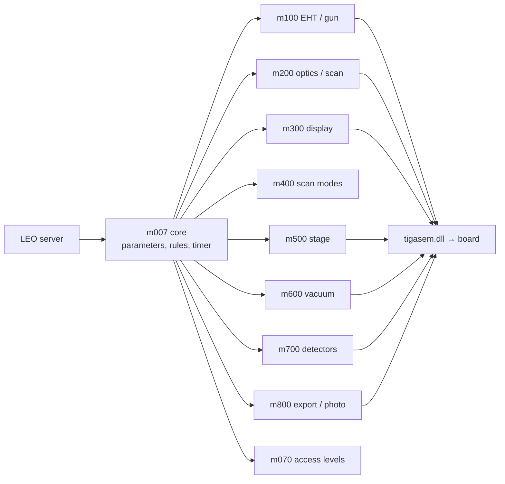

[Home](../../../README.md) › [Programs](../README.md) › Controller modules

# Controller modules (m007 … m800)

> **In short:** the LEO server hands every hardware job to a **16-bit controller module**, one per subsystem. They all
> share the same skeleton: initialise, restore configuration, a timer tick that polls status, and one function per
> parameter (`SET…` for values, `SWITCH…` for states, `DOCOMMAND…` for commands). For how each subsystem works, read
> its page in [How the microscope works](../../subsystems/README.md); the links below go to the raw per-module data.

| Module | Explained in | Module note | Every export (API table) | Function digest | Annotated listing |
|---|---|---|---|---|---|
| m007 core | [Rules and licences](../../subsystems/core-rules-accessories.md) | [m007.md](m007.md) | [api](../../modules-api/m007-seg2.md) | [digest](../../modules-digest/m007-seg2.md) | [asm](../../modules-asm/m007-seg2.asm) |
| m070 access | [Rules and licences](../../subsystems/core-rules-accessories.md) | [m070.md](m070.md) | [api](../../modules-api/m070.md) | [digest](../../modules-digest/m070.md) | [asm](../../modules-asm/m070.asm) |
| m100 EHT | [High voltage and gun](../../subsystems/eht-gun.md) | [m100.md](m100.md) | [api](../../modules-api/m100.md) | [digest](../../modules-digest/m100.md) | [asm](../../modules-asm/m100.asm) |
| m200 optics | [Scanning and optics](../../subsystems/scanning-eo.md) | [m200.md](m200.md) | [api](../../modules-api/m200.md) | [digest](../../modules-digest/m200.md) | [asm](../../modules-asm/m200.asm) |
| m300 display | [Display and export](../../subsystems/display-modes-export.md) | [m300.md](m300.md) | [api](../../modules-api/m300.md) | [digest](../../modules-digest/m300.md) | [asm](../../modules-asm/m300.asm) |
| m400 modes | [Display and export](../../subsystems/display-modes-export.md) | [m400.md](m400.md) | [api](../../modules-api/m400.md) | [digest](../../modules-digest/m400.md) | [asm](../../modules-asm/m400.asm) |
| m500 stage | [Stage](../../subsystems/stage.md) | [m500.md](m500.md) | [api](../../modules-api/m500.md) | [digest](../../modules-digest/m500.md) | [asm](../../modules-asm/m500.asm) |
| m600 vacuum | [Vacuum](../../subsystems/vacuum.md) | [m600.md](m600.md) | [api](../../modules-api/m600.md) | [digest](../../modules-digest/m600.md) | [asm](../../modules-asm/m600.asm) |
| m700 detectors | [Detectors](../../subsystems/detectors-acquire.md) | [m700.md](m700.md) | [api](../../modules-api/m700.md) | [digest](../../modules-digest/m700.md) | [asm](../../modules-asm/m700.asm) |
| m800 export | [Display and export](../../subsystems/display-modes-export.md) | [m800.md](m800.md) | [api](../../modules-api/m800-seg2.md) | [digest](../../modules-digest/m800-seg2.md) | [asm](../../modules-asm/m800-seg2.asm) |

---

## Technical reference

*Full detail for maintenance and further reverse engineering: function names, addresses, parameters, sources. Inferred points are marked \*?\*.*

One page per module is generated from the binaries by `tools/gen-module-notes.ps1`: exports, parameters written/read
(resolved from the decompiled call arguments, see [`../../parameter-usage.csv`](../../parameter-usage.csv)), hardware calls and
text found in the binary. This page adds the interpretation.

How the parameter usage was resolved: the modules call `M007_PUTVALUE/GETVALUE/PUTSTATE/GETSTATE/PUTLOW/PUTHIGH/PUTXY`
with the parameter's index in its AP or DP block as the first pushed argument (Win16 far PASCAL). `tools/ghidra/ExportCallArgs.java`
recovers those pushes from the disassembly ([`../../callargs/`](../../callargs)). 3419 of 4428 calls use a constant ID
(642 distinct parameters, after following `MOV reg, imm` → `PUSH reg`); the rest use IDs computed at run time (tables, loops).

| Module | Version / banner | Pages |
|---|---|---|
| m007 | "Master DLL - V03.00 20-Feb-96" | [m007.md](m007.md) |
| m070 | "Access Controller DLL - V01.00 9-Aug-94" | [m070.md](m070.md) |
| m100 | — | [m100.md](m100.md) |
| m200 | — | [m200.md](m200.md) |
| m300 | — | [m300.md](m300.md) |
| m400 | — | [m400.md](m400.md) |
| m500 | — | [m500.md](m500.md) |
| m600 | — | [m600.md](m600.md) |
| m700 | — | [m700.md](m700.md) |
| m800 | — | [m800.md](m800.md) |

### m007 — core parameter server
Holds the parameter database every other module reads and writes (`M007_*`), dispatches `SETVALUE`/`SETSTATE`/`EXECUTECOMMAND`
to the owning module, and runs the master tick (`S300_TICK`). Imports all of m100–m800. Also:
- DDE bridges to `LEO_DDE.DLL` and `ISIS_DDE.DLL` (Oxford Instruments ISIS EDX integration); "Set digital via DDE not implemented in this version".
- Can launch an external control pad: `C:\applics\leo_pad.exe com<n>` (not part of a standard installation).
- Reads `C:\LEO\config.LEO` and `C:\LEO\L500.ini`.

### m070 — access controller (LEOACC)
Visibility of every value/state/command and panel per user level (`LOADVISTABLES`, `SETVALUEVIS`, `ISAVISIBLE`…), read from
`C:\LEO\access.leo`; user accounting messages ("LEO Accounting Monitor"); menu enabling; image-directory policy. Also exports
the key-check functions used for service access (inventory note only).

### m100 — EHT / gun
Sets limits and defaults for the gun parameters at start (`INITIALISE_EHT_CONTROLLER_DATA`): filament age, user max EHT,
extractor/suppressor/liner-tube voltages and currents (field-emission columns), nominal beam current, SE supplies.
Commands: run-up, beam on/off, EHT off, standby, manual, shutdown; filament type switching and new-filament procedure.
Hardware: TIGASEM EHT block (900–932: ramps, filament current, acceleration voltage, collector bias, PM voltage, scintillator).
Firmware: `G100.440` (queues commands to the EHT supply; "Failed to send command, Putqueue status", "Readback OFF").

### m200 — electron optics
Largest module (301 exports, 155 parameters written). Magnification and mag tracking/compensation, working distance and focus,
C1/C2/C3 lens calibration and hysteresis removal, stigmators (incl. wobble, dynamic stig), scan rotation/orthogonality/offset,
tilt correction, beam shift, gun shift/tilt/alignment, apertures and probe current, stereo, dual-mag, microshift, emission imaging,
conjugate focus, beam blanking, and all autofunctions (coarse/fine autofocus, autostig, auto beam alignment, feature scan).
Hardware: TIGASEM EO block (2000–2141) + DSP block (6000–6019). Firmware: `G200.42x/44x` ("EO board version"), `G900.RLM` (feature scan).
The EO calibration values it uses are the EO section of `DATA.VAC`.

### m300 — display
Display store selection, profiles/histograms, overlay objects (create/move/hide/kill, ghosts), image enlarge/reduce,
output LUTs. Hardware: TIGASEM display block (500–572).

### m400 — scan mode
Normal / split / quad / small / reduced raster / emission, spot and line scan, zoom, stereo. No direct hardware calls:
it drives m200/m300/m700 through shared parameters.

### m500 — stage
Stage types (Cartesian 95 on a typical LEO 430), init (manual/auto), go-to/vector moves, backlash per axis, speeds,
field scanning, protected Z and safe Z, rotation limit switch, joystick emulation, user limits, stage registration.
Reports "Stage HW version" / "Stage FW version". Uses `HCSTG.VBX` only for the **hot/cold stage** option
(an option; the file is not part of a standard installation). Hardware: TIGASEM stage block (700–735). Firmware: `G500.RLM`.

### m600 — vacuum
Pump/vent/abort, airlock, viewing window, column pumping and isolation, EDX/WDX window and gate valves, vacuum limits.
Talks to a combined stage/vacuum controller with two CPUs ("STGVAC Comms cpu", "STGVAC Vac cpu"). Also:
- Variable-pressure sequencing with the **HPAPP** program (COM2, see `LEO.INI [HPAPP]`) and an **Orsay** VP board:
  LP (high-vacuum) states B–H, HP/VP states I–W, A1–A2, error states X/Y/Z, safe "LP only" fallback on HPAPP errors.
- Vac status values: VENTING · READY · PUMPING · WAITING TURBO · WAITING PENNING · WAITING EHT · ERROR.
- Writes `C:\LEO\DATA.VAC` ("Failed to write DATA.VAC") and handles the machine serial number / licence data held on the key
  (messages "LEO Serial Number and Licence Dongle", inventory note only).
Hardware: TIGASEM vacuum block (300–331). Firmware: `G600.440` (vacext).

### m700 — acquisition
Detector configuration and mixing (4-quadrant BSD, SCM), video levels, auto brightness/contrast (ABC), noise reduction
(line/frame averaging and integration), LUTs, windows/zones, freeze, X-ray control, spot data.
Hardware: TIGASEM acquire (4000–4033) + video (10000–10022) blocks. Firmware: `G700.RLM`, `G1000.RLM`.

### m800 — image export
TIFF save/load (`SAVEGREY`, `SAVECOLOUR`, `LOADIMAGE`, `GETTIFFHEADER`), clipboard, HRRU photo and cine (film speed,
camera type, brightness/contrast, line repeat), using `C:\LEO\hrru.spd`, `gamma2.dat` and the `loc/loi` LUTs.
Hardware: TIGASEM image-export block (8000–8018).

---
[← Programs](../README.md) · [Home](../../../README.md)
