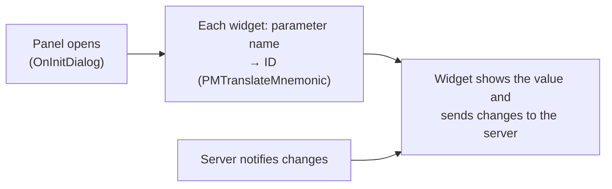

[Home](../../README.md) › [Programs](README.md) › What is on each panel

# What is on each panel

> **In short:** every tab and dialog of the SEM user interface is a class inside one of LEO's controls. Each one
> binds its sliders, buttons and read-outs to server parameters by name when it opens. This page lists, for every
> tab and dialog, the parameters it shows and drives, so you can see what a panel controls without the microscope.
> Generated by `tools/panels-page.ps1` from the decompiled code; raw lists in
> [`../ui/*-panels.csv`](../ui).

## Parameter tabs (tabmgr.ocx)

Classes named `CTabMgr400…` are the LEO 400-series layouts (LEO 430); `CTabMgr…` without 400 are the 1400 / 1500-series layouts *?*; `C1400Vacuum` is the 1400 vacuum tab.

| Class / dialog | Parameters |
|---|---|
| `C1400Vacuum` | System Vacuum (`AP_SYSTEM_VAC`), Pump (`CMD_PUMP`), Vent (`CMD_VENT`), Vent inh. (`DP_VENT_INVALID_REASON`), Vac Status (`DP_VACSTATUS`), EHT Vac ready (`DP_EHT_VAC_READY`), Gun Chamber valve (`DP_GUN_CHAMBER_VALVE`), Gun Vacuum (`AP_COLUMN_VAC`), Column pumping (`DP_COLUMN_PUMPING`), Column Pump (`DP_COLUMN_PUMP`), Column Chamber valve (`DP_COLUMN_CHAMBER_VALVE`), Column Isolation (`DP_COLUMN_ISOLATION`), Start Column Pump (`CMD_START_COLUMN_PUMP`), Stop Column Pump (`CMD_STOP_COLUMN_PUMP`), Partial Vent on Standby (`DP_PARTIAL_VENT`), Sem (`DP_SEM`) |
| `CTabMgr400Apertures` | Aperture No. (`DP_APERTURE`), Focus Wobble (`DP_WOBBLE`), Wobble Fast (`DP_WOBBLE_SPEED`), Wobble Amplitude (`AP_C3WOBBLEAMP`), Aperture Size (`AP_APERTURESIZE`), Conjugate posn. (`AP_CONJUGATE`), Fil I Target (`AP_MANUALCURRENT`), Coarse Align (`CMD_AUTO_ALIGN_COARSE`), Mag (`AP_MAG`), WD (`AP_WD`), Stigmation X (`AP_STIG_X`), Optibeam (`DP_OPTIBEAM`), Optibeam Res Mode (`DP_OPTIRESMODE`), Optibeam Mode (`DP_OPTIMODE`), Fixed Aperture (`DP_FIXED_APERTURE`), Best Aperture (`DP_BEST_APERTURE`), Beam Blanked (`DP_BEAM_BLANKED`), Gun Shift X (`AP_GUNSHIFT_X`), Gun Tilt X (`AP_GUNTILT_X`), Optibeam conjugate (`DP_CONJUGATE`), Emission (`CMD_MODE_EMISSION`), Normal (`CMD_MODE_NORMAL`), Operating Mode (`DP_OPERATING_MODE`), Sem (`DP_SEM`), Column (`DP_COLUMN_TYPE`), System Vacuum (`AP_SYSTEM_VAC`), Pump (`CMD_PUMP`), Vent (`CMD_VENT`), Vent inh. (`DP_VENT_INVALID_REASON`), Vac Status (`DP_VACSTATUS`), EHT Vac ready (`DP_EHT_VAC_READY`), VP Status (`DP_HP_STATUS`), Chamber (`AP_CHAMBER_PRESSURE`), VP Target (`AP_HP_TARGET`), Go To HV (`CMD_GOTO_HV`), Go To VP (`CMD_GOTO_VP`), Partial Vent on Standby (`DP_PARTIAL_VENT`) |
| `CTabMgr400Detectors` | Signal A (`DP_DETECTOR_CHANNEL`), Signal B (`DP_IMPLIED_DETECTOR`), Collector Bias (`AP_COLLECTOR_BIAS`), Mixing (`DP_MIXING`), Signal (`AP_K1`), Differentiate (`AP_DIFF`), Brightness (`AP_BRIGHTNESS`), Contrast (`AP_CONTRAST`), Gamma (`AP_GAMMA`), LUT Transparent (`CMD_LUT_TRANSPARENT`), LUT Gamma (`CMD_LUT_GAMMA`), LUT Inverse (`CMD_LUT_INVERT`), Input LUT Mode (`DP_INPUT_LUT_MODE`) |
| `CTabMgr400Gun` | EHT (`AP_ACTUALKV`), Fil I (`AP_ACTUALCURRENT`), Beam State (`DP_RUNUPSTATE`), New Filament (`DP_NEWFILAMENT`), Beam Current (`AP_BEAM_CURRENT`), I Probe (`AP_IPROBE`), Fil I Target (`AP_MANUALCURRENT`), EHT Target (`AP_MANUALKV`), User Max EHT (`AP_USER_MAX_EHT`), Fil I (Usermax) (`AP_USERMAXCURRENT`), Anode Spacer (`DP_ANODE`), EHT Off @ Log Off (`DP_EHT_LOGOFF`), Filament Type (`DP_FILAMENT_TYPE`), Column (`DP_COLUMN_TYPE`), Spot Size (`AP_SPOTSIZE`), Line Scan (`DP_LINE_SCAN`), Spot (`DP_SPOT`), Operating Mode (`DP_OPERATING_MODE`), Scan + (`CMD_SCANRATEUP`), Scan - (`CMD_SCANRATEDOWN`), Xray Linescan (`DP_XRAY_LINESCAN`), Scan Speed (`DP_SCANRATE`), Noise Reduction (`DP_NOISE_REDUCTION`), Frames to average (`AP_FRAME_AVERAGE_COUNT`), Cycle Time (`AP_FRAME_TIME`), Image (`DP_FROZEN`), Freeze on (`DP_FREEZE_ON`), N (`AP_NR_COEFF`), Zoom (`DP_ZOOM`), Zoom factor (`AP_ZOOM_FACTOR`), Aperture No. (`DP_APERTURE`), Focus Wobble (`DP_WOBBLE`), Wobble Fast (`DP_WOBBLE_SPEED`), Wobble Amplitude (`AP_C3WOBBLEAMP`), Aperture Size (`AP_APERTURESIZE`), Conjugate posn. (`AP_CONJUGATE`), Coarse Align (`CMD_AUTO_ALIGN_COARSE`), Mag (`AP_MAG`), WD (`AP_WD`), Stigmation X (`AP_STIG_X`), Optibeam (`DP_OPTIBEAM`), Optibeam Res Mode (`DP_OPTIRESMODE`), Optibeam Mode (`DP_OPTIMODE`), Fixed Aperture (`DP_FIXED_APERTURE`), Best Aperture (`DP_BEST_APERTURE`), Beam Blanked (`DP_BEAM_BLANKED`), Gun Shift X (`AP_GUNSHIFT_X`), Gun Tilt X (`AP_GUNTILT_X`), Optibeam conjugate (`DP_CONJUGATE`), Emission (`CMD_MODE_EMISSION`), Normal (`CMD_MODE_NORMAL`), Sem (`DP_SEM`) |
| `CTabMgr400Scanning` | Line Scan (`DP_LINE_SCAN`), Spot (`DP_SPOT`), Operating Mode (`DP_OPERATING_MODE`), Scan + (`CMD_SCANRATEUP`), Scan - (`CMD_SCANRATEDOWN`), Xray Linescan (`DP_XRAY_LINESCAN`), Scan Speed (`DP_SCANRATE`), Noise Reduction (`DP_NOISE_REDUCTION`), Frames to average (`AP_FRAME_AVERAGE_COUNT`), Cycle Time (`AP_FRAME_TIME`), Image (`DP_FROZEN`), Freeze on (`DP_FREEZE_ON`), N (`AP_NR_COEFF`), Zoom (`DP_ZOOM`), Zoom factor (`AP_ZOOM_FACTOR`), Aperture No. (`DP_APERTURE`), Focus Wobble (`DP_WOBBLE`), Wobble Fast (`DP_WOBBLE_SPEED`), Wobble Amplitude (`AP_C3WOBBLEAMP`), Aperture Size (`AP_APERTURESIZE`), Conjugate posn. (`AP_CONJUGATE`), Fil I Target (`AP_MANUALCURRENT`), Coarse Align (`CMD_AUTO_ALIGN_COARSE`), Mag (`AP_MAG`), WD (`AP_WD`), Stigmation X (`AP_STIG_X`), Optibeam (`DP_OPTIBEAM`), Optibeam Res Mode (`DP_OPTIRESMODE`), Optibeam Mode (`DP_OPTIMODE`), Fixed Aperture (`DP_FIXED_APERTURE`), Best Aperture (`DP_BEST_APERTURE`), Beam Blanked (`DP_BEAM_BLANKED`), Gun Shift X (`AP_GUNSHIFT_X`), Gun Tilt X (`AP_GUNTILT_X`), Optibeam conjugate (`DP_CONJUGATE`), Emission (`CMD_MODE_EMISSION`), Normal (`CMD_MODE_NORMAL`), Sem (`DP_SEM`), Column (`DP_COLUMN_TYPE`), System Vacuum (`AP_SYSTEM_VAC`), Pump (`CMD_PUMP`), Vent (`CMD_VENT`), Vent inh. (`DP_VENT_INVALID_REASON`), Vac Status (`DP_VACSTATUS`), EHT Vac ready (`DP_EHT_VAC_READY`), VP Status (`DP_HP_STATUS`), Chamber (`AP_CHAMBER_PRESSURE`), VP Target (`AP_HP_TARGET`), Go To HV (`CMD_GOTO_HV`), Go To VP (`CMD_GOTO_VP`), Partial Vent on Standby (`DP_PARTIAL_VENT`) |
| `CTabMgr400Signal` | Auto Video Enable (`DP_AUTO_VIDEO_ENABLE`), Brightness (`AP_BRIGHTNESS`), Auto Video Mean (`AP_AUTO_BRIGHT`), Contrast (`AP_CONTRAST`), Auto Video peak (`AP_AUTO_CONTRAST`), Auto BC (`DP_AUTO_VIDEO`) |
| `CTabMgr400Vacuum` | System Vacuum (`AP_SYSTEM_VAC`), Pump (`CMD_PUMP`), Vent (`CMD_VENT`), Vent inh. (`DP_VENT_INVALID_REASON`), Vac Status (`DP_VACSTATUS`), EHT Vac ready (`DP_EHT_VAC_READY`), VP Status (`DP_HP_STATUS`), Chamber (`AP_CHAMBER_PRESSURE`), VP Target (`AP_HP_TARGET`), Go To HV (`CMD_GOTO_HV`), Go To VP (`CMD_GOTO_VP`), Partial Vent on Standby (`DP_PARTIAL_VENT`), Sem (`DP_SEM`) |
| `CTabMgrApertures` | Aperture No. (`DP_APERTURE`), Focus Wobble (`DP_WOBBLE`), Wobble Fast (`DP_WOBBLE_SPEED`), Wobble Amplitude (`AP_C3WOBBLEAMP`), Aperture Size (`AP_APERTURESIZE`), Gun Align X (`AP_GUNALIGN_X`), Beam Shift X (`AP_BEAMSHIFT_X`), Aperture Align X (`AP_APERTURE_ALIGN_X`), Mag (`AP_MAG`), WD (`AP_WD`), Stigmation X (`AP_STIG_X`), Emission (`CMD_MODE_EMISSION`), Normal (`CMD_MODE_NORMAL`), Operating Mode (`DP_OPERATING_MODE`), Beam Blanked (`DP_BEAM_BLANKED`), Stage at X (`AP_STAGE_AT_X`), Stage at Y (`AP_STAGE_AT_Y`), Stage at Z (`AP_STAGE_AT_Z`), Stage at T (`AP_STAGE_AT_T`), Stage at R (`AP_STAGE_AT_R`), Stage at M (`AP_STAGE_AT_M`), Stage goto X (`AP_STAGE_GOTO_X`), Stage goto Y (`AP_STAGE_GOTO_Y`), Stage goto Z (`AP_STAGE_GOTO_Z`), Stage goto T (`AP_STAGE_GOTO_T`), Stage goto R (`AP_STAGE_GOTO_R`), Stage goto M (`AP_STAGE_GOTO_M`), Safe Z (`AP_SAFE_Z`), Z move on Vent (`DP_Z_ON_VENT`), Track Z (`DP_TRACK_Z`), Stage Is (`DP_STAGE_IS`), Undo Stage Goto (`CMD_UNDO_STAGE_GOTO`), Compuc. Mode (`DP_COMPUCENTRIC_MODE`), X Limit hit (`DP_X_LIMIT_HIT`), Y Limit hit (`DP_Y_LIMIT_HIT`), Z Limit hit (`DP_Z_LIMIT_HIT`), T Limit hit (`DP_T_LIMIT_HIT`), M Limit hit (`DP_M_LIMIT_HIT`), Stage init. (`CMD_STAGE_INIT`), Do Stage Backlash (`CMD_STAGE_BACKLASH`), Stage Backlash (`DP_STAGE_BACKLASH`), Centre Point (`DP_POINT_USING`), Stage stop (`CMD_STAGE_ABORT`), Stage Delta X (`AP_STAGE_DELTA_X`), Stage Delta Y (`AP_STAGE_DELTA_Y`), Stage Delta Z (`AP_STAGE_DELTA_Z`), Stage Delta T (`AP_STAGE_DELTA_T`), Stage Delta R (`AP_STAGE_DELTA_R`), Stage Delta M (`AP_STAGE_DELTA_M`), Joystick Disable (`DP_JOYSTICK_DISABLE`), Protected Z (`DP_PROTECTED_Z`), Sem (`DP_SEM`) |
| `CTabMgrDetectors` | Signal A (`DP_DETECTOR_CHANNEL`), Signal B (`DP_IMPLIED_DETECTOR`), Collector Bias (`AP_COLLECTOR_BIAS`), Mixing (`DP_MIXING`), Signal (`AP_K1`), Auto BC (`DP_AUTO_VIDEO`), Brightness (`AP_BRIGHTNESS`), Contrast (`AP_CONTRAST`), Gamma (`AP_GAMMA`), LUT Transparent (`CMD_LUT_TRANSPARENT`), LUT Gamma (`CMD_LUT_GAMMA`), LUT Inverse (`CMD_LUT_INVERT`), Input LUT Mode (`DP_INPUT_LUT_MODE`), Detector (`DP_DETECTOR_TYPE`), CCD Illumination (`AP_CCD_ILLUMINATION`), Line Scan (`DP_LINE_SCAN`), Spot (`DP_SPOT`), Operating Mode (`DP_OPERATING_MODE`), Scan + (`CMD_SCANRATEUP`), Scan - (`CMD_SCANRATEDOWN`), Xray Linescan (`DP_XRAY_LINESCAN`), Scan Speed (`DP_SCANRATE`), Noise Reduction (`DP_NOISE_REDUCTION`), N (`AP_NR_COEFF`), Store resolution (`DP_IMAGE_STORE`), Cycle Time (`AP_FRAME_TIME`), Image (`DP_FROZEN`), Freeze on (`DP_FREEZE_ON`), Dwell Time (`DP_DWELL_TIME`), Zoom (`DP_ZOOM`), Zoom factor (`AP_ZOOM_FACTOR`), Frame Grabber (`DP_FRAME_GRABBER`), Frames to average (`AP_FRAME_AVERAGE_COUNT`), Line Avg.Count (`AP_LINE_AVERAGE_COUNT`), System Vacuum (`AP_SYSTEM_VAC`), Pump (`CMD_PUMP`), Vent (`CMD_VENT`), Vent inh. (`DP_VENT_INVALID_REASON`), Vac Status (`DP_VACSTATUS`), Column Chamber valve (`DP_COLUMN_CHAMBER_VALVE`), EHT Vac ready (`DP_EHT_VAC_READY`), Column pumping (`DP_COLUMN_PUMPING`), Gun Vacuum (`AP_COLUMN_VAC`), Partial Vent on Standby (`DP_PARTIAL_VENT`) |
| `CTabMgrGun` | Beam State (`DP_RUNUPSTATE`), EHT (`AP_ACTUALKV`), Extractor V (`AP_ACTUALEXT`), EHT Target (`AP_MANUALKV`), Extractor V Target (`AP_MANUALEXT`), Extractor I (`AP_EXTCURRENT`), Leave Gun On at Shutdown (`DP_LEAVE_BEAM_ON`), Fil I (`AP_ACTUALCURRENT`), Fil I Target (`AP_MANUALCURRENT`), User Max EHT (`AP_USER_MAX_EHT`), EHT Off @ Log Off (`DP_EHT_LOGOFF`), Aperture No. (`DP_APERTURE`), Focus Wobble (`DP_WOBBLE`), Wobble Fast (`DP_WOBBLE_SPEED`), Wobble Amplitude (`AP_C3WOBBLEAMP`), Aperture Size (`AP_APERTURESIZE`), Gun Align X (`AP_GUNALIGN_X`), Beam Shift X (`AP_BEAMSHIFT_X`), Aperture Align X (`AP_APERTURE_ALIGN_X`), Mag (`AP_MAG`), WD (`AP_WD`), Stigmation X (`AP_STIG_X`), Emission (`CMD_MODE_EMISSION`), Normal (`CMD_MODE_NORMAL`), Operating Mode (`DP_OPERATING_MODE`), Beam Blanked (`DP_BEAM_BLANKED`), Stage at X (`AP_STAGE_AT_X`), Stage at Y (`AP_STAGE_AT_Y`), Stage at Z (`AP_STAGE_AT_Z`), Stage at T (`AP_STAGE_AT_T`), Stage at R (`AP_STAGE_AT_R`), Stage at M (`AP_STAGE_AT_M`), Stage goto X (`AP_STAGE_GOTO_X`), Stage goto Y (`AP_STAGE_GOTO_Y`), Stage goto Z (`AP_STAGE_GOTO_Z`), Stage goto T (`AP_STAGE_GOTO_T`), Stage goto R (`AP_STAGE_GOTO_R`), Stage goto M (`AP_STAGE_GOTO_M`), Safe Z (`AP_SAFE_Z`), Z move on Vent (`DP_Z_ON_VENT`), Track Z (`DP_TRACK_Z`), Stage Is (`DP_STAGE_IS`), Undo Stage Goto (`CMD_UNDO_STAGE_GOTO`), Compuc. Mode (`DP_COMPUCENTRIC_MODE`), X Limit hit (`DP_X_LIMIT_HIT`), Y Limit hit (`DP_Y_LIMIT_HIT`), Z Limit hit (`DP_Z_LIMIT_HIT`), T Limit hit (`DP_T_LIMIT_HIT`), M Limit hit (`DP_M_LIMIT_HIT`), Stage init. (`CMD_STAGE_INIT`), Do Stage Backlash (`CMD_STAGE_BACKLASH`), Stage Backlash (`DP_STAGE_BACKLASH`), Centre Point (`DP_POINT_USING`), Stage stop (`CMD_STAGE_ABORT`), Stage Delta X (`AP_STAGE_DELTA_X`), Stage Delta Y (`AP_STAGE_DELTA_Y`), Stage Delta Z (`AP_STAGE_DELTA_Z`), Stage Delta T (`AP_STAGE_DELTA_T`), Stage Delta R (`AP_STAGE_DELTA_R`), Stage Delta M (`AP_STAGE_DELTA_M`), Joystick Disable (`DP_JOYSTICK_DISABLE`), Protected Z (`DP_PROTECTED_Z`), Sem (`DP_SEM`) |
| `CTabMgrScanning` | Line Scan (`DP_LINE_SCAN`), Spot (`DP_SPOT`), Operating Mode (`DP_OPERATING_MODE`), Scan + (`CMD_SCANRATEUP`), Scan - (`CMD_SCANRATEDOWN`), Xray Linescan (`DP_XRAY_LINESCAN`), Scan Speed (`DP_SCANRATE`), Noise Reduction (`DP_NOISE_REDUCTION`), N (`AP_NR_COEFF`), Store resolution (`DP_IMAGE_STORE`), Cycle Time (`AP_FRAME_TIME`), Image (`DP_FROZEN`), Freeze on (`DP_FREEZE_ON`), Dwell Time (`DP_DWELL_TIME`), Zoom (`DP_ZOOM`), Zoom factor (`AP_ZOOM_FACTOR`), Frame Grabber (`DP_FRAME_GRABBER`), Frames to average (`AP_FRAME_AVERAGE_COUNT`), Line Avg.Count (`AP_LINE_AVERAGE_COUNT`), System Vacuum (`AP_SYSTEM_VAC`), Pump (`CMD_PUMP`), Vent (`CMD_VENT`), Vent inh. (`DP_VENT_INVALID_REASON`), Vac Status (`DP_VACSTATUS`), Column Chamber valve (`DP_COLUMN_CHAMBER_VALVE`), EHT Vac ready (`DP_EHT_VAC_READY`), Column pumping (`DP_COLUMN_PUMPING`), Gun Vacuum (`AP_COLUMN_VAC`), Partial Vent on Standby (`DP_PARTIAL_VENT`), Beam State (`DP_RUNUPSTATE`), EHT (`AP_ACTUALKV`), Extractor V (`AP_ACTUALEXT`), EHT Target (`AP_MANUALKV`), Extractor V Target (`AP_MANUALEXT`), Extractor I (`AP_EXTCURRENT`), Leave Gun On at Shutdown (`DP_LEAVE_BEAM_ON`), Fil I (`AP_ACTUALCURRENT`), Fil I Target (`AP_MANUALCURRENT`), User Max EHT (`AP_USER_MAX_EHT`), EHT Off @ Log Off (`DP_EHT_LOGOFF`) |
| `CTabMgrStage` | Stage at X (`AP_STAGE_AT_X`), Stage at Y (`AP_STAGE_AT_Y`), Stage at Z (`AP_STAGE_AT_Z`), Stage at T (`AP_STAGE_AT_T`), Stage at R (`AP_STAGE_AT_R`), Stage at M (`AP_STAGE_AT_M`), Stage goto X (`AP_STAGE_GOTO_X`), Stage goto Y (`AP_STAGE_GOTO_Y`), Stage goto Z (`AP_STAGE_GOTO_Z`), Stage goto T (`AP_STAGE_GOTO_T`), Stage goto R (`AP_STAGE_GOTO_R`), Stage goto M (`AP_STAGE_GOTO_M`), Safe Z (`AP_SAFE_Z`), Z move on Vent (`DP_Z_ON_VENT`), Track Z (`DP_TRACK_Z`), Stage Is (`DP_STAGE_IS`), Undo Stage Goto (`CMD_UNDO_STAGE_GOTO`), Compuc. Mode (`DP_COMPUCENTRIC_MODE`), X Limit hit (`DP_X_LIMIT_HIT`), Y Limit hit (`DP_Y_LIMIT_HIT`), Z Limit hit (`DP_Z_LIMIT_HIT`), T Limit hit (`DP_T_LIMIT_HIT`), M Limit hit (`DP_M_LIMIT_HIT`), Stage init. (`CMD_STAGE_INIT`), Do Stage Backlash (`CMD_STAGE_BACKLASH`), Stage Backlash (`DP_STAGE_BACKLASH`), Centre Point (`DP_POINT_USING`), Stage stop (`CMD_STAGE_ABORT`), Stage Delta X (`AP_STAGE_DELTA_X`), Stage Delta Y (`AP_STAGE_DELTA_Y`), Stage Delta Z (`AP_STAGE_DELTA_Z`), Stage Delta T (`AP_STAGE_DELTA_T`), Stage Delta R (`AP_STAGE_DELTA_R`), Stage Delta M (`AP_STAGE_DELTA_M`), Joystick Disable (`DP_JOYSTICK_DISABLE`), Protected Z (`DP_PROTECTED_Z`), Sem (`DP_SEM`) |
| `CTabMgrVacuum` | System Vacuum (`AP_SYSTEM_VAC`), Pump (`CMD_PUMP`), Vent (`CMD_VENT`), Vent inh. (`DP_VENT_INVALID_REASON`), Vac Status (`DP_VACSTATUS`), Column Chamber valve (`DP_COLUMN_CHAMBER_VALVE`), EHT Vac ready (`DP_EHT_VAC_READY`), Column pumping (`DP_COLUMN_PUMPING`), Gun Vacuum (`AP_COLUMN_VAC`), Partial Vent on Standby (`DP_PARTIAL_VENT`), Beam State (`DP_RUNUPSTATE`), EHT (`AP_ACTUALKV`), Extractor V (`AP_ACTUALEXT`), EHT Target (`AP_MANUALKV`), Extractor V Target (`AP_MANUALEXT`), Extractor I (`AP_EXTCURRENT`), Leave Gun On at Shutdown (`DP_LEAVE_BEAM_ON`), Fil I (`AP_ACTUALCURRENT`), Fil I Target (`AP_MANUALCURRENT`), User Max EHT (`AP_USER_MAX_EHT`), EHT Off @ Log Off (`DP_EHT_LOGOFF`), Aperture No. (`DP_APERTURE`), Focus Wobble (`DP_WOBBLE`), Wobble Fast (`DP_WOBBLE_SPEED`), Wobble Amplitude (`AP_C3WOBBLEAMP`), Aperture Size (`AP_APERTURESIZE`), Gun Align X (`AP_GUNALIGN_X`), Beam Shift X (`AP_BEAMSHIFT_X`), Aperture Align X (`AP_APERTURE_ALIGN_X`), Mag (`AP_MAG`), WD (`AP_WD`), Stigmation X (`AP_STIG_X`), Emission (`CMD_MODE_EMISSION`), Normal (`CMD_MODE_NORMAL`), Operating Mode (`DP_OPERATING_MODE`), Beam Blanked (`DP_BEAM_BLANKED`) |
| `CTabMgrXrayDotmap` | Display LUT mode (`DP_LUT_MODE`), X Ray Start (`CMD_XRAY_START`), X Ray stop (`CMD_XRAY_STOP`), X Ray Reset (`CMD_XRAY_RESET`), X-Ray Threshold (`AP_XRAY_THRESHOLD`), X Ray Acquire (`DP_XRAY_ACQUIRE`), Sem (`DP_SEM`) |

## SEM control dialogs (dialgmgr.ocx)

Licence = the licence the dialog needs (number and name from the licence table). Machines = the models the dialog is offered on (dialog table mask, bit n = machine type n; names from srv16.dll); "not offered" dialogs are opened directly by other code. The table also holds a user-level mask (in ../ui/dialgmgr-panels.csv) whose bit meaning is not confirmed *?*.

| Dialog | On LEO 430 | Machines | Licence | Parameters |
|---|---|---|---|---|
| **Aperture Calibration** (dialog 203) | no | LEO 1550, LEO 1530, LEO 1560, LEO 1525, LEO 1525VP, LEO 1530VP, LEO 1550VP | — | Cal Mode (`DP_CALMODE`), Aperture No. (`DP_APERTURE`), Aperture Size (`AP_APERTURESIZE`), Beam Blanked (`DP_BEAM_BLANKED`), Focus Wobble (`DP_WOBBLE`), Gun Wobble (`DP_GAWOBBLE`), Aperture Wobble (`DP_APER_WOBBLE`), Aperture at X (`AP_APERTURE_X`), Aperture at Y (`AP_APERTURE_Y`), Gun at X (`AP_GUN_X`), Gun at Y (`AP_GUN_Y`), Emission (`CMD_MODE_EMISSION`), Normal (`CMD_MODE_NORMAL`), Operating Mode (`DP_OPERATING_MODE`), Cal Gun/Aper Align (`CMD_CAL_APER_ALIGN`), OK (`CMD_OK`), Cancel (`CMD_CANCEL`), Mag (`AP_MAG`), WD (`AP_WD`), Wobble Amplitude (`AP_C3WOBBLEAMP`), Wobble Fast (`DP_WOBBLE_SPEED`), Condenser Normal (`DP_CONDENSER`) |
| **Aperture** (dialog 204) | no | none (not offered) | — | Aperture No. (`DP_APERTURE`), Aperture Size (`AP_APERTURESIZE`), Aperture Align X (`AP_APERTURE_ALIGN_X`), Aperture Align Y (`AP_APERTURE_ALIGN_Y`), Gun Align X (`AP_GUNALIGN_X`), Gun Align Y (`AP_GUNALIGN_Y`), Focus Wobble (`DP_WOBBLE`), Mag (`AP_MAG`), WD (`AP_WD`) |
| **Calibrate Stigmation** (dialog 213) | yes | all except  | — | Stig Balance (`DP_STIGBALANCE`), StigBal Xupper (`AP_STIGXUPPER`), StigBal Xlower (`AP_STIGXLOWER`), StigBal Yupper (`AP_STIGYUPPER`), StigBal Ylower (`AP_STIGYLOWER`), Stigmation X (`AP_STIG_X`), Stigmation Y (`AP_STIG_Y`), Cal Stig Balance (`CMD_CAL_STIGBALANCE`), Stig Bal X (`CMD_STIG_BALANCE_X`), Stig Bal Y (`CMD_STIG_BALANCE_Y`), Stig Bal Amplitude (`AP_STIGBALAMP`), Stig Bal Period (`AP_STIGBALPERIOD`), OK (`CMD_OK`), Cancel (`CMD_CANCEL`), Column (`DP_COLUMN_TYPE`) |
| **Input Lut** (dialog 232) | yes | all except  | — | Gamma (`AP_GAMMA`), LUT Transparent (`CMD_LUT_TRANSPARENT`), LUT Gamma (`CMD_LUT_GAMMA`), LUT Inverse (`CMD_LUT_INVERT`), Input LUT Mode (`DP_INPUT_LUT_MODE`) |
| **Beam Shift** (dialog 234) | yes | all except  | — | Beam Shift X (`AP_BEAMSHIFT_X`), Beam Shift Y (`AP_BEAMSHIFT_Y`), Auto Stig (`CMD_AUTO_STIG`), Mag (`AP_MAG`), WD (`AP_WD`) |
| **Stage Control - Absolute Mode** (dialog 238) | no | none (not offered) | — | Stage at X (`AP_STAGE_AT_X`), Stage at Y (`AP_STAGE_AT_Y`), Stage at Z (`AP_STAGE_AT_Z`), Stage at T (`AP_STAGE_AT_T`), Stage at R (`AP_STAGE_AT_R`), Stage at M (`AP_STAGE_AT_M`), Stage goto X (`AP_STAGE_GOTO_X`), Stage goto Y (`AP_STAGE_GOTO_Y`), Stage goto Z (`AP_STAGE_GOTO_Z`), Stage goto T (`AP_STAGE_GOTO_T`), Stage goto R (`AP_STAGE_GOTO_R`), Stage goto M (`AP_STAGE_GOTO_M`), Stage Is (`DP_STAGE_IS`), X Limit hit (`DP_X_LIMIT_HIT`), Y Limit hit (`DP_Y_LIMIT_HIT`), Z Limit hit (`DP_Z_LIMIT_HIT`), T Limit hit (`DP_T_LIMIT_HIT`), M Limit hit (`DP_M_LIMIT_HIT`), Stage init. (`CMD_STAGE_INIT`), Do Stage Backlash (`CMD_STAGE_BACKLASH`), Stage Backlash (`DP_STAGE_BACKLASH`), Centre Point (`DP_POINT_USING`) |
| **Stage Limits** (dialog 243) | yes | all except LEO 420, LEO 1420, LEO 1420VP | — | X Limit hit (`DP_X_LIMIT_HIT`), Y Limit hit (`DP_Y_LIMIT_HIT`), Z Limit hit (`DP_Z_LIMIT_HIT`), T Limit hit (`DP_T_LIMIT_HIT`), M Limit hit (`DP_M_LIMIT_HIT`), Stage low X (`AP_STAGE_LOW_X`), Stage low Y (`AP_STAGE_LOW_Y`), Stage low Z (`AP_STAGE_LOW_Z`), Stage low T (`AP_STAGE_LOW_T`), Stage low M (`AP_STAGE_LOW_M`), Stage high X (`AP_STAGE_HIGH_X`), Stage high Y (`AP_STAGE_HIGH_Y`), Stage high Z (`AP_STAGE_HIGH_Z`), Stage high T (`AP_STAGE_HIGH_T`), Stage high M (`AP_STAGE_HIGH_M`) |
| **Bakeout** (dialog 246) | no | LEO 1550, LEO 1530, LEO 1560, LEO 1525, LEO 1525VP, LEO 1530VP, LEO 1550VP | — | Bakeout (`DP_BAKEOUT`), Bakeout State (`DP_BAKEOUT_STATUS`), Bakeout Heat (`AP_BAKEOUT_HEAT`), Bakeout Cool (`AP_BAKEOUT_COOL`) |
| **4QBSD Control** (dialog 248) | yes | all except  | — | Q1 (`DP_4QBSD_Q1`), Q2 (`DP_4QBSD_Q2`), Q3 (`DP_4QBSD_Q3`), Q4 (`DP_4QBSD_Q4`), BSD:COMPO (`CMD_COMPO`), BSD:TOPO (`CMD_TOPO`), BSD Fast (`DP_4QBSD_VISIBLE`), BSD Gain (`DP_4QBSD_GAIN`), BSD: Set TOPO (`CMD_BSD_SET_TOPO`), BSD Auto Range (`DP_BSD_AUTO`) |
| **Stage Points List** (dialog 250) | yes | all except LEO 420, LEO 1420, LEO 1420VP | 1 Stage Co-ordinate store and recall | Stage List (`DP_STAGE_LIST`), Stage Is (`DP_STAGE_IS`), Registration (`DP_REGISTRATION`), Stage Initialised (`DP_STAGE_INIT`), Undo Stage Goto (`CMD_UNDO_STAGE_GOTO`) |
| **Magnification Calibration** (dialog 258) | yes | all except  | — | Cal Mode (`DP_CALMODE`), Output To (`DP_OUT_TYPE`), OK (`CMD_OK`), Cancel (`CMD_CANCEL`), Mag Cal Actual Width (`AP_MAGCALWIDTH`), Output Dev cal actual (`AP_OUTPUT_DEV_CAL`) |
| **Specimen Current Monitor** (dialog 256) | no | all except LEO 420, LEO 440, LEO 430, (type 3), LEO 435VP, LEO EBL50, LEO EBL100, LEO 438VP | — | Specimen I (`AP_SCM`), SCM Status (`DP_SCM_STATUS`), SCM On (`DP_SCM1500`), Spot (`DP_SPOT`) |
| **Specimen Change** (dialog 205) | yes | all except LEO EBL50, LEO EBL100, LEO 1550, LEO 1530, LEO 1560, LEO 1525, LEO 1525VP, LEO 1530VP, LEO 1550VP | — | System Vacuum (`AP_SYSTEM_VAC`), Vent inh. (`DP_VENT_INVALID_REASON`), Beam State (`DP_RUNUPSTATE`), Vac Status (`DP_VACSTATUS`) |
| **Stage Scan** (dialog 259) | yes | all except LEO 420, LEO 1420, LEO 1420VP | 2 Stage Scan | Stage Start X (`AP_STAGE_START_X`), Stage Start Y (`AP_STAGE_START_Y`), Stage Start Z (`AP_STAGE_START_Z`), Stage field size X (`AP_STAGE_FIELD_SIZE_X`), Stage field size Y (`AP_STAGE_FIELD_SIZE_Y`), Stage fields X (`AP_STAGE_FIELDS_X`), Stage fields Y (`AP_STAGE_FIELDS_Y`), Stage End X (`AP_STAGE_END_X`), Stage End Y (`AP_STAGE_END_Y`), Stage at field X (`AP_STAGE_AT_FIELD_X`), Stage at field Y (`AP_STAGE_AT_FIELD_Y`), Field Overlap (`AP_FIELD_OVERLAP`), Stage Scan (`DP_STAGE_SCAN`), Stage Scan Invalid (`DP_INVALID_SCAN`), Stage Scanning (`DP_STAGE_SCANNING`), Stage XY+Z (`DP_STAGE_XYZ`), Stage Backlash (`DP_STAGE_BACKLASH`), Stage Scan Start Here (`CMD_STAGE_HERE_START`), Stage Scan ends here (`CMD_STAGE_HERE_END`), Stage calc scan (`CMD_STAGE_CALC_SCAN`), Stage start scan (`CMD_STAGE_START_SCAN`), Stage: Next field (`CMD_STAGE_NEXT_FIELD`), Stage:Prev Field (`CMD_STAGE_PREVIOUS_FIELD`) |
| **Airlock** (dialog 261) | no | LEO 1550, LEO 1530, LEO 1560, LEO 1525, LEO 1525VP, LEO 1530VP, LEO 1550VP | — | Column Chamber valve (`DP_COLUMN_CHAMBER_VALVE`), Open Column Chamber Valve (`CMD_OPEN_COL_CHAMBER_VALVE`), Close Column Chamber Valve (`CMD_CLOSE_COL_CHAMBER_VALVE`), Airlock is (`DP_AIRLOCK_IS`), Airlock Ready (`DP_AIRLOCK_READY`), Pump Airlock (`CMD_PUMP_AIRLOCK`), Vent Airlock (`CMD_VENT_AIRLOCK`), Hold Airlock Vacuum (`CMD_HOLD_AIRLOCK_VACUUM`), Airlock Monitor (`DP_AIRLOCK`) |
| **Water Flow/Temperature** (dialog 263) | no | all except LEO 420, LEO 440, LEO 430, (type 3), LEO 435VP, LEO EBL50, LEO EBL100, LEO 438VP | — | Stage Too Hot (`DP_STAGE_TOO_HOT`), EO Too Hot (`DP_EO_TOO_HOT`), Water OK (`DP_WATER_OK`), Water Temp (`AP_WATER_TEMP`), Water Temp Limit (`AP_WATER_TEMP_LIMIT`), SEM Overheat (`DP_OVERHEAT_MODE`), Reset Overheat (`CMD_RESET_OVERHEAT`) |
| **Stage Registration** (dialog 266) | yes | all except LEO 420, LEO 1420, LEO 1420VP | 43 Stage Registration | Stage List (`DP_STAGE_LIST`), Registration (`DP_REGISTRATION`), Crosshairs (`DP_CROSSHAIRS`), Centre Point (`DP_POINT_USING`), Beam Shift X (`AP_BEAMSHIFT_X`), Beam Shift Y (`AP_BEAMSHIFT_Y`), Stage at X (`AP_STAGE_AT_X`), Stage at Y (`AP_STAGE_AT_Y`), Stage at T (`AP_STAGE_AT_T`), Stage at R (`AP_STAGE_AT_R`), Stage goto X (`AP_STAGE_GOTO_X`), Stage goto T (`AP_STAGE_GOTO_T`), Stage goto R (`AP_STAGE_GOTO_R`), Stage Is (`DP_STAGE_IS`), Stage Backlash (`DP_STAGE_BACKLASH`) |
| **Stage Registered Movement** (dialog 267) | yes | all except LEO 420, LEO 1420, LEO 1420VP | 43 Stage Registration | Stage List (`DP_STAGE_LIST`), Registration (`DP_REGISTRATION`), Sample at X (`AP_SAMPLE_AT_X`), Sample at Y (`AP_SAMPLE_AT_Y`), Sample Goto X (`AP_SAMPLE_GOTO_X`), Sample Goto Y (`AP_SAMPLE_GOTO_Y`), Stage Is (`DP_STAGE_IS`) |
| **Static/Semi Dyn. Stereo** (dialog 318) | yes | LEO 420, LEO 440, LEO 430, (type 3), LEO 435VP, LEO 438VP | — | Freeze All (`CMD_FREEZE_ALL`), Unfreeze All (`CMD_UNFREEZE_ALL`), IA: A to B (`CMD_ATOB`), IA: A Exch B (`CMD_AEXCHB`), Static Stereo (`DP_STATIC_STEREO`), Semi Dyn.Stereo (`DP_SEMI_DYN_STEREO`), Sa 1 (`AP_SS_DEPTH_0`), Sa 2 (`AP_SS_DEPTH_1`), Sb (`AP_SS_ANGLE`), Calc St.Stereo Depth (`CMD_CALC_SS_DEPTH`) |
| **Aperture Data** (dialog 320) | yes | all except LEO EBL50, LEO EBL100, LEO 1550, LEO 1530, LEO 1560, LEO 1525, LEO 1525VP, LEO 1530VP, LEO 1550VP | — | Opt.Aperture (`DP_OPT_APERTURE`), Fixed Aperture (`DP_FIXED_APERTURE`), Sem (`DP_SEM`), Aperture No. (`DP_APERTURE`), Aperture Size (`AP_APERTURESIZE`), Aperture Posn X (`AP_APERTUREPOSN_X`), Aperture Posn Y (`AP_APERTUREPOSN_Y`), EBBU (`DP_EBBU`) |
| **Calibration Centre** (dialog 322) | yes | all except LEO 420, LEO 1420, LEO 1420VP | 45 Compucentric Stage Software | Compucentric Cal. (`DP_COMPUCENTRIC_CAL`), Start Comp. Cal. (`CMD_START_COMP_CAL`), Stage Centre X (`AP_STAGE_CENTRE_X`), Stage Centre Y (`AP_STAGE_CENTRE_Y`), Stage at X (`AP_STAGE_AT_X`), Stage at Y (`AP_STAGE_AT_Y`), Stage at T (`AP_STAGE_AT_T`), Stage at Z (`AP_STAGE_AT_Z`), Stage at R (`AP_STAGE_AT_R`), Mag (`AP_MAG`), Crosshairs (`DP_CROSSHAIRS`), Stage Backlash (`DP_STAGE_BACKLASH`), Centre Point (`DP_POINT_USING`), Stage Is (`DP_STAGE_IS`), Accept Comp. Cal. (`CMD_ACCEPT_COMP_CAL`), Exit Comp. Cal. (`CMD_EXIT_COMP_CAL`) |
| **Compucentric Set Up** (dialog 323) | yes | all except LEO 420, LEO 1420, LEO 1420VP | 45 Compucentric Stage Software | Compucentric Cal. (`DP_COMPUCENTRIC_CAL`), Compu. Tilt Error (`AP_COMPU_TILT_ERROR`), Sample Height (`AP_SAMPLE_HEIGHT`), Tilt Corrn. (`DP_TILT_CORRECTION`), Scan Rot (`DP_SCAN_ROT`), Pixel Size (`AP_PIXEL_SIZE`), Stage at X (`AP_STAGE_AT_X`), Stage at Y (`AP_STAGE_AT_Y`), Stage at T (`AP_STAGE_AT_T`), Stage at Z (`AP_STAGE_AT_Z`), Stage at R (`AP_STAGE_AT_R`), Stage Centre X (`AP_STAGE_CENTRE_X`), Stage Centre Y (`AP_STAGE_CENTRE_Y`), Mag (`AP_MAG`), Crosshairs (`DP_CROSSHAIRS`), Stage Backlash (`DP_STAGE_BACKLASH`), Centre Point (`DP_POINT_USING`), Stage goto T (`AP_STAGE_GOTO_T`), Track Z (`DP_TRACK_Z`), Compuc. Mode (`DP_COMPUCENTRIC_MODE`), Stage Is (`DP_STAGE_IS`), Accept Comp. Cal. (`CMD_ACCEPT_COMP_CAL`), Exit Comp. Cal. (`CMD_EXIT_COMP_CAL`) |
| **Stage Horizontal Alignment** (dialog 324) | yes | all except LEO 420, LEO 1420, LEO 1420VP | 45 Compucentric Stage Software | Stage at X (`AP_STAGE_AT_X`), Stage at Y (`AP_STAGE_AT_Y`), Stage at R (`AP_STAGE_AT_R`), Crosshairs (`DP_CROSSHAIRS`), Centre Point (`DP_POINT_USING`), Stage goto R (`AP_STAGE_GOTO_R`), Stage goto X (`AP_STAGE_GOTO_X`), Stage goto Y (`AP_STAGE_GOTO_Y`), Compuc. Mode (`DP_COMPUCENTRIC_MODE`), Stage Is (`DP_STAGE_IS`) |
| **Vacuum Status** (dialog 206) | yes | all except LEO EBL50, LEO EBL100, LEO 1550, LEO 1530, LEO 1560, LEO 1525, LEO 1525VP, LEO 1530VP, LEO 1550VP | — | System Vacuum (`AP_SYSTEM_VAC`), Gun Chamber valve (`DP_GUN_CHAMBER_VALVE`), Vac Status (`DP_VACSTATUS`), EHT Vac ready (`DP_EHT_VAC_READY`), Gun Vacuum (`AP_COLUMN_VAC`), Column pumping (`DP_COLUMN_PUMPING`), Column Pump (`DP_COLUMN_PUMP`), Column Chamber valve (`DP_COLUMN_CHAMBER_VALVE`), Column Isolation (`DP_COLUMN_ISOLATION`), Start Column Pump (`CMD_START_COLUMN_PUMP`), Stop Column Pump (`CMD_STOP_COLUMN_PUMP`), Column (`DP_COLUMN_TYPE`) |
| **Specimen Current Monitor** (dialog 326) | yes | LEO 420, LEO 440, LEO 430, (type 3), LEO 435VP, LEO 438VP | — | Specimen I (`AP_SCM`), SCM range (`DP_SCM_RANGE`), SCM mode (`DP_SCM_MODE`), SCM Image (`CMD_SCM_IMAGE`), SCM Measure (`CMD_SCM_MEASURE`), Spot (`DP_SPOT`) |
| **C1/C2 Calibration** (dialog 328) | no | LEO 440 | — | Cal C1/C2 (`CMD_CAL_C1C2`), C1 Cal (`CMD_C1CAL`), C1 Rem (`CMD_C1REM`), C2 Cal (`CMD_C2CAL`), C2 Rem (`CMD_C2REM`), C1/C2 Cal Mode (`DP_C1C2CALMODE`), C1 Cal (`AP_C1CAL`), C1 Rem (`AP_C1REM`), C2 Cal (`AP_C2CAL`), C2 Rem (`AP_C2REM`), OK (`CMD_OK`), Cancel (`CMD_CANCEL`) |
| **C3 Calibration** (dialog 329) | no | LEO 440 | — | Focus Wobble (`DP_WOBBLE`), Scan Speed (`DP_SCANRATE`), Cal C3 (`CMD_CAL_C3`), C3 Cal (`CMD_C3CAL`), C3 Rem (`CMD_C3REM`), C3 Cal Mode (`DP_C3CALMODE`), C3 Cal (`AP_C3CAL`), C3 Rem (`AP_C3REM`), OK (`CMD_OK`), Cancel (`CMD_CANCEL`), Wobble Fast (`DP_WOBBLE_SPEED`), Wobble Amplitude (`AP_C3WOBBLEAMP`) |
| **Dynamic Stereo** (dialog 332) | no | LEO 440 | 22 Dynamic Stereo | Stereo Tilt (`AP_STEREO_TILT`), Stereo Merge (`AP_STEREO_MERGE`), Stereo Rotation (`AP_STEREO_ROTATE`), Stereo (Acquire) (`DP_STEREO`), Stereo (L) (`DP_STEREO_LEFT`) |
| **VP Control** (dialog 334) | no | LEO 1450VP, LEO 1460VP, LEO 1420VP, LEO 1430VP, LEO 1455VP, LEO 1525VP, LEO 1530VP, LEO 1550VP | — | Go To VP (`CMD_GOTO_VP`), Go To HV (`CMD_GOTO_HV`), Chamber (`AP_CHAMBER_PRESSURE`), VP Target (`AP_HP_TARGET`), Collector Bias (`AP_COLLECTOR_BIAS`), VPSE detector (`DP_VPSE`), Vacuum Mode (`DP_VAC_MODE`) |
| **Conjugate Focus** (dialog 337) | no | all except LEO 420, LEO 440, LEO 430, (type 3), LEO 435VP, LEO EBL50, LEO EBL100, LEO 1550, LEO 1530, LEO 1560, LEO 438VP, LEO 1525, LEO 1525VP, LEO 1530VP, LEO 1550VP | — | Conjugate posn. (`AP_CONJUGATE`), Optibeam conjugate (`DP_CONJUGATE`), EBBU In Use (`DP_EBBU_IN_USE`), Column (`DP_COLUMN_TYPE`), EBBU (`DP_EBBU`) |
| **Auto Saturation** (dialog 339) | no | all except LEO 420, LEO 440, LEO 430, (type 3), LEO 435VP, LEO EBL50, LEO EBL100, LEO 1550, LEO 1530, LEO 1560, LEO 438VP, LEO 1525, LEO 1525VP, LEO 1530VP, LEO 1550VP | — | Auto Sat. (`DP_AUTO_SAT`), Auto Sat. Interval (New) (`AP_AUTO_SAT_INTERVAL_NEW`), Auto Sat. Interval (Old) (`AP_AUTO_SAT_INTERVAL_OLD`), Auto Saturate (`CMD_AUTO_SATURATION`), Auto Sat. Undo (`CMD_UNDO_AUTO_SAT`), Saturate at (`DP_SATURATE_AT`) |
| **Signal Adjust** (dialog 207) | yes | all except  | — | Brightness (`AP_BRIGHTNESS`), Contrast (`AP_CONTRAST`), Signal A (`DP_DETECTOR_CHANNEL`) |
| **Gun Alignment** (dialog 208) | no | all except LEO 420, LEO 430, (type 3), LEO 435VP, LEO EBL50, LEO EBL100, LEO 1550, LEO 1530, LEO 1560, LEO 438VP, LEO 1525, LEO 1525VP, LEO 1530VP, LEO 1550VP | — | Gun Shift X (`AP_GUNSHIFT_X`), Gun Shift Y (`AP_GUNSHIFT_Y`), Gun Tilt X (`AP_GUNTILT_X`), Gun Tilt Y (`AP_GUNTILT_Y`), Fil I Target (`AP_MANUALCURRENT`), Optibeam Mode (`DP_OPTIMODE`), Focus Wobble (`DP_WOBBLE`), Beam Blanked (`DP_BEAM_BLANKED`), Emission (`CMD_MODE_EMISSION`), Normal (`CMD_MODE_NORMAL`), Coarse Align (`CMD_AUTO_ALIGN_COARSE`), Emission Zoom (`AP_EMISSIONZOOM`) |
| **Noise Reduction** (dialog 209) | no | none (not offered) | — | Noise Reduction (`DP_NOISE_REDUCTION`), Frames to average (`AP_FRAME_AVERAGE_COUNT`), Line Avg.Count (`AP_LINE_AVERAGE_COUNT`), Cycle Time (`AP_FRAME_TIME`), Unfreeze Zone (`CMD_UNFREEZE_ZONE`), Scan - (`CMD_SCANRATEDOWN`), Scan + (`CMD_SCANRATEUP`) |
| **Ext Scan Control** (dialog 210) | yes | all except  | — | Ext.Scan Control (`DP_EXT_SCAN_CONTROL`) |
| **Rotate / Tilt** (dialog 211) | yes | all except  | — | Dyn.Focus (`DP_DYNFOCUS`), Scan Rot (`DP_SCAN_ROT`), Tilt Corrn. (`DP_TILT_CORRECTION`), Scan Rotation (`AP_SCANROTATION`), Tilt Angle (`AP_TILT_ANGLE`), FCF Tilt Angle (`AP_FCF_TILT`), FCF Setting (`AP_FCF_SETTING`) |
| **Stigmation** (dialog 212) | yes | all except  | — | Stigmation X (`AP_STIG_X`), Stigmation Y (`AP_STIG_Y`), Auto Stig (`CMD_AUTO_STIG`), Mag (`AP_MAG`), WD (`AP_WD`) |
| `CLeoDialog` |  |  | — | Supervisor (`DP_SUPERVISOR`) |

## Stage manager (StgMgr.ocx)

| Class / dialog | Parameters |
|---|---|
| `CLeoDialog` | Supervisor (`DP_SUPERVISOR`) |
| **Sample Holder Settings** (dialog 332) | Sample Holder Offset (`AP_SAMPLE_HOLDER_OFFSET`), Spacer Thickness (`AP_SPACER_THICKNESS`), Specimen Height (`AP_SPECIMEN_HEIGHT`) |
| `CScanWizardPage1` | Mag (`AP_MAG`) |
| `CScanWizardPage2` | Stage Start X (`AP_STAGE_START_X`), Stage Start Y (`AP_STAGE_START_Y`), Stage Start Z (`AP_STAGE_START_Z`), Stage End X (`AP_STAGE_END_X`), Stage End Y (`AP_STAGE_END_Y`), Pixel Size (`AP_PIXEL_SIZE`), Mag (`AP_MAG`), Field Overlap (`AP_FIELD_OVERLAP`), Stage fields X (`AP_STAGE_FIELDS_X`), Stage fields Y (`AP_STAGE_FIELDS_Y`), Stage calc scan (`CMD_STAGE_CALC_SCAN`), Stage start scan (`CMD_STAGE_START_SCAN`) |
| `CScanWizardPage3` | Mag (`AP_MAG`), Field Overlap (`AP_FIELD_OVERLAP`), Stage fields X (`AP_STAGE_FIELDS_X`), Stage fields Y (`AP_STAGE_FIELDS_Y`), Stage calc scan (`CMD_STAGE_CALC_SCAN`), Stage start scan (`CMD_STAGE_START_SCAN`) |
| `CScanWizardPage4` | Field Overlap (`AP_FIELD_OVERLAP`), Stage fields X (`AP_STAGE_FIELDS_X`), Stage fields Y (`AP_STAGE_FIELDS_Y`), Stage calc scan (`CMD_STAGE_CALC_SCAN`), Stage start scan (`CMD_STAGE_START_SCAN`) |
| `CStgMgrSM1` | Stage Scan Invalid (`DP_INVALID_SCAN`), Sample Holder (`DP_SAMPLE_HOLDER`), Sample Holder Offset (`AP_SAMPLE_HOLDER_OFFSET`), Spacer Thickness (`AP_SPACER_THICKNESS`), Stage Initialised (`DP_STAGE_INIT`), Stage Is (`DP_STAGE_IS`) |
| `CStgMgrSM2` | Stage at X (`AP_STAGE_AT_X`), Stage at Y (`AP_STAGE_AT_Y`), Stage at Z (`AP_STAGE_AT_Z`), Stage at T (`AP_STAGE_AT_T`), Stage at R (`AP_STAGE_AT_R`), Stage at M (`AP_STAGE_AT_M`), Stage goto X (`AP_STAGE_GOTO_X`), Stage goto Y (`AP_STAGE_GOTO_Y`), Stage goto Z (`AP_STAGE_GOTO_Z`), Stage goto T (`AP_STAGE_GOTO_T`), Stage goto R (`AP_STAGE_GOTO_R`), Stage goto M (`AP_STAGE_GOTO_M`), Stage Delta X (`AP_STAGE_DELTA_X`), Stage Delta Y (`AP_STAGE_DELTA_Y`), Stage Delta Z (`AP_STAGE_DELTA_Z`), Stage Delta T (`AP_STAGE_DELTA_T`), Stage Delta R (`AP_STAGE_DELTA_R`), Stage Delta M (`AP_STAGE_DELTA_M`), Stage field size X (`AP_STAGE_FIELD_SIZE_X`), Compuc. Mode (`DP_COMPUCENTRIC_MODE`), Stage Is (`DP_STAGE_IS`), Undo Stage Goto (`CMD_UNDO_STAGE_GOTO`), Stage stop (`CMD_STAGE_ABORT`), Stage init. (`CMD_STAGE_INIT`), Stage Scan Invalid (`DP_INVALID_SCAN`) |
| `CStgMgrSM3` | Stage List (`DP_STAGE_LIST`), Stage Is (`DP_STAGE_IS`), Registration (`DP_REGISTRATION`), Stage Initialised (`DP_STAGE_INIT`), Undo Stage Goto (`CMD_UNDO_STAGE_GOTO`), Points List (`DP_STAGE_POINTS_LIST`), Z move on Vent (`DP_Z_ON_VENT`), Track Z (`DP_TRACK_Z`), Protected Z (`DP_PROTECTED_Z`), Joystick Disable (`DP_JOYSTICK_DISABLE`), Stage XY+Z (`DP_STAGE_XYZ`), Stage Backlash (`DP_STAGE_BACKLASH`), Do Stage Backlash (`CMD_STAGE_BACKLASH`), Centre Point (`DP_POINT_USING`), Sample Holder (`DP_SAMPLE_HOLDER`), Safe Z (`AP_SAFE_Z`), X Limit hit (`DP_X_LIMIT_HIT`), Y Limit hit (`DP_Y_LIMIT_HIT`), Z Limit hit (`DP_Z_LIMIT_HIT`), T Limit hit (`DP_T_LIMIT_HIT`), M Limit hit (`DP_M_LIMIT_HIT`), Sem (`DP_SEM`), Stage Scanning (`DP_STAGE_SCANNING`), Stage Scan Invalid (`DP_INVALID_SCAN`), Stage Scan (`DP_STAGE_SCAN`), Stage goto field X (`AP_STAGE_GOTO_FIELD_X`) |
| `CStgMgrSM4` | Z move on Vent (`DP_Z_ON_VENT`), Track Z (`DP_TRACK_Z`), Protected Z (`DP_PROTECTED_Z`), Joystick Disable (`DP_JOYSTICK_DISABLE`), Stage XY+Z (`DP_STAGE_XYZ`), Stage Backlash (`DP_STAGE_BACKLASH`), Do Stage Backlash (`CMD_STAGE_BACKLASH`), Centre Point (`DP_POINT_USING`), Sample Holder (`DP_SAMPLE_HOLDER`), Safe Z (`AP_SAFE_Z`), X Limit hit (`DP_X_LIMIT_HIT`), Y Limit hit (`DP_Y_LIMIT_HIT`), Z Limit hit (`DP_Z_LIMIT_HIT`), T Limit hit (`DP_T_LIMIT_HIT`), M Limit hit (`DP_M_LIMIT_HIT`), Sem (`DP_SEM`), Stage Scanning (`DP_STAGE_SCANNING`), Stage Scan Invalid (`DP_INVALID_SCAN`), Stage Scan (`DP_STAGE_SCAN`), Stage goto field X (`AP_STAGE_GOTO_FIELD_X`) |
| `CStgMgrSM5` | Stage Scanning (`DP_STAGE_SCANNING`), Stage Scan Invalid (`DP_INVALID_SCAN`), Stage Scan (`DP_STAGE_SCAN`), Stage goto field X (`AP_STAGE_GOTO_FIELD_X`), Survey Mode (`DP_SURVEY_MODE`), Mag (`AP_MAG`), WD (`AP_WD`), Pixel Size (`AP_PIXEL_SIZE`), Stage Is (`DP_STAGE_IS`), Stage Initialised (`DP_STAGE_INIT`) |
| `CStgMgrSM6` | Survey Mode (`DP_SURVEY_MODE`), Mag (`AP_MAG`), WD (`AP_WD`), Pixel Size (`AP_PIXEL_SIZE`), Stage Is (`DP_STAGE_IS`), Stage Initialised (`DP_STAGE_INIT`) |

## Image processing (Improc.ocx)

| Class / dialog | Parameters |
|---|---|
| `CImProc2D` | Black Threshold (`AP_BLACK_DETECT`), White Threshold (`AP_WHITE_DETECT`), Image Detect (`DP_IMAGE_DETECT`), Area Fraction (`AP_AREA_FRACTION`), Calc Area Fraction (`CMD_AREA_FRACTION`), IA:Reset LUT (`CMD_RESET_DISPLAY_LUT`) |
| `CImProcHist` | Histo Equalise:Store (`CMD_HISTO_EQU_STORE`), Histo Equalise:LUT (`CMD_HISTO_EQU_LUT`), IA:Reset LUT (`CMD_RESET_DISPLAY_LUT`) |
| `CImProcImMath` | Black Threshold (`AP_BLACK_DETECT`), White Threshold (`AP_WHITE_DETECT`), Image Detect (`DP_IMAGE_DETECT`), Area Fraction (`AP_AREA_FRACTION`), Calc Area Fraction (`CMD_AREA_FRACTION`), IA:Reset LUT (`CMD_RESET_DISPLAY_LUT`), Histo Equalise:Store (`CMD_HISTO_EQU_STORE`), Histo Equalise:LUT (`CMD_HISTO_EQU_LUT`) |
| `CImProcThresh` | Black Threshold (`AP_BLACK_DETECT`), White Threshold (`AP_WHITE_DETECT`), Image Detect (`DP_IMAGE_DETECT`), Area Fraction (`AP_AREA_FRACTION`), Calc Area Fraction (`CMD_AREA_FRACTION`), IA:Reset LUT (`CMD_RESET_DISPLAY_LUT`), Histo Equalise:Store (`CMD_HISTO_EQU_STORE`), Histo Equalise:LUT (`CMD_HISTO_EQU_LUT`) |

## Image manager (imgmgr.ocx)

| Class / dialog | Parameters |
|---|---|
| `CClipboardCopy` | Output Reduction (`DP_OUTPUT_REDUCTION`), Store resolution (`DP_IMAGE_STORE`), GSP (`DP_GSP`), Input Reduction (`DP_INPUT_REDUCTION`) |
| `CClipboardPaste` | Input Reduction (`DP_INPUT_REDUCTION`), Store resolution (`DP_IMAGE_STORE`), GSP (`DP_GSP`) |
| `CLeoDialog` | Print No. (`AP_PRINT_NUMBER`) |
| `CLeoDialog` | X-Ray Line Scale (`AP_XRAY_LINE_SCALE`) |
| `CModelessPhotoFrame` | Zone (`DP_ZONE`), Unfreeze Zone (`CMD_UNFREEZE_ZONE`) |
| `CPhotoSelection` | Camera Image (`DP_HRRU_SOURCE`), HRRU Bright. (`AP_HRRU_BRIGHTNESS`), HRRU Contrast (`AP_HRRU_CONTRAST`), Film Speed (`DP_FILM_SPEED`), HRRU Camera (`DP_HRRU_CAMERA`), Photo Fast Time (`DP_HRRU_FAST`), Photo Slow Time (`DP_HRRU_SLOW`), HRRU Gamma (`DP_HRRU_GAMMA`), Photo Fast (`DP_HRRU_SPEED`), HRRU No. (`AP_HRRU_NUMBER`), Column (`DP_COLUMN_TYPE`) |
| `CPhotoSettings` | Film Speed (`DP_FILM_SPEED`), HRRU Camera (`DP_HRRU_CAMERA`), Photo Fast Time (`DP_HRRU_FAST`), Photo Slow Time (`DP_HRRU_SLOW`), HRRU Gamma (`DP_HRRU_GAMMA`), Photo Fast (`DP_HRRU_SPEED`), HRRU No. (`AP_HRRU_NUMBER`), Column (`DP_COLUMN_TYPE`) |
| `CPhotoStart` | Photo No. (`AP_PHOTO_NUMBER`), Photo Time (`AP_HRRU_PHOTO_TIME`), Camera status (`DP_HRRU_PHOTO_STATUS`), Developing Time (`AP_DEVELOP_TIME`), Abort Photo (`CMD_ABORT_PHOTO`), Start Develop Timer (`CMD_START_DEVELOP_TIMER`), HRRU To Do (`AP_HRRU_TO_DO`), Store resolution (`DP_IMAGE_STORE`), GSP (`DP_GSP`), Camera Image (`DP_HRRU_SOURCE`), HRRU Bright. (`AP_HRRU_BRIGHTNESS`), HRRU Contrast (`AP_HRRU_CONTRAST`), Film Speed (`DP_FILM_SPEED`), HRRU Camera (`DP_HRRU_CAMERA`), Photo Fast Time (`DP_HRRU_FAST`), Photo Slow Time (`DP_HRRU_SLOW`), HRRU Gamma (`DP_HRRU_GAMMA`), Photo Fast (`DP_HRRU_SPEED`), HRRU No. (`AP_HRRU_NUMBER`), Column (`DP_COLUMN_TYPE`) |
| `CTIFFImportLoad` | Operating Mode (`DP_OPERATING_MODE`), Pixel Size (`AP_PIXEL_SIZE`), Mag (`AP_MAG`), EHT (`AP_ACTUALKV`), Fil I (`AP_ACTUALCURRENT`), WD (`AP_WD`), Output dev (`DP_OUT_DEV`) |
| `CTIFFImportStandardData` | Operating Mode (`DP_OPERATING_MODE`), Pixel Size (`AP_PIXEL_SIZE`), Mag (`AP_MAG`), EHT (`AP_ACTUALKV`), Fil I (`AP_ACTUALCURRENT`), WD (`AP_WD`), Output dev (`DP_OUT_DEV`) |

## Macro editor (leom.exe)

| Class / dialog | Parameters |
|---|---|
| `CMMAnalogue` | Stage goto X (`AP_STAGE_GOTO_X`), Stage goto Y (`AP_STAGE_GOTO_Y`), Stage goto Z (`AP_STAGE_GOTO_Z`), Stage goto T (`AP_STAGE_GOTO_T`), Stage goto R (`AP_STAGE_GOTO_R`), Stage goto M (`AP_STAGE_GOTO_M`), Stage Delta X (`AP_STAGE_DELTA_X`), Stage Delta Y (`AP_STAGE_DELTA_Y`), Stage Delta Z (`AP_STAGE_DELTA_Z`), Stage Delta T (`AP_STAGE_DELTA_T`), Stage Delta R (`AP_STAGE_DELTA_R`), Stage Delta M (`AP_STAGE_DELTA_M`) |
| `CMMCXY` | Stage goto X (`AP_STAGE_GOTO_X`) |
| `CMMDigital` | Signal A (`DP_DETECTOR_CHANNEL`), `DP_IMPLIED_CHANNEL` |
| `CMMIfThen` | Signal A (`DP_DETECTOR_CHANNEL`), `DP_IMPLIED_CHANNEL`, Signal B (`DP_IMPLIED_DETECTOR`) |
| `CMMKnob` | Column (`DP_COLUMN_TYPE`), Hard Panel (`DP_HARD_PANEL`), Mag (`AP_MAG`), WD (`AP_WD`), Gun Align X (`AP_GUNALIGN_X`), Gun Align Y (`AP_GUNALIGN_Y`), Aperture Align X (`AP_APERTURE_ALIGN_X`), Aperture Align Y (`AP_APERTURE_ALIGN_Y`), Stigmation X (`AP_STIG_X`), Stigmation Y (`AP_STIG_Y`), Scan Rotation (`AP_SCANROTATION`), Beam Shift X (`AP_BEAMSHIFT_X`), Beam Shift Y (`AP_BEAMSHIFT_Y`), Brightness (`AP_BRIGHTNESS`), Contrast (`AP_CONTRAST`), Calibration (`DP_CALIBRATION`), Gun at X (`AP_GUN_X`), Gun at Y (`AP_GUN_Y`), Aperture at X (`AP_APERTURE_X`), Aperture at Y (`AP_APERTURE_Y`) |
| `CMMLut` | Display LUT mode (`DP_LUT_MODE`), LUT Transparent (`CMD_LUT_TRANSPARENT`) |
| `CMMMessage` | Flag 0 (`DP_FLAG0`), Flag 1 (`DP_FLAG1`), Flag 2 (`DP_FLAG2`), Flag 3 (`DP_FLAG3`), Flag 4 (`DP_FLAG4`), Flag 5 (`DP_FLAG5`), Flag 6 (`DP_FLAG6`), Flag 7 (`DP_FLAG7`) |
| `CMMSpecial` | Sem (`DP_SEM`) |
| `CMMTracker` | Column (`DP_COLUMN_TYPE`), Mag (`AP_MAG`), WD (`AP_WD`), Gun Shift X (`AP_GUNSHIFT_X`), Gun Shift Y (`AP_GUNSHIFT_Y`), Gun Tilt X (`AP_GUNTILT_X`), Gun Tilt Y (`AP_GUNTILT_Y`), Stigmation X (`AP_STIG_X`), Stigmation Y (`AP_STIG_Y`), Scan Rotation (`AP_SCANROTATION`), Beam Shift X (`AP_BEAMSHIFT_X`), Beam Shift Y (`AP_BEAMSHIFT_Y`), Brightness (`AP_BRIGHTNESS`), Contrast (`AP_CONTRAST`), C3 Lens I (`AP_C3`), Stage vector X (`AP_STAGE_VECTOR_X`), Stage vector Y (`AP_STAGE_VECTOR_Y`), Stage vector Z (`AP_STAGE_VECTOR_Z`), Stage vector T  (`AP_STAGE_VECTOR_T`), Stage vector R (`AP_STAGE_VECTOR_R`) |
| `CMMWhile` | Signal A (`DP_DETECTOR_CHANNEL`), `DP_IMPLIED_CHANNEL`, Signal B (`DP_IMPLIED_DETECTOR`) |

## Wobble (wobble.exe)

| Class / dialog | Parameters |
|---|---|
| **Aperture Wobble** (dialog 138) | Wobble Fast (`DP_WOBBLE_SPEED`), Aperture Wobble (`DP_APER_WOBBLE`), Wobble Amplitude (`AP_C3WOBBLEAMP`) |
| **Focus Wobble** (dialog 134) | Focus Wobble (`DP_WOBBLE`), Wobble Fast (`DP_WOBBLE_SPEED`), Wobble Amplitude (`AP_C3WOBBLEAMP`) |
| **Gun Wobble** (dialog 136) | Wobble Fast (`DP_WOBBLE_SPEED`), Gun Wobble (`DP_GAWOBBLE`), Wobble Amplitude (`AP_C3WOBBLEAMP`) |

## RemCon32

| Class / dialog | Parameters |
|---|---|
| `CExeFunctions` | Shutdown (`CMD_SHUTDOWN`), Column (`DP_COLUMN_TYPE`), EHT On (`CMD_BEAM_ON`), Beam On (`CMD_MANUAL`), EHT Off (`CMD_EHT_OFF`), Go To HV (`CMD_GOTO_HV`), Go To VP (`CMD_GOTO_VP`), Normal (`CMD_MODE_NORMAL`), Line Scan (`DP_LINE_SCAN`), Spot (`DP_SPOT`), Frames to average (`AP_FRAME_AVERAGE_COUNT`), Split (`CMD_MODE_SPLIT`), Close Column Chamber Valve (`CMD_CLOSE_COL_CHAMBER_VALVE`), Open Column Chamber Valve (`CMD_OPEN_COL_CHAMBER_VALVE`), Vent Airlock (`CMD_VENT_AIRLOCK`), Pump Airlock (`CMD_PUMP_AIRLOCK`) |
| `CGetFunctions` | Aperture Align Y (`AP_APERTURE_ALIGN_Y`), Stigmation Y (`AP_STIG_Y`), All Frozen (`DP_LEFT_FROZEN`), Right Frozen (`DP_RIGHT_FROZEN`), System Vacuum (`AP_SYSTEM_VAC`), Gun Vacuum (`AP_COLUMN_VAC`), Column pumping (`DP_COLUMN_PUMPING`), VP Status (`DP_HP_STATUS`), Chamber (`AP_CHAMBER_PRESSURE`), Fil I (`AP_ACTUALCURRENT`), Beam State (`DP_RUNUPSTATE`), Stage Initialised (`DP_STAGE_INIT`) |
| `CSetFunctions` | Max Scan Speed (`DP_MAX_RATE`), Spot at X (`AP_SPOT_POSN_X`), Spot at Y (`AP_SPOT_POSN_Y`), Line posn Y (`AP_LINE_POSN_Y`), Beam Shift Y (`AP_BEAMSHIFT_Y`), Gun Tilt Y (`AP_GUNTILT_Y`), Gun Shift Y (`AP_GUNSHIFT_Y`), Stigmation Y (`AP_STIG_Y`), Gun Align Y (`AP_GUNALIGN_Y`), Aperture Align Y (`AP_APERTURE_ALIGN_Y`), Stage at X (`AP_STAGE_AT_X`), Stage at Y (`AP_STAGE_AT_Y`), Stage at Z (`AP_STAGE_AT_Z`), Stage at T (`AP_STAGE_AT_T`), Stage at R (`AP_STAGE_AT_R`), Stage at M (`AP_STAGE_AT_M`) |

## l500cal

| Class / dialog | Parameters |
|---|---|
| `CDualMag` | Normal (`CMD_MODE_NORMAL`), Zoom (`DP_ZOOM`), Zoom Posn X (`AP_ZOOMPOS_X`), Zoom factor (`AP_ZOOM_FACTOR`) |
| `CStageAngle` | C3 Rotn Sign (`DP_C3_ROT_SIGN`) |

---
[← Programs](README.md) · [Home](../../README.md)
