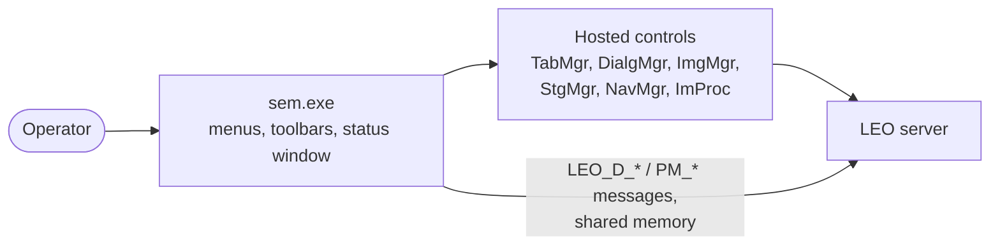

[Home](../../README.md) › [Programs](README.md) › SEM user interface

# SEM user interface (sem.exe)

> **In short:** the operator's window. It is a frame that **hosts LEO's ActiveX controls** (parameter tabs, image
> manager, stage manager, dialogs …) and exchanges window messages with the LEO server. It never calls the hardware or
> the server DLLs directly.

Menus, dialogs and every message handler are listed in the technical reference below.

---

## Technical reference

*Full detail for maintenance and further reverse engineering: function names, addresses, parameters, sources. Inferred points are marked \*?\*.*

`LEO-32\sem.exe` (1 536 000 bytes, 11-Jun-2001) is the operator program: the window the user drives the microscope
from. It is an MFC 4.2 document/view application (`CMainFrame`, `CSEMDoc`, `CSEMView`) that hosts LEO's ActiveX
controls and talks to the LEO server (`LEOSERV.exe`). It does not call the server DLLs directly (no `Srv32.dll`
import); parameters, images and stage moves all go through the controls and through window messages.

Machine-generated references:
- Menus and dialogs (English): [`../ui/sem-resources.txt`](../ui/sem-resources.txt) (made with
  `tools/pe-resources.ps1`; German and French copies are in the same resources).
- Every menu command, window message and LEO message with its handler address: [`../ui/sem-msgmaps.csv`](../ui/sem-msgmaps.csv)
  (made with `tools/mfc-msgmaps.ps1`; 498 entries in 18 message maps, 243 menu commands).
- Decompiled code: [`../decompiled/sem.exe.c`](../decompiled/sem.exe.c). LEO's help: `docs/help/sem`, `OPERATION`, `GETSTART`, `HOW_TO`.

### Structure
| Class (MFC runtime name) | Role |
|---|---|
| `CMainFrame` | main window, menus, toolbars (user toolbar, hard front panel status, trackerball status, status bar), full-screen mode |
| `CSEMDoc` / `CSEMView` | the image view (the live image is drawn by the image manager control) |
| `CServerComms` | link to the LEO server (see below) |
| `CTabMgr`, `CDialgMgr`, `CImgMgr`, `CNavMgr`, `CStgMgr`, `CImProc`, `CEdsMgr` | wrappers for the hosted controls: parameter tabs, dialogs, image manager, navigation, stage manager, image processing, EDS (X-ray) manager |
| `CLeoDialog` | base of LEO's own dialogs |
| `CStatusPropertyFrame`, `CStatusDisplayPropSheet`, `CStatusPropertyDisplayPage` / `FilePage` / `SelectPage`, `CStatusData` | "SEM Status" window (Ctrl+I): choose parameters to display, save/load the selection |
| `CCustomisePropertySheet`, `CCustToolButtonsPropertyPage`, `CCustToolFuncsPropertyPage`, `CCustToolFuncsMiddlePage` | user toolbar editor and left/middle mouse-button assignments |
| `CFunctionProvider` | special functions offered to toolbars and macros |
| `CNightingale` | "ADDIN2" add-in slot (registry `ADDIN2_PRESENT`, `ADDIN2_TITLE`, default title "Nightingale", help `addin2.hlp`) |

Optional parts are switched on by registry flags: `IMPROC_PRESENT` (image processing, `Improc.ocx`), `EDSMGR_PRESENT`
(X-ray / EDS manager, help `edsmgr.hlp`), `ADDIN2_PRESENT`.

### Link to the server
- The server window is found by title: `LEO SRV-32`, or one of its variants `LEO SRV-32 (E)`, `(W)`, `(EW)`.
- Requests use registered window messages named `LEO_D_*`: `LEO_D_GET_VALUE`, `LEO_D_SET_VALUE`, `LEO_D_GET_STATE`,
  `LEO_D_SET_STATE`, `LEO_D_GET_STATE_STRING`, `LEO_D_SET_STRING`, `LEO_D_GET_XY`, `LEO_D_SET_XY`, `LEO_D_EXECUTE`,
  `LEO_D_GET_COMMAND`, `LEO_D_STEP`, `LEO_D_MOUSE_ADJUST_LEFT` / `_MIDDLE`, `LEO_D_SET_FORMAT_MODIFIER`,
  `LEO_D_SET_DEF_PRINT_SCALE`, plus `LEO_GET_SEM_HWND`, `LEO_GET_VALUE_EXTRA`.
- Larger data goes through shared memory: a file mapping named `MMF_LEO_SC_<pid>_<n>_<n>` (`CreateFileMapping` +
  `MapViewOfFile`).
- The server and the controls notify the UI with registered `PM_*` messages; the main window handles 27 of them:
  `PM_PARAMETER_NOTIFY` (a parameter changed), `PM_REFRESH_WINDOW`, `PM_REGISTER_RETURN`, `PM_USER_PREFERENCES_CHANGED`,
  `PM_COARSE_FINE_CHANGED`, `PM_SPECIAL_FUNCTION`, `PM_SP_MOUSE_ADJUSTMENT`, `LEO_MOUSE_FINISHED_ADJUST`, `PM_SEM_CLOSE`,
  `PM_QUERY_CLOSE_SERVER`, `PM_NAVMGR_REQUEST` / `PM_NAVMGR_DONE`, `PM_SHOWHIDEDIALOGS_REQUEST`, `PM_GET_TAB_COUNT` /
  `PM_GET_TAB_NAME` / `PM_GET_DLG_COUNT` / `PM_GET_DLG_NAME` / `PM_SHOW_TABS_DIALOGS` (used by "Goto Control Panel"),
  `PM_MACRO_STATUS`, `PM_MACRO_CONDITIONS_SAVED`, `PM_KNOB_ASSIGNMENT`, `PM_TRACKERBALL_AXIS_SELECTED`,
  `PM_IMGMGR_INHIBIT_SPOT`, `PM_SELECT_USER_AREA` / `READ` / `CREATE` / `DELETE_USER_AREA`.
- Other registered messages it registers: `LEO_LUT_MANAGER_REGISTER`, `LEO_MACRO_MANAGER_REGISTER`, `LEO_HPAPP_MESSAGE`
  (variable-pressure program `hpapp32`, found by its window title `Untitled - hpapp32`).
- Server commands it sends by name (toolbar / function keys): `CMD_BEAM_ON`, `CMD_EHT_OFF`, `CMD_STANDBY`, `CMD_SHUTDOWN`,
  `CMD_AUTO_FOCUS_COARSE` / `_FINE`, `CMD_AUTO_STIG`, `CMD_FOCUS_STIG`, `CMD_C1C2_HYSTERESIS`, `CMD_FINDIMAGE`,
  `CMD_TOGGLE_FREEZE`, `CMD_UNFREEZE_ALL`, `CMD_SCANRATEUP` / `DOWN`, `CMD_MODE_NORMAL` / `REDUCED` / `SPLIT` / `QUAD` /
  `SMALL` / `EMISSION`, `CMD_STAGE_INIT` / `ABORT` / `NEXT_FIELD` / `PREVIOUS_FIELD` / `START_SCAN`, `CMD_TAKE_PHOTO`,
  `CMD_HRRU`, `CMD_PRINTER`, `CMD_VIDEO_PRINTER`, `CMD_DISPLAY`, `CMD_MANUAL`.

### Menus (English resources)
- **File:** Restore / Save For Restore / Standard / Load State / Save State (whole SEM set-ups), Load / Save / Print
  Image (TIFF), Print Setup, Load / Save Annotation, Log Off, Exit.
- **Edit:** Input LUT, Display LUT, Toolbar, Annotation (Ctrl+A), Insert Annotation Text (Ctrl+T), Point-to-Point
  Marker (Ctrl+M), Clipboard.
- **View:** Toolbars (Ctrl+B), Data Zone (toggle Ctrl+D, default, hide/unhide, load user data zone), Toggle Visible
  Dialogs (F3), Full Screen Image (Shift+F3), Crosshairs, Graticule (+ spacing), SEM Status (Ctrl+I), hide/unhide
  annotation (text/bitmap/line, measurements, result panels, selection handles).
- **Beam:** EHT On / Off, Gun Setup, Emission, Accelerating Voltage, Apertures, Stigmation, Beam Shift. On field-emission
  machines a different Beam menu (resource 193) adds Probe Current, Spot Size, Gun Align and OptiBeam (Auto Resolution,
  Depth Mode, Setup).
- **Detection:** Detectors SE1 / SE2 / BSD / SCM (or Detector1–7), Mixing, TV inputs TV1–TV3, X-Ray.
- **Image:** Signal Adjust, Noise Reduction, Freeze, Image Processing, Second Image Window (load from display Ctrl+2 /
  from file, toggle), Find Image, Image Gallery.
- **Scanning:** Speeds, Normal, Reduced, Split, Dual Mag, Spot, Line Scan, X-Ray Line Scan, Rotate/Tilt, Dynamic Focus,
  Store Resolution 512 × 384 / 1024 × 768 / 2048 × 1536 / 3072 × 2304.
- **Stage:** Stage Initialise, Stage Control, Store/Recall, Centre Point (Ctrl+Tab), Centre Feature (Ctrl+Shift+Tab),
  Stage Scan, Stage Map, Survey (Settings, Survey Mode).
- **Vacuum:** Vacuum Status, Specimen Change. VP machines: VP Control, VP Service (resources 198, 199).
- **Tools:** Run A Macro, Macro Editor, Goto Control Panel (Ctrl+G), Goto Panel, Image Capture Mode / Capture Now /
  Capture Frequency, User Preferences, Administrator (starts admin32), Parachute Archiving.
- **Help:** LEO Help (F1), Getting Started, How To, Keys Help (F9), Release Notes, Parachute, About boxes for
  LEO-32 and each control.

### Settings and files
- Registry (under the LEO-32 key): `Main Directory` (default `C:\Program Files\Leo\Leo32\`), `Settings\DataZonePresent`,
  `Settings\Maximised`, `Settings\FrameRect`, `FullScrUserBarVisible` / `FullScrHFPBarVisible` / `FullScrTKBBarVisible` /
  `FullScrStatBarVisible`, `ToolBars`, `ToolTips`, `StatusWindow`, `ImageUpdate\msFrequency`, the add-in flags above,
  `Pass Through Red/Green/Blue`.
- Files: user toolbars (`*.utb`, default `DISTRIB\default.utb`, button bitmaps `*stool*.bmp`), data zones (`*.ADZ`),
  status displays and SEM states (`*.STS`), images (`*.TIF`), macros (`macros\`).
- Languages: English, French, German resources in the same file.
- Machine names it knows (for titles and model-specific menus): LEO 420, 430, 435VP, 438VP, 440, 450, 1420(VP), 1430(VP),
  1450(VP), 1455(VP), 1460(VP), 1500, 1525(VP), 1530(VP), 1550(VP), 1560, EBL50, EBL100.

---
[← Programs](README.md) · [Home](../../README.md)
