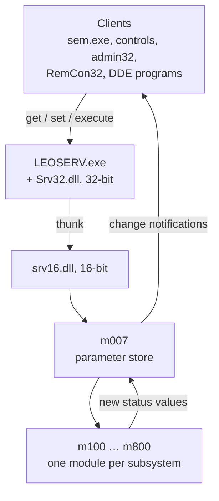

[Home](../../README.md) › [Programs](README.md) › Server and parameters

# LEO server and the parameter model

> **In short:** everything in the microscope is a **parameter** with a short name: **values** (`AP_…`, e.g.
> magnification), **states** (`DP_…`, e.g. vacuum status), **commands** (`CMD_…`, e.g. Pump) and a few strings. The
> **LEO server** (LEOSERV) owns them all. Programs read and change them through the server; the server forwards each
> change to the controller module that handles it.

The full list of 1013 parameters: [parameters.csv](../parameters.csv); which module reads or writes each:
[parameter-usage.csv](../parameter-usage.csv).

---

## Technical reference

*Full detail for maintenance and further reverse engineering: function names, addresses, parameters, sources. Inferred points are marked \*?\*.*

### Components
| Binary | Role |
|---|---|
| `LEOSERV.exe` (Win32 MFC, "LEO SRV-32", Leo-32 Server V03.00 Jan 2000) | central server: owns the microscope state, talks to the hardware through the Win16 side, serves all clients |
| `Srv32.dll` | 32-bit server API (82 exports: `SRV_Get_Value`, `SRV_Execute_Command`, `SRV_Get_Machine_Type`, `SRV_Get_Serial_Number`, `SRV_Get_Stage_Position`, `SRV_Get_Histo`, `SRV_Get_Configuration`, `SRV_Shutdown`…) |
| `srv16.dll` | 16-bit side, reached through a flat thunk (`SRV_THUNKDATA16`); loads the controller modules (`SRV_LOAD_DLL`), forwards `SRV_SET_VALUE`/`SRV_GET_VALUE`/`SRV_EXECUTE_COMMAND`, drives the timer tick |
| `m007.dll` | parameter database for the Win16 modules: `M007_GETVALUE/PUTVALUE/GETSTATE/PUTSTATE/GETLOW/PUTLOW/GETHIGH/PUTHIGH/PUTXY` (used thousands of times by m100–m800) |
| `m070.dll` | LEOACC accessories + control-panel visibility tables (`LOADVISTABLES`, `SETVALUEVIS`…); reads `C:\LEO\access.leo` |
| `leopm.dll` | parameter manager client API for the UI (73 exports: `PMGetValue`, `PMUpdateValue`, `PMGetLimits`, `PMGetMnemonic`, `PMGetName`…); holds the master mnemonic table |
| `leodde32.dll` | DDE server for external programs (advise analogue/digital, histogram/profile data, execute command) |
| `s400eng/fre/ger.dll` | Win16 string tables: parameter display names, error and status messages (English/French/German) |

### The parameter model
Everything in the microscope is a **parameter** with a mnemonic. There are four kinds:

| Kind | Prefix | Count | Meaning | Display-name string IDs |
|---|---|---|---|---|
| Analogue value | `AP_` | 454 | float with low/high limits and units (mag, WD, kV, stig, stage position…) | 2200 + index (index 0–451) |
| Digital state | `DP_` | 352 | enumerated state (detector, scan rate, vacuum status…); `PM_GET_STATES` lists the values | 2652 + index |
| Command | `CMD_` | 201 | action (beam on, autofocus, pump, stage init…) | 3004 + index |
| String value | `SV_` | 6 | FILE_NAME, USER_NAME, OPERATOR, USER_TEXT, SERIAL_NUMBER, VERSION | — |

Full dictionary: [`../parameters.csv`](../parameters.csv) (type, index, mnemonic, string id, English name).
All strings: [`../strings/`](../strings) (`s400eng.csv`, `s400fre.csv`, `s400ger.csv`, 2939 entries each).

Other string ranges in `s400eng`: 400–499 parameter access errors · 500–599 interlock/status messages
(e.g. 501 "Stage Touching", 502 "Gun Valve position incorrect") · 600 column-pumping warning · 700–999 dialog text and
SEM interface read/write/command errors · 1000+ UI text · 1700 NVRAM/vacuum utility messages · 1900 HV/VP messages.

### Client interface (window messages)
LEOSERV registers ~200 window messages that clients use:
- `LEO_D_GET_VALUE` / `LEO_D_SET_VALUE` / `LEO_D_GET_STATE` / `LEO_D_SET_STATE` / `LEO_D_GET_XY` / `LEO_D_SET_XY` / `LEO_D_EXECUTE` / `LEO_D_STEP` …
- `PM_*`: parameter metadata (`PM_GET_NAME`, `PM_GET_MNEMONIC`, `PM_TRANSLATE_MNEMONIC`, `PM_GET_LOW_LIMIT`, `PM_GET_UNITS_STRING`, `PM_IS_READ_ONLY`…),
  stage (`PM_STAGE_GOTO`, `PM_STAGE_POINT_*`), images (`PM_SAVE_TIFF`, `PM_LOAD_TIFF`, `PM_GET_TIFF_HEADER`), LUTs (`PM_LUT_*`),
  macros (`PM_EXECUTE_FILE_MACRO`, `PM_STEP_MACRO`…), users (`PM_LOG_ON`, `PM_LOG_OFF`, `PM_SET_USER_MODE`, `PM_BUTTON_PRIVILEDGE`),
  server lifecycle (`PM_SERVER_LOADING`, `PM_SERVER_READY`, `PM_QUERY_CLOSE_SERVER`, `PM_SEM_REGISTER`, `PM_SEM_CLOSE`).
- It also checks `SEM_INIT_SERVER` / `SEM_INIT_STATUS` (DDE) to make sure sem_init is running.

### Data the server owns
- `C:\LEO\data.vac` (NVRAM configuration, see [file-formats.md](../file-formats.md)) and `C:\LEO\filament data.dat`.
- Filament monitoring: filament age, current, scheduled **autosaturation** ("Performing scheduled filament autosaturation...").
- User levels: User, **Supervisor**, **SERVICE**, **FACTORY** (`user\service\` paths; release notes mention changed service/factory passwords per version).
- Feature licences ("Licences", "validLicences", temporary "All Licences" with expiry) stored with the user database.
- User/settings database: `Program Files\...\LEO-32\SYSTEM\leo_user.mdb` (Microsoft Jet 3, "Standard Jet DB"), with workgroup
  file `system.mda` and lock file `system.ldb`; `DB Version 09.02`. The contents weren't inspected (not readable as plain text).
- Machine type check: "Set Column Type, Unknown machine config code, - fatal programming error".

---
[← Programs](README.md) · [Home](../../README.md)
