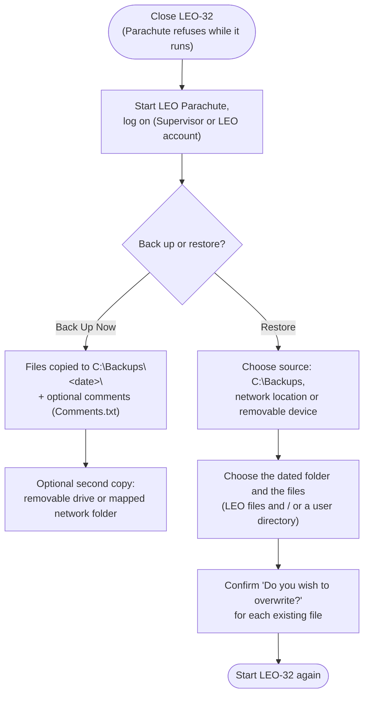
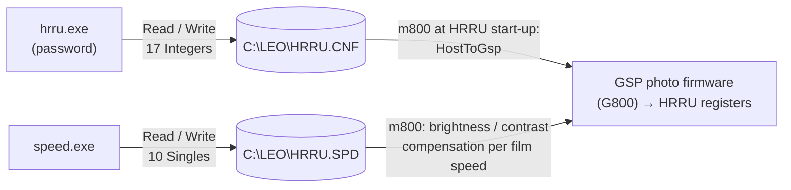

[Home](../../README.md) › [Programs](README.md) › Utilities

# Utilities

> **In short:** the smaller programs of the suite. Most matter only for service: gun tools (field-emission
> machines), photo-unit (HRRU) set-up, display helpers, the DATA.VAC converter and viewer, database upgrade, image
> archiving to FTP, and **Parachute**, which backs up the files that must never be lost.

| Group | Programs |
|---|---|
| Gun (field emission only) | Gun Monitor, gunserv |
| Photo unit (HRRU) | hrru.exe, speed.exe |
| Display and scanning helpers | leosync, wobble, leomouse, leolut |
| Data and installation | convert, view, checkdb, LeoPath |
| Archiving and backup | ImgArc, Parachute |

## Backing up and restoring the machine files (Parachute)

These files make one microscope different from another. Losing them means losing the calibration, the users and the
licence set:

| File | Folder | Holds |
|---|---|---|
| `DATA.VAC` | `C:\LEO` | configuration and calibration |
| `CONFIG.LEO` | `C:\LEO` | system configuration |
| `ACCESS.LEO` | `C:\LEO` | who sees which parameter |
| `L500.INI` | `C:\LEO` | server settings (stage safe area, user limits …) |
| `LEO_USER.MDB` | `LEO-32\SYSTEM` | users, licences, stage tables, serial number |
| `SYSTEM.MDA` | `LEO-32\SYSTEM` | database security file (needed to open LEO_USER.MDB) |
| `account.mdb` | `LEO-32\SYSTEM` | user accounting (only with the accounting option) |

- One backup folder per day (named after the date); a second backup the same day asks before overwriting it.
- What was copied is logged in `Logs\Leofiles.log` and `Logs\Userfiles.log`.
- Without Parachute the same restore is a plain file copy of the table above (LEO-32 closed), from a backup folder
  back to the folders listed.

LEO also keeps its own automatic safety copy of the configuration: `C:\LEO\DATA<n>.VAC`, refreshed at every
successful start (see [LEO server](leoserv.md#good-to-know-for-repair)).

---

## Technical reference

*Full detail for maintenance and further reverse engineering: function names, addresses, parameters, sources. Inferred points are marked \*?\*.*

All in `LEO-32\` unless noted. UI dumps are in [`../ui/`](../ui) and VB6 tables in [`../vb6/`](../vb6). The full list of
LEO's registered window messages (`PM_*`, `LEO_*`, 247 names) these programs share: [`../data/pm-messages.txt`](../data/pm-messages.txt).

### Gun programs (field-emission columns; not used on a tungsten LEO 430)
- **`Gun Monitor.exe`** (MFC, `CGunMonitorDoc` / `CGunMonitorView` / `CGunData`): logs the gun during run-up and plots it.
  Reads `AP_ACTUALCURRENT` (filament I, mA), `AP_ACTUALEXT` (extractor V), `AP_EXTCURRENT` (extractor I, µA),
  `AP_COLUMN_VAC` (gun vacuum, mbar), `AP_ACTUALLENS`, `AP_ACTUALKV` at a set interval; exports CSV (`gundata.csv`,
  header `Time, Filament I, Extractor V, Extractor I, Gun Vacuum, Liner V, EHT V, …`, "Gun Runup Data starting …").
- **`gunserv.exe`** "Gun Service Panel" V03.00 (VB6, project `GunServ.vbp`): service settings of the FE gun:
  nominal filament current, nominal extractor V and I, min/max extractor V (`AP_NOMINALFIL`, `AP_NOMINALEXT`,
  `AP_NOMINALEXTI`, `AP_MIN_EXT`, `AP_MAX_EXTRACTOR_V`), EHT calibration at 100 V, 10 kV, 24 kV, 30 kV
  (`AP_EHT_CAL_100`, `_10KV`, `_24KV`, `_30KV`), manual kV/current/extractor/lens, `CMD_SERVICE_RUNUP`, `CMD_EHT_RESET`.
  **Tip data** (forms `TipDataFRM`, `SelTipData`) is stored in `leo_user.mdb` table `TIPS` (engineer, tip type, serial
  number, filament current, extractor voltage, radius, length, total current, date) and flagged with `keys.TipData`;
  LEOSERV disables the gun after "New Filament" until tip data is entered (see deskey.md, "FE gun flag").
  Needs the Calibration privilege.

### HRRU (High Resolution Recording Unit: the photo CRT camera), Visual Basic 3
The three VB3 tools (hrru, speed, leosync) are Visual Basic 3 p-code. They were decompiled with this archive's own
p-code reader; the full code, every event procedure with its control, is in [`../vb3/`](../vb3/README.md).

- **`hrru.exe`** "HRRU Configuration Manager" V02.02 (1-May-1995) is only an **editor for `HRRU.CNF`**; it never
  talks to the hardware. Forms `Welcome`, `Hrru`, `Display` ([code](../vb3/hrru.txt)):
  - `Welcome`: password box. **Password: `RUSTAT`** (fixed in the program, exact match, upper case; file offset
    `0x962` of hrru.exe). A wrong entry gives "Invalid Password"; OK shows the `Hrru` form, Quit ends.
  - `Hrru`: refuses a second copy (`GetModuleHandle("HRRU.EXE")` / `GetModuleUsage` > 1: "This program is already
    loaded!"). **Read** (`Command1`) / **Write** (`Command4`): `ChDir "C:\LEO"`, Common Dialog "Please select a
    Config file" (default `HRRU.CNF`, filter `*.CNF`), then `Open … For Binary`, 17 Integers with `Get` / `Put`
    at byte 1 + 2·i. **Edit** (`Command2`) shows `Display`; the button named `GSPReadWriteExit` (caption "E&xit")
    closes. There is no GSP menu: that is just the button's name.
  - `Display`: 17 labels, each showing its value in hex; clicking one opens an InputBox with the default in hex,
    checks every character is 0–9 / A–F / a–f, adds `&h`, takes `Val` and stores it if in range:

    | Index | Prompt | Accepted |
    |---|---|---|
    | 0 | Location 0x72 | ≤ 0xFFF |
    | 1, 2 | Location 0x51, 0x52 | ≤ 0xFFF |
    | 3 … 10 | Location 0x34 … 0x3B ("0->0xff") | ≤ 0xFFF (the program does not enforce the 0xFF it states) |
    | 11 | Location 0x70 | ≤ 0xFFF |
    | 12 / 13 | Contrast Low / High Limit | low: 0 ≤ v < high; high: low < v ≤ 0xFFF |
    | 14 / 15 | Brightness Low / High Limit | low: 0 ≤ v ≤ high; high: low < v ≤ 0xFFF |
    | 16 | Location 0x71 | ≤ 0xFFF |
  - The values are HRRU unit registers: m800 loads `c:\leo\hrru.cnf` (34 bytes) at HRRU start-up with its file
    loader (`sub_b290`, `_lread` → `TIGASEM.HostToGsp`, table 7), and the photo firmware (G800) writes 0x51 / 0x52
    before every exposure and also uses 0x20–0x2A (scan ramps), 0x4D (tube on), 0x54 (film speed), 0x6D (shutter),
    0x74 (see [Display and export](../subsystems/display-modes-export.md)). No `HRRU.CNF` is on this disk.
- **`speed.exe`** "Hrru Speed" V02.00 (20-Sep-1995) edits **`HRRU.SPD`**, the brightness / contrast compensation per
  film speed ([code](../vb3/speed.txt)). Same structure as hrru: Read Speed (`Command1`) / Write Speed
  (`Command4`) with a Common Dialog (default `HRRU.SPD`) and `Get` / `Put` of 10 Singles at byte 1 + 4·i; Edit
  Speed (`Command2`) opens `Display` with 10 labels ("ASA 50 Brightness = " … "ASA 800 Contrast = " + value +
  " % "); clicking one asks for the new value (the brightness prompts carry the warning "Excessive amounts of
  Brightness Compensation can Burn the HRRU Tube"), an empty answer cancels, otherwise `Val` is stored (no range
  check). If no file is read, the defaults set at start-up are those of the example below.
  - `C:\LEO\hrru.spd` format (40 bytes): ten little-endian floats, (brightness, contrast) for ASA 50, 100, 200, 400, 800.
    Example (also the program's built-in defaults): (10, 512), (5, 256), (2, 128), (−2, 0), (0, 0).
- Small faults seen in the code: the Write routines of both programs set the Common Dialog `Flags` from an unset
  local variable (so 0) where Read uses `OFN_FILEMUSTEXIST`; harmless.
- The server side of the HRRU (photo, focus, brightness, contrast, gamma LUTs) is in the error help (`HRRU command
  error`: `HRRU_FITTED`, `GAMMA_HRRU_LUT`, `SET_HRRU_FOCUS`, `SET_HRRU_BRIGHTNESS`, `SET_HRRU_CONTRAST`, …).

### Display, scanning helpers
- **`leosync.exe`** "LEO 400 Series PC Plane Sync" V01.00 (VB3, [code](../vb3/leosync.txt)): lines up the PC (VGA)
  picture with the TIGA board's image plane. It dates from the LEO-16 era:
  - At start (`Form1_Load`) it calls `CheckUI`: `M007.GetState`; if that fails it offers "The LEO User Interface is
    not active! … Click OK to load the User Interface" and runs `\LEO\LEO.EXE \LEO\LEO.IMA` (`WinExec`, "Failed
    to load …" if the result is < 32), or reports "not yet loaded" / "not responding". Without an answering UI the
    program closes.
  - Otherwise it reads the current offsets from the board (`TIGASEM.ReadHcnt`, `ReadVcnt`) and shows them as
    4-digit hex. Each spin button adds −1 / +1 (wrapping 0 ↔ 0xFFFF), clicking the value label asks for a new hex
    value ("H-Count Register" / "V-Count Register"); every change shows the new value and sends **both** offsets
    with `TIGASEM.TunePCtoTiga(H, V)`. Nothing is saved to a file.
  - Declared but not used: `GetSystemDirectory`, `GetModuleHandle`, `GetModuleUsage`.
- **`wobble.exe`** (MFC, `CWobbleDoc` / `CWobbleView`): the Focus / Gun / Aperture Wobble panels (`DP_WOBBLE`,
  `DP_WOBBLE_SPEED`, `AP_C3WOBBLEAMP`, `DP_GAWOBBLE`, `DP_APER_WOBBLE`), registered with `PM_WOBBLE_REGISTER`;
  help `Wobble.HLP`.
- **`leomouse.exe`**: background helper for "mouse adjust" (dragging the mouse changes a parameter): registers
  `LEO_MOUSE_REGISTER`, confines and hides the cursor (`ClipCursor`), sends `MOUSE_START` / `MOUSE_UPDATE` /
  `MOUSE_FINISH` / `MOUSE_HIDE` and `LEO_MOUSE_FINISHED_ADJUST`; talks to the server window `LEO SRV-32`.
- **`leolut.exe`** "LEO LUT Editor" V1.0 (1997, MFC): edits the input and display look-up tables; File → Input LUT
  (Ctrl+I), Display LUT (Ctrl+D), Open / Save LUT.

### Data and installation helpers
- **`convert.exe`** "LEO Configuration File Converter" V22.00 (16-bit): upgrades `C:\LEO\DATA.VAC` from any older
  layout (versions 3 … 0x15) to version 22, or imports `C:\S300\DATA.VAC` from the older S300 software. Checks the
  checksum after reading. Messages: "No Conversion of DATA.VAC File Needed", "Converting DATA.VAC File Version …".
- **`view.exe`** "LEO Configuration File Viewer" V22.00 (16-bit): prints every field of DATA.VAC (used to recover the
  file layout, see file-formats.md).
- **`checkdb.exe`** X01.00 (28-Mar-96, VB6): run by the installer. Checks `leo_user.mdb` against the registry
  `DB Version` (`09.02` here) and upgrades it step by step from any version 01.02 … 09.01 (adds tables/fields such as
  `licence`, `Machine`, `salesCode`, `partNumber`, `Class`, `TIPS`, `TipData`, `Attachments`), compacts it, and writes
  `oeminfo.ini`. "The LEO Database is the incorrect version. Please delete …\system\leo_user.* and reinstall Leo32."
- **`LeoPath.exe`** (VB6): after the LEO-32 folder moves, rewrites each user's `UserDirectory`, `CurrentUserDirectory`,
  `ImageDirectory`, `CurrentImageDirectory` in `Users` (LEO accounts → `user\default` or `user\service`, Guest →
  `user\guest`).

### Image archiving and backup
- **`ImgArc.exe`** "LEO FTP Image Archive" V01.03 (Dec 1998, VB6, Mabry `FTP32.OCX` / `GetHst32.OCX`): copies a user's
  images (`*.tif;*.jpg;*.bmp;*.txt`) from the image directory to an FTP server (host, user, password, directory;
  "Include archived" toggle, exclude list, immediate transfers), keeps a log (`LEOFTP.LOG`), and can send images to a
  **Codonics NP1600** network printer (copies, images across/down, gap, margin, landscape, scaling BILINEAR / BICUBIC /
  MITCHELL / LANCZOS, background 80/80/80, cell FF/FF/FF; command files `IMGARC_SETUP.CMD`, `IMGARC_PRINT.CMD`,
  `IMGARC_CANCEL.CMD`). Settings in the registry (`FTPHost`, `FTPUser`, `FTPPassword`, `FTPDir`, `LogFile`,
  `ImmediateXfers`, `NetPrinter*`). Licensed option: "Image Archiving Not Licenced"; it also checks `DP_SCANGEN` /
  `DP_GSP`. Forms and handlers: [`../vb6/ImgArc-objects.csv`](../vb6/ImgArc-objects.csv).
- **`Parachute\Parachute.exe`** "LEO Parachute" (VB6, with `Pchute20.dll`, `Pchute2x.ocx`, `ControlResizer.ocx`):
  backs up and restores the critical files `access.leo`, `config.leo`, `data.vac`, `L500.ini`, `leo_user.mdb`,
  `system.mda` (+ `account.mdb` with the accounting licence) into a dated folder `MM_DD_YY` (the `C:\Backups\`
  folders found on LEO PCs come from it), optionally a user directory, with comments. Targets: `C:\Backups`, a removable
  drive or a mapped network folder. Log-on is checked against `Users` (Supervisor or LEO accounts only, three
  attempts). LEO-32 must be closed: it offers to shut down the server (`ShutDownLEOServer32Gracefully`).
  Support links: `http://www.leo-em.co.uk`, `http://www.leo-usa.com`, `support@leo-em.co.uk`.

---
[← Programs](README.md) · [Home](../../README.md)
