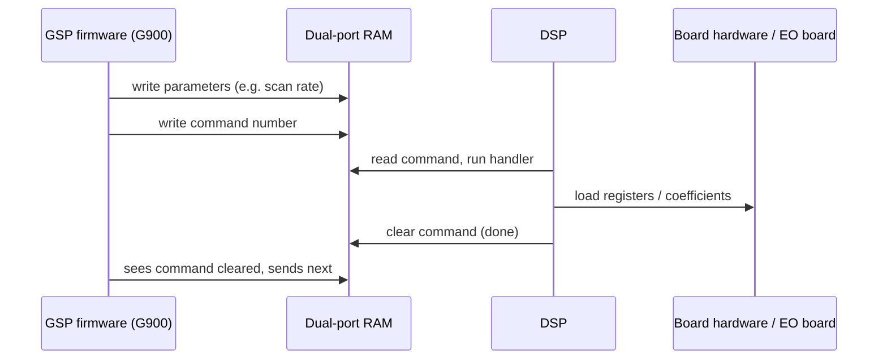

[Home](../../README.md) › [Hardware interface](../hardware-interface.md) › DSP

# DSP (signal processor on the board)

> **In short:** an Analog Devices ADSP-21xx processor on the image processor board generates the **scan** and controls
> the **video pipeline**. Its program (`DPRAM.IMG`) is downloaded at start-up by sem_init. The GSP firmware gives it
> numbered **commands** (48 of them: set scan rate, set raster, write an EO register, set detector gains, histogram …)
> through a shared dual-port RAM. The per-pixel maths itself is done by the board's hardware; the DSP loads the
> coefficients.

---

## Technical reference

*Full detail for maintenance and further reverse engineering: function names, addresses, parameters, sources. Inferred points are marked \*?\*.*

Source: `C:\WINDOWS\DPRAM.IMG` (downloaded into the board's dual-port RAM by `sem_init.exe`).
Disassembled with MAME's `unidasm` (arch `adsp21xx`).

### Processor
**Analog Devices ADSP-21xx** (ADSP-2101 family): 24-bit program words, interrupt vector table of 4 words per vector.
The earlier guess of a TMS320C31 (from a `_C31` symbol in the GSP firmware) was wrong; the code only makes sense as ADSP-21xx.

### Image layout
`DPRAM.IMG` lists bytes as `addr/value;` (hex). Each program word occupies 4 bytes: three instruction bytes
(**most significant first**) and an `FF` pad. Program-memory (PM) word address = DPRAM byte address ÷ 4.

| DPRAM bytes | PM words | Content | Listing |
|---|---|---|---|
| 0x0000–0x0FDF | 0x0000–0x03F7 (1016 words) | interrupt vectors + low code | [pm-0000-03F7.asm](pm-0000-03F7.asm) |
| 0x8000–0xB267 | 0x2000–0x2C99 (3226 words) | main code (timer-interrupt handler at 0x2000…) | [pm-2000-2C99.asm](pm-2000-2C99.asm) |

### Interrupt vectors (PM 0x0000)
| Vector | Address | Target |
|---|---|---|
| Reset | 0x0000 | `JUMP $001C` (start-up: init, calls $00A2, $00CE, $0055…) |
| IRQ2 | 0x0004 | `RTI` (unused) |
| SPORT0 TX | 0x0008 | `RTI` |
| SPORT0 RX | 0x000C | `RTI` |
| SPORT1 TX / IRQ1 | 0x0010 | `JUMP $0200` |
| SPORT1 RX / IRQ0 | 0x0014 | `JUMP $0085` |
| Timer | 0x0018 | `JUMP $2000` (saves AX0/AY0/AR/IMASK, works on data memory $3800–$39xx, calls $2063, $0312…) |

(Vector names per the ADSP-2101 table; which ones the board actually wires up is to be confirmed.)

### Data memory and the PC ⇄ DSP register block
| DSP data memory | What it is |
|---|---|
| `$0000–$00FF` (external) | **video-board hardware registers** (see "Hardware registers" below) |
| `$0800–$09FF` (external) | **the dual-port RAM register block shared with the GSP / PC** (the registers named in `SEM_INIT.DAT`) |
| `$0C00…` (external) | dual-port RAM transfer area (read-back, data for the program loader) |
| `$3800–$3BFF` | ADSP-2101 **internal** data RAM: the DSP's own working variables, the command table at `$3940`, interrupt save areas |
| `$3FE0–$3FFF` | ADSP-2101 memory-mapped control registers (timer, SPORT0/1, wait states, system control) |

**Mapping:** a register at PC "longword address" `L` in `SEM_INIT.DAT` is DSP data memory **`$0800 + (L − 0x400)`**.

> **Correction (2026-10-18).** This file first said `$3800 + (L − 0x400)`. That was wrong. Evidence for `$0800`:
> the command dispatcher reads the command number from `$0800` and clears `$0800` when the handler is done (that is
> the "wait until the DSP clears COMMANDREG" handshake the GSP uses), and writes the status to `$0801`; g900 writes
> COMMANDREG at DPRAM offset 0x8000 bits = word 0x800; and with this mapping each handler reads exactly its own
> parameters: 0x0C reads `$080B` / `$0817` (DETA / DETB, 4 zones × 3 words), 0x0D reads `$0823` / `$082B` (KA / KB)
> and `$084F` (DiffCtrl), 0x0E reads `$0868` (NRMODE) and `$0843` (MAXFA), 0x13 reads `$08CC` (FREEZE), 0x17
> reads `$08ED` / `$08EE` (HISTCTRL / HISTEN), 0x16 `$08CF` (EMISSIONCTRL). The `$38xx` block has many more
> references only because it is the DSP's internal RAM, used constantly by the scan interrupt; its layout is not the
> same as the shared block (e.g. 0x0D copies KA from `$0823` to `$3807`). The annotated listings and
> dpram-registers.csv were regenerated with the corrected mapping.

- Full map: [dpram-registers.csv](dpram-registers.csv) (204 locations: name, PC longword, DSP address, initial value from SEM_INIT.DAT, code references).
- Annotated listings: [pm-0000-03F7.annotated.asm](pm-0000-03F7.annotated.asm), [pm-2000-2C99.annotated.asm](pm-2000-2C99.annotated.asm)
  (every `DM($xxxx)` access to a named register or control register is commented).
- Registers with no direct reference are accessed through index registers (arrays such as DETA/DETB, KA/KB, SCANAMP, GUN/MICRO).

Generated by `tools/annotate-dsp.ps1`.

### Command dispatch
Main loop (PM `0x001C`–`0x0050`): the current **command number** is in DM `$0800`. If non-zero and ≤ 0x30, the handler address
is read from the **command table at DM `$3940 + (n − 1)`** (`I4 = $393F + n; I4 = DM(I4)`), the loop waits while
**WHENTODO** (`$0802`) is ahead of the DSP's time counter (internal `$3802`), then `CALL (I4)` runs the handler;
`$0800` is cleared afterwards and STATUS (`$0801`) set to 1.

- Command **0x01** → `$00DC`: **program loader**. Copies 3-byte words from data memory into program memory (`PM(I4,M5) = AR`),
  which is how code beyond the image is downloaded.
- Command **0x25** → `$2BE4`: (re)initialisation. Rebuilds the command table (`$3941…`, commands 0x02–0x30), resets
  NRMODE/TPO and scan defaults. This matches SEM_INIT.DAT revision A, "Add call to initialise DSP variables".
- The rest of the 48 handlers: [dsp-command-table.csv](dsp-command-table.csv); each is marked
  `; ===== DSP command handler for command(s) 0xNN =====` in the annotated listings.

### Who sends which command: the GSP DSP driver (`g900.rlm`)
The DSP is commanded by the GSP firmware module **`g900.rlm`** (DSP driver), not directly by the PC (apart from
`SEM_INIT.DAT` at start-up). Two layers, both decoded with `tools/gsp-dsp-map.ps1`:

1. **GSP message codes.** Other GSP modules (EO module `G200.42x/44x`: the 31 `_DSP_*` functions) put a message in a
   buffer (word 1 = length, word 2 = `0x19` = DSP driver's channel, word 3 = code) and call `_send_DSP_message`.
   `g900`'s `_ProcDSPCmds` reads word 3 and jumps through a 74-entry table at the start of its `.data` section to one
   handler per code (`_set_scan_rate`, `_eo_init`, `_set_zone_gain`…). Table: [gsp-message-map.csv](gsp-message-map.csv).
2. **DSP commands.** Each handler fills DSP registers in the dual-port RAM (`*_DPRAM`, GSP pointer at `0x37B00`), then
   writes a command number to **COMMANDREG = `*_DPRAM` + 0x8000 bits** (PC longword 0x400, DSP DM `$0800`) and waits
   until the DSP clears it; several handlers send a sequence. For example GSP code `0x11` (set scan rate) → handler
   `_set_scan_rate` → DSP commands `0x06`, `0x21`, `0x20`; `_eo_init` → `0x12`, `0x07`, `0x0B`, exactly the sequence
   `SEM_INIT.DAT` uses ("Initialise EO board", "Set Raster format", "Start Scanning"). Reverse table:
   [dsp-command-users.csv](dsp-command-users.csv).

So the earlier mapping "GSP word 3 = DSP command number" was wrong, but the GSP names are right for the **message
codes** (e.g. code 0x12 `_DSP_set_number_raster` → handler `_set_number_raster` → DSP command 0x08).

### DSP command names
41 of the 48 base-table commands are named, from `SEM_INIT.DAT`, from the g900 functions that send them, or (for
four that g900 never sends) from the handler code: [dsp-command-table.csv](dsp-command-table.csv) (columns Name,
Evidence) and the `; ===== DSP command handler …` headers in the annotated listings. Main ones:

| Cmd | Name | | Cmd | Name |
|---|---|---|---|---|
| 0x01 | load program memory from data memory (program loader; image LUT) | | 0x13 | freeze control |
| 0x02 / 0x03 | write / read LUT | | 0x14 | update gun align / microshift / stereo parameters |
| 0x04 / 0x05 | write / read EO or HRRU register | | 0x15 | stereo scanning |
| 0x06 | SetRate (scan rate, line amplitudes) | | 0x16 | emission image |
| 0x07 | Set Raster format (origins, size) | | 0x17 | get histogram |
| 0x08 | set number of rasters | | 0x18 | collect covariance (autofocus / autostig) |
| 0x09 | feature scan done | | 0x19 | spot definition |
| 0x0A | scan enable (last step) | | 0x1A | scan transform |
| 0x0B | Start Scanning | | 0x1B | windowing on/off |
| 0x0C | detector zone port / offset / gain / invert | | 0x1E | scan event line |
| 0x0D | detector zone alpha / beta / k1 / k2 | | 0x20 | restart scan after a rate change *?* |
| 0x0E | noise reduction / averaging mode | | 0x21 | update scan amplitudes (dual mag, mag offset, shape, digital rate) *?* |
| 0x0F | transfer data to the host (histogram, X-ray buffer) | | 0x22 | photo exposure (HRRU) |
| 0x10 | set mag range | | 0x23 | raster size / FCF limits |
| 0x12 | Initialise EO board | | 0x24 | X-ray control |
| 0x25 | Initialise variables | | 0x29 / 0x2B | feature scan / post-rotation offset |
| 0x2E / 0x2F / 0x30 | gather spot data / spot move / read spot data | | 0x11, 0x1D, 0x1F | not sent by g900; behaviour from the handler code (register readback, table processing, block transfer) |

Names marked *?* are inferred from the set of functions that send the command. The seven commands nobody sends
(0x1C, 0x26–0x28, 0x2A, 0x2C, 0x2D) are now described from their code in dsp-command-table.csv: 0x1C re-arms the
histogram hardware; 0x26 is an endless transfer / test loop; 0x27 loads words from the dual-port RAM into PM
`$3400`; 0x28 installs an event-counting interrupt (1024-entry table at PM `$3400`); 0x2A / 0x2C install interrupt
routines that alternate the SPORT1 clock divider and output stepped values, 0x2D switches that mode on / off. Their
parameters (`$0961`–`$096D`) lie beyond the registers SEM_INIT.DAT initialises, so they belong to features this
software version does not use *?*.

### What the image handlers do (DSP internals)
The DSP does **not** compute the pixels itself. The detector / mixing / averaging handlers take the parameters the
GSP wrote, scale them and load them into **hardware registers of the video board** (external DM `$0000–$00FF`); the
per-pixel arithmetic is done by that hardware at video rate.
- **0x0C (zone port / offset / gain / invert):** for 4 zones, copies DETA (`$080B…`, 3 words per zone) to port
  `$0048` and DETB (`$0817…`) to port `$004C` (same address written repeatedly: auto-incrementing register ports).
- **0x0D (alpha / beta / k1 / k2, differentiate):** three steps. (1) KA (`$0823`) and KB (`$082B`), 4 zones each,
  are shifted left by a variable amount and saturated to 0xFFFF, kept in internal RAM and written to ports `$0010` /
  `$0020`. (2) DiffCtrl (`$084F`) goes into bits 11+ of the board control word (`$0040`, copy at `$3803`), then two
  more 4-zone tables (`$0836`, `$083A`) are written (×8) to `$001C` / `$002C`. (3) For each zone the product of two
  coefficients (`$083E[i]` × internal value) ÷ 16 is written to `$001E`, and twice the value to `$001D`. Every
  register write waits until bit 6 of status register `$0041` is set (`CALL $25C3`), i.e. the hardware accepts new
  coefficients only at a safe moment *?*.
- **0x0E (noise reduction):** dispatches on NRMODE (`$0868`): 0 / 1 = continuous modes (number of rasters per zone
  from MAXFA `$0843` + 1, 8 entries), 2 / 3 = frame average / integrate (NUMRASTERS = MAXFA + 1, restart scan), 4 =
  line mode (calls the scan-setup routine `$0389`); modes 1 / 3 wait until the TPO status bits 0x30 say the
  operation has started.
- **0x13 (freeze):** builds the TPO control words from NRMODE, the raster counter and FREEZE (`$08CC`, `$08CD`) and
  calls `$039D` to apply them.
- **0x17 (histogram):** HISTEN (`$08EE`), HISTCTRL (`$08ED`, bits 3–5) and the area (`$08EF`, `$08F5`…) go into
  the internal histogram control words, which the scan interrupt loads into hardware ports `$005B` / `$005C`.

#### Hardware registers seen from the DSP (external DM, from how the code uses them)
| Address | Use |
|---|---|
| `$0010–$002F` | zone coefficient ports (KA, KB, mixing / differentiate tables) |
| `$0040` | board control register (write; DSP keeps a copy at `$3803`): bit 3 and bit 4 pulsed by 0x26 / 0x1C, DiffCtrl in bits 11+ |
| `$0041` | board status (read): bit 6 = ready for a coefficient write |
| `$0048`, `$004C` | DETA / DETB zone ports (port, offset, gain / invert) |
| `$0050–$005F` | scan and histogram control (`$005B` / `$005C` histogram, `$005E` block output port, `$005F` copy of GSPINTEN) |
| `$0068–$006D` | inputs read by the interrupt routines (signal levels *?*) |
| `$0080`, `$0090` | counters / pointers used by the interrupt routines |

The PC-side error tables (24 "Acquire" and 13 HRRU commands in [../command-codes.csv](../command-codes.csv)) use their
own numbering.

### Size
105 distinct `CALL` targets across both blocks.

---
[← Hardware interface](../hardware-interface.md) · [Home](../../README.md)
