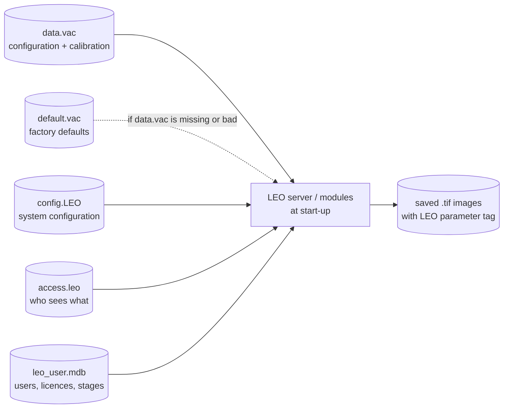

[Home](../README.md) › File formats

# File formats

> **In short:** the files that make one microscope different from another are in `C:\LEO`, and the most important is
> **`data.vac`**: the machine's configuration and calibration (serial number, fitted options, lens calibration, beam
> hours …). Losing it leaves the microscope running on factory defaults, uncalibrated. This page decodes it and the
> other files: `config.LEO`, `access.leo`, LUTs, HRRU files, board files and the TIFF tags of saved images.

| File | Section |
|---|---|
| `data.vac` | [DATA.VAC](#datavac--machine-nvram-configuration-the-most-important-file) |
| `config.LEO` | [config.LEO](#configleo--system-configuration-packed-128-bytes) |
| `access.leo` | [access.leo](#accessleo--who-sees-which-parameter) |
| LUT, HRRU and other data files | [Other files](#other-files) |
| board and boot files | [Board / boot files](#board--boot-files) |
| saved images | [SEM TIFF images](#sem-tiff-images) |

---

## Technical reference

*Full detail for maintenance and further reverse engineering: function names, addresses, parameters, sources. Inferred points are marked \*?\*.*

Which program reads each file was found by searching the binaries for the file names (see the "Owner" column).
Values marked *?* need confirming in the decompiled code.

### `C:\LEO` — machine data (back these up)

#### `DATA.VAC` — machine NVRAM configuration (the most important file)
- Owner: `m600.dll` (loads at start), `LEOSERV.exe`, `admin32.exe` (edits); `view.exe` (viewer), `convert.exe` (converter).
- Binary, **1567 bytes**, little-endian; integers, bytes and IEEE-754 floats.
- `DEFAULT.VAC` = factory default with the same layout; `DATA1.VAC` and `data.old` = older copies of the machine's data.
- Header fields (shown by the viewer): **Version Number** (22 for LEO-32 V02.04), **Write Times** (a counter that
  goes up at every save, e.g. `850`), **Sum Check** (16-bit checksum, e.g. `5000`).
- Human-readable dumps made with LEO's own viewer (`view.exe` V22.00):
  - [`data/DATA.VAC.listing.txt`](data/DATA.VAC.listing.txt) — a machine's file, all 300 fields
  - [`data/DEFAULT.VAC.listing.txt`](data/DEFAULT.VAC.listing.txt) — factory default
  - [`data/vac-viewer-exports/`](data/vac-viewer-exports) — the viewer's "Export" (calibration subset)
- Sections: NVRAM header · Stage (stage type, motorised axes, backlash per axis, move Z on vent) ·
  Vacuum (EDX / WDX / airlock / viewing window fitted, vent column, EDX vacuum limit) ·
  EO (pixel size, stage angle, stigmator limits, 16 mag-compensation amps/offsets, C1/C2/C3 cal & remanence,
  mag cal X/Y 1–5, focus rotation, scan orthogonality, column type, lens crosstalk,
  line/frame transform amps and offsets, beam shift cal, dual-mag slopes, microshift, 4 apertures, PM/serial/version fields) ·
  Acquire (BSD type) ·
  EHT (filament type, anode spacer, filament currents, **beam time** in hours, filament life).
- Machine identity: **machine type and serial number** (e.g. Machine Type `LEO 430`, Serial Number `1234`).
- **Which copy is newest:** the one with the highest Write Times. Copies to look for: `C:\LEO\data.vac` (current),
  `C:\LEO\DATA<n>.VAC` (LEOSERV's copy of the last good load, [leoserv.md](components/leoserv.md#good-to-know-for-repair)), `C:\LEO\data.old`, and Parachute backups `C:\Backups\<MM_DD_YY>\DATA.VAC`. A copy taken right
  after installing the PC has a write count of 1 and holds no calibration.
- **Field layout (main reference): [`data/vac-layout-disasm.csv`](data/vac-layout-disasm.csv)**: all 205 fields the viewer prints,
  located from its 16-bit machine code by `tools/vac-layout-from-disasm.ps1` (MAME unidasm),
  with array stride and length. It agrees with the 83 offsets that were confirmed twice before, and corrects 6 anchor-only
  ones (Pixel Size u8@39, Mag Cal u8@40, Mag Range Cal Y 2 @370, Aperture 1 Diameter @246, Connected To Port u8@989 in
  18-byte port records, Max X Ray Windows u8@1363). Serial and Column Number are 16-bit (@1351, @1364). Newly placed:
  EBBU present u8@341; Gun Align Cal 4 × 10 f32 @503/543/583/623 (Upper X/Y, Lower X/Y; used only for column type 2);
  aperture position table 7 × 38 bytes @663 (diameter, gun and aperture coarse/fine X/Y, aperture number; column types 6 and 8
  only; garbage in practice, column type 1 at offset 237); service passwords u8@1281–1286 (Fact / Eng / User Password 1 and 2; here 0, 0, 0xFE, 0x1B, 0, 0, which LEO's viewer prints as signed numbers 0, 0, −2, 27, 0, 0; all 0 in DEFAULT.VAC, data.old and the install-day backup; no program reading them was found *?*);
  Licence[1..63] u8@1287+i and Licence Copy[0..63] u8@1366+i (old NVRAM copy of the licences, all 0 here; the database
  and key are used now); PM 2/3 Fitted u8@1353/1354; C1/C2 serial numbers i16@1355–1361; LEO Version[0..7] u8@1442;
  Beam Time u32@1496 in **minutes** (e.g. 60000 = 1000 h); Adjust Anode u8@1520; Conditioning State u8@1541; Leave Beam On
  u8@1542.
- Earlier layout (kept for reference): [`data/vac-layout.csv`](data/vac-layout.csv), from `tools/vac-layout-from-viewer.ps1`, which
  reads the offsets straight out of LEO's viewer code (each print call pushes `ES:[BX+offset]` and the field label) and merges them
  with the value-anchored offsets below. **153 numeric fields located, 80 of them confirmed by both methods**; the remaining 45
  are values the viewer computes from bit fields, or sub-tables whose base pointer is re-loaded inside the routine.
  The service/factory/user password fields of the Master section are printed by the viewer (`1000:3C50` … `3CCD`) as the signed bytes at offsets 1281–1286, and only when its flag `DS:0x14` is set; values in the table above.
- Earlier value-anchored offsets: [`data/vac-offsets.csv`](data/vac-offsets.csv), produced by `tools/map-vac-offsets.ps1`, which anchors each
  numeric field on the offset where both the machine value and the factory value appear. 95 of 296 fields are located
  (49 uniquely, 46 by field order/inference), covering most of the EO calibration. The rest are bit flags or fields that are
  0 in both files (most of "Master Configuration"); those need the viewer's code (`view.exe`) or more sample files.
- **Section map** (from `view.exe`: it reads the file to DS:0x3B3E and passes each section's address to its print routine):

| File offset | Size | Section | Viewer routine |
|---|---|---|---|
| 0 | 5 | NVRAM header (version, write count, checksum) | 1000:136C |
| 5 | 12 | Stage: `[0]` type, `[1]` motorised, `[2]` axes, `[3]` hot/cold, `[4..9]` backlash X,Y,Z,T,R,M (0–3), `[10]` rotate limit, `[11]` move Z on vent | 1000:1428 |
| 17 | 22 | Vacuum: `+0` EDX vac limit (f32), `+4` EDX, `+5` WDX, `+6` airlock, `+7` viewing window, `+8` column pumping, `+9` vent mode, `+10` WDX gate valve, `+11` IXI backplate (machine types 0/4), `+12` partial vent and `+13` bakeout + bakeout times (types 6/8) | 1000:1BDA |
| 39 | 936 | EO configuration (pixel size, mag cal, stage angle, stigmators, mag comp, C1–C3, mag cal, transforms, apertures…) | 1000:213E |
| 975 | 477 | "Master" configuration (PM fitted, lens serial numbers, X-ray windows, date stamps, LEO version words…) | 1000:3680 |
| 1452 | 5 | Acquire (BSD type: 3 = "Mark 2, 4 Quadrant") | 1000:42DC |
| 1457 | 110 | EHT (old filament life f32 @1457, filament currents/lives, beam time, voltage offset, filament type, anode spacer…) | 1000:441C |

  The viewer keeps a **machine/column type byte at file offset 237** (inside the EO section, e.g. 1) that switches
  optional fields (IXI backplate for types 0/4, bakeout and partial vent for types 6/8).
- Decoded start of the record (by diffing DATA.VAC against DEFAULT.VAC, DATA1.VAC and data.old, confirmed by the viewer code):

| Offset | Type | Field | Values seen |
|---|---|---|---|
| 0 | u8 | Version Number | 0x16 = 22 |
| 1 | u16 | Write Times (write counter) | 856 (DATA), 855 (DATA1), 2 (data.old), 0 (default) |
| 3 | u16 | Sum Check = low 16 bits of the sum of **all bytes except offsets 3–4** (verified on all four .vac files) | 0x173B = 5947 (DATA), 0x735B (default), 0x1617 (DATA1), 0xEDE9 (data.old) |
| 5 | u8 | Stage Type | 0 = Cartesian, 2 = Cartesian 95 |
| 6 | u8 | Stage | 0 = Manual, 1 = Motorised |
| 7 | u8 | Axis present | 1 = XYZ, 2 = XYZTR |
| 8 | u8 | Hot and Cold Stage | 0 = Not Fitted |
| 9–14 | u8 ×6 | Backlash X, Y, Z, T, R, M | 3 = "+ −", 0 = Off (1/2 presumably "+"/"−") |
| 15 | u8 | Rotate Limit | 0 = Not Fitted |
| 16 | u8 | Move Z on Vent | 1 = Yes (DATA), 0 = No (default) |
| 17 | f32 | EDX vac limit (torr) | 6e-6 |
| 21 | u8 | EDX | 0 = Not Fitted |
| 22 | u8 | WDX | 0 = Not Fitted |
| 23 | u8 | Airlock | 0 = Not Fitted |
| 24 | u8 | Viewing Window | 1 = Fitted (DATA), 0 (default) |
| 25 | u8 | Column Pumping | 0 = Not Fitted |
| 26 | u8 | When Venting Chamber | 0 = Vent Column |
| 27 | u8 | WDX Gate Valve | 0 = Manual |
| 28–38 | | IXI backplate / partial vent / bakeout (not used on machine type 1) — byte 30 differs (1 in default) | |
| 39 | u8 | Pixel Size (EO) | 1 / 0 |
| 40 | u8 | Mag Cal (EO) | 1 / 0 |
| 41 | f32 | Stage Angle | −51 / −50 |
| 45…57 | f32 | Stig X Upper/Lower, Stig Y Upper/Lower | |
| 61…121 | f32 ×16 | Mag Comp Amp[0–15] | |
| 125…155 | i16 ×16 | Mag Comp Off[0–15] | |
| 157…177 | f32 | C1/C2/C3 Cal and Rem | |
| 181… | f32 | Mag Cal X/Y 1–5, … | see the CSV |

#### Other files
| File | Size | Owner | Content |
|---|---|---|---|
| `config.LEO` | 128 | m007 | **system configuration**, decoded: see below |
| `access.leo` | 2064 | m070 | **parameter visibility levels**, decoded: see below and [`data/access-levels.csv`](data/access-levels.csv) |
| `L500.ini` | text | m007 | `[User] UserMaxEht, Filament0` · `[Stage] Protected Z` · `[VP] VP target/limit` · `[EBBU] In Use` |
| `filament data.dat` | 4 | LEOSERV | filament counter (0 here) *?* |
| `hrru.spd` | 40 | m800, speed.exe | HRRU film-speed table: float pairs (10/512, 5/256, 2/128, −2/0…) |
| `hrru.cnf` | 34 | m800 (loads it into the board at HRRU start-up), hrru.exe | 17 × 16-bit HRRU register values: locations 0x72, 0x51, 0x52, 0x34 … 0x3B, 0x70, contrast low / high, brightness low / high limits, 0x71 ([utilities](components/utilities.md#hrru-high-resolution-recording-unit-the-photo-crt-camera-visual-basic-3)); not on this disk |
| `gamma2.dat` | 16384 | m800 | 8192 × 16-bit gamma LUT (HRRU) |
| `loc38/loc3a[h].dat`, `.2at` | 8192 each | m800 | 4096 × 12-bit LUTs (HRRU photo CRT intensity curves; `h` = high variant, `.2at` = alternate set) |
| `loi38/loi3a[h].dat` | 8192 each | m800 | 4096 × 12-bit LUTs (inverse curves *?*) |

#### `config.LEO` — system configuration (packed, 128 bytes)
Read and written by `m007.dll` (loader around 1008:D0xx; it also upgrades older 24/34-byte files). Byte 18 is a format version
that gates the later fields; each field feeds the named setter. Typical values in the last column.

| Offset | Type | Field (setter) | Typical value |
|---|---|---|---|
| 0–17 | 9 × u16 | detector → connector assignment (default: `0,1,0,0,0,0,1,…,3,3,3`; error 412 if inconsistent) | `00 01 00 00 00 00 01 03 01 00 01 00 03 00 03 00 00 00` |
| 18 | u8 | format version | 11 |
| 20 | u8 | image store (state 0x23) | 0 |
| 21 | u8 | `SWITCHIMAGE_STORE` | 0 |
| 22 | u8 | mixer (state 0x71) | 0 |
| 23 | u8 | `SWITCHMIXER` | 1 |
| 24 | u8 | `SWITCHVP_TYPE` (video printer type) | 8 |
| 25 | u8 | `SWITCHHRRU_FITTED` | 0 |
| 26 | u8 | `SWITCHVP_PAPER_SIZE` | 0 |
| 27 | u8 | `SWITCHMONITOR` | 1 |
| 28 | u8 | output device: 0 video printer, 1 HRRU, 2 display, 3 printer | 2 (display) |
| 29 | u8 | `SWITCHHRRU_CAMERA` | 2 |
| 30 | u8 | `SWITCHFILM_SPEED` | 4 |
| 31 | f32 | HRRU brightness | 50.0 |
| 35 | f32 | HRRU contrast | 50 |
| 39 | f32 | HRRU focus | 3216 |
| 43 | u8 | state 0xC3 | 69 |
| 44 | u8 | `SWITCHLEO_DDE` (version > 2) | 0 |
| 45 | u8 | `SWITCHPARALLEL_PORT` (> 3) | 0 |
| 46–48 | u8 ×3 | joystick, keypad, trackball (> 4) | 0, 0, 0 |
| 49 | u8 | wobble speed (> 5) | 1 |
| 50 | f32 | C3 wobble amplitude | 100 |
| 54 | f32 | photo number | 850 |
| 58, 59 | u8 | further options (> 6, > 7) | 0, 0 |
| 60 | u8 | `SWITCHVP_PRIORITY` (> 8) | 0 |
| 61 | f32 × 16 | output magnification table (`IMPORTOUTMAGTABLE`, > 9) | 1.0, 1.0, 0.974, … |
| 125 | u8 | `SWITCHHARD_PANEL` (> 10) | 0 |

The hot/cold stage state (`SWITCHHCSTAGE`) is set from the parameter database, not from this file.

#### `access.leo` — who sees which parameter
Read by `m070.dll` `LOADVISTABLES` (file must be exactly 0x810 = 2064 bytes and start with version word 0):

| File offset | Content |
|---|---|
| 0 | header: version 0, then 352, 452, 201 (DP, AP and command counts) |
| 8 | AP levels: 453 × 16-bit (index = AP index, see `docs/parameters.csv`) |
| 920 | DP levels: 353 × 16-bit |
| 1642 | command levels: 202 × 16-bit |

Only the low byte is used. `ISAVISIBLE` / `ISDVISIBLE` / `ISCVISIBLE` compare the level with the current visibility mode
(`SETVISMODE`, set from the logged-on user's privilege). From the data: **3 = everyday operator controls** (Mag, WD, brightness,
scan speed, beam on, pump/vent, autofocus…), **2 = expert** (stigmation, detector…), **1 = service** (calibrations, force stage init,
EO board…), **0 = most restricted** (e.g. EO self test). Example: AP 58/141/161/93, DP 30/92/120/111, CMD 63/32/52/55
at levels 3/2/1/0. The trailing 46 bytes after the command block in memory are panel visibility flags.

### Board / boot files
| File | Owner | Content |
|---|---|---|
| `TIGA\TIGA.CFG` | TIGACD, TIGACFG | board config: magic 0x8214, name, I/O 0xA300, IRQ 9, memory D000/D800 — see [hardware-interface.md](hardware-interface.md) |
| `TIGA\TIGA.CL` | TIGACFG | list of display configurations / monitors |
| `GSPUTILS\mmlca.mcs` | MCS2GSP | Intel-hex style LCA (FPGA) bitstream for the board memory module *?* |
| `WINDOWS\sem_init.dat` | sem_init.exe | text, Leica Cambridge "S300" DSP downloader data (commented, revision history in the header) |
| `WINDOWS\dpram.img` | sem_init.exe | text, `addr/value;` pairs (hex) for the dual-port RAM |
| `TIGA\g*.rlm`, `g*.4x0` | m100…m700 via TIGASEM | GSP firmware modules (TI COFF/RLM) |

### Registry and INI
See [registry-config.md](registry-config.md) and `WINDOWS\SYSTEM\LEO.INI` (`[passthru]`, `[HPAPP]` pressure monitor on COM2).

### Program data (`Program Files\...\LEO-32`)
| File | Owner | Content |
|---|---|---|
| `DISTRIB\default.MLL`, `Standard.MLC`, `mouse stigmation.MLF` | leom.exe, leoapi.ocx | macro library / macro collection / macro file |
| `DISTRIB\default.utb` | sem.exe | user toolbar layout |
| `DISTRIB\datazone.ADZ`, per-user `Current.ADZ` | sem.exe | data-zone (annotation bar) layout |
| `SYSTEM\*.STS` | sem.exe | user settings snapshot (`Current.STS-Summary` in registry) |
| `LOG\leolog.leo` | LEOSERV, Parachute | event log |
| `icons.leo` | — | icon resource bank *?* |

### SEM TIFF images
Standard baseline TIFF (8-bit grey, 1024×768 here) plus private ASCII tags written by `leoimg.dll`:
**34117** (0x8545, annotation data, optional) and **34118** (0x8546, image parameters).

Tag 34118 is built by `leoimg.dll` (routine at 0x10008xxx) from a parameter structure, one value per CR/LF line,
with `"%d\r\n"` for integers (`FUN_10008570`) and `"%e\r\n"` for floats (`FUN_10008610`), max 0x911 bytes:
header line `0`, a `0`, then **4 blocks, one per display zone** (index 0–3), each:

| # | Field | Type | Meaning |
|---|---|---|---|
| 0 | zone index | int | 0–3 |
| 1 | pixel size | float | metres (= 0.1146 m / (1024 × mag) on this system, i.e. display-width based) |
| 2 | magnification | float | × |
| 3 | **detector** | int | detector code: **15 = SE1**, **5 = QBSD**, **14 = SE1** as well (all confirmed against the burned-in data bars; 14 only in March 2014, probably SE1 on another channel/connector configuration) |
| 4 | EHT | float | volts |
| 5 | **filament current** *(likely)* | float | amps, typically 2.1–2.7; drifts over the years and steps between sessions, 0 when the gun is off |
| 6 | probe current | float | amps |
| 7 | working distance | float | metres |

Example (`Images MEB\...\101_G_01.tif`): zone 0: 1.146e-7 m, ×1000, SE1, 15 000 V, 2.371 A, 8e-10 A, 25.99 mm.
In single-image saves the 4 blocks are identical. Typical values seen in saved images: detector 15 (SE1) most often, then 5 (QBSD) and 14.

---
[Home](../README.md)
