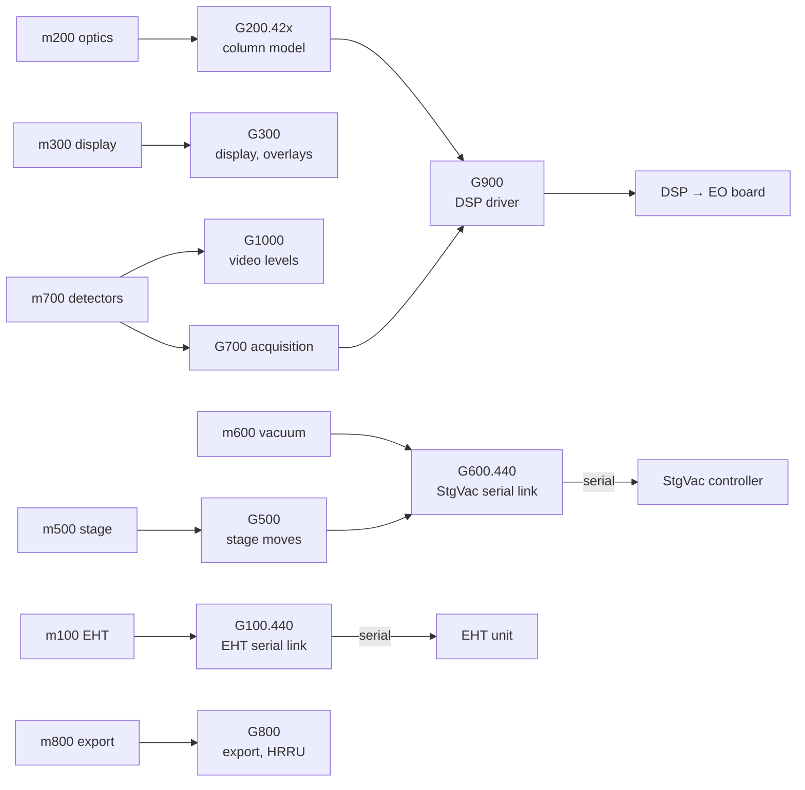

[Home](../../README.md) › GSP firmware

# Firmware on the image processor board

> **In short:** the board's GSP processor has no fixed program: the PC loads **one firmware module per subsystem** at
> start-up (files in `C:\TIGA`). The modules still carry their symbol names, so every function is named. They do the
> real-time work: ramps, unit conversions, serial communication and retries, and the DSP commands.

Disassembly of every module: [`asm/`](asm). Serial command sets: [Serial protocols](serial-protocols.md).

---

## Technical reference

*Full detail for maintenance and further reverse engineering: function names, addresses, parameters, sources. Inferred points are marked \*?\*.*

The files in `C:\TIGA` (plus `C:\WINDOWS\SYSTEM\TIGAWIN.RLM`) are **TI COFF object files for the TMS340x0 GSP**
(magic `0x0090`). They're linked at run time onto the board by TIGALNK / TIGASEM (`INSTALLRLM`, `INIT*RLM`).
Their symbol tables survive, so every module's functions and globals are named. One page per file, generated by
`tools/coff-symbols.ps1`.

| File | Built (UTC) | Symbols | Loaded by | Role |
|---|---|---|---|---|
| [`TIGAGM.OUT`](TIGAGM.OUT.md) | 1996-11-08 | 939 | sem_init | TIGA graphics manager (cursor, page flip, scan-wait interrupts) |
| [`TIGAWIN.RLM`](TIGAWIN.RLM.md) | 1992-02-25 | 434 | sem_init | LEO graphics engine for Windows |
| [`extprims.rlm`](extprims.rlm.md) | 1995-04-10 | 496 | TIGALNK -lx | TIGA extended drawing primitives |
| [`g100.440`](g100.440.md) | 2000-02-16 | 460 | m100 | **EHT**: own UART to the EHT supply ("EHT set": `_InitEHTUART`, `_EHTISR`, `_send_eht_set_acc_voltage`, `_send_eht_set_fil_current`, `_eht_fault_monitor`, `_interpret_hwid_response`, filament/EHT ramping, emergency rundown) |
| [`g200.420`](g200.420.md) / [`g200.440`](g200.440.md) | 1998-09-29 / 1997-04-22 | 1168 / 1130 | m200 | **Electron optics** through the DSP: `_DSP_set_EO_register`, `_DSP_read_EO_register`, scan enable/amplitudes, dual mag, emission, stereo, C3 ramp, spot, feature scan, covariance (autofocus) |
| [`g300.rlm`](g300.rlm.md) | 1997-06-19 | 816 | m300 | display / overlay / X-ray display |
| [`g500.rlm`](g500.rlm.md) | 2000-09-19 | 559 | m500 | **stage** control (messages to the stage/vacuum controller) |
| [`g600.440`](g600.440.md) | 1996-03-05 | 507 | m600 | **vacuum**: own UART to the combined stage/vacuum controller (`_InitStgVacUART`, `_SVISR`, `_COMMS_SOFTWARE_ID`, comms PSU) |
| [`g700.rlm`](g700.rlm.md) | 1998-10-13 | 364 | m700 | acquisition |
| [`g800.rlm`](g800.rlm.md) | 1994-06-03 | 371 | m300/m800 | overlays / image export (`_DSP_send_message`, compression) |
| [`g900.rlm`](g900.rlm.md) | 1996-01-26 | 311 | m200 | **DSP driver**: dual-port RAM, DSP control/interface/interrupt ports, `_DSPISR`, command queue, feature scan |
| [`G1000.RLM`](G1000.RLM.md) | 1998-11-04 | 536 | m700 | video levels / detectors (gbricont: brightness/contrast) |

`.420` / `.440` = variants for the LEO 420 and 440 column families.

### What this says about the hardware
- The image processor board carries **at least two serial links** handled by GSP firmware with their own interrupt handlers:
  one to the **EHT supply** (g100) and one to the **stage/vacuum controller** (g600, which has a comms CPU and a vac CPU).
- The **EO board** (lenses, scan coils, stigmators, beam blanking) is driven through the **DSP** and its registers (g200 → g900).
- The DSP program itself comes from `C:\WINDOWS\DPRAM.IMG` and its registers are initialised by `SEM_INIT.DAT` (see
  [../components/sem_init.md](../components/sem_init.md)).
- Floating-point helper symbols (`FS$*`, `FD$*`) are the TI C runtime; the code was written in C (TI TMS340 C compiler).

### Disassembly
Full disassembly of every module's `.text`, labelled with the COFF symbols, is in [`asm/`](asm) (`tools/disasm-gsp.ps1`,
MAME `unidasm -arch tms34020`; addresses are GSP bit addresses relative to the module's `.text`). Example finding: the two
serial links (EHT supply at GSP 0x60300000, stage/vacuum controller at 0x60380000) are 16550-style UARTs set to 9600 8N1
(see [../hardware-interface.md](../hardware-interface.md)).

---
[Home](../../README.md)
