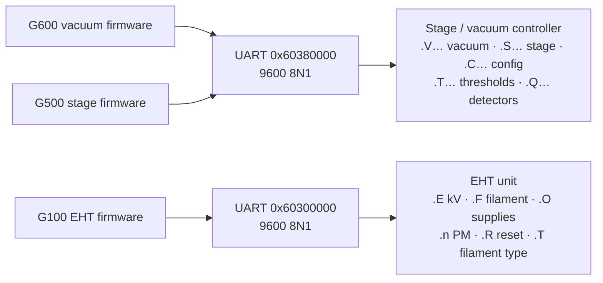

[Home](../../README.md) › [GSP firmware](README.md) › Serial protocols

# Serial protocols: EHT unit and stage / vacuum controller

> **In short:** two 9600-baud serial lines leave the image processor board. Both carry short **ASCII commands that
> start with a dot**: `.VL P` (pump), `.VL V` (vent), `.SF x y z t r` (stage move), `.E12C` (EHT 30.0 kV) and so on.
> The firmware modules build and send them; this page lists every command found.

---

## Technical reference

*Full detail for maintenance and further reverse engineering: function names, addresses, parameters, sources. Inferred points are marked \*?\*.*

Two 9600-baud 8N1 links leave the image processor board (see [../hardware-interface.md](../hardware-interface.md)):
one to the **stage/vacuum controller** ("StgVac", UART at GSP 0x60380000) and one to the **EHT supply** (UART at 0x60300000).

### Stage/vacuum controller: ASCII commands `.XX [args]`
Recovered from the firmware modules' data (command strings) and cross-referenced to the functions that send them
(`tools/gsp-string-xref.ps1`; full table with addresses in [serial-commands.csv](serial-commands.csv)).
Argument formats: [below](#argument-formats-decoded-from-the-firmware); disassembly in [asm/](asm).

#### Vacuum and configuration (sent by `G600.440`)
| Cmd | Firmware function | Meaning |
|---|---|---|
| `.CA` | `_configure_airlock_tiga` | configure airlock |
| `.CB` | `_configure_viewing_window_tiga` | configure viewing window |
| `.CC` | `_configure_front_panel_tiga` | configure front panel |
| `.CD` | `_config_vac_tilt0_tiga_request` | vacuum tilt-0 configuration |
| `.CE` | `_configure_column_pumping_tiga` | configure column pumping |
| `.CF` | `_configure_edx_tiga` | configure EDX |
| `.CG` | `_configure_wdx_tiga` | configure WDX |
| `.VL` | `_system_pumping_tiga` | system pumping (pump/vent) |
| `.VB` | `_column_pumping_tiga` | column pumping |
| `.VO` | `_operate_isolation_valve_tiga` | operate isolation valve |
| `.VP` | `_column_isolation_tiga` | column isolation |
| `.VI` | `_operate_wdx_gate_valve_tiga` | WDX gate valve |
| `.VT` | `_read_vacuum_status`, `_ProcStgVacCmds` | read vacuum status |
| `.VS` | `_vacuum_fault_routine` | vacuum fault handling |
| `.VU` | `_save_system_config_data` | save system configuration |
| `.VV` | `_get_system_config_data`, `_read_vacuum_software` | get configuration / vacuum software id |
| `.VV 66` | `_check_vac_board` | check vacuum board |
| `.VX` | `_read_comms_software` | comms software id |
| `.VX 65` / `.VW 65` | `_touch_alarm_off` | touch alarm off |
| `.VX 61` / `.VW 61` | `_calibrate_scm` | calibrate specimen current meter |
| `.VY` | `_get_comms_psu` | comms PSU status |
| `.TA` | `_set_scint_threshold` | scintillator interlock threshold |
| `.TB` | `_set_acc_threshold` | acceleration voltage threshold |
| `.TC` | `_set_pm_threshold` | photomultiplier threshold |
| `.TD` | `_ion_pump_threshold` | ion pump threshold |
| `.TE` | `_set_fil_threshold` | filament threshold |
| `.TH` | `_set_edx_threshold_tiga` | EDX threshold |
| `.QA` | `_set_qbsd_control_tiga_request` | 4-quadrant BSD control |
| `.QB` | `_set_qbsd_visible_tiga_request` | QBSD visible quadrants |
| `.QC` | `_set_qbsd_gain_tiga_request` | QBSD gain |
| `.QD` | `_set_scm_range_tiga_request` | specimen current meter range |
| `.QE` | `_take_scm_reading` | specimen current reading |

So the "vacuum" controller also hosts the interlock thresholds (vacuum vs. EHT/scintillator/PM/filament), the touch alarm,
the 4-quadrant BSD amplifier and the specimen current meter.

#### Stage (sent by `G500.RLM`)
| Cmd | Firmware function | Meaning |
|---|---|---|
| `.SA` | `_set_stage_position` | set (calibrate) stage position |
| `.SB` | `_set_cruising_speed` | cruising speed |
| `.SC` | `_set_ramp_rate` | ramp (acceleration) rate |
| `.SD` | `_read_stage_status` | stage status |
| `.SE` | `_send_axes_reset` | reset axes |
| `.SF` | `_move_to_a_position` | move to a position |
| `.SH` | `_move_a_short_distance` | short relative move |
| `.SI` | `_move_stage_at_speed` | move at speed (joystick) |
| `.SJ` | `_set_usr_upr_limits_tiga_request` | user upper limits |
| `.SK` | `_send_abort_move_tiga_request` | abort move |
| `.SL` | `_set_stage_config` | stage configuration, one axis per line |
| `.SM` | `_write_axis_register` | write axis register |
| `.SN` | `_read_axis_register`, `_read_axis_software` | read axis register / software |
| `.SO` | `_set_stage_lower_limits` | lower limits |
| `.SP` | `_stage_fault_routine` | stage fault handling |
| `.SQ` | `_set_usr_low_limits_tiga_request` | user lower limits |
| `.SR` | `_disable_touch_alarm_tiga_reques` | disable touch alarm |
| `.SS` | `_check_stage_psu_tiga_request` | stage PSU check |
| `.SV` | `_set_axis_stepsizes` | axis step sizes |
| `.SW` | `_write_joystick_pixelsize` | joystick pixel size |
| `.SY` | `_read_hw_fw_ver_numbers`, `_send_stage_command` | hardware/firmware version |
| `.SZ` | `_general_stage_cmd_tiga_req` | general stage command |

#### Request numbers (PC → board) behind these commands
LEO's error help ([../help/ERRORS/ERRORS.txt](../help/ERRORS/ERRORS.txt), "Vacuum Command error" / "Stage Command Error") lists the
request codes the PC side queues to the GSP; the error dialog shows the failing code. Full list: [../command-codes.csv](../command-codes.csv).

| Code | Vacuum request | → serial | | Code | Stage request | → serial |
|---|---|---|---|---|---|---|
| 1 | CONFIGURE_FRONT_PANEL_REQ | `.CC` | | 1 | SET_UP_STAGE_REQ | config |
| 2 | SYSTEM_PUMPING_REQ | `.VL` | | 2 | MANUAL_INIT_REQ | `.SE`/`.SA` |
| 3 | CONFIG_VIEWING_WINDOW_REQ | `.CB` | | 3 | AUTO_INIT_REQ | `.SE` |
| 4 | CONFIG_COLUMN_PUMPING_REQ | `.CE` | | 4 | LOWER_USER_LIMITS_REQ | `.SQ` |
| 5 | COLUMN_PUMPING_REQ | `.VB` | | 5 | UPPER_USER_LIMITS_REQ | `.SJ` |
| 6 | COLUMN_ISOLN_REPLY_REQ | `.VP` | | 6 | TIGA_TIMER_TICK_REQ | (status poll `.SD`) |
| 7 | EDX_CONFIGURE_REQ | `.CF` | | 7 | SPEED_MOVE_REQ | `.SI` |
| 8 | WDX_CONFIGURE_REQ | `.CG` | | 8 | STAGE_POSITION_REQ | `.SF`/`.SH` |
| 9 | FILAMENT_THRESH_REQ | `.TE` | | 9 | BACKLASH_REQ | backlash |
| A | EDX_THRESH_REQ | `.TH` | | A | MOVE_MODE_REQ | — |
| B | SET_4QBSD_QUADRANT_REQ | `.QA` | | B | ABORT_REQ | `.SK` |
| C | SET_4QBSD_VISIBILITY_REQ | `.QB` | | C–11 | STAGE_PARAMS_V_START / V_INC / T_STEP / BACKLASH_SPD / BACKLASH_DST / MAXIMUM_SPD | `.SC` `.SB` `.SV`… |
| D | SET_4QBSD_GAIN_REQ | `.QC` | | 12 | GET_ERROR_STATUS | `.SP` |
| E | SET_SCM_RANGE_REQ | `.QD` | | 13 | CHECK_STAGE_PSU | `.SS` |
| F | SCM_READINGS_REQUIRED_REQ | `.QE` | | | | |
| 10 | VACUUM_TIMER_ROUTINE_REQ | `.VT` (status poll) | | | | |
| 11 / 12 | WRITE / READ_VACUUM_DATA_REQ | `.VU` / `.VV` | | | | |
| 13 | OPER_WDX_GATE_VALVE_REQ | `.VI` | | | | |
| 14 | AIRLOCK_CONFIGURE_REQ | `.CA` | | | | |
| 15 | SET_TILT0 | `.CD` | | | | |
| 16 | SET_TOUCH_ALARM_OFF | `.VX 65`/`.VW 65` | | | | |
| 17 | GET_VACUUM_ERRORS | `.VS` | | | | |
| 18 | GET_COMMS_PSU | `.VY` | | | | |

(The request → serial pairing is by name and by the firmware function that sends each command; the help states codes
below 0x40 are communication failures with the stage/vacuum subsystem, above 0x40 internal queueing errors.)

### Argument formats (decoded from the firmware)
Every line is built in a RAM buffer (`0x349A0` in G600, `0x58A40` in G500): `strcpy` of the command text, `strcat` of
the arguments, and **CR LF** at the end (added by `_retry_vac_command` / `_send_stage_command`). Where an argument
follows, the command text already ends in a space (`".VL "`), so a line is for example `.VL P␍␊`.
Numbers are written with the module's own `_ltoa` (**decimal**, minus sign if negative) or `_hexstr` (**upper-case hex,
no leading zeros**, `0` for zero). Replies to read commands are parsed with `_hextoc` (hex, leading spaces skipped).
A request value outside the listed ones is refused (error code 10 in `0x2F900`, nothing sent).

#### Vacuum and configuration (G600): one letter per state
| Line | Request value → letter | Letter meaning *?* |
|---|---|---|
| `.VL x` system pumping | 0 → `P`, 1 → `V`, 2 → `A` | pump, vent, airlock (?) |
| `.VB x` column pumping | 0 → `P`, other → `V` | pump, vent |
| `.VO x` isolation valve | 0 → `C`, 1 → `O`, 2 → `A` | close, open, automatic |
| `.VP x` column isolation | 1 → `I`, other → `C` | isolate, connect |
| `.VI x` WDX gate valve | 0 → `C`, 1 → `O` | close, open |
| `.CC x` front panel, `.CB x` viewing window, `.CF x` EDX | 1 → `P`, other → `N` | present, not present |
| `.CD x` tilt-0 | 0 → `N`, 1 → `P` | not present, present |
| `.CE x` column pumping config | 0 → `N`, 1 → `M` | none, manual (?) |
| `.CG x` WDX | 0 → `N`, 1 → `M`, 2 → `A` | none, manual, automatic |
| `.CA x` airlock | 0 → `N`, 1 → `O` | none, fitted (?) |
| `.QA q m` 4Q-BSD quadrant | first value 4…7 → `q` = `1`…`4`; second 0 → `O`, 1 → `N`, 2 → `I` | quadrant; off, normal, inverted |
| `.QB x` 4Q-BSD visible | 1 → `V`, other → `I` | visible, invisible |
| `.QC x` 4Q-BSD gain | 0 → `L`, 1 → `M`, 2 → `H`, 3 → `V` | low, medium, high, very high |
| `.QD n` SCM range | range number, decimal | |
| `.TA n`, `.TC n`, `.TH n` thresholds | `n` = `_calculate_threshold(value, 0)`, decimal | |
| `.TB n m`, `.TE n m` | `n`, `m` = `_calculate_threshold(value, 0)` and `(value, 1)`, decimal: two limits from one setting | |
| `.TD n m` ion pump | `n` from the first value (index 0), `m` from the second (index 1), decimal | |

Status and memory access:

| Line | Use |
|---|---|
| `.VT` | vacuum status (polled by the timer request); `.QE` takes an SCM reading |
| `.VS` / `.VY` | vacuum error data / comms PSU status |
| `.VV a` | read one byte of the vacuum controller's memory at hex address `a`; reply = the byte in hex |
| `.VU a v` | write byte `v` (hex) at hex address `a` |
| `.VV 3000` … `.VV 348E` | `_get_system_config_data`: reads the 1167-byte (`0x48F`) system configuration block, one byte per line, into GSP `0x317A0`; `_save_system_config_data` writes it back with `.VU 3000 v` … |
| `.VV 80` … `.VV 86` | vacuum software id, 7 bytes (`_read_vacuum_software`) |
| `.VX a` / `.VW a v` | the same read / write on the **comms board**; `.VX 80` … `.VX 86` = comms software id |
| `.VX 65` → `.VW 65 v` | touch alarm off: read register `0x65`, clear bit `0x40`, write it back |
| `.VX 61` → `.VW 61 v` (twice) | calibrate SCM: read register `0x61`, write it with bit `0x04` set, then with it cleared (a pulse) |
| `.VV 66` | check vacuum board: read register `0x66` |

#### Stage (G500): one value per fitted axis
The stage has six axis slots in this order: **X Y Z T R M** (from the `.SL` texts). Each slot has a flag (GSP `0x4D300`
+ 8 × slot); only slots whose flag is 1 (motorised) get a value, written as a space and a decimal number. So a 3-axis
stage sends three numbers, a 5-axis stage five.

| Line | Value per fitted axis |
|---|---|
| `.SF a b …` move to a position | target, float → integer (`FD$FTOI`) |
| `.SH a b …` short relative move | signed byte |
| `.SI a b …` move at speed (joystick) | signed 16-bit speed |
| `.SB a b …` cruising speed | signed 16-bit |
| `.SC a1 a2 a3 b1 b2 b3 …` ramp | three per axis: start speed, speed increment (16-bit), timer step (float → integer) |
| `.SA` / `.SQ` / `.SJ` / `.SO` set position / user lower / user upper / lower limits | position converted to motor steps by `_calc_step_pos(value, offset, scale)` (per-axis offset at `0x4D640` + 0x20 × slot, scale at `0x4D340` + 0x20 × slot) |
| `.SV a b …` step sizes | float → integer after a division |
| `.SE f f …` reset axes | ` 1` for an axis whose request byte is 0, ` 0` otherwise *?* |
| `.SL X 0` … `.SL M 5` | `_set_stage_config`: request value 1…6 selects the axis letter and slot number |
| `.SW n` | joystick pixel size, one integer |
| `.SZ A n` / `.SZ  n` | general command: request value 1 → `A ` and the second value × 10 as an integer, otherwise two spaces and an integer *?* |
| `.SN a r` / `.SM a r v` | read / write register `r` (hex) of axis `a` (decimal); value `v` in hex; reply parsed as hex |
| `.SD`, `.SS`, `.SY`, `.SK`, `.SR`, `.SP` | no argument: status, PSU check, hardware / firmware version, abort, disable touch alarm, fault data |

The bytes on the line are exact (read from the code); what each letter stands for comes from the code paths and the
request names, and is marked *?* where it is only the best reading.

### EHT supply ("EHT set")
Same style: ASCII lines starting with `.` and a command letter, values as **hex digits** (`_ltohex` / `_hextol`), lines
terminated by a newline (the receive path cuts each line at `\n`, max 79 characters, in `_add_string_terminator`).
The command letter is built in the message buffer at GSP 0x34CA8 as `'.'` followed by `0x2E + k`.

| Cmd | Firmware function | Value |
|---|---|---|
| `.E` | `_send_eht_set_acc_voltage`, `_r_send_eht_set_acc_voltage` | acceleration voltage, scaled ×10 and rounded (+0.5), 3 hex digits → 0.1 kV steps, e.g. 30 kV = `.E12C` *(scaling read from the code; units to confirm on the machine)* |
| `.F` | `_send_eht_set_fil_current`, `_r_send_eht_set_fil_current` | filament current |
| `.A` | `_set_eht_set_anode_type` | anode type |
| `.B` | `_set_eht_set_beam_current` | beam current |
| `.C` | `_set_eht_set_collecter_bias` | collector bias |
| `.T` | `_set_eht_set_fil_type` | filament type |
| `.O` | `_set_eht_set_supply_state`, `_r_set_eht_set_supply_state`, `_supply_toggle` | supply on/off state |
| `.R` | `_send_an_eht_set_reset` | reset the EHT unit |
| `.n…` | `_set_eht_set_pm_voltage` | photomultiplier voltage: `.`, one hex digit `n` = PM number (clamped 1 … 3), then `round(volts × 4)` as 3 hex digits, CR (e.g. `.1898` = PM1 at 550 V) |

Other functions: `_send_direct_command` (raw command from the PC, TIGASEM `SENDGSPDIRECTCOMMAND`), `_request_eht_set_status`,
`_request_eht_set_values`, `_read_eht_set_hw_id`, `_eht_fault_monitor`, emergency rundown. Error texts: "Invalid Command!",
"Unknown Command!", "Error code received", "Readback OFF!". Disassembly: [asm/g100.440.asm](asm/g100.440.asm).

These two ASCII protocols mean the EHT unit and the stage/vacuum controller can be **exercised from any PC terminal at 9600 8N1**
for bench testing, with the argument formats above (the meaning of a few letters still to confirm on a working machine).

---
[← GSP firmware](README.md) · [Home](../../README.md)
