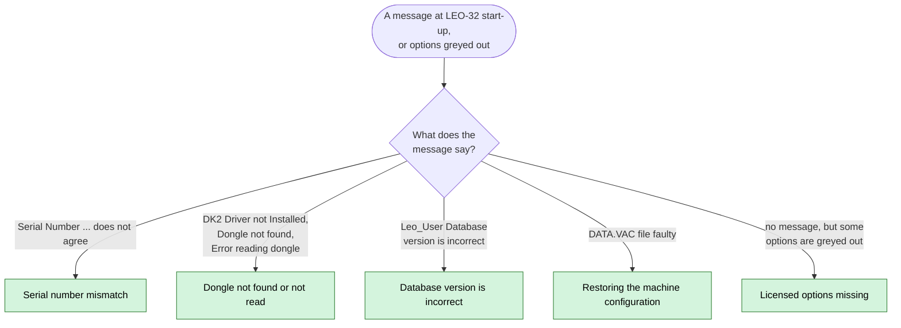

[Home](../../README.md) › [Troubleshooting](../troubleshooting.md) › Fix guides

# Fix guides

> **In short:** one page per problem, meant to be followed at the microscope. Each guide explains what the message
> means, which fix to use, **what it changes**, what you need (login, password, files), the steps, and how to check it
> worked. The technical background is linked at the end of each guide.

**[Key Recovery Helper](https://elpoupa.github.io/leo430-sem-archive/):** the same serial-number, dongle and licence procedures as a guided page, logins included; it also generates the daily Key Code (Rescue SN, Write Dongle, temporary licences or calibration).

| Message or symptom | Guide |
|---|---|
| "Serial Number read from dongle does not agree with Data.Vac" · "Serial Number in Data.Vac does not agree with Serial Number in Database" · after restoring a disk image on another LEO 430 | [Serial number mismatch](serial-mismatch.md) · [Key Recovery Helper](https://elpoupa.github.io/leo430-sem-archive/) |
| "DK2 Driver not Installed" · "Dongle not found" · "Error reading dongle" | [Dongle not found or not read](dongle-not-found.md) · [Key Recovery Helper](https://elpoupa.github.io/leo430-sem-archive/) |
| "The Leo_User Database version is incorrect" | [Database version is incorrect](database-version.md) |
| message 414 "DATA.VAC file faulty, DEFAULT.VAC used" · 415 "DEFAULT.VAC faulty" · magnification and focus values wrong | [Restoring the machine configuration](restore-configuration.md) |
| no message, but some options greyed out | [Licensed options missing](licences-missing.md) · [Key Recovery Helper](https://elpoupa.github.io/leo430-sem-archive/) |

**Before any fix:** make a backup of the machine files (Parachute, or copy `C:\LEO\data.vac` and
`…\LEO-32\SYSTEM\leo_user.mdb` to a USB stick or another folder). See
[Backing up and restoring](../components/utilities.md#backing-up-and-restoring-the-machine-files-parachute).

**Logins used in these guides** (LEO's own service accounts, passwords not case-sensitive; what each one may do:
[Service accounts](../components/service-accounts.md)):

| User name | Password | Needed for |
|---|---|---|
| `Service` | `petrol` | LEO Administrator, Service menu (serial numbers, Rescue SN, service log) |
| `Factory` | `keele` | everything Service can do, plus the Factory menu (set the serial by hand) and Set All / Clear All licences |
| `Development` | `stansted` | everything Factory can do, plus editing the LEO accounts themselves |

**Need files to recover a machine** (for example a lost `data.vac` or the LEO-32 installation)? [Open an issue](https://github.com/ELPoupa/leo430-sem-archive/issues/new/choose).

These guides are built from how the software was decoded; the steps were **not yet tried on a real machine**.
If a screen looks different from the description, stop and check the linked technical page.

---
[← Troubleshooting](../troubleshooting.md) · [Home](../../README.md)
