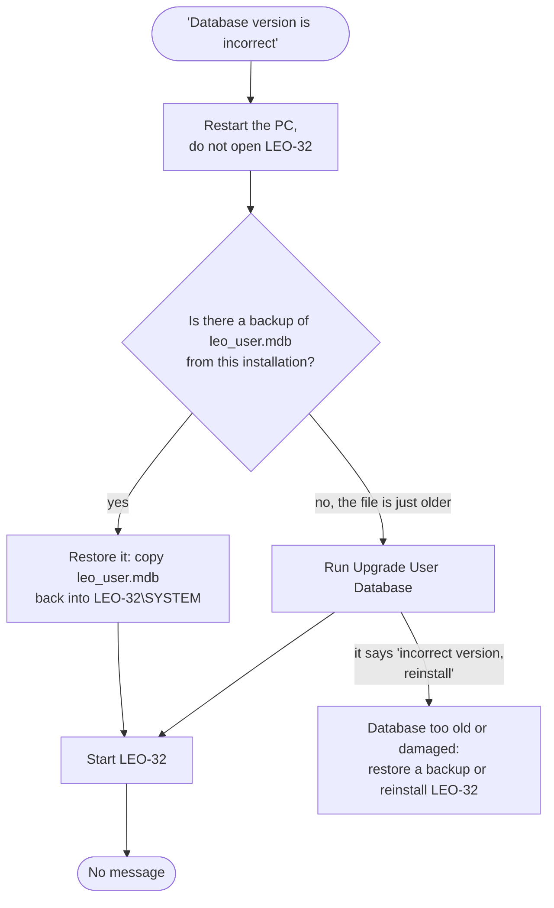

[Home](../../README.md) › [Troubleshooting](../troubleshooting.md) › [Fix guides](README.md) › Database version is incorrect

# Database version is incorrect

> **In short:** LEO-32 keeps users, licences and the serial number in a database file, `leo_user.mdb`. The registry
> says which version of that file the installed LEO-32 expects. If the file is a different version, the server
> stops checking at once and **starts with all licensed options off**. The fix is LEO's own **Upgrade User
> Database** tool, or restoring the database that belongs to this installation.

## What you see
At LEO-32 start-up: "The Leo_User Database version is incorrect. Upgrade it using the Upgrade Database Utility."
The microscope works, licensed options are grey.

## Why
Two values must be equal:
- the registry value `DB Version` in `HKEY_LOCAL_MACHINE\Software\LEO Electron Microscopy Ltd\LEO-32`
  (`09.02` for LEO-32 V02.04);
- the `Version` entry inside `…\LEO-32\SYSTEM\leo_user.mdb`.

They differ when an older database was copied back (from an older backup or another PC), or after a LEO-32 update
whose database step did not run.

## What the fix changes
- **Upgrade User Database** (`checkdb.exe`) adds the tables and fields of each newer version to `leo_user.mdb`, one
  version step at a time (from 01.02 up to the version the registry asks for), then compacts the file and updates
  `C:\WINDOWS\SYSTEM\oeminfo.ini`. It only adds; users, passwords, licences and the serial already in the file
  should stay as they are *?* (decoded from the program, not tried).
- **Restoring a backup** replaces the whole file: users, licences and serial come back as they were when the backup
  was made.
- Neither touches DATA.VAC, the calibration or the dongle.

## What you need
- A freshly restarted PC, with **SEM User Interface and LEO Administrator not opened** (the database must not be
  open; closing the SEM window does not always stop the LEO server, a restart does).
- A copy of the current `…\LEO-32\SYSTEM\leo_user.mdb` (and `system.mda` next to it) before changing anything.
- No login.

## Steps
1. Restart the PC and do not open SEM User Interface or LEO Administrator: neither starts by itself, so nothing has the file open.
2. Back up `…\LEO-32\SYSTEM\leo_user.mdb` and `system.mda` (copy them to another folder).
3. Start → Programs → **LEO-32 Service → Upgrade User Database**. It compares the database with the registry and
   upgrades it.
   - If it says "The LEO Database is the incorrect version. Please delete …\system\leo_user.* and reinstall Leo32",
     the file is from a version it cannot upgrade. Restore a matching backup instead (Parachute keeps
     `LEO_USER.MDB` and `SYSTEM.MDA` in `C:\Backups\<date>`), or reinstall LEO-32.
4. Start SEM User Interface.

## Check it worked
No database message at start-up. If a serial message appears now, the restored or upgraded database holds a different
serial: see [Serial number mismatch](serial-mismatch.md).

## Technical reference
- The check order at start-up (the version test comes first): [DESkey → Decision flow](../components/deskey.md#decision-flow-fun_00417c50)
- What the upgrade tool does: [Utilities → checkdb](../components/utilities.md)
- Backups with Parachute: [Backing up and restoring](../components/utilities.md#backing-up-and-restoring-the-machine-files-parachute)
- Registry values: [Registry](../registry-config.md)

---
[← Fix guides](README.md) · [Troubleshooting](../troubleshooting.md) · [Home](../../README.md)
