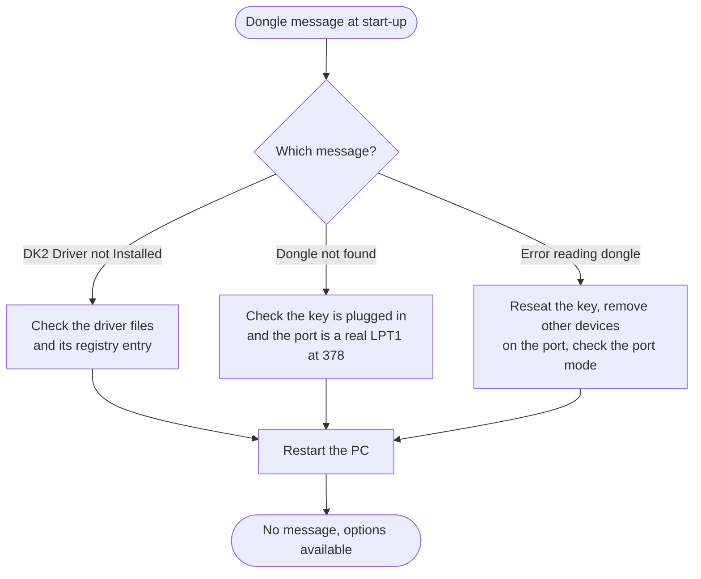

[Home](../../README.md) › [Troubleshooting](../troubleshooting.md) › [Fix guides](README.md) › Dongle not found or not read

# Dongle not found or not read

> **In short:** the licensed options need the **DESkey dongle**, a small key plugged into the PC's parallel (printer)
> port. If Windows' dongle driver is missing, the key is not found, or it cannot be read, LEO-32 still starts and the
> microscope works, but **all licensed options stay off**. The fix is on the PC side: key, port, driver. No login and
> no LEO software setting is involved.

**Guided version:** the [Key Recovery Helper](https://elpoupa.github.io/leo430-sem-archive/) covers these checks and, when no dongle is available, the procedure for running LEO-32 without one (Omit Dongle Check).

## What you see
| Message at LEO-32 start-up | Meaning |
|---|---|
| "DK2 Driver not Installed. Licences will not be enabled." | Windows did not load the dongle driver `DK2WN95.386` |
| "Dongle not found. Licences will not be enabled." | the driver is loaded but no key answered on the port |
| "Error reading dongle. Licences will not be enabled." | the key answered but 10 reads in a row failed |
| a box "Waiting for Printer to Finish" with a Cancel button | the port is busy (a print job or a printer on the same port) |

## What the checks change
Nothing in LEO-32's data: no serial, licence or calibration value is touched. Only hardware, the BIOS port setting or
Windows' driver installation.

## Checks, in order
1. **The key is on the right port.** It plugs into the PC's parallel port **LPT1** (25-pin printer socket). If a
   printer is connected, it goes into the back of the key; try once without the printer.
2. **The port is a real parallel port at address `378`.** In the PC's BIOS setup: parallel port enabled, address
   `378` (`0x378`), standard / normal mode is the safest choice *?* (the mode was not checked on the real PC).
   **USB-to-parallel adapters do not work**: the driver talks to the port hardware directly, which only a built-in
   port or an expansion card at `378` provides.
3. **The driver files are present** on the PC: `C:\WINDOWS\SYSTEM\DK2WN95.386` (Windows driver) and
   `C:\WINDOWS\SYSTEM\DK2WIN32.DLL` (used by LEO-32).
4. **The driver is registered** so Windows loads it at boot: registry key
   `HKEY_LOCAL_MACHINE\System\CurrentControlSet\Services\VxD\DK2 Windows95 Driver` with `StaticVxD` =
   `DK2WN95.386` and `LPTPort` = `0x378`. If it is missing, the driver installation from LEO's software distribution
   has to be repeated (or the key imported from a backup of the registry). After any change: restart Windows.
5. **Nothing else uses the port** while LEO-32 starts: no print job, no other parallel-port device. If the
   "Waiting for Printer to Finish" box appears, let the print finish or cancel it.
6. **Still "Error reading dongle"** with everything above correct: the key itself may be faulty. Try it on another
   PC with the same software, or contact the manufacturer for a replacement key holding the machine's serial.

## Check it worked
LEO-32 starts without a dongle message, and LEO Administrator → Service → Serial Numbers… shows the serial read from
the dongle. If you now get "Serial Number read from dongle does not agree with Data.Vac", continue with
[Serial number mismatch](serial-mismatch.md).

## Technical reference
- How LEO-32 reads the key (driver chain, port registers, retries):
  [DESkey → DK2WIN32.DLL](../components/deskey.md#dk2win32dll-32-bit-api) and [DK2WN95.386](../components/deskey.md#dk2wn95386-vxd)
- The start-up check and its messages: [DESkey → Decision flow](../components/deskey.md#decision-flow-fun_00417c50)
- Where the driver is loaded during boot: [Start-up](../boot-chain.md)
- Registry settings: [Registry](../registry-config.md)

---
[← Fix guides](README.md) · [Troubleshooting](../troubleshooting.md) · [Home](../../README.md)
