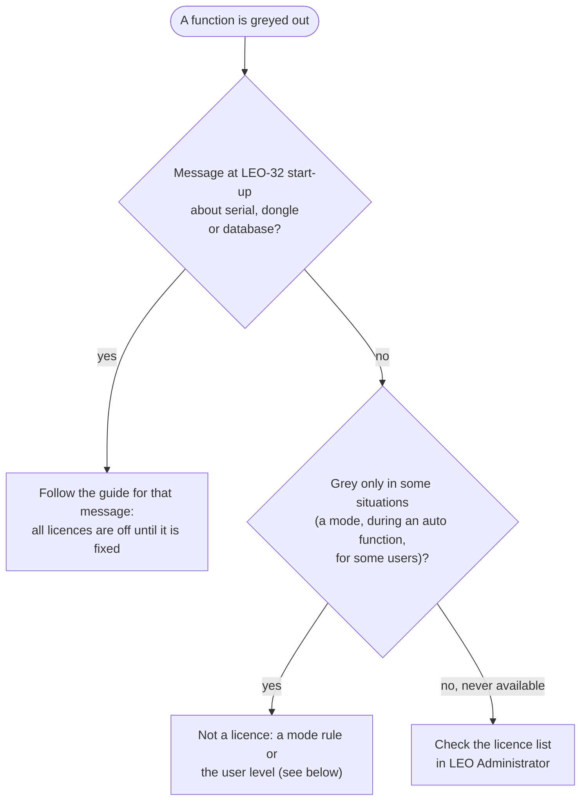

[Home](../../README.md) › [Troubleshooting](../troubleshooting.md) › [Fix guides](README.md) › Licensed options missing

# Licensed options missing

> **In short:** some functions of LEO-32 are paid options (licences). If **all** of them are grey, the start-up
> check failed and a message says why. If only **one** function is grey and there is no message, it is usually not
> a licence at all but a rule of the current mode or the user's level. This guide sorts out which case you have.

**Guided version:** the [Key Recovery Helper](https://elpoupa.github.io/leo430-sem-archive/) covers the serial-number comparison, Restore Licences and the related fixes, and generates the Key Code for All Licences (Temporary).

## Which case?

## Case 1: a message at start-up
All licensed options stay off until the start-up check passes. Fix the message first:
[Serial number mismatch](serial-mismatch.md) · [Dongle not found or not read](dongle-not-found.md) ·
[Database version is incorrect](database-version.md).

## Case 2: grey only in some situations
LEO-32 greys out commands that make no sense in the current state, for example during spot mode, while an auto
function runs, or with split screen. Leave that mode and try again. A user with a low **user level** also sees fewer
controls: log on as a user with a higher level, or ask the administrator to raise it (LEO Administrator → Users →
Edit). The full list of these rules: [Rules and licences](../subsystems/core-rules-accessories.md).

## Case 3: never available
Check whether the option is licensed on this machine:
1. Start → Programs → **LEO-32 → LEO Administrator**, log on as `Service` (password `petrol`).
2. Menu **Licences ..** opens "Licence Administration": every licence with its description, part number and sales code,
   and whether it is enabled.
3. If an option that this machine had before is now off, **Restore Licences** puts back the machine's stored licence
   set (as shipped by LEO). The change is sent to the running server at once; restarting LEO-32 is not required.
4. An option that the machine never had is a separate purchase: LEO supplied it as a licence file on floppy disk
   (`.lic`), installed with **Install from disk ..**. A licence file only installs on the machine whose serial it
   was made for.

The licences of a typical LEO 430 and what each one unlocks are listed in
[DESkey → Example licence set](../components/deskey.md#example-licence-set-a-typical-leo-430-serverlicences-the-same-as-masterlicences-and-copylicences)
and [Rules and licences](../subsystems/core-rules-accessories.md).

> **Do not press Clear All** (Factory and Development only) unless you mean it: it also erases the stored licence set,
> so Restore Licences can no longer bring the licences back. Only a backup of `leo_user.mdb` or the licence files can.

## What these steps change
Every button in Licence Administration writes the licence tables of `…\LEO-32\SYSTEM\leo_user.mdb`, then copies the
result to the table the server loads at start-up and tells the running server to reload it (LEOSERV admin function 13),
so the change is live at once. Back the file up first. Nothing is written to the dongle, DATA.VAC or the calibration.

| Button | Changes |
|---|---|
| tick / untick one licence | the working set only |
| Restore Licences | working set ← stored set |
| Install from disk .. | stored set and working set |
| Set All (Factory) | working set only |
| Clear All (Factory) | working set **and** stored set |

## Technical reference
- Where the licence set comes from at start-up: [DESkey → Where the licence set comes from](../components/deskey.md#where-the-licence-set-comes-from-fun_00419df0)
- What each button writes: [DESkey → Licence Administration: where a change goes](../components/deskey.md#licence-administration-where-a-change-goes)
- Licence files: [DESkey → Licence files](../components/deskey.md#licence-files-lic-licence-administrator--install-from-disk-)
- Which commands each licence enables: [Rules and licences](../subsystems/core-rules-accessories.md)
- LEO Administrator's forms: [LEO Administrator](../components/admin32.md)

---
[← Fix guides](README.md) · [Troubleshooting](../troubleshooting.md) · [Home](../../README.md)
