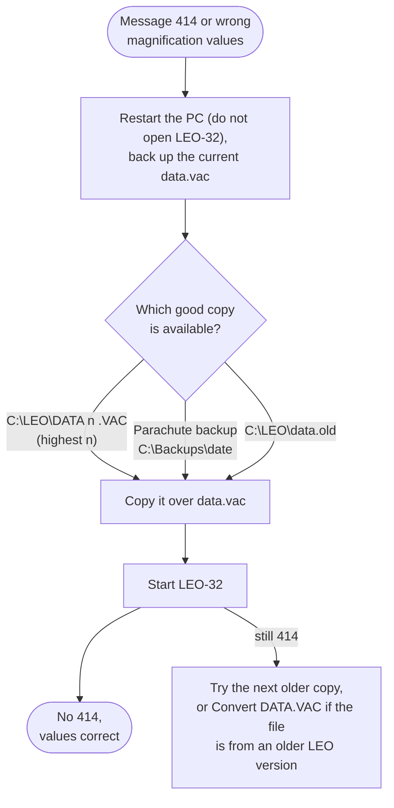

[Home](../../README.md) › [Troubleshooting](../troubleshooting.md) › [Fix guides](README.md) › Restoring the machine configuration

# Restoring the machine configuration (DATA.VAC)

> **In short:** `C:\LEO\DATA.VAC` holds this microscope's configuration and calibration (magnification, lens and
> stage calibration, fitted hardware, serial number). If it is missing or damaged, LEO-32 falls back to the factory
> defaults in `DEFAULT.VAC`: the microscope runs, but magnification, focus and lens values are wrong. The fix is to
> copy back the newest good copy. LEO-32 keeps one automatically.

## What you see
- Message **414** "DATA.VAC file faulty, DEFAULT.VAC used" at start-up, and/or magnification, focus and lens values
  that are clearly off.
- Message **415** "DEFAULT.VAC faulty, proceed with caution": both files are bad.

## Why
At start-up the server reads `C:\LEO\data.vac` and checks its version and checksum. If that fails it uses
`C:\LEO\default.vac` (factory values). After every **successful** start it also copies `data.vac` to
`C:\LEO\DATA<n>.VAC`, so there is always a copy of the last configuration that loaded cleanly.

## Where the good copies are (newest first)
| Copy | Notes |
|---|---|
| `C:\LEO\DATA<n>.VAC` (for example `DATA1.VAC`, `DATA2.VAC`) | made by LEO-32 after each good start. **Hidden and read-only**: switch on "show hidden files" in Explorer. If there are several, the **highest `<n>`** is the newest (the number goes up each time a start failed to load data.vac). |
| Parachute backups `C:\Backups\<date>\DATA.VAC` | one folder per backup day |
| `C:\LEO\data.old` | an older copy |

To compare copies: Start → Programs → **LEO-32 Service → View DATA.VAC** shows every field, including
**Write Times** (a counter that goes up at each save: the highest is the newest) and the serial number.

## What the fix changes
Only `C:\LEO\data.vac`: it becomes the copy you chose, with the calibration and settings it held at that time.
Calibrations done after that copy was made are lost and have to be redone. Users, licences and the dongle are not
touched.

## What you need
- A freshly restarted PC, with **SEM User Interface and LEO Administrator not opened** (closing the SEM window
  does not always stop the LEO server, a restart does).
- No login.

## Steps
1. Restart the PC and do not open SEM User Interface or LEO Administrator: neither starts by itself, so nothing has the file open.
2. Copy the current `C:\LEO\data.vac` to a safe folder (even if damaged, it may help later).
3. Choose the newest good copy (table above).
4. Copy it to `C:\LEO\` under the name **`data.vac`**, replacing the old one. If you copied `DATA<n>.VAC`, remove the
   read-only and hidden attributes of the new `data.vac` (right-click → Properties).
5. Start SEM User Interface.

## Check it worked
- No message 414 at start-up; magnification and focus values look normal.
- If a serial message appears now, the copy comes from another machine or another database: see
  [Serial number mismatch](serial-mismatch.md).
- If 414 persists with every copy, the files may be from an older LEO-32 version: Start → Programs →
  **LEO-32 Service → Convert DATA.VAC** upgrades an older file to the current layout.
- After restoring a disk image on **another** microscope, DATA.VAC still holds the source machine's calibration:
  recalibrate ([Calibration](../components/calibration.md)).

## Technical reference
- The safety copy `DATA<n>.VAC` and the start-up read: [LEO server → Good to know for repair](../components/leoserv.md#good-to-know-for-repair)
- DATA.VAC layout, checksum, how to find the newest copy: [File formats](../file-formats.md)
- Converter and viewer: [Utilities](../components/utilities.md)
- Backups: [Backing up and restoring](../components/utilities.md#backing-up-and-restoring-the-machine-files-parachute)

---
[← Fix guides](README.md) · [Troubleshooting](../troubleshooting.md) · [Home](../../README.md)
