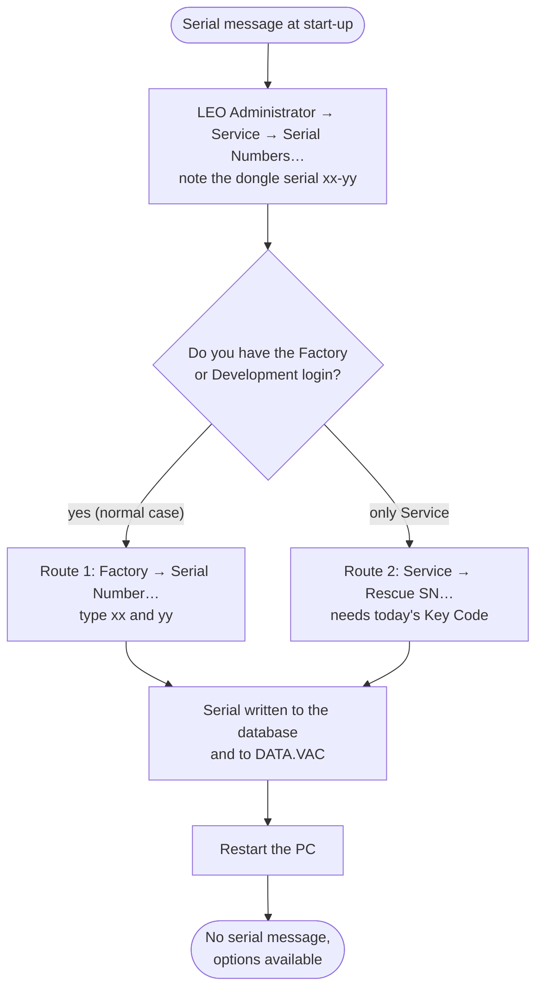

[Home](../../README.md) › [Troubleshooting](../troubleshooting.md) › [Fix guides](README.md) › Serial number mismatch

# Serial number mismatch

> **In short:** LEO-32 compares three copies of the machine's serial number at every start: the one in the
> **dongle** (the small key on the parallel port), the one in **`C:\LEO\DATA.VAC`** and the one in the **user
> database**. If they differ, the microscope still works but **all licensed options stay off** (grey buttons).
> The fix is to write the right serial into DATA.VAC and the database with **LEO Administrator**. Nothing is written
> to the dongle and nothing else changes.

## What you see
One of these messages in the server's message list when LEO-32 starts (and grey buttons for options such as split
screen, scan rotation, dynamic focus, stage store/recall, spot mode, RemCon32):

| Message | What disagrees | Usual reason |
|---|---|---|
| "Serial Number read from dongle does not agree with Data.Vac. Licences will not be enabled." | dongle ≠ DATA.VAC | the disk image comes from another LEO 430, or a dongle from another machine is fitted |
| "Serial Number in Data.Vac does not agree with Serial Number in Database. Licences will not be enabled." | DATA.VAC ≠ database | an older database or an older DATA.VAC was restored (a database copied right after the PC was installed holds `0000`) |

## Which serial is the right one?
**The dongle's.** The dongle belongs to the microscope; LEO wrote that machine's serial into it. A serial looks like
`LEO 430-xx-yy` (two 2-digit groups; the 4-digit form is `xxyy`).

To see all three side by side: LEO Administrator → log on (see below) → **Service → Serial Numbers…**. It shows the
serial read from the dongle, the one in the database and the one in DATA.VAC. Write down the dongle's `xx` and `yy`.
(If the dongle cannot be read, follow [Dongle not found or not read](dongle-not-found.md) first.)

## What the fix changes, and what it does not
| Changed | Not changed |
|---|---|
| user database `…\LEO-32\SYSTEM\leo_user.mdb`, table `keys`: the serial (`Serial_Number` = `xxyy`, `SerialNumber` = `LEO 430-xx-yy`) | the dongle (it is only read) |
| `C:\LEO\DATA.VAC`: the serial field, written by the LEO server (LEO Administrator starts it if it is not running) | calibration, beam time, filament data and everything else in DATA.VAC: still the values of the machine the image came from |
| `C:\WINDOWS\SYSTEM\oeminfo.ini`: the model text shown in Windows' System Properties | the licence list: still the set stored in the database (see [Licensed options missing](licences-missing.md) if options are still off) |

It can be undone the same way (type the old serial back) or by restoring the backup.

## What you need
- LEO-32 does **not** need to be running: LEO Administrator starts the LEO server itself to write DATA.VAC, so
  the first change can take a minute or two.
- **LEO Administrator**: Start → Programs → **LEO-32 → LEO Administrator** (`admin32.exe`).
- A login. Passwords are not case-sensitive:

  | Route | User name | Password |
  |---|---|---|
  | 1 (recommended) | `Factory` | `keele` |
  | 1 | `Development` | `stansted` |
  | 2 | `Service` (or Factory, Development) | `petrol` (`keele`, `stansted`) |
- A backup first: copy `C:\LEO\data.vac` and `…\LEO-32\SYSTEM\leo_user.mdb` somewhere safe (or run Parachute).

## Route 1: Factory → Serial Number… (no Key Code)
1. Start LEO Administrator, log on as **Factory** (password `keele`).
2. Menu **Factory → Serial Number…** (the Factory menu is only shown to Factory and Development). The window
   "Factory Settings" shows the machine type and two boxes with the serial currently in the database.
3. Type the dongle's serial: first box `xx`, second box `yy` (2 digits each).
4. **Leave "Omit Dongle Check" unticked.** Ticking it makes LEO-32 skip the dongle completely (meant for LEO's
   factory testing; the server then shows "The Dongle check has been omitted …" at every start).
5. Click **OK**. ("Invalid Serial Number" means a box does not contain two digits.)
6. Close LEO Administrator and restart the PC: the serial is checked when the LEO server starts (LEO Administrator
   may have started it in the background).

## Route 2: Service → Rescue SN… (with the daily Key Code)
Use this only if you cannot log on as Factory or Development.
1. Start LEO Administrator, log on as **Service** (password `petrol`).
2. Menu **Service → Rescue SN…**. The window reads the dongle and shows "Dongle Serial Number".
   "Dongle Read Failure" means the dongle cannot be read: see [Dongle not found or not read](dongle-not-found.md).
3. Enter **today's Key Code**. It is a number derived from the dongle text and the **PC's date** (so it changes every
   day). LEO service used to supply it; how it is calculated is described in
   [Key Code formula](../components/deskey.md#key-code-formula-fun_004981c0) (mode 2).
   "Key Code not Valid or Incorrect Serial Number read from Dongle" means the number does not match.
4. On success the program says **"Serial Numbers rescued"**: it has written the dongle's serial into the database,
   DATA.VAC and `oeminfo.ini`.
5. Close LEO Administrator and restart the PC: the serial is checked when the LEO server starts (LEO Administrator
   may have started it in the background).

## Check it worked
- LEO-32 starts without the serial message.
- LEO Administrator → Service → Serial Numbers…: the three values are the same.
- The licensed options (split screen, scan rotation …) are available again.

If the message is still there:
- "… dongle does not agree with Data.Vac" again: the DATA.VAC part was not written: the LEO server did not answer in
  time. Start SEM User Interface, wait until it is ready, and repeat.
- A different message: see the [Fix guides](README.md) list.
- No message, but some options still off: [Licensed options missing](licences-missing.md).
- After moving a disk image to another machine, the calibration is still the old machine's: recalibrate
  ([Calibration](../components/calibration.md)).

## Technical reference
- How the start-up check works, step by step: [DESkey → Decision flow](../components/deskey.md#decision-flow-fun_00417c50)
- Both routes in full detail (forms, what is written where):
  [DESkey → Moving a disk image to another LEO 430](../components/deskey.md#moving-a-disk-image-to-another-leo-430-rescue-serial-number)
- What each login may do: [Service accounts](../components/service-accounts.md)
- LEO Administrator menus and forms: [LEO Administrator](../components/admin32.md)
- Where the serial sits in DATA.VAC: [File formats](../file-formats.md)

---
[← Fix guides](README.md) · [Troubleshooting](../troubleshooting.md) · [Home](../../README.md)
