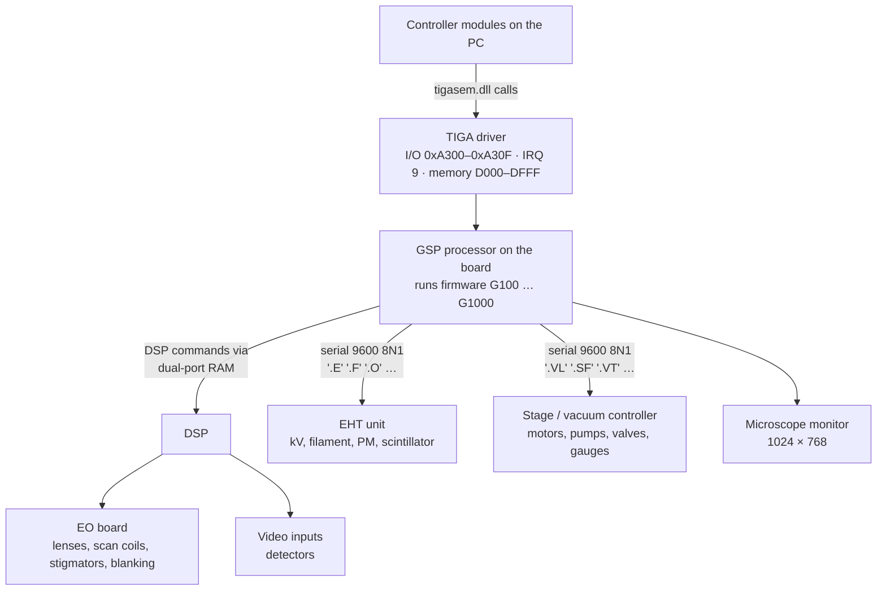

[Home](../README.md) › Hardware interface

# Hardware interface: how the PC drives the microscope

> **In short:** the PC does **not** talk to the microscope electronics directly. Everything goes through one ISA card,
> the **image processor board**, built around a TI **TMS34020 GSP** processor, an Analog Devices **DSP** and
> dual-port RAM. The PC loads one firmware module per subsystem into the GSP; those modules drive the EO board through
> the DSP and talk to the EHT unit and the stage / vacuum controller over two serial lines.



## For a replacement PC
The board needs: a free **ISA slot**, I/O **0xA300–0xA30F**, **IRQ 9** reserved for legacy ISA in the BIOS, and the
upper-memory range **D000–DFFF** left free (no shadow RAM, option ROM or EMM386 there). The DESkey needs a real
parallel port at **0x378**.

Firmware details: [GSP firmware](firmware/README.md) · [Serial protocols](firmware/serial-protocols.md) · [DSP](dsp/README.md).

---

## Technical reference

*Full detail for maintenance and further reverse engineering: function names, addresses, parameters, sources. Inferred points are marked \*?\*.*

Sources: decompiled `GSPHALT.EXE`, `EPROM.EXE`, `tigacd.exe`, `tigasem.dll`, `m*.dll` ([`decompiled/`](decompiled)),
`TIGA\TIGA.CFG`, the TIGASEM export table ([`tigasem-api.csv`](tigasem-api.csv)) and the controller modules' import tables.

### Big picture
The PC does **not** talk to the microscope electronics directly. Everything goes through one ISA board,
the **"Stereoscan Image Processor"**, built around a **TI TMS34020 graphics system processor (GSP)** with a DSP
and dual-port RAM. The GSP runs LEO firmware modules (TIGA `.rlm` / `.4x0` files), one per subsystem.
Those firmware modules talk on to the column electronics: the **EO board**, EHT supply, vacuum controller,
stage controller, detectors and the HRRU photo unit.

```
 LEO-32 (Win32)  ──thunk──►  srv16 + m100…m800 (Win16)
                                 │  call TIGASEM.DLL (Win16) by ordinal, one API block per subsystem
                                 ▼
                         TIGASEM.DLL ──► TIGA comms driver (TIGACD, INT 0x7F, TIGA.CFG)
                                 │        I/O 0xA300–0xA30F · IRQ 9 · memory windows D000/D800
                                 ▼
             ┌──────── ISA image processor board (TMS34020 GSP + DSP + dual-port RAM) ────────┐
             │  GSP firmware modules loaded at run time (INSTALLRLM / INIT*RLM):               │
             │  G100.440 EHT · G200.42x/44x EO · G500 stage · G600.440 vacuum · G700 acquire   │
             │  G900 feature scan/autofunctions · G1000 video/detectors · g300/g800 display    │
             │  TIGAWIN.RLM (Windows support) · extprims.rlm (TIGA extended primitives)        │
             └──────────────┬───────────────┬─────────────┬────────────┬───────────────────────┘
                            ▼               ▼             ▼            ▼
                       EO board        EHT supply     vacuum ctl   stage ctl   (+ detectors, HRRU)
                 (lenses, scan,       (gun, filament,  (pumps,     (5 axes,
                  stigmators, blank)   anode, scint.)   valves)     joystick)
```

### ISA board resources (from `TIGA\TIGA.CFG`)
`TIGA.CFG` is read by TIGACD (magic word `0x8214` at offset 0). Decoded fields:

| Offset | Value | Meaning |
|---|---|---|
| 0x00 | `0x8214` | file magic |
| 0x02 | `0x01A5` | file length (421 bytes) |
| 0x1C | text | board name: "LEO 400 Series 16 Colour Board 1024x768 60Hz" |
| 0x10 → 0x6E | `0x00F5`, `0x00B7` | display timing words *?* |
| 0x14 → 0x72 | `0x0009` | **IRQ 9** (tigasem programs both PICs: 0x20/0x21 and 0xA0/0xA1) |
| 0x74 | `0xA300` | **I/O base** (host interface registers) |
| 0x76 | `0x0010` | I/O range: 16 ports (0xA300–0xA30F) |
| 0x7A / 0x7E | `0xD000` / `0xD800` | **memory window segments** (0xD0000 and 0xD8000, 32 KB each) |

`TIGA.CL` lists the supported display configurations ("LEO 400 Series 16 Colour Board 1024x768 60Hz",
"Taxan Multivision 794 – 14 inch", "Taxan Ultravision 1095 – 20 inch"). The board drives its own
1024×768 monitor; the PC's S3 card drives the Windows screen.

**For repair or a replacement PC:** the board needs a free ISA slot, I/O `0xA300–0xA30F`, IRQ 9 reserved
for legacy ISA in the BIOS, and the upper-memory range `D000–DFFF` left free (no shadow RAM/option ROM/EMM386 there).

### Host interface protocol (real-mode tools)
From `GSPHALT.EXE` / `EPROM.EXE` (functions at 1000:0265, 1000:02C8, 1000:0329):
1. write the high part of the 32-bit GSP address to port **0xA301**, the low part (bits 0–1 cleared) to **0xA300**;
2. read/write 16-bit words through the memory window (window offset = address & 0x7FFF);
3. block transfers repeat step 2 over consecutive words.

TIGACD does the same through variables set from `TIGA.CFG` (base port and base+2), and uses the PC timer
(ports 0x40/0x43) for delays. `GSPHALT` halts the GSP; `EPROM OFF` unmaps the board EPROM at GSP address
0xEFF00000; `MCS2GSP` loads the memory-module LCA bitstream `MMLCA.MCS`; `TIGALNK -lx` links the extended primitives.

### TIGASEM API (the PC ⇄ board protocol)
TIGASEM.DLL exports 439 functions, grouped by ordinal block. Full list in [`tigasem-api.csv`](tigasem-api.csv).

| Ordinals | Block | Used by | Examples |
|---|---|---|---|
| 1–299 | TIGA core, host transfer, graphics | all | INITIALISETIGA, HOSTTOGSP, GSPTOHOST, POKEBREG, INSTALLRLM, SETINTERRUPT |
| 300–331 | Vacuum | m600 | INITVACCOMMS, READVACSTATUS, SYSTEMPUMPINGSTATE, CONFIGUREAIRLOCKTIGA, COLUMNISOLATIONTIGA, READCOMMSID, GETCOMMSPSUSTATUS |
| 500–572 | Display, overlay, output LUTs, histogram, profiles, X-ray maps | m300 | CREATEOVERLAYOBJ, SETOPLUTRGB, STARTHISTACQUIRE, GETPROFILEDATA |
| 700–735 | Stage | m500 | INITSTAGECOMMS, AUTOSTAGEINITTIGA, MOVETHESTAGETIGA, SETBACKLASHDISTTIGA, JOYSTICKEMULNTIGA, SETPROTECTEDZMODE |
| 816, 900–932 | EHT / gun | m100 | INITEHTCOMMS, SENDGSPEHTRAMPREQUEST, SETFILCURRENT, SETACCVOLTAGE, SETBEAMCURRENTGSPREQUEST, READEHTSETREADBACK |
| 2000–2141 | Electron optics | m200 | GSPINITEOBOARD, GSPSETMAG, GSPSETWORKINGDIST, GSPSETC1/C2/C3CAL, GSPSETSTIGMATORX/Y, GSPSETSCANROTATION, GSPBLANKBEAM, GSPPERFORMCOARSEAUTOFOCUS, GSPPERFORMAUTOSTIG |
| 4000–4033 | Acquisition | m700 | INITACQUIRECOMMS, FRAMEAVERAGETIGAREQUEST, SETGAMMALUTTIGAREQUEST, SETDETGAINTIGAREQUEST |
| 6000–6019 | DSP and dual-port RAM | m200, m700, m800 | INITDSPDRIVER, READDPRAM, WRITEDPRAM, READEO, WRITEEO, FEATURESCAN_STATUS |
| 8000–8018 | Image export, HRRU photo | m800 | INITIMAGECOMMS, LIVEPHOTO, SETFILMSPEED, SETCAMERATYPE |
| 10000–10022 | Video / detectors | m700 | GSPCONFIGUREDETECTOR, GSPAUTOVIDEO, GSPDOABC, GSPSETBSDAUTORANGE |

Each block has the same lifecycle: `SET<X>MODULE` (load the GSP firmware module), `INIT<X>COMMS` / `INIT<X>RLM`,
operation calls, `SUSPEND<X>MODULE`, `DEL<X>MODULE`.

### Controller modules → firmware modules
| PC module | Subsystem | GSP firmware (`C:\TIGA`) | TIGASEM block |
|---|---|---|---|
| m100.dll | EHT / gun | `G100.440` ("Failed to send command, Putqueue status", "Readback OFF") | 900 |
| m200.dll | Electron optics, scan, autofunctions | `G200.420` / `G200.440` ("EO board version"), `G900.RLM` (featscan) | 2000, 6000 |
| m300.dll | Display / overlays | `g300.rlm`, `g800.rlm` *?* | 500 |
| m500.dll | Stage | `G500.RLM` | 700 |
| m600.dll | Vacuum | `G600.440` (vacext) | 300 |
| m700.dll | Acquisition / detectors | `G700.RLM`, `G1000.RLM` (gbricont) | 4000, 10000 |
| m800.dll | Image export / HRRU | — | 8000 |
| sem_init.exe | Board/DSP initialisation | `TIGAWIN.RLM`, `sem_init.dat`, `dpram.img` | core |

The `.420` / `.440` suffixes are variants per microscope model (LEO 420 / 440 family); m200 references `G200.420`.
Which variant is loaded on this LEO 430 is still to confirm in m200's loader code.

`m007` (core) and `m070` (accessories/panel) don't touch the board; they hold the shared parameter
database (`M007_GETVALUE/PUTVALUE/GETSTATE/PUTSTATE/…`) that every other module reads and writes.

### Serial links on the board (from the firmware disassembly)
Both are 16550-style UARTs on the image processor board, mapped in GSP address space, registers 4 bytes apart
(GSP bit offsets 0x00, 0x20, 0x40, 0x60, 0x80 = RBR/THR·DLL, IER·DLM, IIR/FCR, LCR, MCR):

| Link | GSP address | Init routine | Divisor | LCR | IER | MCR | Result |
|---|---|---|---|---|---|---|---|
| EHT supply | 0x60300000 | `_InitEHTUART` (G100.440) | 0x000C | 0x03 | 0x05 | 0x08 | **9600 baud, 8 data bits, no parity, 1 stop** (with the usual 1.8432 MHz UART clock); RX-data + line-status interrupts; OUT2 enables the IRQ |
| Stage/vacuum controller | 0x60380000 | `_InitStgVacUART` (G600.440) | 0x000C | 0x03 | 0x05 | 0x0A | **9600 baud 8N1**, same interrupts; RTS asserted + OUT2 |

So the EHT supply and the stage/vacuum controller each hang off a plain 9600-baud 8N1 serial line from the image processor
board, which makes them easy to monitor with a serial analyser when diagnosing faults. Command sets: [firmware/serial-protocols.md](firmware/serial-protocols.md).

### Links behind the board (from the firmware symbol tables, see [firmware/README.md](firmware/README.md))
- **EHT supply** ("EHT set"): serial link run by the GSP firmware module `G100.440` (`_InitEHTUART`, `_EHTISR`, `_TxEnable`,
  command/readback/fault/ramp buffers, `_interpret_hwid_response`). Commands: acceleration voltage, filament current, anode type,
  beam current, collector bias, PM voltage, supply/scintillator toggles, FE extractor/suppressor/lens voltages.
- **Stage/vacuum controller** ("StgVac", with a comms CPU and a vac CPU): serial link run by `G600.440` (`_InitStgVacUART`,
  `_SVISR`, `_COMMS_SOFTWARE_ID`, comms PSU status). Stage moves (`G500.RLM`) and vacuum commands share it.
- **EO board** (lens currents, scan, stigmators, blanking, dual mag, emission): registers written through the **DSP**
  (`_DSP_set_EO_register` / `_DSP_read_EO_register` in `G200.4x0`), DSP driven by `G900.RLM` over dual-port RAM.
- **DSP**: an **Analog Devices ADSP-21xx** (ADSP-2101 family), identified by disassembling its program `C:\WINDOWS\DPRAM.IMG` (see [dsp/README.md](dsp/README.md)); downloaded by sem_init
  and its scan/video registers are initialised by `SEM_INIT.DAT`.

### Other links
- **HPAPP pressure monitor** (`WINDOWS\SYSTEM\LEO.INI` `[HPAPP]`): Port=2 (COM2), Comms Timeout=2000 ms,
  monitor interval 1 s, pressure units, gauge gain 1.018 / offset 210, `OrsayBoardTimeout=300`. *Program to identify.*
- **RemCon32**: serial remote-control protocol for external computers (see release notes; component notes to do).
- **DES key** on LPT1 (0x378): DK2WN95.386 drives the LPT data/status/control registers directly; checked by LEOSERV
  at start-up to enable the licensed options, see [components/deskey.md](components/deskey.md).
- No other direct port I/O was found in the Win32 programs; the hits in `Cal98`, `admin32`, `ImgArc`, `Parachute`,
  `StageAdmin` and `checkdb` are disassembly artefacts (data decoded as code), to be confirmed.

---
[Home](../README.md)
