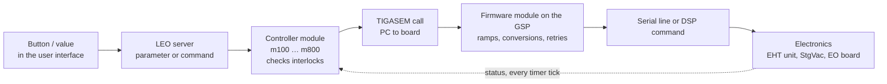
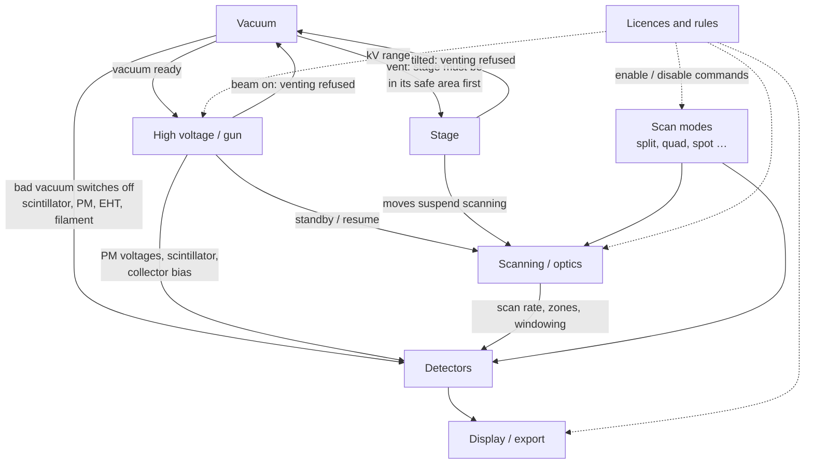

[Home](../../README.md) › How the microscope works

# How the microscope works

The LEO 430 is controlled as a set of **subsystems**. Each one has the same layers: a button or value in the user
interface, a controller module on the PC, a firmware module on the image processor board, and finally the
electronics. Each page below follows one subsystem through all the layers.

| Page | Subsystem | PC module | Board firmware |
|---|---|---|---|
| [Vacuum](vacuum.md) | pumps, valves, gauges, interlocks | m600 | G600.440 |
| [High voltage and gun](eht-gun.md) | accelerating voltage, filament, beam on/off | m100 | G100.440 |
| [Stage](stage.md) | motorised X Y Z tilt rotation | m500 | G500.RLM |
| [Scanning and electron optics](scanning-eo.md) | magnification, focus, lenses, stigmators, autofocus | m200 | G200.42x, G900 |
| [Detectors and image signal](detectors-acquire.md) | detectors, brightness/contrast, auto levels, averaging | m700 | G700, G1000 |
| [Display, modes and export](display-modes-export.md) | screen, split/quad/spot modes, filters, saving, photo | m300, m400, m800 | G300, G800 |
| [Rules, licences and access](core-rules-accessories.md) | what is allowed when, licences, visibility levels | m007, m070 | — |

Start-up order and the board itself: [Start-up](../boot-chain.md) · [Hardware interface](../hardware-interface.md).

## The layers every subsystem goes through

Each module also has a **timer tick**: several times a second it reads the status back from the board and updates the
values shown on screen.

## How the subsystems affect each other

What this means in practice:
- **No vacuum, no beam:** the EHT run-up waits ("Waiting Vac") until the vacuum controller reports ready.
- **Beam on, no venting:** venting is refused while the beam is on or the stage is tilted, and the stage is moved to
  its safe area first.
- **Grey buttons:** the rules module switches commands off by mode (spot, auto functions, X-ray) and by licence.

## How these pages were made
Each page is built from the annotated module listings ([`../modules-asm/`](../modules-asm), made with
`tools/ne-annotate.ps1`), the per-function digests ([`../modules-digest/`](../modules-digest)), the per-module API
tables ([`../modules-api/`](../modules-api)) and the GSP firmware listings ([`../firmware/asm/`](../firmware/asm),
`tools/gsp-annotate.ps1`). Open points per page: the scanning page cannot list a fixed register per lens (the board
fills that table at start-up); the exact per-pixel mixing formula is in board hardware, not in software.
