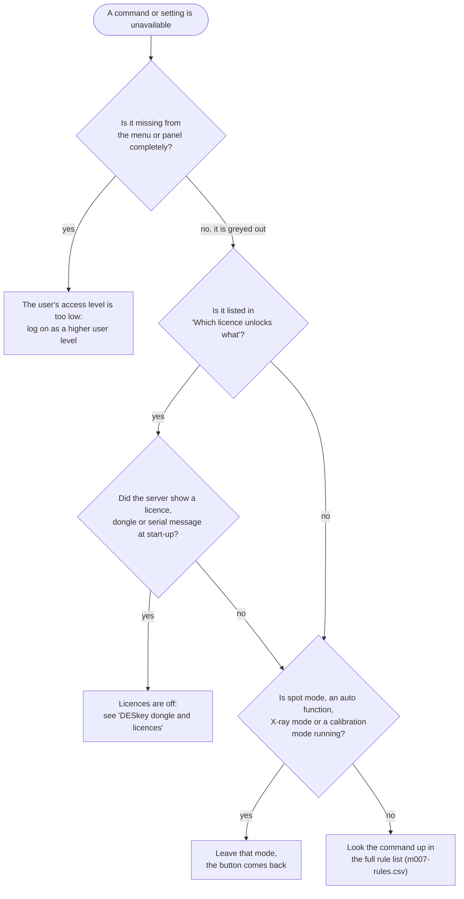
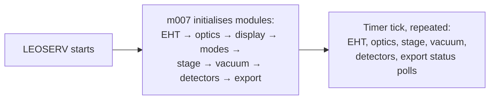

[Home](../../README.md) › [How the microscope works](README.md) › Rules, licences and access

# Rules, licences and access levels

> **In short:** a core module (m007) starts all the other modules, runs their timers, and keeps an **enabled / disabled
> flag for every command and setting**. About 300 small rules decide those flags from the current situation (spot
> mode, auto function running, X-ray mode …) and from the **licences**. A second module (m070) decides what each user
> level may **see** (from `access.leo`). So a greyed-out button is either a situation rule, a missing licence, or the
> user's access level.

## Why is this button grey?

**Links:** [Which licence unlocks what](#which-licence-unlocks-what-summary) ·
[DESkey dongle and licences](../components/deskey.md) · [Full rule list](../data/m007-rules.csv)

## Start-up and timer order

## Which licence unlocks what (summary)
| Licence | Unlocks |
|---|---|
| Scan Rate Expansion | the extra scan speeds |
| Split Screen, Quad Mode, Reduced Raster, Spot Mode, Window Mode | those scan modes |
| Scan Rotation, Dual Magnification, Tilt Compensation, Dynamic Focus | those scan functions |
| Input Gamma, Input Signal Invert, Signal Mixing | detector signal options |
| Image Maths, Static Stereo, Dynamic Stereo | image processing and stereo |
| X-ray dot map / line scan | X-ray acquisition |
| Stage Scan, Stage Registration, Compucentric, Survey Mode | stage options |
| 40 kV, Low Voltage | the high-voltage range |

The exact list of commands per licence number is in the technical reference below.

---

## Technical reference

*Full detail for maintenance and further reverse engineering: function names, addresses, parameters, sources. Inferred points are marked \*?\*.*

Sources: `m007.dll` ([`../modules-asm/m007-seg2.asm`](../modules-asm/m007-seg2.asm), digest
[`../modules-digest/m007-seg2.md`](../modules-digest/m007-seg2.md)), `m070.dll`
([`../modules-asm/m070.asm`](../modules-asm/m070.asm)). The parameter server itself (srv16/srv32, LEOSERV, how the
PC programs reach the modules) is in [`../components/server-and-parameters.md`](../components/server-and-parameters.md);
the dongle / serial / licence check in [`../components/deskey.md`](../components/deskey.md).

### 1. m007: the core of the 16-bit side
- **Parameter store** for all modules: `M007_GETVALUE/PUTVALUE` (analogue AP_*), `M007_GETSTATE/PUTSTATE` (digital
  DP_*, one word each at DS:`196Ah` + 2·n, 352 states), low / high limits, XY pairs, strings. `M007_PUTSTATE` only
  acts when the value changes, then notifies the UI and calls that state's handler through a table (DS:`182h`).
- **Start-up** `INITIALISE_CONTROLLER` initialises the modules in this order: m100 (EHT), m200 (EO), m300 (display),
  m400 (modes), m500 (stage), m600 (vacuum), m700 (acquire), m800 (export).
- **Timer** `S300_TICK` (name from the S300 heritage) calls every tick: m100 `EHT_TIMER_TICK`, m200 `EO_TIMER_TICK`,
  m500 `STAGE_TIMER_TICK`, m600 `VAC_TIMER_TICK`, m700 `ACQUIRE_TIMER_TICK`, m800 `IMEX_TIMER_TICK`. These are the
  status polls described in the subsystem chapters.
- Privileges and switches kept here: supervisor, user, "gun off" privilege, EHT log-off, stage-init privilege, DDE
  access, GSP present (`SWITCHGSP`), scan generator type, frame grabber, keypad / trackball, auto-saturation interval,
  cursor size, overheat reset.
- Knob / UI helpers: `KNOBASSIGN` (which parameter the hard-panel knob turns), `SETSENSITIVITY`, `NUDGEVALUE`,
  `RUNMACROFILE` / `RUNMACROLIBRARY` (macros, see [`../components/macros.md`](../components/macros.md)),
  `TAKELEOPHOTO`, `LEO_MSGBOX`, `UIF_LOG`, `LOG_CAL_CHANGE` (calibration change log), DDE advise loops
  (`ADVISEANALOGUE`, `ADVISEDIGITAL`, `ADVISEERRORS`, histogram / profile links).
- Licences and evaluation: `UIF_READ_SN`, `UIF_READ_LICENCES`, `UIF_WRITE_LICENCES`, `ISLICENCED`,
  `GRANT_EVALUATION`, `CHECKEVALUATIONLICENCE`, `EVALUATIONEXPIRES`, `EVALUATIONBEAMHOURS` (an evaluation licence
  can be limited by date and by beam hours), `REVOKEEVALUATION`. After any change `DOLICENCERULES` re-applies the
  rules below.

### 2. Availability rules ("why is this button grey?")
Every command (`CMD_*`) and every state (`DP_*`) has an enabled flag (commands: table DS:`2DDEh`, states: DS:`2F7Eh`).
About **300 small rule routines** in m007 test the current states and licences and switch one command or state on
or off (`sub_22ca` / `sub_22f0` for commands, `sub_227e` / `sub_22a4` for states). They run when a related state
changes, and the licence-dependent ones all together from `DOLICENCERULES`.

- **Full table:** [`../data/m007-rules.csv`](../data/m007-rules.csv) (generated by
  `../../tools/m007-rules.ps1`): routine, what it switches, every state value and
  licence it tests. The "Tests" column lists the comparisons in code order; the exact and/or logic is in the routine
  (see the listing at that address).
- Typical example (`sub_715c`, scan rate 1): disabled while in spot mode, during an auto function, in windowing,
  X-ray acquisition or X-ray line scan, in operating mode 6, or when the split / quad maximum rate applies; enabled
  again with licence 3 (Scan Rate Expansion) or calibration mode.

#### Which licence unlocks what (from the rules)
Licence numbers as in `leo_user.mdb` table `licences` ([`../data/leo_user-licences.txt`](../data/leo_user-licences.txt)).

| Licence | Commands / states it enables |
|---|---|
| 2 Stage Scan | `CMD_STAGE_START_SCAN` `CMD_STAGE_NEXT_FIELD` `CMD_STAGE_PREVIOUS_FIELD` |
| 3 Scan Rate Expansion | scan rates 1, 3, 5, 6, 8–15 (`CMD_SCANRATE…`) |
| 4 Scan Rotation | `DP_SCAN_ROT` |
| 5 Split Screen | `CMD_MODE_SPLIT` |
| 6 Dual Magnification | `DP_ZOOM` |
| 7 Tilt Compensation | `DP_TILT_CORRECTION` |
| 9 Dynamic Focus | `DP_DYNFOCUS` |
| 10 Derivative Processing | tested once in m007 (differentiate) *?* |
| 11 Input Gamma | `CMD_LUT_GAMMA` `CMD_LUT_MERGE` |
| 12 Input Signal Invert | `CMD_LUT_INVERT` |
| 16 Quad Mode | `CMD_MODE_QUAD` |
| 17 Adjustable Reduced Raster | checked in m400 `DOCOMMANDMODE_REDUCED` |
| 18 Window Mode scanning | `DP_WINDOWING` |
| 19 / 25 / 26 X-ray dot map, simple dot map / line scan, X-ray line scan | `CMD_XRAY_START`, `DP_XRAY_LINESCAN` (25) |
| 22 Dynamic Stereo | `DP_STEREO` |
| 27 Spot Mode | `DP_SPOT` |
| 31 Signal Mixing | `DP_MIXING` `DP_IMPLIED_DETECTOR` `DP_IMPLIED_INVERT` (Signal B) |
| 33 Image Maths | A+B, A−B, min, max, A→B, B→A, A↔B, histogram equalisation, area fraction, split stereo, stereo pair, `DP_IMAGE_DETECT`, `DP_IMAGE_FILTER` |
| 34 Static Stereo | `CMD_ATOB` `CMD_AEXCHB` `CMD_CALC_SS_DEPTH` `DP_STATIC_STEREO` `DP_SEMI_DYN_STEREO` |
| 35 40 kV EHT Set | m100 `sub_56fc`: highest EHT 40 kV instead of 30 kV (see [eht-gun.md](eht-gun.md#4-other-commands)) |
| 36 Low Voltage Working | m100 `CHECKKVLICENCES`: lowest EHT 100 V instead of 300 V |
| 43 Stage Registration | `DP_STAGE_LIST` |
| 45 Compucentric Stage Software | `CMD_START_COMP_CAL` `DP_COMPUCENTRIC_MODE` |
| 47 Stage Survey Mode | `DP_SURVEY_MODE` |

Licences not tested in the 16-bit modules (1 stage co-ordinate store, 8 vector scan, 13–15 annotation /
measurement / cut & paste, 21 Y-mod, 23 centre feature, 24 graticule, 30 extra inputs, 32 RS232, 37 trackball, 41 /
61 / 62 API, 44 accounting, 46 FTP archiving (ImgArc: "Image Archiving Not Licenced"), 48, 49) are checked by the
32-bit programs and controls *?*.

**Serial / dongle mismatch:** these are exactly the functions that stay grey when the serial number check fails (for example a disk image restored onto another microscope) and the licences stay
off; the fix is in [`../components/deskey.md`](../components/deskey.md).

### 3. m070: accessories, panel visibility, accounting
- **Visibility tables:** `LOADVISTABLES` reads `C:\LEO\ACCESS.LEO` (must be exactly 0x810 = 2064 bytes, first word =
  issue 0, else "File issue incorrect"): three byte arrays copied from 16-bit words: 453 analogue values, 353 states,
  202 commands, each a minimum access level. `ISAVISIBLE` / `ISDVISIBLE` / `ISCVISIBLE` answer per parameter;
  `SETVISMODE` switches level. Decoded table: [`../data/access-levels.csv`](../data/access-levels.csv), format in
  [`../file-formats.md`](../file-formats.md).
- **Panel visibility:** `ACCESSP.LEO` (`LOADPANELVISTABLE` / `SAVEPANELVISTABLE`, "File incorrect size"), panels
  registered with `REGISTERLEOPANEL`.
- **Accounting:** `ACCOUNTINGMESSAGE` posts a registered message `LEOMON_MSG` to the window "LEO Accounting Monitor"
  (a VB "ThunderForm"); m800 calls it for every saved / printed / photographed image (counters in the registry,
  [`../registry-config.md`](../registry-config.md)).
- **Dongle stubs:** `SERVICEDONGLEPRESENT` and `LEOCHECKDONGLE` in m070 **always return 0** in this build (no code
  behind them); the real dongle check is in LEOSERV (deskey.md).
- Menu helpers (`CLEARMENULIST`, `DISABLEMENUITEM`, `MENUITEMSTATE`), image directory (`SETIMAGEDIR`), name strings
  for parameters / commands in the current language, `SHOW_HP_PANEL` (opens the vacuum hard-panel / service panel in
  m600).

---
[← How the microscope works](README.md) · [Home](../../README.md)
