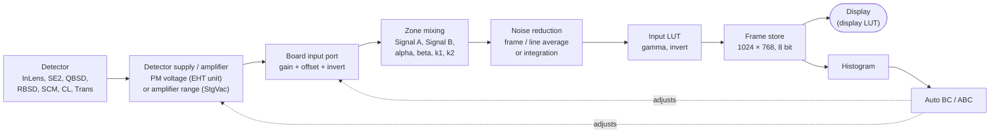
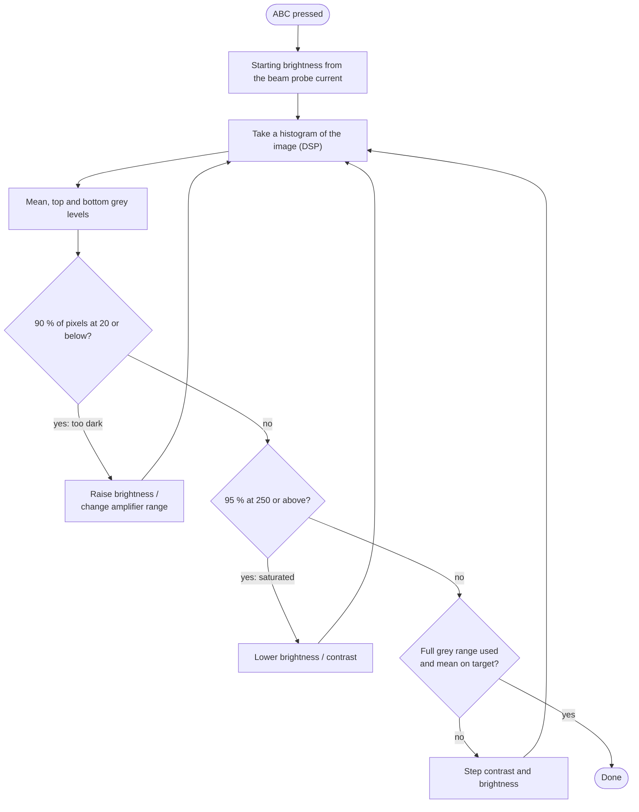

[Home](../../README.md) › [How the microscope works](README.md) › Detectors and image signal

# Detectors and image signal

> **In short:** each detector's signal enters the image processor board on an input port, gets a gain and offset,
> can be mixed with a second signal, averaged to reduce noise, and passed through a look-up table before it is shown.
> **Brightness and contrast do not act on the same thing for every detector:** on the electron detectors with a
> photomultiplier they set the photomultiplier voltage and the port offset; on the backscatter and specimen-current
> detectors they switch amplifier ranges. Auto brightness/contrast reads the image histogram and adjusts them.

## The signal path



## What Brightness and Contrast change

| Detector | Brightness | Contrast |
|---|---|---|
| InLens, SE2, RBSD, Cathodo (photomultiplier detectors) | photomultiplier voltage, 100 + 9 × value (100–1000) | port offset |
| QBSD, Trans | port offset | amplifier range (4 ranges) + port gain |
| SCM (specimen current) | port offset | amplifier range (13 ranges) + port gain |
| TV input | — | — |

This is what the firmware code does; checking it on a working machine is still open (see the technical reference).

## Auto brightness and contrast



## What the detectors depend on
- **EHT unit:** photomultiplier voltages, scintillator (switched on for SE detectors, off for cathodoluminescence) and
  collector bias.
- **Vacuum controller:** BSD and specimen-current amplifier ranges; bad vacuum switches the scintillator and
  photomultiplier off.
- **Scan:** rate and mode (spot, line, windows) decide what averaging is possible.
- **Licences:** signal mixing (Signal B), input gamma and input invert are licensed options.

## Good to know
- Each detector remembers its own brightness, contrast and auto settings; switching detector restores them.
- The per-pixel mixing and averaging are done by the board's hardware; the software only loads the coefficients.

---

## Technical reference

*Full detail for maintenance and further reverse engineering: function names, addresses, parameters, sources. Inferred points are marked \*?\*.*

Sources: PC module `m700.dll` ([`../modules-asm/m700.asm`](../modules-asm/m700.asm), digest
[`../modules-digest/m700.md`](../modules-digest/m700.md), **every export with its firmware call and parameters:
[`../modules-api/m700.md`](../modules-api/m700.md)**), GSP firmware `C:\TIGA\G1000.RLM` (video / detector control,
[`../firmware/asm/G1000.RLM.asm`](../firmware/asm/G1000.RLM.asm)) and `C:\TIGA\G700.RLM` (acquisition,
[`../firmware/asm/g700.rlm.asm`](../firmware/asm/g700.rlm.asm)), the DSP driver `g900.rlm` and the DSP program
([`../dsp/README.md`](../dsp/README.md)). Annotated listings of any function: `tools/gsp-annotate.ps1 -Module G1000.RLM
-Function <name>`.

```
 SEM UI: Detectors panel, Brightness / Contrast knobs, Auto BC, ABC, Signal A/B + Mixing, Noise reduction, Freeze, LUTs
        │ AP_BRIGHTNESS, AP_CONTRAST, DP_DETECTOR_TYPE, DP_ZONE, AP_GAIN/OFFSET, DP_NOISE_REDUCTION, DP_FREEZE_ON …
        ▼
 m700.dll: per-detector memory of settings, zone/port assignment, averaging counts, spot data, X-ray mode
        │ TIGASEM: GSPSETDETPSEUDOBRIGHTNESS/CONTRAST, GSPDOABC, GSPAUTOVIDEO, SETDETGAINTIGAREQUEST, FRAMEAVERAGETIGAREQUEST …
        ▼
 G1000.RLM (video):   brightness/contrast → PM voltage (via EHT unit), BSD / SCM amplifier range (via StgVac unit),
                      input gain/offset per port; auto video (Auto BC) and one-shot ABC from histograms
 G700.RLM (acquire):  gain/offset/invert/port per zone, mixing (alpha, beta, k1, k2), LUTs, averaging, freeze, windows,
                      spot data, X-ray acquisition
        │ messages to the DSP driver g900 (codes 2–9, 0x0D, 0x0F, 0x1B, 0x2B, 0x37, 0x3D, 0x46–0x48)
        ▼
 DSP (ADSP-21xx) on the image-processor board: video ADC per port, zone mixing, noise reduction, frame store, histogram
```

### 1. Detectors
Detector type numbers (`DP_DETECTOR_TYPE`, strings 1011–1027 long names, 1028–1044 short names). The G1000 tables
are indexed with exactly these numbers (17 entries).

| # | Detector | Brightness acts on | Contrast acts on |
|---|---|---|---|
| 1 | SE1 / **InLens** | PM voltage of its photomultiplier | input offset of its port(s) |
| 2 | **SE2** (Everhart-Thornley) | PM voltage | input offset |
| 3 | **QBSD** (4-quadrant backscatter) | input offset (100 − b) | 4QBSD amplifier range + input gain |
| 4 | RBSD (Robinson backscatter) | PM voltage | input offset |
| 5 | **SCM** (specimen current monitor) | input offset (100 − b) | SC amplifier range + input gain |
| 6 | Cathodo (cathodoluminescence) | PM voltage | input offset |
| 7 | Trans (transmission) | input offset (100 − b) | 4QBSD-type amplifier range + input gain |
| 8 | TV (video input) | nothing | nothing |
| 9–17 | Aux1 … Aux9 | per the detector's configuration flags: PM, or input gain, or offset | same |

(From the jump tables at G1000 `.data` 0x2EC80 (brightness) and 0x2EEA0 (contrast), function
`_gsp_set_detector_apparent_brigh` / `_gsp_set_detector_apparent_contr`. **Naming note:** the firmware really drives
the PM voltage from the *Brightness* value and the port offset from *Contrast* for the PM detectors; this is what the
code does, whatever the panel labels suggest. Not yet checked on the real machine *?*.)

- **Which detectors are fitted** and which port, PM number and amplifier each uses is sent at start-up by
  `DOSTRUCTDETECTOR_PORT_ASGN` → `GSPCONFIGUREDETECTOR` (G1000 `_gsp_configure_detector`), kept in the GSP table at
  `0x31B40` (5 bytes per detector: flags "has PM", "uses input gain", "uses input offset", and the PM number) and the
  port→detector map at `0x31B00` (8 ports).
- **Switching detector** (`SWITCHDETECTOR_TYPE`) restores that detector's own brightness, contrast, Auto-BC mean/peak
  and collector bias: each detector remembers its last settings.
- **Scintillator:** selecting InLens or SE2 switches the scintillator on through the EHT unit
  (`_EHT_turn_scintillator(1)`, EHT command 0x0B); selecting **Cathodo switches it off** (its light would swamp the
  CL detector). Unless the scintillator inhibit (`0x31E90`) is set.
- **Collector bias** (`SETCOLLECTOR_BIAS` → `SETEHTSETCOLLECTORBIAS`): applies only to detectors with a collector
  grid (InLens, SE2, or any detector in VP mode); with the SE supplies off (`DP_SE_SUPPLIES` = 0) the bias is forced to
  its default. Stored per detector. The EHT side is described in [eht-gun.md](eht-gun.md).
- **4QBSD**: quadrant switches Q1–Q4 (`SWITCH4QBSD_Q1…4` → `SETQBSDCONTROLTIGAREQUEST`), Compo (all quadrants added)
  and Topo (pairs subtracted) presets `DOCOMMANDCOMPO`, `DOCOMMANDTOPO`, `DOCOMMANDBSD_SET_TOPO`, gain range
  `SWITCH4QBSD_GAIN`, auto range `SWITCHBSD_AUTO` (`GSPSETBSDAUTORANGE`), BSD in / out (retractable), BSD type
  (`SWITCHBSD_TYPE` → `GSPSET4QBSDTYPE`). The BSD type comes back at start-up in a 3-byte block
  (`RESTORE_ACQUIRE_CONFIG`: BSD type + two flags).
- **SCM** (specimen current): image mode or measure mode (`DOCOMMANDSCM_IMAGE` / `_MEASURE` →
  `SCMREADINGREQDTIGAREQUEST`); the reading is shown in `AP_SCM` (timer). Its range and the reading come over the
  stage/vacuum controller (see [vacuum.md](vacuum.md), `.QD` / `.QE`).

### 2. Brightness and contrast: the numbers (G1000)
- **PM voltage:** `PM = 100 + 9 × b` for b = 0 … 100 % (so 100 … 1000 V)
  (`_convert_brightness_to_PM_val`). `_set_PM_level(level, pm#)` rounds it, skips the send if the cached value for
  that PM (3 PMs, cache `0x33260/70/80`) is unchanged, and sends it to the **EHT unit** (`_VidToEhtTigaCmd`, command
  7, PM number, value; retried up to 100 times). On the EHT UART this is the `.n…` PM command
  ([eht-gun.md](eht-gun.md)): `_set_eht_set_pm_voltage` sends `.`, the PM number as one hex digit (clamped to 1 … 3),
  `round(PM × 4)` as three hex digits and CR, e.g. PM1 at 550 V → `.1898` + CR. One count is 0.25 and the field tops
  out at 0xFFF / 4 = 1023.75, just above the 1000 maximum, so the value is in volts (the unit itself is not printed
  anywhere in the software). After a change the firmware returns a settling delay proportional to the voltage step
  (`|ΔPM| × 0.037 / 0.0185`, at least 1) *?*.
- **Port offset / gain** (`_set_input_offset`, `_set_input_gain`): sent to the acquisition process (G700) for every
  port wired to that detector. Offset value = `(v − 50) × 2` (−100 … +100 %). For the PM detectors the contrast value c
  gives `v = 0.6 c + 40`.
  G700 then converts to the board DACs: **gain DAC = round(2.55 × g)** (8 bit, 0 … 255) and
  **offset DAC = 2048 + 20.475 × o** (12 bit, centre 2048), and passes them to g900 as messages 4
  (`_set_zone_gain`) and 3 (`_set_zone_offset`) → DSP command 0x0C.
- **SC amplifier (SCM):** `n = c × 13 / 100` limited to 0 … 12, range = 12 − n (13 decade-type ranges) sent to the
  stage/vacuum controller (`_VidToVacTigaCmd`, command 0x0E), the remainder within the range becomes the input gain
  (`_convert_contrast_to_SCA_vals`).
- **4QBSD amplifier:** contrast thresholds 25 / 50 / 75 % select amplifier range 3 / 2 / 1 / 0, the fine gain inside a
  range is exponential (`cal × exp(k × (c − threshold))`, `cal` = `_bsd_range_cal`); with auto range on, the range is
  computed from `log(100 / _bsd_range_cal) / 25` (`_convert_contrast_to_4QBSDA_vals`). Range sent to the StgVac
  controller (command 0x0D).

### 3. Automatic video levels
Both use the DSP **histogram** (g900 message 0x37 `_get_histogram` → DSP command 0x17; transferred with 0x38 →
DSP 0x0F) of 256 grey levels.

`_calculate_peak_and_mean(p, result)` (G1000 0x10BB0), exactly:
- N = number of pixels, mean = Σ (i+1)·h[i] / N;
- **top** = grey level reached when counting down from 255 until more than p % of the pixels are included;
  **bottom** = same counting up from 0; **range** = top − bottom (≥ 0);
- status: **1 = too dark** if ≥ 90 % of pixels are at level ≤ 20; **3 = saturated** if ≥ 95 % are at level ≥ 250;
  else 0.

- **Auto BC** (continuous, `SWITCHAUTO_VIDEO` → `GSPAUTOVIDEO`, panel targets "Auto Video Mean" `AP_AUTO_BRIGHT` and
  "Auto Video Peak" `AP_AUTO_CONTRAST`): `_perform_auto_video_loop` keeps mean and peak at the targets; thresholds set
  by `_setup_auto_video_thresholds` (per detector group: 20, 40, 60, 100, 9, 0.3, 3). Suspended during other
  operations (`SUSPEND/RESUME_AUTO_VIDEO_LEVEL`). `DOCOMMANDFIND_MEAN` / `FIND_PEAK` run one step
  (`GSPFINDAUTOLEVEL`, `DP_AUTO_FUNCTION` 6 / 5).
- **ABC, one-shot auto brightness & contrast** (`DOCOMMANDABC` → `GSPDOABC`, `DP_AUTO_FUNCTION` = 10,
  `_perform_one_shot_abc`): starting brightness chosen from the **probe current** (`_algorithm_one`, log/exp model,
  `_autolevel_probe_current`), then repeated sample → histogram → adjust: brightness steps (`_abc_adjust_brightness`)
  and contrast steps (`_abc_adjust_contrast`) between min/max limits (`_abc_set_thresholds`) until the image is in range
  and spans the full width; if it cannot, the BSD or SCA amplifier range is changed (`_abc_cannot_get_full_width`,
  `_abc_handle_low_brightness`). Result offset = `2 × contrast − 100`. Progress/status in `_g_one_shot_status`;
  targets `AP_ABC_BRIGHT`, `AP_ABC_CONTR`.
- **ABC calibration:** `SWITCHABCC_B_CAL` / `_C_CAL` store `BrightnessCal<zone>` / contrast cal in the LEO ini file,
  section `[Detectors]`.

### 4. Zones, signals and mixing (G700)
- The screen has up to **8 zones** (`DP_ZONE`, `DP_Z0…Z7`; e.g. split / dual / quad screen). Each zone shows
  **Signal A** (`DP_DETECTOR_CHANNEL`, gain A, offset A, invert A) and optionally **Signal B** ("implied detector",
  `DP_IMPLIED_DETECTOR`, gain B, offset B, invert B), and has its own averaging and LUT. `DP_ALL_ZONES` applies a
  change to every zone. `DP_MAIN_DETECTOR` ("Control") says which signal the knobs act on.
- Zone ↔ input port: `ASSIGNZONEPORTTIGAREQUEST` (g900 message 2 `_set_zone_port` → DSP 0x0C).
- **Mixing** (`SWITCHMIXING`, `SETK1` "Signal", `SETK2` "Mix Signal", `SETALPHA`, `SETBETA`, `SETDIFF`
  "Differentiate"): coefficients go to the DSP as g900 messages 6 / 7 / 8 / 9 → DSP command 0x0D. Scaling in G700:
  **alpha → round(255 × α)**, **k1 → int(3 × k1)**; differentiate as message 0x0A. The DSP only loads these
  coefficients into hardware registers of the video board; the per-pixel mixing is done by that hardware, so the exact
  pixel formula is not in any software (see ../dsp/README.md, "What the image handlers do"). Mixing window (`SWITCHWINDOW` → `SETMIXWINDOWTIGAREQUEST`) forces scan
  rates 3–5.
- **LUTs** (`DP_LUT_DESTINATION`, sources A/B): transparent (identity), gamma (`255 × (i/255)^(1/γ)`, `AP_GAMMA`),
  invert, merge of two LUTs, copy, user-defined (`DEFINE_LUT`), input LUT mode.
- **Windows** (`DEFINE_WIN_ELEMENT`, `SWITCHWINDOWING`, `POINTINWINDOW`): reduced raster areas; turning windowing on
  switches zoom / line scan / spot off (calls into m400).

### 5. Noise reduction and freeze
- `DP_NOISE_REDUCTION` modes: **frame average** (`AP_FRAME_AVERAGE_COUNT`, g900 0x3D → DSP 0x0E, 0x0B, 0x0E),
  **frame integration** (`AP_FRAME_INT_COUNT`), **line average** / **line integration** (`AP_LINE_AVERAGE_COUNT`,
  g900 0x2B → DSP 0x0E, 0x0B), continuous average, pixel NR (`DOCOMMANDPIXNR`). `AP_NR_COEFF` ("N") is the averaging
  coefficient. Integration modes freeze the image when done (`DP_FREEZE_ON`), progress in `AP_PROGRESS`.
  Status `_NOISE_REDUCTION_STATUS` (2 = frame, 5 = line), abort flag `_Noise_Abort`.
- **Freeze** per zone, per channel or all (`DOCOMMANDFREEZE_*`, `INSTANT_FREEZE_*`, `DOCOMMANDTOGGLE_FREEZE` →
  `FREEZECONTROLTIGAREQUEST` → g900 0x0D → DSP 0x13); "freeze on" = end of frame / end of integration; plane A / B
  freeze (`GSPONEZEROFREEZE`, overlay planes); `DP_FREEZE_STATUS` and `DP_Z0…Z7` (frozen per zone) read back each tick.

### 6. Spot data and X-ray
- **Spot data** (signal sampled with the beam parked: `DOCOMMANDSTART_SPOT_ACQUIRE`, rate `AP_SPOT_DATA_RATE`,
  duration `AP_SPOT_DATA_DURATION`, buffer `GET_SPOT_DATA_LOCATION` / `GET_SPOT_NUM_SAMPLES`, `FREESPOTDATABUFFER`):
  g900 0x48 `_dsp_gather_spotdata` → DSP 0x2E, read with 0x46 → DSP 0x30. External spot control
  (`SWITCHEXT_SPOT_CONTROL`) lets an outside unit (EDX) position the spot.
- **X-ray acquisition** (`CONTROL_XRAY` → `GSPCONTROLXRAY`, `DP_XRAY_ACQUIRE`): reprograms averaging and coefficients
  for X-ray mapping and starts the DSP X-ray mode (g900 0x1B `_dsp_control_xray` → DSP 0x24, buffer read 0x1C → DSP
  0x0F).

### 7. Timer and start-up
- `INITIALISE_ACQUIRE_CONTROLLER`: `SETVIDMODULE` + `INITVIDRLM` (G1000), `SETACQUIREMODULE` + `INITACQUIRECOMMS`
  (G700), only when the image-processor board is present (`DP_GSP`).
- `ACQUIRE_TIMER_TICK` (`sub_4abe`): `READACQUIRESTATUS` (freeze and averaging state, progress), SCM reading, spot
  data, `READGSPVIDEOLEVELDATA` (current gain/offset after Auto BC), `GSPGETAUTOLEVELSTAT`; writes `AP_SCM`,
  `DP_FREEZE_STATUS`, `DP_Z0…Z7`, `AP_OFFSET`, `AP_IMPLIED_GAIN/OFFSET`.
- Not on the LEO 430 but in the same module: chamberscope / CCD illumination, VPSE (variable-pressure SE detector),
  electron counting, dwell-time modes for the frame grabber, Z130 detector restore.

### Open points
- PM voltage unit (V assumed) and the exact settling-delay formula.
- The exact pixel formula for mixing (alpha/beta/k1/k2/diff) and averaging (`AP_NR_COEFF`): done in board hardware,
  not in the DSP code (the DSP only loads the coefficients); would need the board schematics or measurements.
- The brightness → PM / contrast → offset mapping should be confirmed on the machine (turn Brightness with SE2 and
  watch the PM voltage in the EHT status).

---
[← How the microscope works](README.md) · [Home](../../README.md)
