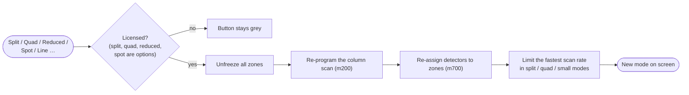
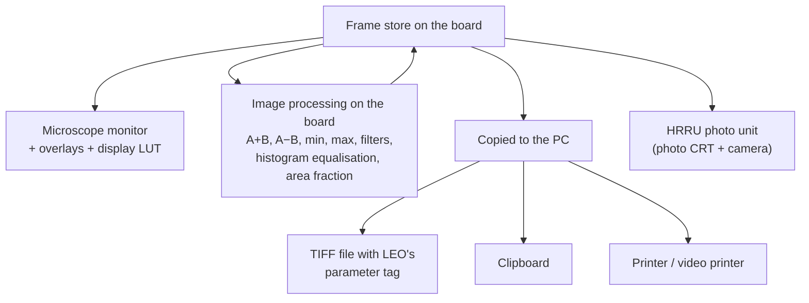

[Home](../../README.md) › [How the microscope works](README.md) › Display, modes and export

# Display, scan modes and image export

> **In short:** the image lives in a **frame store on the board** (1024 × 768, 8 bit) and is shown on the
> microscope's own monitor with overlays (data bar, markers, measurements). **Scan modes** (normal, split, quad,
> reduced raster, spot, line, zoom, emission) re-program the scan and the detector zones together. The **export**
> side copies the frame store to the PC to save TIFF files, print, run image maths and filters, or expose a photo on
> the HRRU camera unit.

## Changing scan mode



## Where an image goes



## The ten image filters
Sharpen (two strengths), horizontal and vertical edges, two Laplacian edge detectors, Sobel, mean blur and Gaussian
blur. The exact 3 × 3 kernels are in the technical reference.

## Good to know
- Image maths, stereo and the filters are licensed options (see [Rules and licences](core-rules-accessories.md)).
- Every saved, printed or photographed image is counted for user accounting.
- TIFF layout and LEO's parameter tag: [File formats](../file-formats.md#sem-tiff-images).

---

## Technical reference

*Full detail for maintenance and further reverse engineering: function names, addresses, parameters, sources. Inferred points are marked \*?\*.*

Sources: PC modules `m300.dll` (display, overlays, output LUTs, histogram / profiles, X-ray display), `m400.dll`
(operating modes: normal / split / quad / reduced / spot / line / emission / zoom), `m800.dll` (image export, TIFF,
image maths, stereo, HRRU photo, video printer); API tables [`../modules-api/m300.md`](../modules-api/m300.md),
[`../modules-api/m400.md`](../modules-api/m400.md), [`../modules-api/m800-seg2.md`](../modules-api/m800-seg2.md); GSP
firmware `G300.RLM` (display controller, [`../firmware/asm/g300.rlm.asm`](../firmware/asm/g300.rlm.asm)) and
`G800.RLM` (image export / HRRU, [`../firmware/asm/g800.rlm.asm`](../firmware/asm/g800.rlm.asm)). File formats
(TIFF tags 34117 / 34118, HRRU files, LUT files) are in [`../file-formats.md`](../file-formats.md).

```
 m400 operating modes ──► m200 (SETEOCOLUMNSCAN, SETEOZOOM, SETEOEMISSION) + m700 (zones, windowing, freeze)
 m300 display        ──► G300: planes (PC / SEM / image), overlays, output LUTs, histogram, line profiles, X-ray display
 m800 export / photo ──► G800: frame store ↔ host, image maths and filters, HRRU photo CRT, cine
                         PC side: TIFF files (leoimg.dll), clipboard, printer / video printer
```

### 1. Frame store and display (G300, m300)
- **Image store:** 1024 × 768 pixels, 8 bit, at GSP address `0x20000000` (line pitch 0x2000 bits = 1024 bytes); G800
  works line by line through a 3-line buffer `_Image`. `_determine_disp_config` probes memory banks at `0x00400000`,
  `0x10000000`/`0x10400000`, `0x20000000`/`0x21000000`, `0x40000000`/`0x41000000` (`_mem_pres`, `_hres_mem_pres` for
  the high-resolution extension) to find what is fitted; `DP_IMAGE_STORE` / `SETDISPLAYSTANDARD` select the display
  standard and store resolution (`_enable_high_res`, image LUT sets `_load_imagelut_df/dr/rw`).
- **Planes:** PC graphics plane, SEM overlay plane (text / markers), image plane, each switched by
  `PC_PLANE_CTRL`, `SEM_PLANE_CTRL`, `IMAGE_PLANE_CTRL` → `SETPLANESTATE`. Overlay planes A / B also carry the X-ray
  dots and the stereo / comparison images (7-bit mode, `DP_7BIT`).
- **Overlay objects** (data bar, markers, measuring lines, text, icons; `OM_*` exports → `CREATEOVERLAYOBJ`, …):
  G300 keeps a display list of rectangles, strings, lines, ovals, polygons, icons, histogram / profile / Y-mod graphs
  and redraws only the objects a change "violates" (`_mark_all_violated_objs`, `_restore_affected_objects`); fonts
  are downloaded (`OM_LOAD_INST_FONT` → `INSTALLFONT`). Reduced image (`OM_REDUCE_OVERLAY` / `ENLARGE`): the live
  image shrunk into a corner with the PC screen around it.
- **Output (display) LUTs** (`OPLUT_*`): per-colour red / green / blue tables, linear, inverse, gamma, brightness /
  contrast, points, save / restore, grey wedge (`DRAW_GREY_WEDGE`, freezes the image first). This is the display LUT;
  the input LUTs per zone are in m700 ([detectors-acquire.md](detectors-acquire.md)).
- **Histogram and profiles:** live histogram (`START_HIST_ACQUIRE`, `DP_LIVE_HISTO`), line profile, vertical /
  horizontal profile, live line profile, Y-modulation (`DEFINE_YMOD_CHAN`), read back with `GETHISTOGRAMDATA` /
  `GETPROFILEDATA`. `READ_AN_IMAGE_PIXEL` reads one pixel.
- **X-ray display:** EDX dots (`DP_EDX_DOTS`), X-ray line scan with colour and scale, X-ray profile, ratemeter,
  filter and energy windows (`SET_XRAY_FILTER`, `SET_XRAY_WINDOWS`, G300 `_ProcXRayAcqCmds`, `_filter_xray_data`).
  `DOCOMMANDXRAY_START` selects scan rate 7 or 8, freezes planes A/B and calls m700 `CONTROL_XRAY`.

### 2. Operating modes (m400)
`DP_OPERATING_MODE`: **0 normal**, **1 split** (two zones side by side), **2 quad**, **3 emission** (image of the
gun emission, `AP_EMISSIONZOOM`, for gun alignment), **4 small**, **5 reduced raster** (`AP_RED_RASTER_W/H`,
position X/Y; needs a licence check `M007.ISLICENCED`). Each mode change unfreezes everything, re-programs the column
scan (`M200.SETEOCOLUMNSCAN`), re-applies the detectors to the zones (`M700.UPDATE_DETECTORS`) and checks beam
blanking. `DP_MAX_RATE` limits the fastest scan rate in the split / quad / small modes.
- **Zoom** (`SWITCHZOOM`, `AP_ZOOM_FACTOR`, position): split screen with a live zoomed view; per-zone magnifications
  `AP_MAG0…7` (zone 4/5 forced by the zoom factor).
- **Spot** (`SWITCHSPOT`, `AP_SPOT_POSN_X/Y`): beam parked; auto video and dynamic focus off; starts spot data.
- **Line scan** and **X-ray line scan** (`AP_LINE_POSN`, `AP_LINE_LENGTH`), with profile display (m300).
- Stereo (`SWITCHSTEREO` → `M200.SETEOSTEREO`), display channels, crosshairs and graticule (`AP_CROSS_X/Y`,
  `AP_GRAT_SPACE`), high-res, freeze blanks, "temporary normal mode" while an auto function runs
  (`DOTEMPNORMALMODE` / `UNDOTEMPNORMALMODE`).

### 3. Image processing on the board (G800, m800)
Commands work on the frozen store; A and B are two zones / stores.
- **Arithmetic:** A+B, A−B, B−A, min(A,B), max(A,B), A→B, B→A, A↔B (`DOCOMMANDAPLUSB` … `AEXCHB`, G800
  `_image_maths`, `_image_exchange`, `_copy_zone`).
- **Histogram equalisation** of the store or only of the LUT (`DOCOMMANDHISTO_EQU_STORE` / `_LUT`).
- **Detection / area fraction:** black / white / grey thresholds (`AP_BLACK_DETECT`, `AP_WHITE_DETECT`,
  `DP_IMAGE_DETECT`) and the area fraction of the detected phase (`AP_AREA_FRACTION`).
- **Filters** (`DP_IMAGE_FILTER` 1–10, G800 `_image_filter` → `_do_filter1…10`). Exact 3 × 3 kernels read from the
  code (result clipped to 0 … 255, the border pixels are not processed):

| # | Kernel (rows top → bottom) | Effect |
|---|---|---|
| 1 | `0 −1 0 / −1 5 −1 / 0 −1 0` | sharpen (4-neighbour) |
| 2 | `−1 −1 −1 / −1 9 −1 / −1 −1 −1` | strong sharpen (8-neighbour) |
| 3 | `−2 −2 −2 / 0 0 0 / 2 2 2` | horizontal edges (dark above → bright) |
| 4 | `−2 0 2 / −2 0 2 / −2 0 2` | vertical edges (dark left → bright) |
| 5 | `0 −1 0 / −1 4 −1 / 0 −1 0` | Laplacian (edges only, 4-neighbour) |
| 6 | `−1 −1 −1 / −1 8 −1 / −1 −1 −1` | Laplacian (edges only, 8-neighbour) |
| 7 | `2 0 −2 / 2 0 −2 / 2 0 −2` | vertical edges (bright left) |
| 8 | `1 0 −1 / 2 0 −2 / 1 0 −1` | Sobel, vertical edges |
| 9 | `1 1 1 / 1 1 1 / 1 1 1` ÷ 9 | mean (smoothing) |
| 10 | `1 2 1 / 2 4 2 / 1 2 1` ÷ 16 | Gaussian smoothing |

- **Stereo:** static stereo (red/green anaglyph via the output LUT, `SWITCHSTATIC_STEREO`), semi-dynamic stereo,
  split stereo, stereo pair, depth calculation from the stereo angle (`DOCOMMANDCALC_SS_DEPTH`, `AP_SS_ANGLE`).
- Image comparison (two planes), external image analysis hooks: user routine / dialog (`DP_IA_USER_ROUTINE`), ISIS
  and QWin (`C:\QWINLEO\QWINLEO.EXE`, "LEOrun"), not part of a standard installation.

### 4. Saving, loading, printing (m800, leoimg.dll)
- `SAVEGREY` / `SAVECOLOUR` / `SAVEBINARY` / `SAVEWORK`: frame store (+ overlay, + LUTs) to the host
  (`GSPTOHOST`) and to a TIFF file; the photo number `AP_PHOTO_NUMBER` increments and an accounting message is
  logged (`M070.ACCOUNTINGMESSAGE`). `LOADIMAGE`, `LOADREDUCEDIMAGE`, `LOADWORK` go the other way (`HOSTTOGSP`);
  `GETTIFFHEADER` reads the header (input reduction). Binary images are run-length / CCITT-style compressed on the
  GSP (`_compress_binary_image`, white / black terminating codes). TIFF layout and the LEO parameter tag: see
  file-formats.md.
- Clipboard in/out (`SENDIMAGETOCLIPBOARD`, `GETIMAGEFROMCLIPBOARD`), Windows printer (`DEFPRINT*`,
  `DUMPIMAGETOPRINTER`), video printer (`PRINTVIDEOIMAGE`, `PRINTVIDEOTIFF`, paper size, copies, priority, parallel
  port).
- Output device (`DP_OUT_TYPE`: 1 HRRU, 2 display, 3 printer; `DOCOMMANDHRRU` …) changes the scan via
  `M200.SWITCHOUT_DEV`.

### 5. HRRU photo (G800, m800)
The HRRU (High Resolution Recording Unit) is a photo CRT with a camera (Polaroid / 35 mm / 120, `DP_HRRU_CAMERA`).
- **Sources:** live photo (slow scan of the column straight onto the CRT), left / right stored image, or a file
  (`Z130FILETOHRRU`); `DOCOMMANDTAKE_PHOTO` → `LIVEPHOTO` / `LEFTSTOREDPHOTO` / `RIGHTSTOREDPHOTO` with brightness
  and contrast compensation for the film speed (`SETBRIGHTNESSCOMP`, `SETCONTRASTCOMP`, `C:\LEO\HRRU.SPD`).
- **G800 sequence** (`_start_photo`): stop ramps → HRRU register 0x74 → film speed (`_set_film_speed`, reg 0x2A /
  0x54) → HRRU brightness and contrast → regs 0x51, 0x52 (the calibration values hrru.exe edits) → **open shutter**
  (reg 0x6D, depends on camera type) → ramps (regs 0x20–0x2A) → … → close shutter. Tube on/off = reg 0x4D. A live photo
  is scanned at 3072 × 2304, 8-bit grey: G800 `_take_live_photo` sends GSP message 0x27 with 0xC00 / 0x900, and
  G900 `_dsp_take_photo` passes those two words to `_set_raster_size` before starting the DSP (commands 0x0E, 0x22).
  This is the largest store resolution Image Manager offers (512 × 384 … 3072 × 2304).
- Gamma LUT `C:\LEO\gamma2.dat` and the CRT intensity curves `loc38/loc3a/loi38/loi3a[h].dat`; focus, line repeat,
  fast / slow speeds, photo time `AP_HRRU_PHOTO_TIME`, develop timer (`AP_DEVELOP_TIME`).
- **Cine mode** (`DOCOMMANDSTART_CINE_MODE`, elapsed time, reduction): a timed sequence of stored frames.

---
[← How the microscope works](README.md) · [Home](../../README.md)
