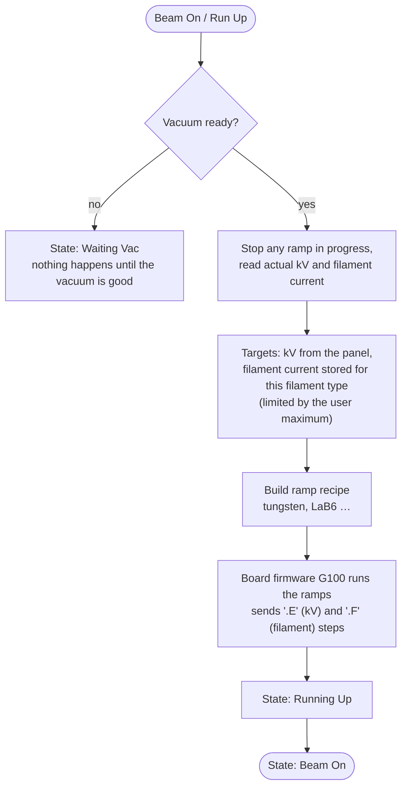
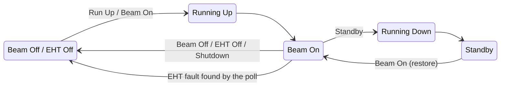
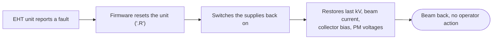

[Home](../../README.md) › [How the microscope works](README.md) › High voltage and gun

# High voltage (EHT) and gun

> **In short:** turning the beam on is a **run-up**: the accelerating voltage and the filament current are raised in
> slow, controlled ramps so the filament is not damaged. The PC builds the ramp "recipe" for the filament type and
> hands it to the board firmware (G100), which steps the EHT unit along it over a serial line, watches for faults and
> recovers from short trips by itself. The PC also counts beam hours and filament age.

## Beam on (run-up)



Tungsten filament (the standard LEO 430 source): **EHT** jumps to 20 kV then rises at 1000 V/s; **filament** rises at 0.15 A/s up
to 1.8 A, then at 0.04 A/s to the target.

## Beam states



## Automatic trip recovery

Repeated trips appear as messages 519 ("Extractor Trip"), 520 ("Emergency Rundown"), 549 ("spurious status").

## What the high voltage affects
- **Vacuum:** venting is refused while the beam is on.
- **Detectors:** the EHT unit also supplies the photomultiplier voltages, the scintillator and the collector bias.
- **Optics:** the optics module is put in standby and resumed around beam changes.
- **Licences:** the allowed range is 300 V … 30 kV; the 40 kV licence raises the top to 40 kV, the Low Voltage
  licence lowers the bottom to 100 V.

---

## Technical reference

*Full detail for maintenance and further reverse engineering: function names, addresses, parameters, sources. Inferred points are marked \*?\*.*

Sources: PC module `m100.dll` ([`../modules-asm/m100.asm`](../modules-asm/m100.asm), digest
[`../modules-digest/m100.md`](../modules-digest/m100.md), Ghidra C in `../decompiled/m100.dll.c`), GSP firmware
`C:\TIGA\G100.440` ([`../firmware/asm/g100.440.asm`](../firmware/asm/g100.440.asm), `tools/gsp-annotate.ps1 -Module g100.440`),
the EHT serial protocol ([`../firmware/serial-protocols.md`](../firmware/serial-protocols.md)), `C:\LEO\L500.ini`, DATA.VAC.

```
 SEM UI: Beam menu, toolbar (EHT On/Off, Gun Setup, Emission, Accelerating Voltage)
        │ CMD_BEAM_ON / CMD_RUNUP / CMD_STANDBY / CMD_EHT_OFF / CMD_SHUTDOWN …
        ▼
 m100.dll: checks interlocks, builds ramp recipes, beam-time / filament-age bookkeeping
        │ TIGASEM: SENDGSPEHTRAMPREQUEST, SENDGSPFILRAMPREQUEST, READGSPEHTSTATUS, SETEHTSETPMVOLTAGE, …
        ▼
 GSP firmware G100.440: executes the ramps step by step, watches the EHT unit, recovers from faults
        │ ASCII ".E…" (kV), ".F…" (filament), ".O…" (supplies), ".n…" (PM), … on the EHT UART (GSP 0x60300000, 9600 8N1)
        ▼
 EHT supply ("EHT set"): acceleration voltage, filament, anode, collector bias, scintillator, photomultipliers
```

### 1. Start-up
`INITIALISE_EHT_CONTROLLER` → `TIGASEM.SETEHTMODULE("G100.440")` (firmware into the GSP) and `INITEHTCOMMS`.
`GET_EHT_SET_DESC` (`GETGSPEHTSETDESCRIPTION`) reads the unit's description: `AP_EHT_SET_MAX` / `AP_EHT_SET_MIN`
(voltage range), and the current kV / collector bias. `RESTORE_EHT_CONFIG` takes the EHT section of DATA.VAC (filament
type, currents and lives, beam time, anode spacer, voltage offset, …).

### 2. Beam states (`DP_RUNUPSTATE`, strings 3231 + n)
| n | State | Set by |
|---|---|---|
| 0 | Shutdown | |
| 1 | Beam On | end of a run-up |
| 2 | Running Up | `DOCOMMANDRUNUP` |
| 3 | Shutting Down | `DOCOMMANDSHUTDOWN` |
| 4 | Running Down | `DOCOMMANDSTANDBY` |
| 5 | Beam Going Off | `DOCOMMANDBEAM_OFF` |
| 6 | Restoring Beam | `DOCOMMANDBEAM_ON` (from standby) |
| 7 | Standby | |
| 8 | EHT going off | `DOCOMMANDEHT_OFF` |
| 9 | Beam Off | |
| 10 | EHT Off | also forced when the status poll finds the EHT off / faulted |
| 12 | **Waiting Vac** | run-up / beam on refused because `DP_EHT_VAC_READY` ≠ 1 |
| 13 | Service Runup | `DOCOMMANDSERVICE_RUNUP` (gun service panel) |
| 14 | Emergency Rundown | |
| 15 | Conditioning | new-filament conditioning |

(The vacuum module uses the same values: venting is refused unless the state is 0 or 9.)

### 3. Run-up (`DOCOMMANDRUNUP`, `DOCOMMANDBEAM_ON`)
1. Adjustable-anode machines: check the anode setting against the kV (`sub_311a`, may ask with a message box).
2. **Vacuum interlock:** `DP_EHT_VAC_READY` must be 1 (set from the vacuum controller), else state 12 "Waiting Vac".
3. A blown filament (`DP_FIL_BLOWN` = 1) is reset to 2 before trying.
4. Any running ramp is stopped (`KILLGSPEHTANDFILRAMPING`); actual kV/current are read back.
5. Targets: kV = `AP_MANUALKV`; filament current = the stored current for the filament type (from DATA.VAC "Filament
   Current"), limited to `AP_USERMAXCURRENT`; beam current set with `SETBEAMCURRENTGSPREQUEST`.
6. A **ramp recipe** is built for the filament type (below) and sent to the GSP; state → 2 Running Up; the EO module
   leaves standby (`M200.EOSTANDBY`); progress is shown with `DP_PROGRESS` / `AP_PROGRESS`.
7. The timer (`sub_665c` → status poll `sub_5e80`) moves the state on when the GSP reports the ramp finished.

#### Ramp recipes (`sub_5da0` / `sub_5d50` build 20-byte steps: index, type, start, flag, rate, step time, target)
Filament types (`DP_FILAMENT_TYPE`, strings 3222–3226): 0 **Tungsten** · 1 Denka (LaB6) · 2 Kimball (LaB6) ·
3 FEI (LaB6) · 4 FE FEI (field emission, handled by the gun service tools). Types 5–7 use the tungsten recipe.

| Filament | EHT up | EHT down | Filament up | Filament down |
|---|---|---|---|---|
| Tungsten (`sub_6f48`) | to 20 kV in one fast step, then **1000 V/s** to target | −1000 V/s | **0.15 A/s** up to 1.8 A, then **0.04 A/s** to target | −0.15 A/s |
| Denka (`sub_7468`) | same | same | 0.004 A/s to 1.8 A, then 0.002 A/s | −0.15 A/s |
| Kimball (`sub_82a8`), FEI (`sub_7c32`) | same | same | 0.004 A/s | −0.15 A/s |
| New LaB6 filament (`sub_77a2`, `sub_8538`, `sub_7ec2`) | 1000 V steps | | **0.001 A/s** (conditioning) | |

(Rates as stored in the recipe; the step period field is 1 s. Values from the module's data segment.)

### 4. Other commands
- **Standby** (`DOCOMMANDSTANDBY`, state 4): filament down to standby, EHT kept *?*; **Beam Off** (5): filament off *?*;
  **EHT Off** (8): both off; **Shutdown** (3); **Emergency rundown** (14).
- **Manual** (`DOCOMMANDMANUAL`) = Beam On with manual values; **Load targets** copies `AP_TARGETKV` / `AP_TARGETCURRENT`.
- **kV and licences:** `CHECKKVLICENCES` sets the allowed kV range (values in volts, m100 data segment constants):
  - **top** = the smaller of `AP_EHT_SET_MAX` and the anode limit (`sub_574a` → `sub_56fc(DP_ANODE)`): 3 000 V when
    Anode Spacer (`DP_ANODE`) is state 1 and Adj. Anode (`DP_ADJ_ANODE`) is off; otherwise 40 000 V with licence 35
    "40 kV EHT Set", 30 000 V without. It becomes the high limit of `AP_ACTUALKV`, `AP_MANUALKV`, `AP_TARGETKV`
    (`sub_50a0`); target and manual kV are clipped to it (`sub_57a2`), and if the actual kV is above it the kV is
    set down to it (`SETMANUALKV`).
  - **bottom** = the larger of `AP_EHT_SET_MIN` and 100 V with licence 36 "Low Voltage Working" (300 V without),
    written as the low limit of `AP_MANUALKV`. `SETUSER_MAX_EHT` keeps a user maximum in `L500.ini`
  `[User] UserMaxEht` (−25536 here, i.e. not set).
- **Filament:** `SWITCHFILAMENT_TYPE` (`CHANGEFILTYPEGSPMESSAGE` → `.T`), a per-type value in `L500.ini`
  (`[User] Filament0=2900`, meaning not confirmed *?*), `SWITCHNEWFILAMENT` (resets `AP_FILAMENT_AGE`), `SETFILAMENT_AGE`.
- **Detector supplies on the EHT unit:** photomultiplier voltages `SETPM1/2/3` (`SETEHTSETPMVOLTAGE` → `.n…`),
  scintillator on/off `SWITCHSCINT` (`.O`), collector bias, SE supplies.
- **Calibration:** `SETEHT_OFFSET` (`SETEHTSETVOLTOFFSET`), `SETEHT_CAL_100` / `_10KV` / `_24KV` / `_30KV`
  (FE units), `SETEHT_ACTUAL_1/3`; raw commands for service: `SEND_EHT_DIRECT_COMMAND` (`SENDGSPDIRECTCOMMAND`).
- **Wobblers** (focus / beam): `SEND_GSP_LENS_WOBBLE`, `SEND_GSP_BEAM_WOBBLE`.

### 5. Status and bookkeeping (timer)
- `EHT_TIMER_TICK` adds **1/60 h per minute** to the beam time (`AP_BEAM_TIME`, stored in DATA.VAC in minutes) and to
  the filament age (`AP_FILAMENT_AGE`) while the beam is on.
- Status poll (`sub_5e80`, `READGSPEHTSTATUS`): actual kV and filament current, PM1–3 voltages, collector bias,
  scintillator state; clears the PM / collector / scintillator inhibits when allowed; if the unit reports off or a
  fault, state → 10 (EHT Off) and the event is logged.

### 6. Inside the GSP (G100.440)
- `_ProcEHTCmds` receives the PC requests (ramp tables, direct commands, PM voltages, anode/filament type).
- `_control_eht_ramping` / `_control_fil_ramping`: ramp state 1 = ramping (each tick add the step to `_g_eht`, send it
  with `_request_new_eht_val` → `.E`), 2 = load the next segment (`_check_for_next_eht_ramp`, `_get_ramp_details`),
  3 = aborted (`_check_for_eht_abort_ramp`). The value is sent until it is within one step of the target.
- `_eht_fault_monitor`: polls the unit (`_request_eht_set_status`); on fault status 0x40 / 0x50 / 0x80 it resets the
  unit (`.R`, `_send_an_eht_set_reset`), switches the supplies back on (`_switch_supplies_back_on`) and restores the
  last kV, beam current, collector bias and PM voltages (`_restore_eht_settings`). So a short EHT trip recovers by
  itself; repeated trips show up as error messages (`519` "EHT Set Extractor Trip", `520` "EHT Set Emergency Rundown",
  `549` "EHT Set spurious status").
- Values go out as hex digits (`_ltohex`); kV in 0.1 kV steps (`.E12C` = 30.0 kV).

---
[← How the microscope works](README.md) · [Home](../../README.md)
