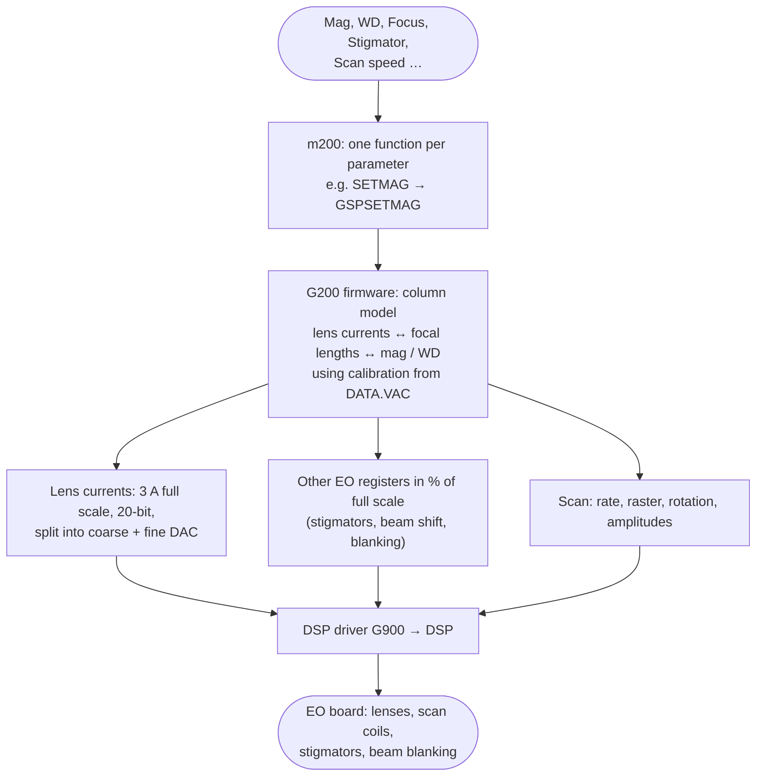
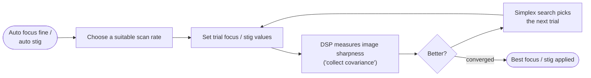

[Home](../../README.md) › [How the microscope works](README.md) › Scanning and electron optics

# Scanning and electron optics

> **In short:** magnification, working distance, focus, stigmation, beam shift and scan speed are all set through
> one PC module (m200) and one board firmware module (G200). The firmware holds a **model of the column**: from the
> wanted magnification and working distance it works out the lens currents and scan amplitudes, then writes them to
> the **EO board** through the DSP. Autofocus and autostigmation are search loops that change focus and watch a
> sharpness figure computed by the DSP.

## From a knob to the EO board



## Autofocus and autostigmation


Coarse autofocus first sweeps the focus through the working-distance range.

## What the optics affect
- **Detectors and display:** the scan rate sets how fast the image is acquired and which noise-reduction modes are
  possible.
- **Calibration:** all the column constants (lens calibration, crosstalk, magnification calibration) live in
  DATA.VAC; the calibration modes (C1/C2, magnification, scan orthogonality …) are listed in the technical reference.

## Good to know
- The register number of each lens on the EO board is filled in at start-up from the board version, so it cannot be
  read from the files alone.
- Field-emission and variable-pressure functions in the same module are not used on the LEO 430.

---

## Technical reference

*Full detail for maintenance and further reverse engineering: function names, addresses, parameters, sources. Inferred points are marked \*?\*.*

Sources: PC module `m200.dll` ("S420/430 EO DLL V03.00 10-Jan-95"; [`../modules-asm/m200.asm`](../modules-asm/m200.asm),
digest [`../modules-digest/m200.md`](../modules-digest/m200.md), **every export with its firmware call and parameters:
[`../modules-api/m200.md`](../modules-api/m200.md)**), GSP firmware `G200.420` / `G200.440` (EO model) and `g900.rlm`
(DSP driver), the DSP program ([`../dsp/README.md`](../dsp/README.md)).

```
 SEM UI / panels / macros: Mag, WD, Focus, Stigmation, Scan speed, Beam shift, Gun align, Apertures, Autofocus …
        │ AP_MAG, AP_WD, AP_C1…C3, AP_STIG_X/Y, DP_SCANRATE, CMD_AUTO_FOCUS_FINE …
        ▼
 m200.dll: one export per parameter/command (301), calibration modes, timer read-back
        │ TIGASEM GSP* calls (≈150 different ones: GSPSETMAG, GSPSETC3CURRENT, GSPSETSTIGMATORX, GSPSETSCANRATE …)
        ▼
 GSP EO firmware G200.42x: column model (lens currents ↔ focal lengths ↔ mag / WD), hysteresis, autofunctions
        │ EO register writes and scan commands as messages to the DSP driver (see dsp/README.md "Who sends which command")
        ▼
 GSP DSP driver g900 → DSP (ADSP-21xx) → EO board registers (lens DACs, scan generator, stigmators, blanking)
```

### 1. PC side (m200)
- Almost every export is a thin wrapper: store the parameter, call one GSP request. Examples: `SETMAG` →
  `GSPSETMAG` (+ pixel size and field width/height recalculated, `GSPNOTIFYOPTIBEAM` on FE machines); `SETWD` →
  `GSPSETWORKINGDIST`; `SETC1` / `SETC2` → `GSPSETCONDENSERLENSCURRENT`; `SETC3` → `GSPSETC3CURRENT`; `SETXYSTIG` →
  `GSPSETSTIGMATORX/Y`; `SETXYBEAMSHIFT` → `GSPSETMICROSHIFT`; `SETSCANROTATION` → `GSPSETSCANROTATION`;
  `DOCOMMANDSCANRATE0…15` → `GSPSELECTSCANNING` + `GSPSETSCANRATE` (and the mag-compensation amplitude/offset for that
  rate); `DOCOMMANDC1C2_HYSTERESIS` → beam blanked + `GSPCOMPOSITEHYSTERESIS`. The full list is in the API table.
- `EO_TIMER_TICK` reads the column state back each tick (`GSPREADUIFDATA`, `DSPCYCLETIME`): actual mag, WD, C1–C3,
  probe current, pixel size, field size, mag range, optimum/best aperture, gun tilt/shift, beam shift, stigmators.
- `INITIALISE_EO_CONTROLLER` loads the DSP driver (`SETDSPMODULE`, `INITDSPDRIVER`) and the EO firmware
  (`SETEOMODULE`, `INITEORLM`); `RESTORE_EO_CONFIG` takes the EO section of DATA.VAC (all the calibration values).
- `EOSTANDBY`, `EOSUSPENDOPERATION` / `EORESUMEOPERATION`: called by the EHT and stage modules around beam changes and
  stage moves.

#### Calibration modes (`DP_CALMODE`, strings 3246 + n)
Each `DOCOMMANDCAL_*` puts the column in a calibration mode in which the operator (or l500cal/Cal98, see
calibration.md) adjusts the related parameters, then OK/Cancel (`DOCOMMANDOK` / `DOCOMMANDCANCEL`):
1 C1/C2 · 2 C3 · 3 Scan Orthog · 4 Scan rate mag comp · 5 Dual Mag Offset · 6 Stig Balance · 7 Stage angle · 8 Focus
rotation · 9 Magnification · 10 Line Ampl · 11 Frame Ampl · 12 Line:Frame · 13 Scan Centre · 14 Dual Mag Slope ·
15 Output Device · 16 Beam Shift · 17 Stereo · 18 Mag Range Shift · 19 Emission centre · 20 Gun Align · 21 Aperture
Align · 22 User Magnification.

### 2. EO board values (G200)
- **Registers are bipolar DACs in % of full scale.** `_set_reg(reg, p)` writes `N/2 + N·p/200` (rounded), where N is
  the register's full-scale count from the table `_reg_size` (GSP `0xFEC80`, one 16-bit entry per register);
  `_get_reg` is the inverse, so −100 % … +100 % spans the DAC. Writes go out through `_write_EO_value` →
  `_DSP_set_EO_register` (DSP message 0x1E → DSP command 0x04). Stigmators (`_gsp_set_stig_x_reg`, …), stig balance,
  beam blanking, stereo and beam-align values use this path.
- **Lens currents:** C1/C2 (condensers, `_gsp_set_condenser_lens_current`) and C3 (objective, `_gsp_set_C3_current`)
  are converted as `current / 3.0 A × 1 048 575`, i.e. **3 A full scale on 20 bits**, then split over a coarse and a
  fine DAC register (read back with `_read_EO_value` first). The register numbers per lens come from the per-chip
  tables `_CHIP0` (condensers) and `_CHIP1` (objective) … `_CHIP4`, which are filled at start-up from the column
  profile / EO-board version (not stored in the file), so a fixed register list cannot be read statically.
- Lens polarity (`_gsp_set_C1/C2/C3_lens_polarity`), reversal / normalisation (`DOCOMMANDC1_REVERSE`, …), hysteresis
  removal (`_composite_hysteresis`, `_ramp_condenser`, `_rampC1C2C3`, C3 hysteresis), defocus, wobble
  (`_gsp_focus_wobble`, C1/C2/C3 wobble amplitude and period).
- **Column model:** the condenser and objective excitations are worked out from the required crossovers, focal lengths
  and working distance (`_calculate_excitation`, `_calc_excitation_for_WD`, `_calculate_focal_length`,
  `_calculate_crossover`, `_update_C1/C2/C3_crossover_and_mag`, `_calc_condenser_lens_current`,
  `_calc_focus_lens_current`) using the calibration constants from DATA.VAC (C1–C3 cal/rem, crosstalk, mag cal) and
  polynomial tables (`_A31`, `_B31`, `_C11`…`_C33`, `_CC1`…`_CS3`, `_ZPI_*`, `_ZPO_*`, min/max excitation and focal
  length limits). Magnification is computed from the scan deflection and the image distance
  (`_calc_mag`, `_calc_scan_deflection`, `_read_image_magnification`, `_toggle_mag_range`, mag ranges).
- **Scan:** scan rate (`_gsp_set_scan_rate`, `_find_closest_rate`), raster size/origin, scan rotation, orthogonality,
  line/frame amplitudes and ratio, dual mag, scan transforms (`_scale_and_set_transforms`), tilt correction, dynamic
  focus / stig, stereo patterns, beam blanking, microshift (beam shift), spot mode; all sent to the DSP driver as the
  `_DSP_*` messages listed in dsp/README.md.

### 3. Autofunctions
- **Coarse autofocus** (`DOCOMMANDAUTO_FOCUS_COARSE` → `GSPPERFORMCOARSEAUTOFOCUS`): a focus scan
  (`_gsp_start_focus_scan`) through the WD range while the DSP measures image sharpness *?*.
- **Fine autofocus / autostig** (`…_FINE`, `DOCOMMANDAUTO_STIG`, `DOCOMMANDFOCUS_STIG`): a **simplex search**
  (`_simplex_focus_and_stig`, `_simplex_stig_only`, `_do_stig_autofocus`) over focus (and stigmator X/Y) maximising
  the sharpness figure the DSP computes with **"collect covariance"** (GSP message 0x19 → DSP command 0x18) on a
  scan rate chosen by `_choose_scanrate`. Progress and aborts: `DP_AUTO_FUNCTION`, `DOCOMMANDABORT_AUTO`.
- Auto beam align (coarse / standard / fine / wide), auto aperture align, find image (`GSPPERFORMFINDIMAGE`), auto
  saturation (`DOCOMMANDAUTO_SATURATION`, `SWITCHSATURATE_AT`), auto photo.

### 4. Field-emission (FE) and VP extras in the same module
OptiBeam (`SWITCHOPTIBEAM`, `SWITCHOPTIMODE`, resolution / depth mode, probe and condition tables:
`IMPORT/EXPORTPROBETABLE`, `…CONDITIONTABLE`), FE gun alignment (`SWITCHFEC1_ALIGN`, …), EBBU (electrostatic beam
blanking unit), water temperature limit, conjugate focus. Not used on the LEO 430.

### 5. EO board versions (from the release notes)
The release notes list the EO board part and issue each software version expects:
`348224-8318.020` … `.060` (420/430/435/438/440 boards) and `347924-6018.020` (1400/1500 series), with their GSP
firmware module issues. Useful when fitting a spare board: see `docs/help/RELEASE/RELEASE.txt`.

---
[← How the microscope works](README.md) · [Home](../../README.md)
