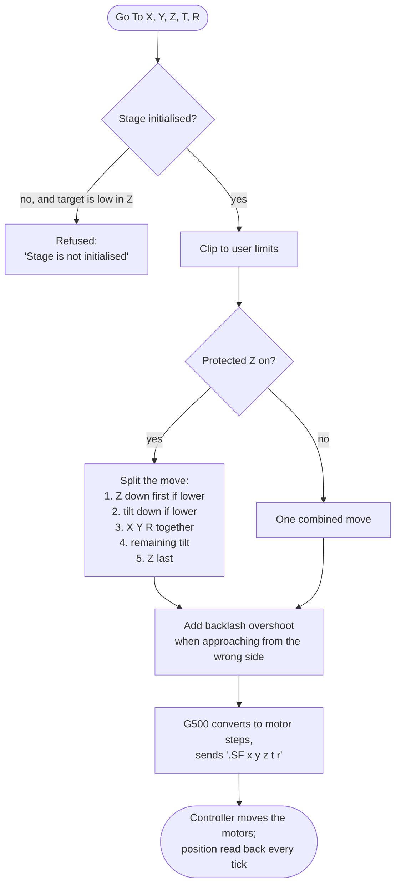
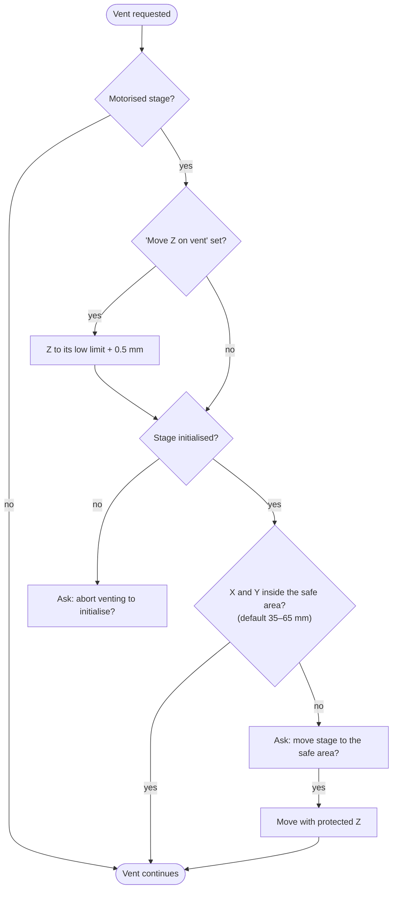

[Home](../../README.md) › [How the microscope works](README.md) › Stage

# Stage

> **In short:** the motorised stage (X, Y, Z, tilt, rotation) is driven by the same **StgVac controller** as the
> vacuum. The PC works in millimetres and degrees; the board firmware (G500) converts them to motor steps and sends
> one move line per target. The PC adds the safety logic: limits, a **protected-Z** move order so the specimen cannot
> hit the lens, backlash correction, and the "safe position" check before venting.

## A "Go To" move



## Initialisation
At **Stage Initialise** every axis drives to its reference switch in a fixed order: **Z first, then tilt, X, Y,
rotation**. Progress is shown as a percentage; the stage counts as initialised at 95 %.

## Before venting (asked by the vacuum module)



## What the stage affects
- **Vacuum:** venting needs the stage in its safe area and not tilted.
- **Scanning:** stage moves suspend the scan and resume it afterwards.
- **Touch alarm:** if the specimen touches the lens or chamber the controller raises "Stage Touching".

## Good to know
- Axis data (step sizes, ranges, speeds) come from the database `leo_user.mdb`; the table for every stage type is in
  the technical reference below.
- Without the image processor board the software **simulates** the stage (positions move towards the target), which is
  why LEO-32 can run in a virtual machine.

---

## Technical reference

*Full detail for maintenance and further reverse engineering: function names, addresses, parameters, sources. Inferred points are marked \*?\*.*

Sources: PC module `m500.dll` ([`../modules-asm/m500.asm`](../modules-asm/m500.asm) and `m500-seg2.asm`, digest
[`../modules-digest/m500.md`](../modules-digest/m500.md), Ghidra C `../decompiled/m500.dll.c`), GSP firmware
`C:\TIGA\G500.RLM` ([`../firmware/asm/g500.rlm.asm`](../firmware/asm/g500.rlm.asm), `tools/gsp-annotate.ps1 -Module g500.rlm`),
the stage tables in `leo_user.mdb` ([`../data/leo_user-stages.txt`](../data/leo_user-stages.txt)), `L500.ini`, DATA.VAC,
LEO's Stage Administrator help.

```
 SEM UI: Stage menu, stage manager control (StgMgr / NavMgr), joystick, trackerball, macros
        │ AP_STAGE_GOTO_X…M, CMD_STAGE_INIT, CMD_STAGE_ABORT, stage scan commands
        ▼
 m500.dll: limits, protected-Z move order, backlash, safe position for venting, touch alarm, stage scan
        │ TIGASEM: MOVETHESTAGETIGA, READSTAGETIGADATA, AUTOSTAGEINITTIGA, SENDCONFIGSTAGETIGA, …
        ▼
 GSP firmware G500.RLM: converts to motor steps, speed profiles, command lines ".SF x y z t r m", status decoding
        │ ASCII on the StgVac UART (GSP 0x60380000, 9600 8N1), same controller as the vacuum
        ▼
 Stage/vacuum controller ("StgVac"): stepper drivers per axis, limit switches, touch alarm, PSU
```

### 1. Stage types and axes (`leo_user.mdb` tables `Stage`, `Axis`, `AxisRule`, `CentreRule`)
The type in use is DATA.VAC "Stage Type" (`DP_STAGE_TYPE`); a typical LEO 430: **2 = Cartesian 95/98**, motorised X Y Z T R.

| # | Stage | Cartesian | Rotation centre (m) | Axes |
|---|---|---|---|---|
| 0 | Cartesian | yes | 0.05, 0.05 | X Y Z |
| 1 | Eucentric | no (side tilt) | 0.05, 0.05 | X Y Z |
| **2** | **Cartesian 95/98** | yes, SnapBack, PowerDown 3 | 0.062, 0.05 | X Y Z T R |
| 3 | Makro | no | 0.0375, 0.0375 | X Y Z R |
| 4 | Fjeld 6in | no | 0.0762, 0.0762 | X Y Z T R M |
| 5 | Fjeld 5in | no | 0.062, 0.05 | X Y Z T R |
| 6 | Makro II | no | 0.0375, 0.0375 | X Y Z R |
| 7 | Cartesian 95/98 (XYZ) | yes | 0.062, 0.05 | X Y Z |
| 8 | Fjeld 6in MK2 | no | 0.0762, 0.0762 | X Y Z T R M |

Axis data for the **Cartesian 95/98** (lengths in m, angles in degrees, speeds in steps/s):

| Axis | Step size (steps/unit) | Range | Mid point | Backlash dist. / speed | Start speed | Acceleration | Max speed | Init position | Prot-Z priority | Init order |
|---|---|---|---|---|---|---|---|---|---|---|
| X | 122718 | 0 … 0.125 | 0.0625 | +0.5 mm / 32000 | 50 | 204800 | 48000 | 0.05 | 3 | 3 |
| Y | 122718 | 0 … 0.100 | 0.05 | −0.5 mm / 32000 | 50 | 204800 | 48000 | 0.05 | 3 | 4 |
| Z | 15494 | 0 … 0.035 | 0.03 | −0.5 mm / 32000 | 50 | 204800 | 96000 | 0.0005 | 1 | 1 |
| T | 88778 | −1 … 90 | 0 | 2 / 32000 | 50 | 204800 | 64000 | 0 | 2 | 2 |
| R | 118370 | −380 … 720 | 0 | 2 / 32000 | 50 | 204800 | 96000 | 0 | 3 | 5 |

`AxisRule` narrows ranges for some column/WDX combinations (X ≤ 0.1, Y ≤ 0.125, Z ≤ 0.022 with WDX); `CentreRule`
sets the X centre to 0.05. The full table for every stage type is in the data file. Stage Administrator edits these
tables (see service-accounts.md for who may edit).

### 2. Start-up and initialisation
- `INITIALISE_STAGE_CONTROLLER` → `SETSTAGEMODULE` (firmware `G500.RLM`), `INITSTAGECOMMS`; `READAXISIDTIGA` /
  `.SY` read the axis hardware and firmware versions ("Stage HW version", "Stage FW version").
- `SENDCONFIGSTAGETIGA` (`sub_9036`) sends the axis table: step sizes `.SV`, cruising speeds `.SB`, ramp rates `.SC`,
  lower/upper limits `.SO` / `.SJ` / `.SQ`, joystick pixel size `.SW`.
- **Stage Initialise** (`DOCOMMANDSTAGE_INIT`, `AUTOSTAGEINITTIGA` or `MANUALINITTIGA`): the axes drive to their
  reference switches in `InitOrder` (Z first, then T, X, Y, R), progress from `GETSTAGEINITPERCENT` shown in
  `AP_PROGRESS`; done at ≥ 95 %. `DOCOMMANDFORCE_STAGE_INIT` forces it (Supervisor privilege "Force Stage Initialise").
  Without initialisation, moves below a Z threshold are refused ("The Stage is not initialised. Unable to move to lower
  Z position.").

### 3. Moving
- Go-to parameters `AP_STAGE_GOTO_X…M` (`SETXYSTAGE_GOTO`, `SETXYZTRMSTAGE_GOTO`, …) or vectored / short moves
  (`SETXYSTAGE_VECTOR`, `.SH`) and joystick moves (`JOYSTICKEMULNTIGA`, `.SI` move at speed).
- **Protected Z** (`SWITCHPROTECTED_Z`, saved in `L500.ini [Stage] Protected Z`): a multi-axis move is split so the
  stage cannot hit the lens: Z down first if the target is lower, tilt down if lower, then X/Y/R/M together, then the
  remaining tilt, then Z (axis `ProtZPriority` 1 = Z, 2 = T, 3 = others).
- **Backlash** per axis (`SWITCHX_BACKLASH`…, distances/speeds `SETBACKLASH_DISTANCE_*`, `SETBACKLASH_SPEED_*`): the
  move overshoots by the backlash distance and comes back at the backlash speed when approaching from the "wrong" side
  (G500 `_calculate_backlash_position`, clipped to the user limits).
- **Speed profile** per axis: start speed, speed increment and time increment (`SETSTAGE_V_START_*`,
  `SETSTAGE_SPEED_INC_*`, `SETSTAGE_TIME_INC_*`) up to the cruise speed (`SETSTAGE_CRUISE_*`); the GSP computes the move
  time and the best speed for vectored moves (`_calc_move_time`, `_calc_vector_speed`, `_check_max_speed`).
- The GSP sends **`.SF` followed by one integer per fitted axis** (X Y Z T R M order, space separated), the target in
  motor steps (`_move_to_a_position`); abort is `.SK` (`DOCOMMANDSTAGE_ABORT`); **Undo** returns to the previous
  position (`DOCOMMANDUNDO_STAGE_GOTO`).
- User limits (`SETXYSTAGE_LOW/HIGH`, `SETSTAGE_LOW/HIGH_Z/T/M`) go to the controller (`.SQ` / `.SJ`); limit hits are
  reported as messages 490–518 ("Stage X axis low outer limit hit", … inner / user limits).

### 4. Status (timer)
`STAGE_TIMER_TICK` → `sub_741a`: `READSTAGETIGADATA` gives positions and flags. In the GSP the `.SD` reply fields are
parsed with `atol` and converted with the axis **step size** around the **mid point** (`_STEP_SIZE`, `_MID_POINT`).
The PC updates `AP_STAGE_AT_X…M`, the axis-present states (`DP_X_AXIS_IS` …), the motion-profile read-backs, and:
- **Touch alarm**: `DP_STAGE_TOUCH` (string 501 "Stage Touching"): the specimen or stage touched the lens / chamber;
  inhibit with `SWITCHTOUCH_INH` / `.SR`; `TOUCHALARMOFFTIGA` clears it.
- **Overheat**: `DP_STAGE_TOO_HOT` / `DP_OVERHEAT_MODE` (motor drivers), shown with a message box.
- Near the exchange position (`DP_NEAR_EXCHANGE`), stage scanning progress (`DP_STAGE_SCANNING`, `AP_STAGE_AT_FIELD_X`).
- Faults from the controller (`_stage_fault_routine`, `.SP`); PSU check `.SS` (`DOCOMMANDSTGVAC_PSU_TEST`: "Stage Tilt
  −15V failed" …, messages 515–518).

**Without the image-processor board** (`DP_GSP` = 0) m500 **simulates** the stage: on every tick each axis position
steps towards its target by a fixed amount. That is why LEO-32 can run and "move" in a VM with no hardware.

### 5. Safe position for venting (`STAGEINSAFEPOSITION`, called by the vacuum module before Vent)
1. Not motorised → OK.
2. Reads the safe area from `L500.ini [Stage]`: `SafePosLowX`, `SafePosLowY`, `SafePosHighX`, `SafePosHighY` (mm).
   Missing (−1) or outside the axis range → defaults **35 … 65 mm** in X and Y.
3. If "Move Z on Vent" (DATA.VAC, `DP_Z_ON_VENT`) is set: Z goes to its low limit + 0.5 mm first (refused with a
   warning if the stage is not initialised).
4. Stage not initialised → "Stage is not initialised and may not be in a safe position for opening chamber door. Do
   you wish to abort venting to initialise the stage." (Yes aborts the vent).
5. Outside the safe area → "Vent Inhibited. Stage is not in safe area. Do you want stage moved to x,y ?" with the
   limits; Yes moves it (with the protected-Z order) and the vent continues.

`CHANGEINVACSTATUS` (called by m600 when the vacuum state changes) re-applies the axis limits for the new state.

### 6. Stage scan, survey, custom stages
- Stage scan (`DOCOMMANDSTAGE_START_SCAN`, `NEXT_FIELD`, `PREVIOUS_FIELD`, `SETXYSTAGE_FIELDS`, `SETFIELD_OVERLAP`,
  `DOCOMMANDSTAGE_HERE_START/END`, `DOCOMMANDSTAGE_CALC_SCAN`): steps the stage over a grid of fields with overlap; the
  StgMgr control's "Define Scan Fields Wizard" sets it up.
- Compucentric tilt correction (`SETCOMPU_TILT_ERROR`), rotation limit switch (`SWITCHROTATE_LIMIT`,
  `SETROTAXISLIMITSWITCH`), motors on/off (`STAGEMOTORSONOFF`; Cartesian 95/98 "PowerDown 3" = reduced idle current),
  hot/cold stage (`SWITCHHCSTAGE`, needs `HCSTG.VBX`, not part of a standard installation).
- Custom stages: `DEFINECUSTOMSTAGE`, `DEFINEAXISHIGHRANGE` (from Stage Administrator).

---
[← How the microscope works](README.md) · [Home](../../README.md)
