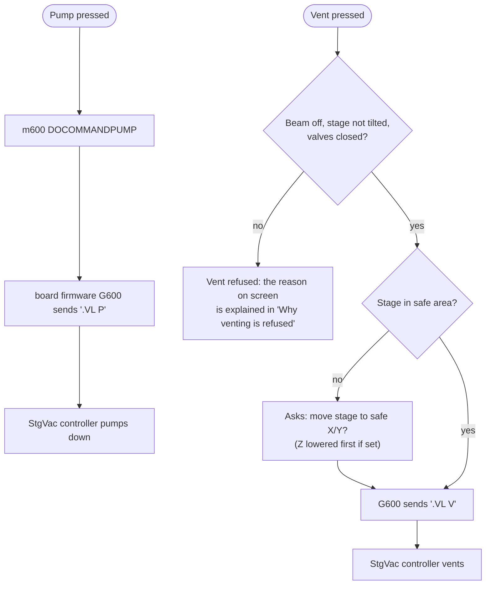
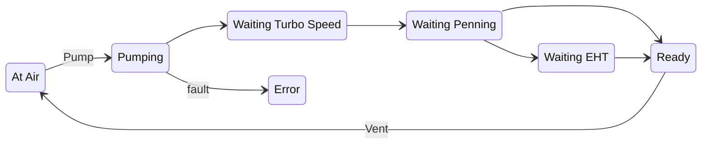

[Home](../../README.md) › [How the microscope works](README.md) › Vacuum

# Vacuum

> **In short:** the PC does not open valves itself. It sends one-word orders (Pump, Vent, Abort) through the image
> processor board to the **stage / vacuum controller ("StgVac")**, which runs the pumps and valves and enforces its
> own vacuum interlocks. The PC polls the status every tick, shows it, and refuses unsafe actions (for example venting
> with the beam on). The machine's configuration file **DATA.VAC** is also loaded by this module at start-up.

## Pressing Pump or Vent


**Links:** [Why venting is refused](#why-venting-is-refused-dp_vent_invalid_reason) ·
[Stage: before venting](stage.md#before-venting-asked-by-the-vacuum-module)

## Vacuum status as shown on screen


(The order of the intermediate states is how they are normally reached; the controller reports the state, the PC only
displays it.)

## What vacuum affects
- **Beam:** the high voltage only runs up when the controller says the vacuum is good enough ("Waiting Vac" otherwise).
- **Detectors and gun:** the controller itself switches off scintillator, photomultiplier, high voltage, filament and
  ion pump if the pressure rises above their thresholds (set from DATA.VAC).
- **Stage:** venting first puts the stage in a safe position. Every reason a vent can be refused is listed in
  [Why venting is refused](#why-venting-is-refused-dp_vent_invalid_reason).

## Good to know for repair
- The configuration and calibration file is **`C:\LEO\data.vac`**. If it is missing or corrupt the software silently
  falls back to `default.vac` (factory defaults): the microscope runs but is **uncalibrated**. Keep backups.
- The controller's own memory is not used for the configuration on this installation (registry mode 6), so swapping
  the StgVac controller does not lose the configuration.
- The gauge readings are converted from controller counts by fixed formulas (in the technical reference below).

---

## Technical reference

*Full detail for maintenance and further reverse engineering: function names, addresses, parameters, sources. Inferred points are marked \*?\*.*

This chapter follows the vacuum system through every software layer. Sources: the PC module `m600.dll`
(annotated listing [`../modules-asm/m600.asm`](../modules-asm/m600.asm), function digest
[`../modules-digest/m600.md`](../modules-digest/m600.md)), the GSP firmware module `C:\TIGA\G600.440`
([`../firmware/asm/g600.440.asm`](../firmware/asm/g600.440.asm); annotate with `tools/gsp-annotate.ps1 -Module g600.440`),
TIGASEM, the registry and DATA.VAC.

```
 SEM UI (Vacuum menu, toolbar)          LEOSERV / srv16 / m007 (parameters, commands)
        │ CMD_PUMP / CMD_VENT / …               │ timer tick
        ▼                                        ▼
 m600.dll  DOCOMMANDPUMP/VENT/…  ─────── VAC_TIMER_TICK: poll status, interlocks, NVRAM
        │ TIGASEM.SYSTEMPUMPINGSTATE(0|1|2), READVACSTATUS, CONFIGURE*TIGA, …
        ▼
 GSP firmware G600.440 (on the image-processor board)
        │ ASCII lines ".VL P", ".VT", … on the StgVac UART (GSP 0x60380000, 9600 8N1)
        ▼
 Stage/vacuum controller ("StgVac": comms CPU + vac CPU) → pumps, valves, gauges, interlock thresholds,
 specimen-current meter, 4Q-BSD amplifier, touch alarm
```

### 1. Start-up
1. LEOSERV → `m007.INITIALISE_CONTROLLER(600, mode)` → `m600.INITIALISE_VAC_CONTROLLER(mode)`. **`mode`** is the
   registry value `HKLM\Software\LEO Electron Microscopy Ltd\LEO-32\M600` (typically **6**; the other `M100`…`M800`
   values are 0 except `M200` = 1). It selects where the machine configuration ("NVRAM", i.e. DATA.VAC) lives, see §6.
2. `TIGASEM.SETVACMODULE("G600.440")` loads the vacuum firmware into the GSP; `INITVACCOMMS` opens the serial link.
3. `READVACID` / `READCOMMSID` ask the controller for its two firmware versions (`.VV`, `.VX`); they are logged as
   "STGVAC Vac cpu = …" and "STGVAC Comms cpu = …" ("NOTREAD" if no answer).
4. The configuration is restored (§6) and every module gets its section (`RESTORE_STAGE_CONFIG`, `RESTORE_VACUUM_CONFIG`,
   `RESTORE_EO_CONFIG`, …).
5. The fitted options from DATA.VAC are sent to the controller: EDX `.CF`, WDX `.CG`, airlock `.CA`, viewing window
   `.CB`, column pumping `.CE`, front panel `.CC`, tilt-0 `.CD`, thresholds `.TA`–`.TE`/`.TH` (§5).

### 2. Commands
| UI command (server) | m600 function | Checks first | Hardware call | Serial line |
|---|---|---|---|---|
| Pump (`CMD_PUMP`) | `DOCOMMANDPUMP` | VP machine (column type 3) in VP mode: HPAPP handles it | `SYSTEMPUMPINGSTATE(0)` | `.VL P` |
| Vent (`CMD_VENT`) | `DOCOMMANDVENT` | **`M500.STAGEINSAFEPOSITION`** (stage moved to its safe Z first), VP checks | `SYSTEMPUMPINGSTATE(1)` | `.VL V` |
| Vacuum abort | `DOCOMMANDVAC_ABORT` | VP checks | `SYSTEMPUMPINGSTATE(2)` | `.VL A` |
| Start / stop column pump | `DOCOMMANDSTART/STOP_COLUMN_PUMP` | — | `COLUMNPUMPINGSTATE(0/1)` + column isolation | `.VB`, `.VP` |
| Column isolation | `SWITCHCOLUMN_ISOLATION` | — | `COLUMNISOLATIONTIGA` | `.VP` |
| EDX / WDX / airlock / viewing window / column pump fitted | `SWITCHEDX`, `SWITCHWDX`, `SWITCHAIRLOCK`, `SWITCHVIEWING_WINDOW`, `SWITCHCOLUMN_PUMP` | — | `CONFIGURE…TIGA` | `.CF`, `.CG`, `.CA`, `.CB`, `.CE` |
| WDX gate valve | `SWITCHGATE_VALVE`, `SWITCHWDX_GATE_VALVE_MOTOR` | — | `OPERATEWDXGATEVALVETIGA` | `.VI` |
| Open / close column-chamber valve; pump / vent / hold airlock | `DOCOMMANDOPEN_COL_CHAMBER_VALVE`, … `DOCOMMANDHOLD_AIRLOCK_VACUUM` | — | **none: empty functions in this build** | — |
| EDX vacuum limit | `SETEDX_VAC_LIMIT` | — | `SETEDXTHRESHOLDTIGA` | `.TH` |
| Comms PSU status | `DOCOMMANDGETCOMMSPSU` | — | `GETCOMMSPSUSTATUS` | `.VY` |

In the GSP, `_system_pumping_tiga` builds `".VL "` + `P` / `V` / `A` and sends it with `_retry_vac_command`
(error 0x0A in `_Vac_Error` for an unknown argument).

### 3. Status polling (every timer tick)
`VAC_TIMER_TICK` → `sub_2834` (status) and `sub_3036` (configuration state machine, §6).
- `READVACSTATUS` returns the **vacuum status record**, the same layout in the GSP (`_VACUUM_STATUS`, bit address
  `0x2F3A0`) and on the PC:

  | Offset | Type | Meaning | Parameter |
  |---|---|---|---|
  | 0 | float | system (chamber) vacuum | `AP_SYSTEM_VAC` |
  | 4 | float | gun / column vacuum | `AP_COLUMN_VAC` ("Gun Vacuum") |
  | 8 | byte | vacuum status (table below) | `DP_VACSTATUS` (a change also calls `M500.CHANGEINVACSTATUS`) |
  | 9 | byte | column pumping | `DP_COLUMN_PUMPING` |
  | 0x0A | byte | gun–chamber valve | `DP_GUN_CHAMBER_VALVE` |
  | 0x0B | byte | column–chamber valve | `DP_COLUMN_CHAMBER_VALVE` |
  | 0x0C | byte | EDX window | `DP_EDX_WINDOW` |
  | 0x0D | byte | WDX gate valve | `DP_GATE_VALVE` |
  | 0x0E | byte | airlock | `DP_AIRLOCK_IS` |

  With column pumping fitted, `DP_COLUMN_ISOLATED` = 1 when both chamber valves read closed.
- A second record gives the fault flags: vent inhibited, EDX enable, viewing window, vent invalid, stage tilted, **chamber
  leak**, **Penning failure**, and position errors for the gun valve, chamber valve, EDX window, WDX gate valve and
  airlock. Each new fault sets its `DP_…` flag and logs the message (string table 502–506: "Gun Valve position
  incorrect", "Chamber column valve position incorrect", "EDX system window position incorrect", "Airlock Gate valve
  position incorrect", "WDX system gate valve position incorrect").
- Other values taken from the same poll: specimen current meter range (`DP_SCM_RANGE`), 4-quadrant BSD gain
  (`DP_4QBSD_GAIN`), EO board present.

**`DP_VACSTATUS` values** (strings 3417–3425): 0 At Air · 1 Ready · 2 Pumping · 3 Error · 4 Waiting Turbo Speed ·
5 Waiting Penning · 6 Waiting EHT · 7 Vent Inhibited · 8 Going VP.

#### Why venting is refused (`DP_VENT_INVALID_REASON`)
Worked out on every poll, in this order (strings 3531 + n):

| n | Reason | Condition in `sub_2834` |
|---|---|---|
| 5 / 4 | Gun Valve not closed / not open | column pumping fitted and isolated, gun–chamber valve in the wrong position |
| 7 / 6 | Col Valve not closed / not open | same for the column–chamber valve |
| 1 | EDX valve not closed | EDX fitted and EDX window open |
| 2 | WDX valve not closed | WDX fitted and gate valve not closed |
| 3 | Airlock not closed | airlock fitted and not closed |
| 8 | Stage Tilted | motorised tilt stage and `DP_TILTED` |
| 10 | Pumping error | `DP_VACSTATUS` = 3 (Error) |
| 9 | Beam Present | gun run-up state not 0/9 (beam on) or column isolated |
| 11 | Stage Temperature | hot/cold stage temperature out of range (`AP_HCSTAGE_TEMP`) |

### 4. Inside the GSP: the controller's status reply
`.VT` returns the status as text fields; `_decode_vac_status(field, text)` handles them by position:

| Field | Decoded by | Stored in `_VACUUM_STATUS` |
|---|---|---|
| 0 | `_check_column_state` | +9 column pumping |
| 1 | number → `_calculate_pressure(n, 1)` | +4 gun vacuum (and +0x0E) |
| 2, 3, 4 | `_check_valve_state` | +0x0C EDX window, +0x0D WDX gate valve, +8 status |
| 5 | `_check_system_state` | system state (and `_send_eo_vac_state` tells the EO/EHT side) |
| 6 | number → `_calculate_pressure(n, 0)` | +0 system vacuum (and +0x0A) |
| 7, 8 | `_check_valve_state` | +0x0B column–chamber valve, … |

Any field that does not parse sets `_Vac_Error` = 0x0C and logs it.

**Gauge conversion `_calculate_pressure(n, gauge)`** (TI soft-float; constants from `.data`). A reading of 0 is
treated as 1.
- gauge 0 (system/chamber): `p = 1 / (60 · n^0.9)`
- gauge 1 (gun/column): `p = 0.2666 / (500 · n)`; if `p < 1e-8`, `p = p / (p / 1e-8)^0.185` (low-pressure correction)
- both: result `× 1.3333 / 1000` (Torr→mbar factor and /1000, i.e. mTorr → mbar *?*), returned as float.

(`pow(x, y)` argument order taken from the TI C calling convention; the physical meaning of `n`, a count from the
controller, is not confirmed.)

### 5. Interlock thresholds (held by the controller)
The controller itself switches things off when the vacuum is not good enough. Thresholds are set from DATA.VAC /
parameters with `_calculate_threshold` (the inverse of the gauge formula) and sent as:
`.TA` scintillator, `.TB` accelerating voltage (EHT), `.TC` photomultiplier, `.TD` ion pump on/off, `.TE` filament,
`.TH` EDX. The PC mirrors the resulting inhibits as `DP_VAC_SCINT_INHIBIT`, `DP_VAC_ACC_VOLT_INHIBIT`,
`DP_VAC_PM_INHIBIT`. Also on this controller: specimen current meter (`.QD` range, `.QE` reading, `.VX/.VW 61`
calibrate), 4Q-BSD amplifier (`.QA` control, `.QB` visible, `.QC` gain), touch alarm off (`.VX/.VW 65`).

### 6. Machine configuration ("NVRAM" = DATA.VAC)
`m600` owns the machine configuration record (DATA.VAC layout, version byte 0x16 = 22, checksum). Where it is kept
depends on the registry `M600` mode passed at start-up:

| Mode | Read at start-up from | Saved to |
|---|---|---|
| 1, 3 | the controller's NVRAM (`REQUESTSYSTEMCONFIGTIGA` → `.VV`; `GETSYSTEMCONFIGDATATIGA`) | controller (`SAVESYSTEMCONFIGDATATIGA` → `.VU`), mode 3 also the file |
| 2 | — | controller |
| 4 | the DESkey (code stubbed out: never works) | — |
| 5 | file | file + debug dump `C:\LEO\data.dgl` |
| **6 (usual LEO 430 setting)** | **`C:\LEO\data.vac`** | `C:\LEO\data.vac` |

Restore order (`sub_3036`): the selected source; if it is missing, has the wrong version or a bad checksum →
`C:\LEO\data.vac`; then → `C:\LEO\default.vac` (the factory default; licences cleared); if all fail an error is logged
and only the master section is restored. Each fallback is logged. `FORCE_SAVE_NVRAM` / `WRITE_NVRAM` write the current
configuration back.

**Repair notes:**
- With mode 6 the controller's own NVRAM is not used for the configuration, so swapping the stage/vacuum controller or
  restoring a disk image onto another machine does not create a mismatch; but **DATA.VAC carries the source machine's
  calibration** (see file-formats.md), so a restored image brings the source machine's calibration along.
- If `data.vac` is lost or corrupt, the server silently falls back to `default.vac` (factory defaults): the machine
  will run but uncalibrated. Keep the `C:\Backups` copies (Parachute).

### 7. Variable pressure (VP / "HPSEM") machines only
Column type 3 (435VP/438VP) adds an external program **`HPAPP.EXE`** (pressure controller on COM2, `LEO.INI [HPAPP]`)
driven through registered messages (`LEO_HPAPP_MESSAGE`, functions `HP_STATE_EVENT`, `HP_ERROR_EVENT`,
`HP_SET_CHAMBER_PRESSURE`, `RESTART_HPAPP`, `CLOSE_HPAPP`, `UPDATE_HPSEM_PANEL`, `DOCOMMANDGOTO_HV` / `GOTO_VP`,
`SETHP_TARGET`, `SETVP_LIMIT`). In VP mode the normal Pump/Vent/Abort are refused ("pump (HPSEM column-LP mode only)")
or routed through HPAPP, with a time-out monitor ("User vent whilst time out monitor active."). Bake-out and partial
vent (`SWITCHBAKEOUT`, `DOCOMMANDSTART_BAKEOUT`, `SWITCHPARTIAL_VENT`) belong to machine types 6/8. HPAPP itself is
not part of a LEO 430 installation; its error messages are strings 550–560+ ("HPApp failed to start", "VP Turbo Isolation Valve …").

---
[← How the microscope works](README.md) · [Home](../../README.md)
