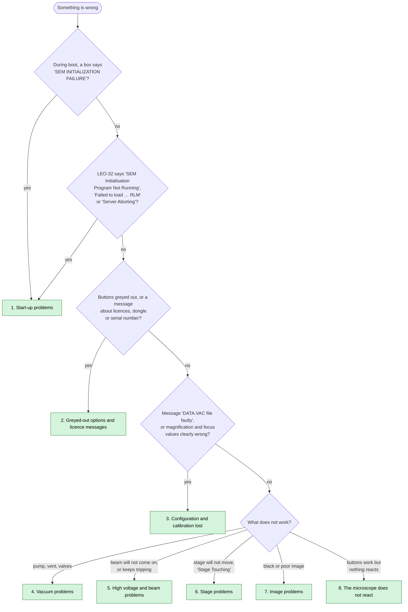

[Home](../README.md) › Troubleshooting

# Troubleshooting

Each entry lists a symptom, its likely cause, what to check, and where it's explained. They're based on how the
software works rather than on recorded repairs, so treat them as a starting point, not a guaranteed diagnosis.

**[Fix guides](fixes/README.md):** step-by-step procedures for the problems that need one: what the message means, what the fix changes, the logins required, and how to check it worked.

Follow the questions; each green box corresponds to a section below.

**Jump to:** [1. Start-up problems](#1-start-up-problems) ·
[2. Greyed-out options and licence messages](#2-greyed-out-options-and-licence-messages) ·
[3. Configuration and calibration lost](#3-configuration-and-calibration-lost) ·
[4. Vacuum problems](#4-vacuum-problems) · [5. High voltage and beam problems](#5-high-voltage-and-beam-problems) ·
[6. Stage problems](#6-stage-problems) · [7. Image problems](#7-image-problems) ·
[8. The microscope does not react](#8-the-microscope-does-not-react)

## 1. Start-up problems

| Symptom | Likely cause | Check | More |
|---|---|---|---|
| "SEM INITIALIZATION FAILURE" box during boot | a DOS board tool failed (FPGA load, GSP halt, TIGA driver) | board seated; I/O `0xA300–0xA30F`, IRQ 9 and memory `D000–DFFF` free in the BIOS; files in `C:\GSPUTILS`, `C:\TIGA` | [Start-up](boot-chain.md), [Board tools](components/board-tools.md), [Hardware interface](hardware-interface.md) |
| "LCA failed to configure" / "configured prematurely" | board FPGA did not load | `C:\GSPUTILS\MMLCA.MCS` present and intact; board hardware | [Board tools](components/board-tools.md) |
| "LEO Server: Fatal Error — SEM Initialisation Program Not Running" | `sem_init.exe` did not start or crashed (it cannot reach the board) | the DOS stage above; `DPRAM.IMG`, `SEM_INIT.DAT`, `TIGAGM.OUT`, `TIGAWIN.RLM` present | [sem_init](components/sem_init.md) |
| messages 416–432 "Failed to load … RLM" / "Failed to activate … Process" | a firmware module could not be loaded into the board | the file named in the message in `C:\TIGA`; board memory | [Error codes](error-codes.md), [Firmware](firmware/README.md) |
| "PC Dongle not present … Server Aborting" | the installation thinks it is an office PC without microscope hardware (registry `Gsp` and `ScanGen` both 0) | registry `HKLM\Software\LEO Electron Microscopy Ltd\LEO-32`: `Gsp` = 1 on a microscope PC | [DESkey](components/deskey.md), [Registry](registry-config.md) |

## 2. Greyed-out options and licence messages

| Message at server start | Meaning | Fix | More |
|---|---|---|---|
| "The Leo_User Database version is incorrect" | registry `DB Version` ≠ database version | run Upgrade User Database, or restore the matching database | **[Fix guide](fixes/database-version.md)** · [DESkey](components/deskey.md) |
| "Serial Number in Data.Vac does not agree with Serial Number in Database" | DATA.VAC and `leo_user.mdb` disagree (e.g. an old database restored) | set the serial with LEO Administrator | **[Fix guide](fixes/serial-mismatch.md)** · [DESkey](components/deskey.md#moving-a-disk-image-to-another-leo-430-rescue-serial-number) |
| "DK2 Driver not Installed" | dongle driver `DK2WN95.386` not loaded | driver files and registry entry; Windows 98 | **[Fix guide](fixes/dongle-not-found.md)** · [DESkey](components/deskey.md) |
| "Dongle not found" / "Error reading dongle" | dongle missing or port not usable | dongle on LPT1; a **real** parallel port at `0x378` (USB adapters do not work) | **[Fix guide](fixes/dongle-not-found.md)** · [DESkey](components/deskey.md) |
| "Serial Number read from dongle does not agree with Data.Vac" | disk image from another machine, or wrong dongle | Factory → Serial Number or **Rescue Serial Number** in LEO Administrator | **[Fix guide](fixes/serial-mismatch.md)** · [DESkey → Moving a disk image](components/deskey.md#moving-a-disk-image-to-another-leo-430-rescue-serial-number) |
| no message, but one function grey | situation rule (spot mode, auto function …) or access level | leave that mode; check the user level | **[Fix guide](fixes/licences-missing.md)** · [Rules and licences](subsystems/core-rules-accessories.md) |

## 3. Configuration and calibration lost

| Symptom | Likely cause | Check | More |
|---|---|---|---|
| message 414 "DATA.VAC file faulty, DEFAULT.VAC used"; microscope runs but magnification, focus, lens values are off | `C:\LEO\data.vac` missing, wrong version or bad checksum: factory defaults loaded | restore `data.vac`: the newest good copy is `C:\LEO\DATA<n>.VAC` with the highest `<n>` (made at each successful start; hidden, read-only), else a Parachute backup in `C:\Backups` | **[Fix guide](fixes/restore-configuration.md)** · [Backing up and restoring](components/utilities.md#backing-up-and-restoring-the-machine-files-parachute), [Vacuum §6](subsystems/vacuum.md#6-machine-configuration-nvram--datavac) |
| message 415 "DEFAULT.VAC faulty, proceed with caution" | both files bad | restore from backup | **[Fix guide](fixes/restore-configuration.md)** · [File formats](file-formats.md) |
| after restoring an image on another machine, calibration slightly off | DATA.VAC carries the **source** machine's calibration | recalibrate (Cal98, l500cal) | [Calibration](components/calibration.md) |

## 4. Vacuum problems

| Symptom | Likely cause | Check | More |
|---|---|---|---|
| Vent refused, reason shown | beam on, stage tilted, a valve open, pumping error … | the reason text; each one is listed | [Why venting is refused](subsystems/vacuum.md#why-venting-is-refused-dp_vent_invalid_reason) |
| "Vent Inhibited. Stage is not in safe area" | stage outside the safe X/Y area | answer Yes to move it, or initialise the stage | [Stage](subsystems/stage.md) |
| messages 502–506 "… valve position incorrect" | valve switch reports the wrong position | that valve and its position switch | [Vacuum](subsystems/vacuum.md) |
| messages 438 / 439 "Vacuum Board ±12V failed" | controller power supply | StgVac supply | [Error codes](error-codes.md) |
| status stays "Waiting Turbo Speed" / "Waiting Penning" | pump or gauge not reaching its threshold | turbo pump, Penning gauge | [Vacuum](subsystems/vacuum.md) |

## 5. High voltage and beam problems

| Symptom | Likely cause | Check | More |
|---|---|---|---|
| beam state "Waiting Vac", nothing happens | vacuum not ready (interlock) | vacuum status first | [EHT and gun](subsystems/eht-gun.md) |
| message 433 "Filament Blown" | filament broken | replace filament, then "New Filament" | [EHT and gun](subsystems/eht-gun.md) |
| beam drops and comes back by itself | EHT trip recovered automatically by the firmware | if frequent: messages 434, 519, 520, 549; gun cleanliness, vacuum | [Trip recovery](subsystems/eht-gun.md#automatic-trip-recovery) |
| kV cannot be set as high / low as wanted | licence (40 kV, Low Voltage) or anode setting | licences; anode spacer | [Rules and licences](subsystems/core-rules-accessories.md) |

## 6. Stage problems

| Symptom | Likely cause | Check | More |
|---|---|---|---|
| "The Stage is not initialised. Unable to move to lower Z position." | stage not initialised | run Stage Initialise | [Stage](subsystems/stage.md) |
| "Stage Touching" | specimen or stage touching the lens / chamber | move Z down; then clear the alarm | [Stage](subsystems/stage.md) |
| messages 490–518 "… limit hit" | an axis reached a limit switch | axis position, limits in Stage Administrator | [Stage](subsystems/stage.md) |

## 7. Image problems

| Symptom | Likely cause | Check | More |
|---|---|---|---|
| black image with an SE detector | scintillator or photomultiplier switched off by the vacuum interlock, or brightness very low | vacuum ready; detector selected; brightness (= PM voltage on SE detectors) | [Detectors](subsystems/detectors-acquire.md) |
| black image with Cathodo selected | normal: the scintillator is switched off for cathodoluminescence | — | [Detectors](subsystems/detectors-acquire.md) |
| ABC / Auto BC does not reach a good image | signal outside the range it can correct | detector, amplifier range (BSD / SCM) | [Detectors](subsystems/detectors-acquire.md) |
| some scan speeds missing | licence (Scan Rate Expansion) or a mode limiting the rate (split, quad, spot) | licences, mode | [Rules and licences](subsystems/core-rules-accessories.md) |

## 8. The microscope does not react

LEO-32 starts and buttons can be clicked, but the microscope does nothing. Every command goes from LEO-32 through the
image processor board to the EHT unit or the stage / vacuum controller, each on its own serial link from the board
([Serial protocols](firmware/serial-protocols.md)); a command that does nothing stopped on that path or waits for an
interlock. The message list (also saved in `…\LEO-32\LOG\leolog.leo`) usually says which.

| Symptom | Likely cause | Check | More |
|---|---|---|---|
| messages 408 "EHT comms failed to open/close" / 477 "EHT set comms timeout" | the EHT unit does not answer on its serial link | EHT unit switched on; its cable to the image processor board | [EHT and gun](subsystems/eht-gun.md) · [Error codes](error-codes.md) |
| messages 437 "Vacuum Command error" / 443 "Stage Command Error" | the stage / vacuum controller does not answer (request codes below 0x40 are communication failures) | controller switched on; its cable to the board | [Serial protocols](firmware/serial-protocols.md) · [Error codes](error-codes.md) |
| one action waits: beam "Waiting Vac", vent refused, stage will not move | an interlock | sections 4 to 6 above | [Vacuum](subsystems/vacuum.md) · [EHT and gun](subsystems/eht-gun.md) · [Stage](subsystems/stage.md) |
| nothing reacts at all and there is no message | registry `Gsp` ≠ 1 or `ScanGen` ≠ 0: LEO-32 does not start its controller modules, so the interface drives nothing | `regedit`, `HKLM\Software\LEO Electron Microscopy Ltd\LEO-32`: `Gsp` = 1, `ScanGen` = 0, `Machine` = 2, `M600` = 6; restart | [Registry](registry-config.md) · [Error codes → board firmware start-up](error-codes.md#board-firmware-start-up) |

---
[Home](../README.md)
