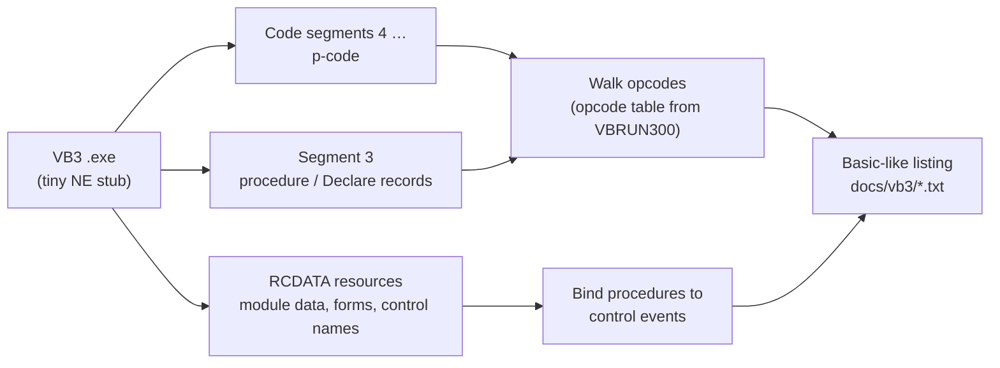

[Home](../../README.md) › [Raw data](../raw-data.md) › Visual Basic 3 tools

# Visual Basic 3 tools: decompiled code

> **In short:** three small service programs are written in Visual Basic 3: **hrru.exe** (HRRU register editor),
> **speed.exe** (HRRU film-speed table editor) and **leosync.exe** (PC / TIGA picture alignment). VB3 does not
> compile to machine code but to *p-code* run by `VBRUN300.DLL`, so the usual tools cannot read them. A p-code
> reader was written for this archive (`tools/vb3-pcode.ps1`); the files here are its
> output: every event procedure with its control and event, rebuilt as Basic-like statements. What each program
> does is described in [Utilities](../components/utilities.md#hrru-high-resolution-recording-unit-the-photo-crt-camera-visual-basic-3).

| File | Program | Procedures |
|---|---|---|
| [`hrru.txt`](hrru.txt) | HRRU Configuration Manager V02.02 | 28, all bound to their control events |
| [`speed.txt`](speed.txt) | Hrru Speed V02.00 | 17, all bound |
| [`leosync.txt`](leosync.txt) | LEO 400 Series PC Plane Sync V01.00 | 11 (8 event procedures + 3 general procedures) |



## How to read the listings
- Each procedure starts with a comment line: code segment and offsets, the procedure record in segment 3, and the
  form / control / event it is bound to (with the class, the event slot and the class's event count).
- Each statement line starts with the p-code offset of the statement. `L_xxxx:` lines are jump targets.
- Control flow is shown as it is compiled: `If Not (…) Then GoTo L_xxxx`, `GoTo`. A `For` / `Do` loop is a test at
  the top and a `GoTo` back; `Select Case` appears as one `Case …` test per range with its two targets.
- `L_xx` = local variable, `G_xx` = module variable, `K_xx` = constant, `P_xx` = parameter; `xx` is the operand
  (an offset into the module's tables). Where a variable, object or import call has a real name below, it was
  given by hand in `tools/vb3/<name>.names.csv`, each row with its reason. Everything else (controls, events,
  properties, Declares, strings, constants) comes from the exe itself.
- Implicit type conversions are not shown (VB does them silently too).
- The password of the HRRU Configuration Manager is **`RUSTAT`**: the string literal at file offset `0x962` of
  `original/.../LEO-32/hrru.exe`, compared with the password box in `OKCmd_Click` (exact, case-sensitive match).
- The tool can still hide a literal if needed: an `R` row in `tools/vb3/<name>.names.csv` with the SHA-256 of the
  literal as key and the replacement text as name.

## Regenerating
```
powershell -ExecutionPolicy Bypass -File tools\vb3\classes.ps1
powershell -ExecutionPolicy Bypass -File tools\vb3-pcode.ps1 -Name hrru
powershell -ExecutionPolicy Bypass -File tools\vb3-pcode.ps1 -Name speed
powershell -ExecutionPolicy Bypass -File tools\vb3-pcode.ps1 -Name leosync
```
`-Raw` adds every opcode with its operands under the statements.

---

## Technical reference

*Full detail for maintenance and further reverse engineering. Inferred points are marked \*?\*.*

### File layout (all three programs)
| Part | Holds |
|---|---|
| segment 1 (0x19 bytes) | start-up stub: far call into `VBRUN300` |
| segment 2 | automatic data (empty in the file) |
| segment 3 | descriptor: module records (0x48 bytes each), procedure records and Declare records (0x38 bytes each) |
| segments 4 … | p-code, one code segment per module (form or `.BAS`), procedures one after another |
| RCDATA 0x8001 | project header (form file names, e.g. `LEOSYNC.FRM`, VBX names) |
| RCDATA 0x8002 | module data image: string constants, constant values, Declare library / function names |
| RCDATA 0x8004 / 0x8005, 0x8006 / 0x8007 … | per form: the form binary (properties, control records) / the control-name list |

- **Procedure record:** `… module, self + 1, start, ?, end-marker offset, FF FF FF FF FF FF, next, …`; the record
  offset in segment 3 is what calls and event slots refer to (they store record + 1). Verified for every procedure:
  the `self + 1` word sits at record + 0x16 and the start offset at record + 0x18.
- **Declare record:** word 7 = 0x000C, word 9 = 0xFFFF, words 10 and 11 = module; word 23 + base = offset of the
  function name (length-prefixed) and word 20 + base = the library name in RCDATA 0x8002. The base (0x102 in
  leosync) is found by trying every base until all names read as identifiers.
- **Control-name list:** one length-prefixed name per control index, a 0 byte for an index with no name.
- **Control record** (form binary): `00, index (16-bit), [class byte for a built-in control], FF`, then either the
  VBX class name (`SpinButton`, `SSFrame`, `CommonDialog`) or the caption, the properties, and at the end
  `FF, event count, one 16-bit slot per event` = procedure record + 1 or 0. The slot number is the index in the
  class's event list (`tools/vb3/classes.csv`); e.g. a Form has 23 events, slot 6 = Load; SpinButton slots 2 / 3 =
  SpinDown / SpinUp.
- **Module data:** string constants are `(?, length, text)` entries listed in a small table (offsets + 0x64 in
  speed); integer / long constants (e.g. `cdlCancel` = 32755 at module data 0x448 in speed, base 0x422; 0x3EE in
  hrru) are read directly. The per-module base is not decoded in general, so those constants are named by hand *?*.

### The p-code
- The interpreter is `VBRUN300.DLL` segment 25 (file offset 0x12200, 0x8A64 bytes). P-code is read from ES:SI;
  **each opcode is the 16-bit offset of its handler in segment 25** (threaded code); handlers fetch their operands
  with `es lodsw` and end with `es lodsw / jmp ax` (339 such endings). The operand size of each opcode was found by
  tracing its handler; handlers that jump through type tables, call operand-reading helpers (`0x6B35`, `0x6B53`,
  `0x49EE`: +2 bytes) or run a runtime function were checked by hand. Check: in all three programs every code
  segment decodes to its exact last byte and all 56 procedure ends (`0x494B 0x65D9 0x0E5E 0x0E5B`) fall on an
  opcode boundary.
- The table is `tools/vb3/opcodes.csv`: 150 opcodes with operand bytes, stack effect
  and meaning. Groups:
  - statement start (`0x491F`, `0x4935`, `0x4945`, `0x494B` …, they also count down to the DoEvents check);
  - constants (`0x37ED` … `0x3828` = 1 … 10, `0x3834` imm16, `0x388D` imm32, `0x383D` True, `0x389A` string:
    skip, id, length, text);
  - variables: local `[bp+di]` (`0x2CA5` / `0x2F3B` Integer, `0x2CC4` / `0x2F4B` Long, `0x2CF0` / `0x2F77` Single,
    `0x2D21` / `0x2FD4` Variant, `0x3234` / `0x2F9A` String), module (`0x2A86`, `0x2AA3`, `0x2D55`), constants
    (`0x2B50`, `0x2B6C`), arrays (`0x006A` / `0x00CC` Integer, `0x018A` / `0x024A` Single);
  - Integer operators and comparisons (`0x38D3` +, `0x38EF` *, `0x396D` = … `0x39E7` And), Long comparisons via
    `0x3B00`, typed (Variant / floating) operators with a type tag pushed before (`0x0EB0` = Integer,
    `0x0F1C` Long, `0x11C3` String);
  - jumps: `0x35FE` GoTo, `0x3500` / `0x34B7` If-false, `0x1F4A` leave, `0x0CFF` / `0x0D57` Select Case;
  - objects: `0x4AA7` / `0x4A6E` object, `0x4A63` control of a form (`index | 0x8000`), `0x4C09` / `0x4C72`
    property get / set (`0xC000 | index` in the class's property list), `0x4B61` method (slot 0x0F Show,
    0x10 Hide, 0x13 SetFocus), `0x4A23` Unload;
  - calls: `0x62DD` / `0x62E0` (argument count, procedure or Declare record), `0x62A7` (argument count, entry of
    the module's import table: which DLL function is named from context *?*);
  - statements and functions in the runtime: `0x52D8` InputBox$, `0x52F4` / `0x5308` MsgBox (MsgBox is
    `VBRUN300` seg 49:0, InputBox seg 49:0x244), `0x742E` Beep (USER.MessageBeep), `0x537B` ChDir, `0x373B` Open,
    `0x3662` Get, `0x367E` Put, `0x3631` Close, `0x7EB6` On Error, `0x19CE` / `0x19D7` Err.
- **Runtime functions:** handlers `call 0x7930 … 0x796C` followed by an inline byte n; the runtime function index
  is **n + 1** (the stub does `inc ax`), dispatched to segment 49 (index < 0x4D, table at 0x4FA), 51 (< 0x8F, table
  0x406) or 58. Identified: 0x4D ChDir (AnsiUpper, AnsiToOem, DOS call). Chr$, Hex$, Len, Mid$, Right$, Str$, Val
  and `&` are named from their use in these programs (arguments and results), not from their code *?*.
- **Property and event names:** `VBRUN300.DLL` data segment 100 holds the standard property table (`~n` codes,
  0x164E), the standard event table (0x04C0) and one property and event list per built-in class (Form 0x1DA8,
  Label 0x1F22, CommandButton 0x2528, TextBox 0x1AF6, Screen 0x2696, Menu 0x22CE); VBX controls have their own lists
  (CMDIALOG.VBX 0x03CE, SPIN.VBX 0x0100 / events 0x0158). All extracted by
  `tools/vb3/classes.ps1` into `tools/vb3/classes.csv`.
  Check: every property index used by the three programs gives a name that fits its use (CMDialog 3 Filename,
  5 DialogTitle, 6 Filter, 7 Action, 8 DefaultExt, 0xB Flags, 0xD FilterIndex, 0x1A CancelError; Form 5–8
  Left / Top / Width / Height; Screen 2 / 3 Width / Height, 8 MousePointer; TextBox 11 Text; Label 0 Caption).
- Not covered: opcodes these three programs do not use; the class of a control is taken from its event count
  (23 Form, 12 Label, 11 CommandButton, 17 TextBox, 4 SpinButton, 1 Menu), which is enough here but not general.

---
[← Raw data](../raw-data.md) · [Home](../../README.md)
